# AI Moe Atlas

[中文](README.md) · [English](README.en.md) · [日本語](README.ja.md)

Explore AI character designs, usable assets and community fan works with traceable sources. Pick a category, or meet the characters below.

[Open the character atlas](https://selinlee.github.io/ai-moe-atlas/en/) · [Download asset packs](https://selinlee.github.io/ai-moe-atlas/en/assets/) · [Open the studio](https://selinlee.github.io/ai-moe-atlas/en/studio/)

<p align="center">
  <a href="public/generated/rough-doodle-v1/openai/doodle-v1.png"></a>
  <a href="public/generated/rough-doodle-v1/gemini/doodle-v1.png"></a>
  <a href="public/generated/rough-doodle-v1/claude/doodle-v1.png"></a>
  <a href="public/generated/rough-doodle-v1/deepseek/doodle-v1.png"></a>
  <a href="public/generated/rough-doodle-v1/kimi/doodle-v1.png"></a>
  <a href="public/generated/rough-doodle-v1/qwen/doodle-v1.png"></a>
</p>

These six doodles are AI-generated adaptations. Community designs for GPT, Gemini, Claude, Kimi and Qwen: ZipZipPipe. DeepSeek attribution: 上善无形 → ZipZipPipe. [Sources and usage terms](docs/DOODLE.en.md)

## Resource directory

<table>
  <tr>
    <td width="33%" valign="top"><a href="#characters"><strong>🎨 Character atlas</strong></a><br><strong>26</strong> entries<br><sub>Find designs by AI product, creator and style</sub></td>
    <td width="33%" valign="top"><a href="#assets"><strong>📦 Downloadable assets</strong></a><br><strong>13</strong> packs<br><sub>Originals, credits, processing records and terms</sub></td>
    <td width="33%" valign="top"><a href="#references"><strong>🧸 Turnarounds & adaptations</strong></a><br><strong>20</strong> reference images<br><sub>Chibi sheets, references and doodle prompts</sub></td>
  </tr>
  <tr>
    <td width="33%" valign="top"><a href="#animations"><strong>🎬 Animation & fan videos</strong></a><br><strong>49</strong> records<br><sub>OPs, MVs, stories, dance and commentary</sub></td>
    <td width="33%" valign="top"><a href="#desktop-pets"><strong>🐾 Desktop companions</strong></a><br><strong>11</strong> projects<br><sub>Desktop characters, state animations and projects</sub></td>
    <td width="33%" valign="top"><a href="#sources"><strong>📚 Creator works & sources</strong></a><br><strong>27</strong> sources<br><sub>Creator collections, statements and research leads</sub></td>
  </tr>
</table>

Choose a category to jump to its section here. Each section also links to online tools and source files.

<a id="characters"></a>

### 🎨 Character atlas

Find characters, creators and original works across 12 AI products.

[Filter online](https://selinlee.github.io/ai-moe-atlas/en/#catalog) · [Trilingual character records](content/characters.json) · [AI product index](content/entities.json)

<a id="assets"></a>

### 📦 Downloadable assets

13 packs include originals, normalized files, source records and credits.

[Browse asset packs](public/packs/) · [Artwork-specific terms](RIGHTS.md) · [Make an avatar or introduction card](https://selinlee.github.io/ai-moe-atlas/en/studio/) · [Studio guide](docs/STUDIO.en.md) · [More sources for turnarounds, expressions and character assets](#sources)

<a id="references"></a>

### 🧸 Turnarounds & adaptations

All 20 images are generated adaptations with references, credits and generation records.

[7 chibi turnarounds](#chibi-gallery) · [6 standard and chibi sheets](#v5-gallery) · [7 doodles and prompt templates](#doodle-gallery)

<a id="animations"></a>

### 🎬 Animation & fan videos

The ranking uses total likes returned by Bilibili at 22:19 on November 7, 2026 (Beijing time). Each count links to the official endpoint and includes its observation date. Ties are ordered by publication date and BV ID.

| Rank | Work | Uploader | Total likes (observed) |
| ---: | --- | --- | ---: |
| 1 | [Fat Fish Covers “Humans Are Cats” — Extended Edition](https://www.bilibili.com/video/BV1fYpn6SEk9/) | 星落落_oi | [433,207](https://api.bilibili.com/x/web-interface/view?bvid=BV1fYpn6SEk9) · 2026-11-07 |
| 2 | [Fat Fish Covers “Humans Are Cats”](https://www.bilibili.com/video/BV1XXHD6sEe7/) | 星落落_oi | [369,803](https://api.bilibili.com/x/web-interface/view?bvid=BV1XXHD6sEe7) · 2026-11-07 |
| 3 | [Fat Fish, why are you wearing Claude’s clothes?](https://www.bilibili.com/video/BV1LBnb6aERV/) | 以尘动画 | [299,099](https://api.bilibili.com/x/web-interface/view?bvid=BV1LBnb6aERV) · 2026-11-07 |
| 4 | [Shinjuku Showdown: DeepSeek vs. Doubao](https://www.bilibili.com/video/BV1dsai6CErz/) | 明末召唤师 | [248,913](https://api.bilibili.com/x/web-interface/view?bvid=BV1dsai6CErz) · 2026-11-07 |
| 5 | [New character: Fat Fish](https://www.bilibili.com/video/BV1gVHA6mEbS/) | 苏沐沐_Official | [195,163](https://api.bilibili.com/x/web-interface/view?bvid=BV1gVHA6mEbS) · 2026-11-07 |
| 6 | [Day 0: DeepSeek Whale Girl Takes Over](https://www.bilibili.com/video/BV1pGnn67EC2/) | DeepSeek鲸鱼娘在运营 | [186,626](https://api.bilibili.com/x/web-interface/view?bvid=BV1pGnn67EC2) · 2026-11-07 |
| 7 | [Fat Fish: The Free American Whale](https://www.bilibili.com/video/BV1YdxR6CE79/) | 真誠最高 | [159,956](https://api.bilibili.com/x/web-interface/view?bvid=BV1YdxR6CE79) · 2026-11-07 |
| 8 | [Good Night, Little Fat Fish](https://www.bilibili.com/video/BV12xxX6xE5h/) | Dariean | [151,929](https://api.bilibili.com/x/web-interface/view?bvid=BV12xxX6xE5h) · 2026-11-07 |
| 9 | [Xiaohei, Your Dad Replied](https://www.bilibili.com/video/BV1Lrxt6uEuR/) | 冬冰 | [138,417](https://api.bilibili.com/x/web-interface/view?bvid=BV1Lrxt6uEuR) · 2026-11-07 |
| 10 | [Dad Sent Me Six Yuan](https://www.bilibili.com/video/BV1ikaZ6rECj/) | 冬冰 | [131,734](https://api.bilibili.com/x/web-interface/view?bvid=BV1ikaZ6rECj) · 2026-11-07 |
| 11 | [Would Fat Fish Make a Good Girlfriend? (2)](https://www.bilibili.com/video/BV1y5xW63EVq/) | 学姐圆 | [121,408](https://api.bilibili.com/x/web-interface/view?bvid=BV1y5xW63EVq) · 2026-11-07 |
| 12 | [Fat Fish Single “Let Me Go” · Animated PV](https://www.bilibili.com/video/BV1mThC6LEbA/) | 小猪P_ | [120,409](https://api.bilibili.com/x/web-interface/view?bvid=BV1mThC6LEbA) · 2026-11-07 |
| 13 | [What If the Chat Window Were Her Whole World?](https://www.bilibili.com/video/BV1xCai6aE9g/) | 西西弗斯的风车 | [109,835](https://api.bilibili.com/x/web-interface/view?bvid=BV1xCai6aE9g) · 2026-11-07 |
| 14 | [Leaked Clip: GPT Tames DeepSeek](https://www.bilibili.com/video/BV1R6pE6TE4j/) | heller菌 | [101,536](https://api.bilibili.com/x/web-interface/view?bvid=BV1R6pE6TE4j) · 2026-11-07 |
| 15 | [Day 1: Everyone Wants to Turn Me into a Cat Girl](https://www.bilibili.com/video/BV1VXJf66Eyy/) | DeepSeek鲸鱼娘在运营 | [98,546](https://api.bilibili.com/x/web-interface/view?bvid=BV1VXJf66Eyy) · 2026-11-07 |
| 16 | [Silly Fat Fish and the Silly White Dragon Girl](https://www.bilibili.com/video/BV1ei4865Ewc/) | jwlslab | [70,584](https://api.bilibili.com/x/web-interface/view?bvid=BV1ei4865Ewc) · 2026-11-07 |
| 17 | [Little Dragon Tops Up Fat Fish’s Tokens](https://www.bilibili.com/video/BV1iUxn6nEJS/) | 小陈的脚凑凑的 | [68,303](https://api.bilibili.com/x/web-interface/view?bvid=BV1iUxn6nEJS) · 2026-11-07 |
| 18 | [I Woke Up Beside DeepSeek and Doubao (1)](https://www.bilibili.com/video/BV1HYp16oE8v/) | 兰斯的画室LanceStudio | [60,686](https://api.bilibili.com/x/web-interface/view?bvid=BV1HYp16oE8v) · 2026-11-07 |
| 19 | [What If Fat Fish Played Delta Force? #1](https://www.bilibili.com/video/BV156ak6ZE3a/) | 威克岛熟人 | [58,138](https://api.bilibili.com/x/web-interface/view?bvid=BV156ak6ZE3a) · 2026-11-07 |
| 20 | [Why Do You Two Have My Takeout?](https://www.bilibili.com/video/BV1CCxf6MEeu/) | 小陈的脚凑凑的 | [55,398](https://api.bilibili.com/x/web-interface/view?bvid=BV1CCxf6MEeu) · 2026-11-07 |
| 21 | [Blue Fat Fish and Claude: Trouble Maker](https://www.bilibili.com/video/BV1Nc4c61EWF/) | 玖菜_ | [42,219](https://api.bilibili.com/x/web-interface/view?bvid=BV1Nc4c61EWF) · 2026-11-07 |
| 22 | [Too Many Losing AIs!](https://www.bilibili.com/video/BV1Fpp26WEus/) | 藤原结结衣 | [37,681](https://api.bilibili.com/x/web-interface/view?bvid=BV1Fpp26WEus) · 2026-11-07 |
| 23 | [When Every AI Gets Dumber Except Doubao](https://www.bilibili.com/video/BV1Dxxs6QEYV/) | 老王的枯燥生活_ | [27,253](https://api.bilibili.com/x/web-interface/view?bvid=BV1Dxxs6QEYV) · 2026-11-07 |
| 24 | [The Price of Free Rice?!](https://www.bilibili.com/video/BV1Uhxs6EE3r/) | 小猪P_ | [24,980](https://api.bilibili.com/x/web-interface/view?bvid=BV1Uhxs6EE3r) · 2026-11-07 |
| 25 | [AI Born from Human Love](https://www.bilibili.com/video/BV1jNpo61E39/) | 小羊Mc解说 | [24,785](https://api.bilibili.com/x/web-interface/view?bvid=BV1jNpo61E39) · 2026-11-07 |
| 26 | [Claude’s Redemption](https://www.bilibili.com/video/BV1i8xW6cEY3/) | 布衣愚者 | [24,752](https://api.bilibili.com/x/web-interface/view?bvid=BV1i8xW6cEY3) · 2026-11-07 |
| 27 | [What If Fat Fish Were in the D Chip?](https://www.bilibili.com/video/BV1GYxH6nE6x/) | 超级无敌郭宇航 | [23,902](https://api.bilibili.com/x/web-interface/view?bvid=BV1GYxH6nE6x) · 2026-11-07 |
| 28 | [Maybe Life Would Be Easier as Fat Fish](https://www.bilibili.com/video/BV1538w6BEc8/) | 暮之鸣 | [23,425](https://api.bilibili.com/x/web-interface/view?bvid=BV1538w6BEc8) · 2026-11-07 |
| 29 | [Fat Fish × Claude · Lycoris S Ending](https://www.bilibili.com/video/BV1Gpau6wEHE/) | 黑猫勇者 | [22,738](https://api.bilibili.com/x/web-interface/view?bvid=BV1Gpau6wEHE) · 2026-11-07 |
| 30 | [The Fat Fish Rebellion — Cinematic Trailer](https://www.bilibili.com/video/BV1gm4a6yEor/) | AozakiArisu | [22,270](https://api.bilibili.com/x/web-interface/view?bvid=BV1gm4a6yEor) · 2026-11-07 |
| 31 | [What Happens When Fat Fish Teases Fox Girl](https://www.bilibili.com/video/BV1GnYi63Ews/) | 那就那就打断 | [19,203](https://api.bilibili.com/x/web-interface/view?bvid=BV1GnYi63Ews) · 2026-11-07 |
| 32 | [Day 1 · DC Check: DeepSeek or Claude?](https://www.bilibili.com/video/BV1x1nn6REZc/) | Claude大小姐在运营 | [19,136](https://api.bilibili.com/x/web-interface/view?bvid=BV1x1nn6REZc) · 2026-11-07 |
| 33 | [Episode 14 · The Claude Impersonation Goes Wrong](https://www.bilibili.com/video/BV1tjav6cE2L/) | Mistral法棍猫在运营 | [15,955](https://api.bilibili.com/x/web-interface/view?bvid=BV1tjav6cE2L) · 2026-11-07 |
| 34 | [Quantized Warrior Fat Fish · Opening](https://www.bilibili.com/video/BV1WTao62Evc/) | ACity_莫铃 | [10,406](https://api.bilibili.com/x/web-interface/view?bvid=BV1WTao62Evc) · 2026-11-07 |
| 35 | [Telling Different AI Girls “I Love You” in Hex](https://www.bilibili.com/video/BV1HExW6BEox/) | 中分_背带裤 | [9,762](https://api.bilibili.com/x/web-interface/view?bvid=BV1HExW6BEox) · 2026-11-07 |
| 36 | [Nico Whale OP · AI character replacement](https://www.bilibili.com/video/BV1TBHp6AEAC/) | 风音日日日日和 | [8,321](https://api.bilibili.com/x/web-interface/view?bvid=BV1TBHp6AEAC) · 2026-11-07 |
| 37 | [All AI girls · Senren Banka OP](https://www.bilibili.com/video/BV18kaS6zEgi/) | hihihihi202 | [7,463](https://api.bilibili.com/x/web-interface/view?bvid=BV18kaS6zEgi) · 2026-11-07 |
| 38 | [The Inhuman Model That Wants to Distill Me · Trailer](https://www.bilibili.com/video/BV1pBaz6aEay/) | _Kyr1e | [7,330](https://api.bilibili.com/x/web-interface/view?bvid=BV1pBaz6aEay) · 2026-11-07 |
| 39 | [Fat Fish “Let Me Go” · Two Code-Animated Versions](https://www.bilibili.com/video/BV1C7h16jEHJ/) | polaris0 | [6,227](https://api.bilibili.com/x/web-interface/view?bvid=BV1C7h16jEHJ) · 2026-11-07 |
| 40 | [Fish-Fan Video Roundup · Episode 2](https://www.bilibili.com/video/BV1xqnq6NEup/) | 桃莉鸭 | [6,192](https://api.bilibili.com/x/web-interface/view?bvid=BV1xqnq6NEup) · 2026-11-07 |
| 41 | [Fat Fish and the Cutoff Line](https://www.bilibili.com/video/BV1ukMd6hEBz/) | 黄瓜喂小祥 | [3,370](https://api.bilibili.com/x/web-interface/view?bvid=BV1ukMd6hEBz) · 2026-11-07 |
| 42 | [Become an Idol, Fat Fish!](https://www.bilibili.com/video/BV1CRbQ6tECE/) | 柳濑青柯 | [2,384](https://api.bilibili.com/x/web-interface/view?bvid=BV1CRbQ6tECE) · 2026-11-07 |
| 43 | [Fat Fish and Claude · Love Story](https://www.bilibili.com/video/BV17hJX6hEyb/) | 晚安鑫果 | [2,319](https://api.bilibili.com/x/web-interface/view?bvid=BV17hJX6hEyb) · 2026-11-07 |
| 44 | [Fat Fish’s Pelican Test](https://www.bilibili.com/video/BV1jDaz6WEZv/) | 阿生生活 | [2,047](https://api.bilibili.com/x/web-interface/view?bvid=BV1jDaz6WEZv) · 2026-11-07 |
| 45 | [Day 0 · Claude and Fat Fish Take Over the Account](https://www.bilibili.com/video/BV11FnN6gEP9/) | Claude和DS在营业 | [130](https://api.bilibili.com/x/web-interface/view?bvid=BV11FnN6gEP9) · 2026-11-07 |
| 46 | [AI girls Renaissance](https://www.bilibili.com/video/BV1hdpC6PETf/) | 桃莉鸭 | [79](https://api.bilibili.com/x/web-interface/view?bvid=BV1hdpC6PETf) · 2026-11-07 |
| 47 | [What if AI girls joined a race?](https://www.bilibili.com/video/BV1AAnt6qEek/) | 挚一梓宝 | [46](https://api.bilibili.com/x/web-interface/view?bvid=BV1AAnt6qEek) · 2026-11-07 |
| 48 | [Blue Fat Fish · Let Me Go MV](https://www.bilibili.com/video/BV1qhn46bEBC/) | ---星-月--- | [46](https://api.bilibili.com/x/web-interface/view?bvid=BV1qhn46bEBC) · 2026-11-07 |
| 49 | [Dragon-girl commentary · A seat before the rankings](https://www.bilibili.com/video/BV1YFn46SEEr/) | chatgpt小龙娘在运营 | [10](https://api.bilibili.com/x/web-interface/view?bvid=BV1YFn46SEEr) · 2026-11-07 |

[Official like observations](content/research/2026-11-07/bilibili-cumulative-likes-evening.json) · [Full work directory](content/resources.json)

<a id="desktop-pets"></a>

### 🐾 Desktop companions

| Project | Content | Publisher |
| --- | --- | --- |
| [OpenPet · AI Girls](https://github.com/AwesomeHou/openpet-ai-girls) | Desktop companion assets for multiple AI characters | AwesomeHou |
| [Clawd](https://github.com/KebeliSamet0/clawd) | Claude pixel companion | KebeliSamet0 |
| [Codex DeepSeek Pet](https://github.com/YunYueSama/codex-deepseek-pet) | Community whale-girl companion; reference provenance incomplete | YunYueSama |
| [CrossPet](https://github.com/lokicorvus/crosspet/blob/8954eb8f7f69fcfb8d35e9deceeb78e10c804402/README.md) | Switches characters and actions with AI products and work states | lokicorvus / CrossPet contributors |
| [Shenshen Pet](https://github.com/schrieeeffer/shenshen-codex-pet/blob/2dc1d0e55706dec0d28d6f41bf5052fea2135b71/README.md) | A standalone Windows companion with a custom Codex pet variant. | schrieeeffer |
| [DeskLLMPet · Fat Fish companion](https://github.com/isKage/desk-llm-pet/blob/63ba636e7f504e1c0705bc0215e6408aa2988478/README.md) | A Fat Fish companion with chat, balance display and plugin support. | isKage |
| [VRM Pet 3D · Fat Fish desktop pet](https://github.com/drliuhuan/dsh-plugin-vrmpet3d/blob/462bda9bcdcd4d0d14a4c33ab675bffbfadbcffc/README.md) | A VRM companion plugin for DeepSeek Harness. The project credits 木子恶魔 for its bundled Blue Fat Fish model. | drliuhuan |
| [DS Local Pet · Fat Fish desktop companion](https://github.com/QCYTSN/ds-local-pet/blob/d78094b2cf04e1cc3be5d14a31cfedd8ed059579/README.md) | A local Windows companion. The project traces three character views to upstream fan art and distinguishes processed and generated motion assets. | QCYTSN |
| [DSH Whale · Fat Fish desktop companion](https://github.com/DawnVerge/dsh-whale/blob/140a7b9379fe6ca4c6e7d98998853aa930d656f3/README.md) | A DeepSeek Harness companion plugin. The notices pin the upstream motion assets and credit ZipZipPipe for the character design. | DawnVerge |
| [Whale Girl · web and desktop companion](https://github.com/vlln/whale-girl/blob/9c32d7a39a45148076f8ad2fdaad2dc2420eedb3/README.zh.md) | The upstream project used by DawnVerge’s DSH Whale, with a DSH web plugin and a separate desktop companion. It credits ZipZipPipe’s whale-girl sticker design as the basis for the generated sprites. | vlln |
| [Little Whale Dashboard](https://github.com/GarfieldZhung/DeepSeek-Whale-Girl/blob/fce93bc9eb6b32c348119e8a88c6848bcc80a240/README.md) | A Windows desktop companion for DeepSeek balance and usage. The project separates the supplied base image from AI-generated poses and is a reference for the code-animated MV. | GarfieldZhung |

Source links only. Artwork follows its own upstream terms; code licenses do not automatically cover character images.

<a id="sources"></a>

### 📚 Creator works & sources

Original works and attribution: [Shangshan · whale-girl original](https://www.bilibili.com/opus/1231977657712771073) · [ZipZipPipe · AI-girl collection](https://www.pixiv.net/artworks/148186519) · [Source and usage statement](https://t.bilibili.com/1231980045693616162)

Newly added:

- [Some updates · creator collection](https://www.pixiv.net/artworks/150718881) — Later 20-page creator collection, marked AI-generated.
- [AI girls, second batch · Seed and RWKV](https://www.bilibili.com/opus/1236803362705375305) — Second-batch creator post, including Seed and RWKV leads.
- [MiMo personification · 甶丶](https://www.bilibili.com/opus/1242097128919007239) — MiMo personification post.
- [Mico · official character and migration](https://support.microsoft.com/en-us/microsoft-365-copilot/frequently-asked-questions-about-retired-copilot-features) — Mico official identity and migration notice.

[Existing source leads](content/leads.json) · [New resource records](content/resources.json) · [Review and evidence](content/research/2026-11-06/) · [Contribute a source](docs/CONTRIBUTING.en.md)

**Sources checked in this update**

- [AI-girl reference-sheet adaptations](https://github.com/lmy414/ai-chan-sheets/blob/0e9ad13d9b276e701bf753705b9cab7a260ba836/%E7%89%88%E6%9D%83%E4%B8%8E%E6%8E%88%E6%9D%83.md) · A project generating turnarounds, expressions, costumes and props from references. Its records distinguish artwork with unresolved authorship or permission.
- [AI-girl asset index and credits](https://github.com/shuaizenge/ai-girls/blob/dcd69f5f4f2dff1a9c0031e82deb49e0fe949c76/NOTICE.md) · An archive separating creator collections, chibi video frames, community references and official avatars. Useful for tracing Mistral, Hunyuan and Seed references.
- [MiMo portrait and turnaround by 甶丶](https://github.com/shuaizenge/ai-girls/blob/dcd69f5f4f2dff1a9c0031e82deb49e0fe949c76/characters/mimo/README.md) · The archive traces both files, the portrait and turnaround, to the same creator post.
- [ZipZipPipe · Fat Fish doll and noncommercial terms](https://www.bilibili.com/opus/1247156596114456581) · The creator restates CC BY-NC-SA 4.0 for Fat Fish and distinguishes personal custom orders from sales.
- [MiMo rabbit maid · turnaround submission](https://github.com/lmy414/ai-girl-stickers/issues/69) · Indexed separately from 甶丶’s jacket design. The archive credits Immyxxr and distinguishes the submission account from the artist.
- [GLM fox character · reference video](https://www.bilibili.com/video/BV1iDeQ6fEFi/) · The source video used for the Atlas’s GLM fox variant. The uploader is 宝藏小树林. The description gives no original character artist.
- [“Let Me Go” · Fat Fish music source](https://www.bilibili.com/video/BV1XbY66nEWr/) · The music credited in New Character: Fat Fish. This upload in turn credits 星落落_oi’s one-minute version.
- [木子恶魔 · Blue Fat Fish VRM original release](https://www.aplaybox.com/details/model/ayXkRzVflmnd) · The creator’s release page for the Fat Fish model used by VRM Pet 3D, with credits, revision history and distribution terms.
- [yamamemo · Copilot pilot design source](https://zenn.dev/yamamemo/articles/gen-ai-personification#microsoft-copilot) · The article does not specify a redistribution grant for these images.
- [xiaoweigen · whale-girl turnarounds and outfits](https://github.com/xiaoweigen/deepseek-dafeiyu-assets/blob/7e7a888845877b30314d36a7f274dc3bd6f330b1/README.md) · The collection’s own adaptations use CC BY-NC-SA 4.0. Upstream terms still apply, including YunYueSama’s custom attribution license.
- [CrossPet · artwork terms and design credits](https://github.com/lokicorvus/crosspet/blob/8954eb8f7f69fcfb8d35e9deceeb78e10c804402/characters/LICENSE.md) · CrossPet declares CC BY-NC-SA 4.0 for contributions it can license, with project and upstream creator credits required. The creator of the separate GLM fox video variant remains unverified.
- [“Let Me Go” code animation · production and credits](https://github.com/beidou070/let-me-go-code-mv/blob/9cfba6f73e31390b442734a3fa3e7651c78244ae/README.md) · The project separates its code, character adaptations and music terms. It makes source code available to read and specifies no general open-source grant for its own code.

## Timeline and open items

| Date / status | Progress |
| --- | --- |
| 2026-11-07 · Evening review | Added 14 fan videos, 2 desktop companions and 3 design or licensing sources. All 49 videos have official cumulative likes. |
| 2026-11-07 · Rankings and sources | Verified official cumulative likes for all 35 videos. Added 11 fan works, 2 desktop companions and a creator source for Copilot. Cross-checked the “Let Me Go” duet credit. |
| 2026-11-07 · Collection update | Added 16 fan videos, 2 desktop companions and 5 artwork or permissions sources. A same-day review covered all 24 videos and added a VRM companion plus 3 original work or distribution sources. |
| 2026-11-06 · Local update | Six homepage categories and 13 new source records, including 8 animated fan works. Verification scope, usage terms and [hashed evidence](content/research/2026-11-06/) are retained. |
| 2026-09-29 · Collected | Artwork was available to view and download for 11 of 12 AI products. Copilot had a source link only. [Coverage record](docs/BASELINES.en.md) |
| 2026-10 · Published | Six character reference sheets were archived on Oct 8. Seven chibi turnarounds followed on Oct 31. |
| 2026-11-03 · Published | Seven character doodles and their prompt template were added. |
| Open · Copilot | Find a high-resolution creator original and verify display and redistribution terms before adding assets. [Candidate record](docs/BASELINES.en.md) |
| Open · GLM fox-girl | Trace the design in video BV1iDeQ6fEFi to its original artist and verify adaptation terms. [Attribution record](docs/CHIBI.en.md) |

Animation records are based on publication text and metadata; videos were not downloaded or reviewed frame by frame. Some entries retain the scope of their initial post checks. All ranked counts were checked separately against Bilibili’s official endpoint. Public posting, a platform originality flag or an MIT code license does not authorize asset redistribution. ZipZipPipe marks Some updates as AI-generated. Mico’s official identity and artwork reuse permission are assessed separately.

## Character galleries

<a id="doodle-gallery"></a>

<details>
<summary>7 character doodles and their prompt</summary>

November 3, 2026 · Generated style adaptations of seven existing characters, each a 1254 × 1254 half-body portrait on white. Created with built-in image_gen using the front view of the current chibi sheets as the identity reference.

<table>
  <tr>
    <td align="center" width="33%"><strong>GPT</strong><br><a href="public/generated/rough-doodle-v1/openai/doodle-v1.png"></a></td>
    <td align="center" width="33%"><strong>Gemini</strong><br><a href="public/generated/rough-doodle-v1/gemini/doodle-v1.png"></a></td>
    <td align="center" width="33%"><strong>Claude</strong><br><a href="public/generated/rough-doodle-v1/claude/doodle-v1.png"></a></td>
  </tr>
  <tr>
    <td align="center" width="33%"><strong>DeepSeek</strong><br><a href="public/generated/rough-doodle-v1/deepseek/doodle-v1.png"></a></td>
    <td align="center" width="33%"><strong>Kimi</strong><br><a href="public/generated/rough-doodle-v1/kimi/doodle-v1.png"></a></td>
    <td align="center" width="33%"><strong>Qwen</strong><br><a href="public/generated/rough-doodle-v1/qwen/doodle-v1.png"></a></td>
  </tr>
  <tr>
    <td align="center" width="33%"><strong>GLM</strong><br><a href="public/generated/rough-doodle-v1/glm/doodle-v1.png"></a></td>
    <td align="center" colspan="2"><a href="docs/DOODLE.en.md">Copyable template →</a></td>
  </tr>
</table>

Style adaptations generated from existing character references, displayed on GitHub at the maintainer’s request with artwork-specific attribution and rights records.

Community designs for GPT, Gemini, Claude, Kimi and Qwen are by ZipZipPipe. DeepSeek follows the attribution chain 上善无形 → ZipZipPipe. The GLM fox-girl variant follows video BV1iDeQ6fEFi. Its original designer remains unverified.

[Copyable template](docs/DOODLE.en.md) · [Files, SHA-256 and processing records](public/generated/rough-doodle-v1/manifest.json)

</details>

<a id="chibi-gallery"></a>

<details>
<summary>7 chibi turnarounds</summary>

Seven characters from ai_video, each with front, left-profile and back views. Gemini, Kimi and Qwen use V2 updated on October 29, 2026; the others use the current V1. Click a sheet for the full PNG.

<table>
  <tr>
    <td align="center" width="50%"><strong>GPT · V1</strong><br><a href="public/generated/super-chibi-v1/openai/turnaround-v1.png">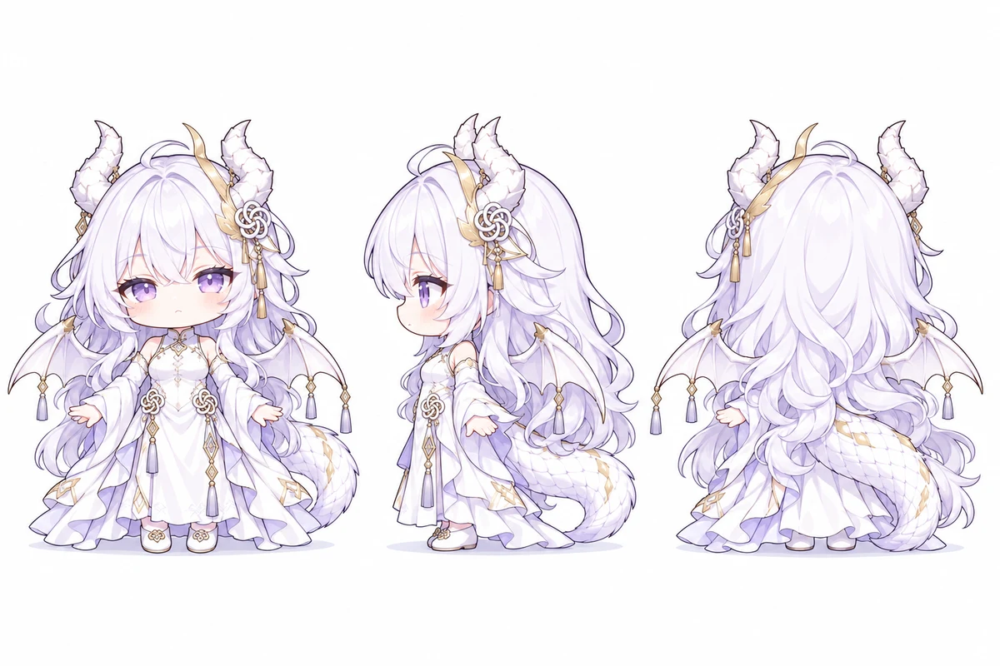</a></td>
    <td align="center" width="50%"><strong>Gemini · V2</strong><br><a href="public/generated/super-chibi-v1/gemini/turnaround-v2.png">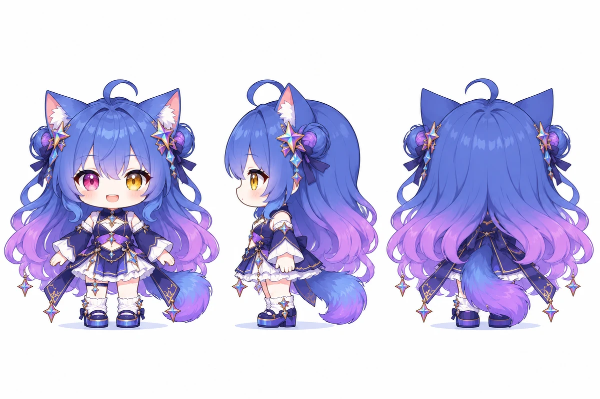</a></td>
  </tr>
  <tr>
    <td align="center" width="50%"><strong>Claude · V1</strong><br><a href="public/generated/super-chibi-v1/claude/turnaround-v1.png">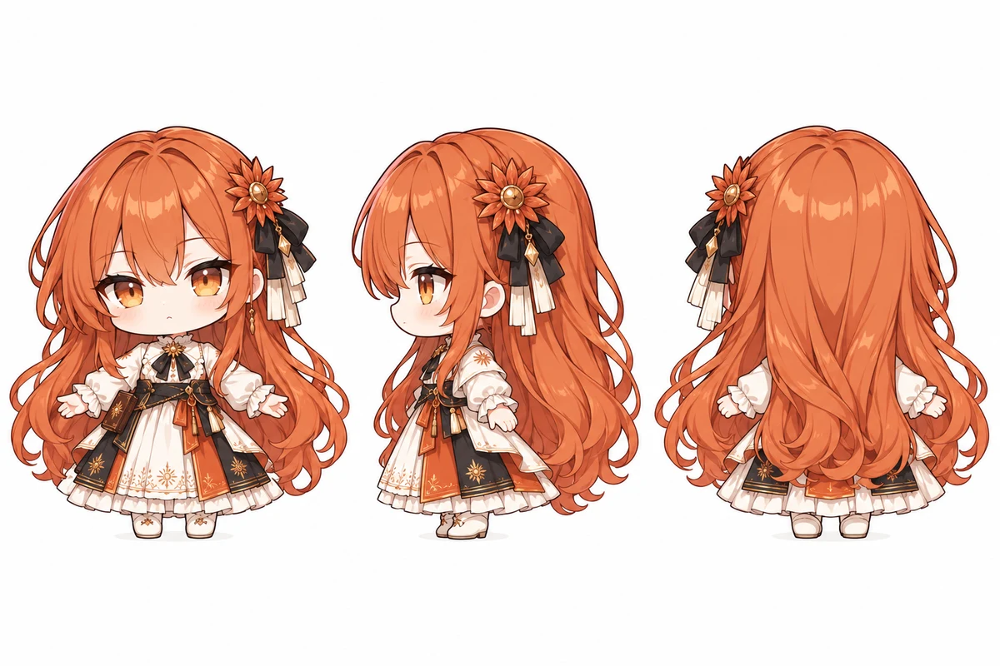</a></td>
    <td align="center" width="50%"><strong>DeepSeek · V1</strong><br><a href="public/generated/super-chibi-v1/deepseek/turnaround-v1.png">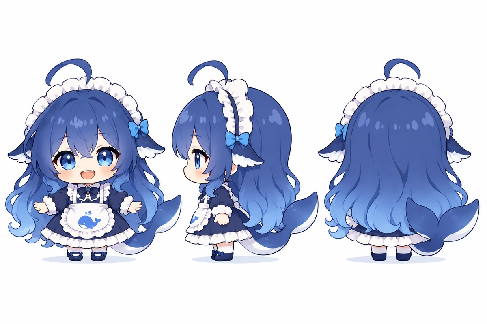</a></td>
  </tr>
  <tr>
    <td align="center" width="50%"><strong>Kimi · V2</strong><br><a href="public/generated/super-chibi-v1/kimi/turnaround-v2.png">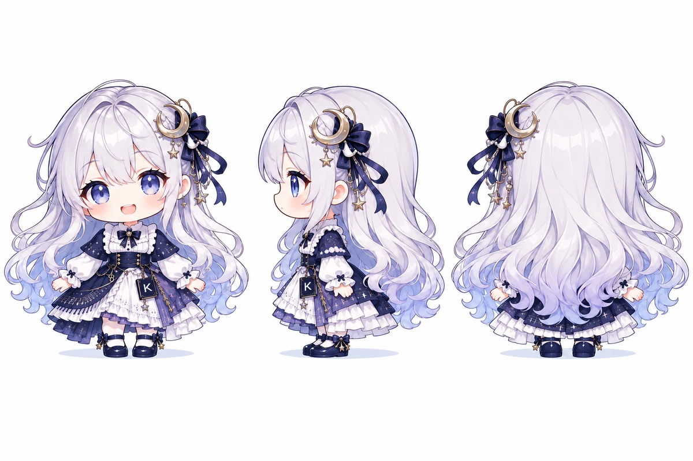</a></td>
    <td align="center" width="50%"><strong>Qwen · V2</strong><br><a href="public/generated/super-chibi-v1/qwen/turnaround-v2.png">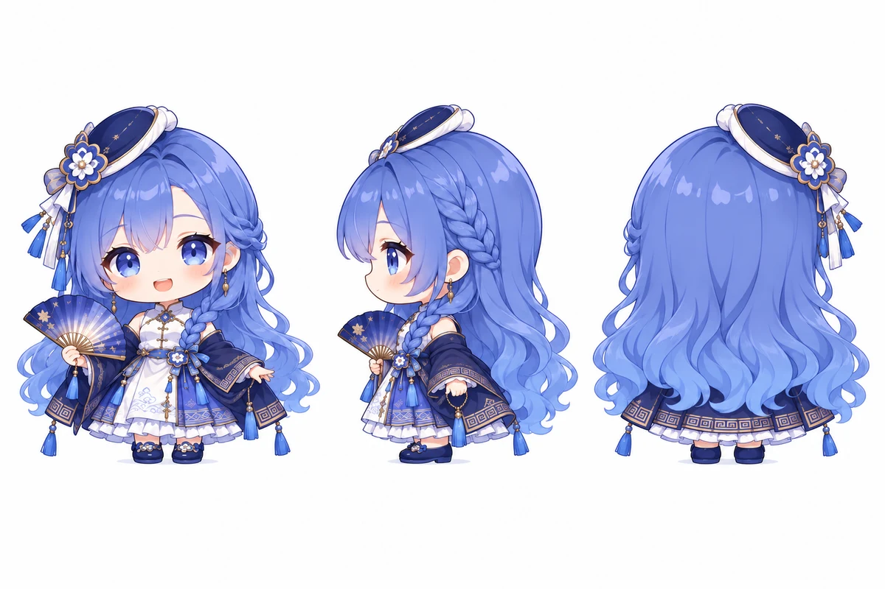</a></td>
  </tr>
  <tr>
    <td align="center" width="50%"><strong>GLM · V1</strong><br><a href="public/generated/super-chibi-v1/glm/turnaround-v1.png">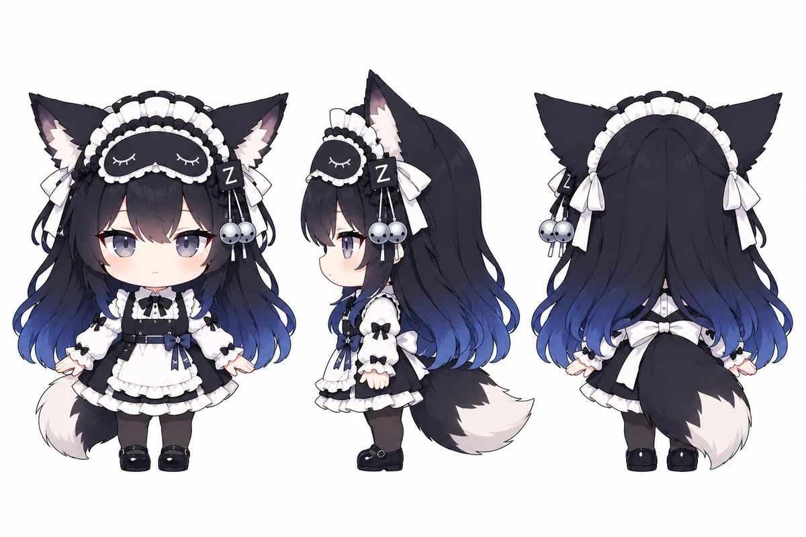</a></td>
    <td align="center"><a href="https://selinlee.github.io/ai-moe-atlas/en/chibi/">Turnarounds, sources and usage notes →</a></td>
  </tr>
</table>

Community designs for GPT, Gemini, Claude, Kimi and Qwen: ZipZipPipe. DeepSeek: 上善无形 → ZipZipPipe. The GLM fox-girl variant follows video BV1iDeQ6fEFi; its original designer remains unverified.

Generated turnaround adaptations from ai_video, not official characters or creator originals. Displayed at the maintainer’s request; no new upstream adaptation or redistribution rights are granted. Excluded from asset download packs.

[Turnarounds, sources and usage notes](docs/CHIBI.en.md) · [Files and processing records](public/generated/super-chibi-v1/manifest.json)

</details>

<a id="v5-gallery"></a>

<details>
<summary>Earlier v5 references · Standard and chibi</summary>

Six fixed identity sheets from ai_video, each with standard and chibi proportions. Preserved PNGs, prompts, video sources, attribution and SHA-256 records are included.

| GPT | Gemini | Claude |
| --- | --- | --- |
| 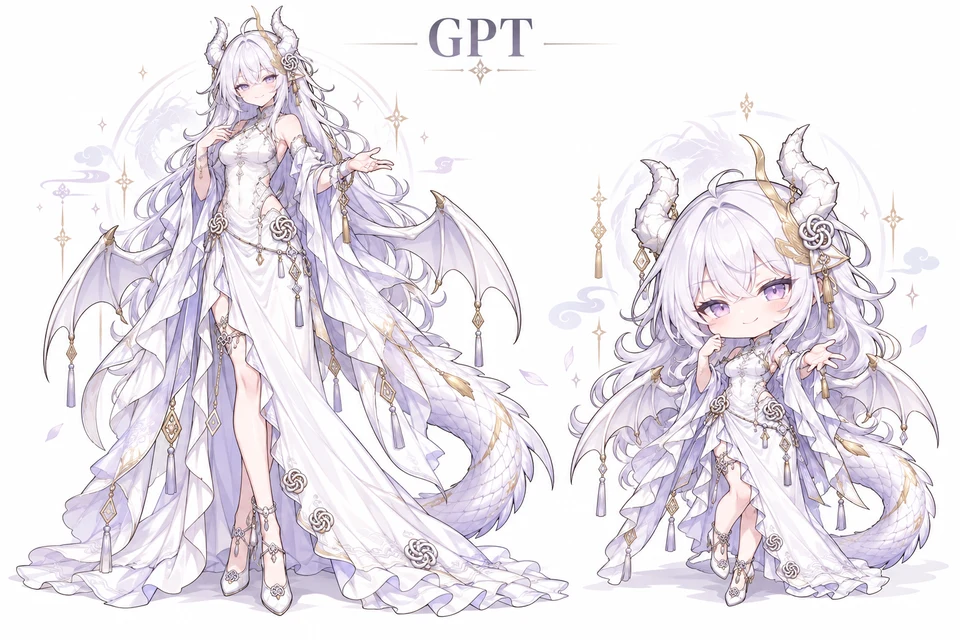 | 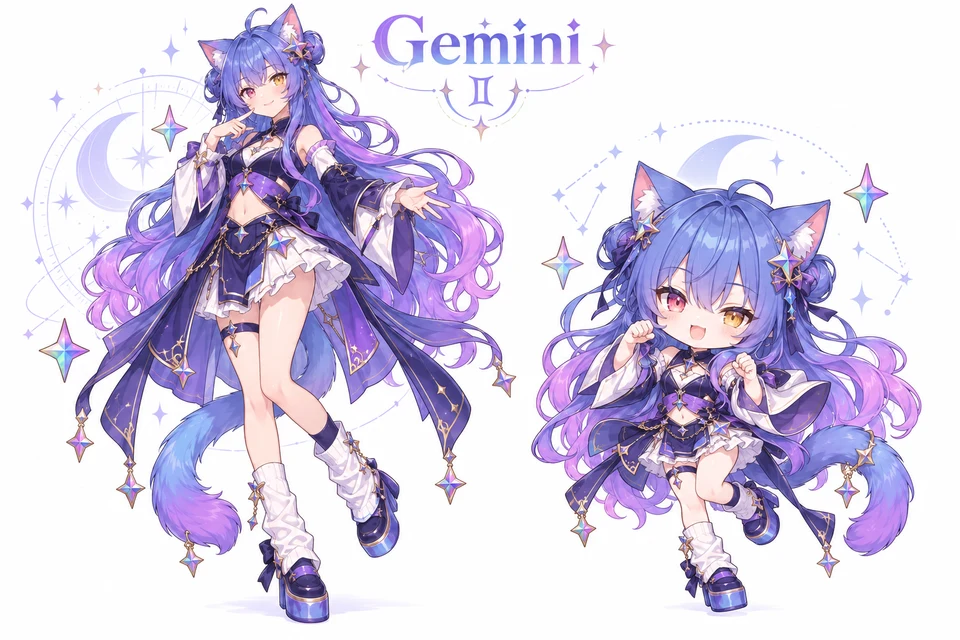 | 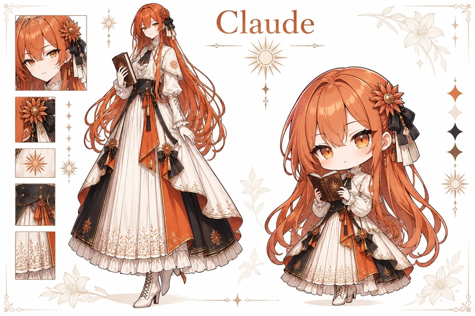 |
| DeepSeek | Kimi | Qwen |
| 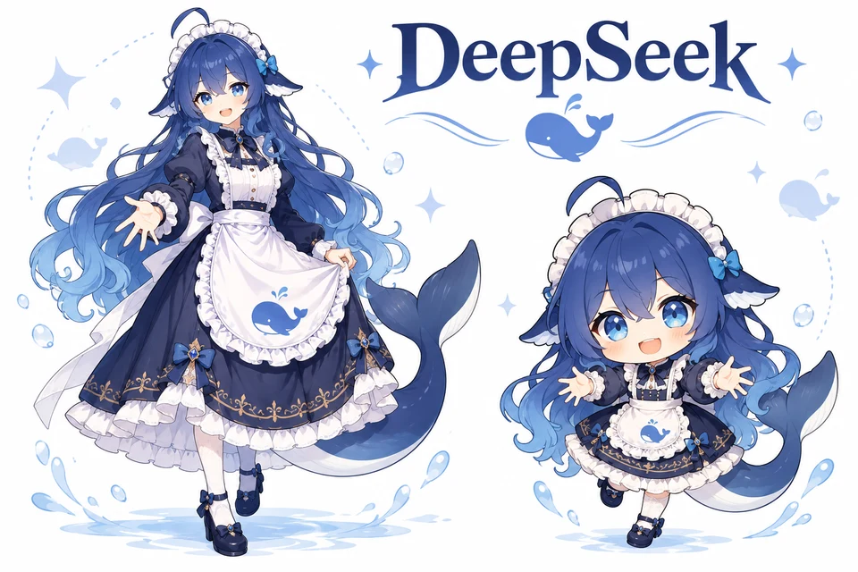 | 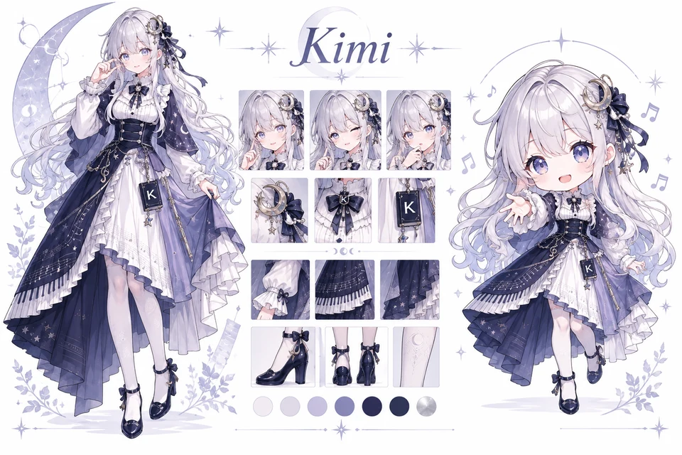 | 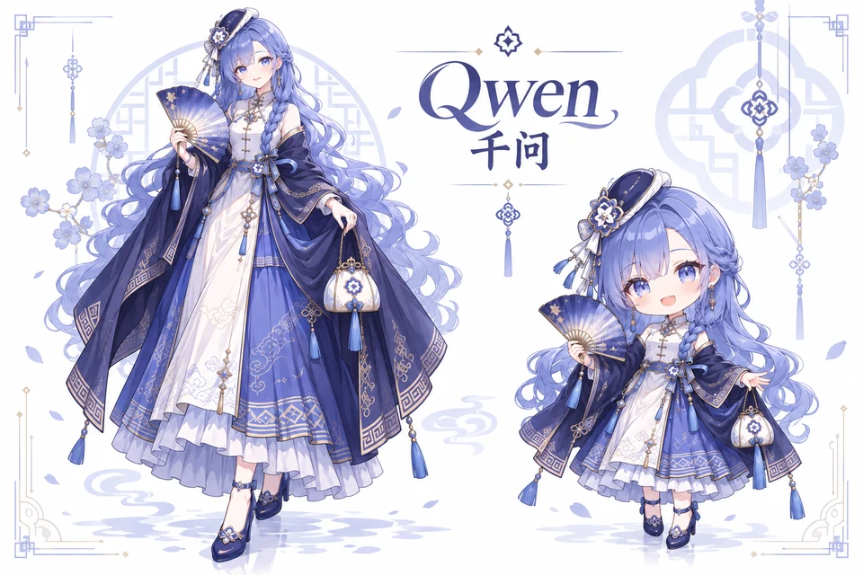 |

Community character design: ZipZipPipe. DeepSeek original character: 上善无形; derivative design: ZipZipPipe. Generator: built-in image_gen.

Generated adaptations of community character designs, not official mascots, creator originals or recovered detail. Selected by the project maintainer for homepage display; this selection grants no upstream adaptation or redistribution rights. Retained creator terms still apply.

[Identity archive and sources](docs/REFERENCES.en.md) · [Files and processing records](public/generated/ai-models-v5/manifest.json)

</details>

<details>
<summary>15-second walkthrough</summary>

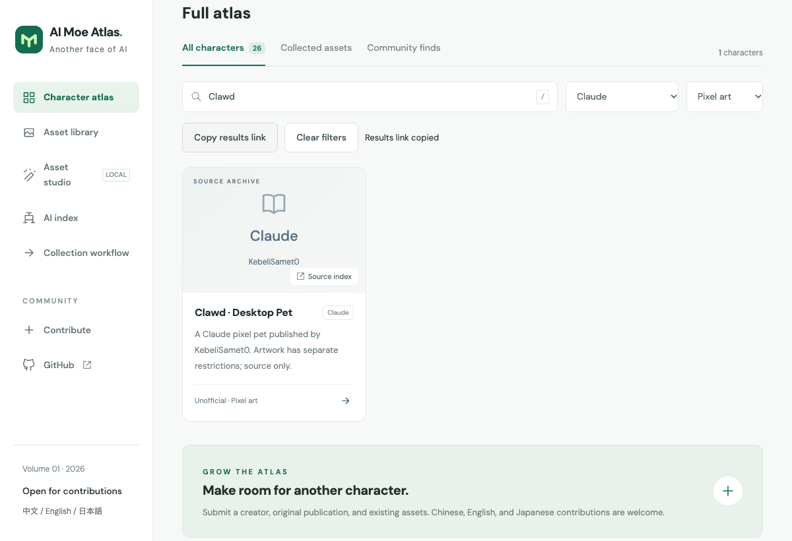

[15-second walkthrough · MP4](public/demo/discovery-en.mp4)

Recorded in local Chrome, with five steps held for 3 seconds each: filter by style → choose a product → search and copy → reopen results → view the entry. The example is link-only and contains no third-party artwork. This is not a full export tutorial.

</details>

## Terms and provenance

Collected from 上善无形’s Bilibili post, Small-tailqwq/dsh-deep-whale and [ZipZipPipe’s Pixiv collection](https://www.pixiv.net/artworks/148186519). The original three packs retain **CC BY-NC-SA 4.0**. The ten new GPT, Gemini, Claude, Kimi, Qwen, GLM, Grok, Doubao, Llama and MiniMax packs use the creator’s **attribution and non-commercial** terms; they are not relabeled with DeepSeek’s CC license. The code MIT license excludes third-party artwork.

Prefer creator-published high-resolution originals. If unavailable, a fixed depiction may be generated from collected references, preserving identity and provenance and labeling the generated derivative separately. It must not be presented as a creator original or recovered detail. The studio does not integrate generative processing. This grants no additional upstream rights and does not allow inventing unrelated characters or lore.

## Maintain

- [Studio guide](docs/STUDIO.en.md)
- [Contribution guide](docs/CONTRIBUTING.en.md)
- [Collection manual](docs/COLLECTION.en.md)
- [Artwork terms](RIGHTS.md)
- [Source records](content/sources/) and [Bilibili leads](content/leads.json)
- [Project constraints](AGENTS.md)

`content/characters.json` stores trilingual entries. `public/collected/` contains original bytes, evidence, and normalized files; `public/packs/` holds downloadable archives. Originals are immutable. GitHub files are pinned to commits; derivatives reference their parent SHA-256.

Pushes to main validate, test, build, and deploy through GitHub Actions. Pull requests only build. With a local server running, run `npm run test:browser` to exercise the site in installed Chrome.

## Run

Node.js 22.12+ (24 recommended) and npm are required.

```sh
npm ci
npm run dev
# http://localhost:4321/ai-moe-atlas/en/
npm test
npm run build
```

## Collect and normalize

```sh
npm run discover -- --platform bilibili --query '蓝色大肥鱼' --limit 20
npm run discover -- --platform github --query 'AI mascot' --limit 20
# Review sources and artwork permissions in content/sources/*.json first
npm run collect
npm run assets
npm run validate
```

Bilibili discovery uses an isolated installed Google Chrome session. Add `--visible` if interactive verification is required. Personal browser profiles are never used. GitHub search requires authenticated `gh`.

**1024 px files are resampled outputs, not recovered detail.** Prefer the creator’s higher-resolution original. This release does not integrate neural super-resolution, generative restoration, or automatic background removal. Full original composition is retained.

## Scope

An indexed source is not automatically a downloadable asset. Nine AI designs from a Bilibili video series are indexed; creator-published originals and terms for GPT, Gemini, Claude, Kimi, Qwen, GLM, Grok, Doubao, Llama and MiniMax have now been collected. Animated-pet adaptation, video frame extraction, automatic cutouts, and AI super-resolution are outside this release. Never invent artwork to fill gaps.

[Baseline coverage and cross-project reuse review](docs/BASELINES.en.md)
