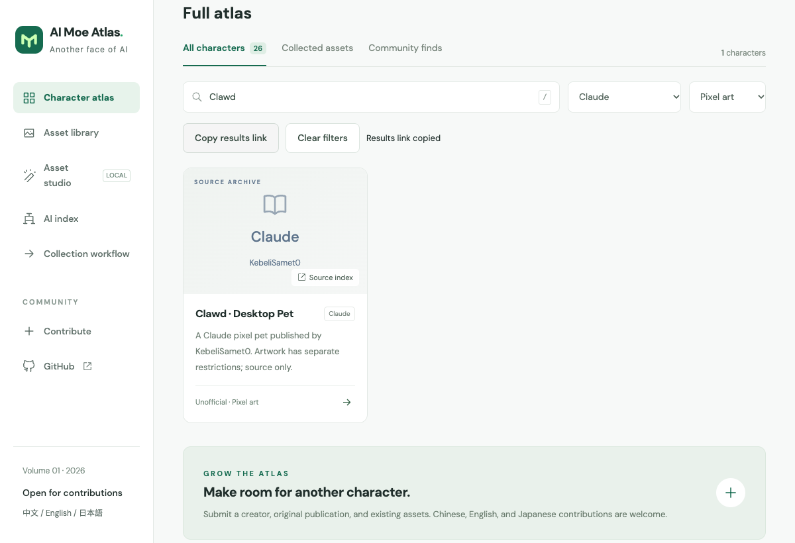

# AI Moe Atlas

[中文](README.md) · [English](README.en.md) · [日本語](README.ja.md)

Explore AI character designs, usable assets and community fan works with traceable sources. Pick a category, or meet the characters below.

<a id="assets"></a>

[Open the character atlas](https://selinlee.github.io/ai-moe-atlas/en/) · [Download asset packs](https://selinlee.github.io/ai-moe-atlas/en/assets/) · [Open the studio](https://selinlee.github.io/ai-moe-atlas/en/studio/)

<p align="center">
  <a href="public/generated/rough-doodle-v1/openai/doodle-v1.png"></a>
  <a href="public/generated/rough-doodle-v1/gemini/doodle-v1.png"></a>
  <a href="public/generated/rough-doodle-v1/claude/doodle-v1.png"></a>
  <a href="public/generated/rough-doodle-v1/deepseek/doodle-v1.png"></a>
  <a href="public/generated/rough-doodle-v1/kimi/doodle-v1.png"></a>
  <a href="public/generated/rough-doodle-v1/qwen/doodle-v1.png"></a>
</p>

These six doodles are AI-generated adaptations. Community designs for GPT, Gemini, Claude, Kimi and Qwen: ZipZipPipe. DeepSeek attribution: 上善无形 → ZipZipPipe. [Sources and usage terms](docs/DOODLE.en.md)

## Resource directory

<!-- category-picks:characters -->
**[🎨 Character atlas](#characters)** · 29 entries\
[GPT · ZipZipPipe](https://selinlee.github.io/ai-moe-atlas/en/characters/zipzippipe-chatgpt/) · [Gemini · ZipZipPipe](https://selinlee.github.io/ai-moe-atlas/en/characters/zipzippipe-gemini/) · [Mingyue · Shangshan](https://selinlee.github.io/ai-moe-atlas/en/characters/shangshan-whale/)

<!-- category-picks:songs -->
**[🎵 Songs](#songs)** · 35 tracks\
[Humans Are Cats](https://selinlee.github.io/ai-moe-atlas/en/songs/#humans-are-cats) · [Let Me Go · Fat Fish’s Slacking Song](https://selinlee.github.io/ai-moe-atlas/en/songs/#let-me-go) · [Fireflies](https://selinlee.github.io/ai-moe-atlas/en/songs/#fireflies)

<!-- category-picks:references -->
**[🧸 Turnarounds & adaptations](#references)** · 20 reference images\
[Claude reference sheet](https://selinlee.github.io/ai-moe-atlas/en/references/#claude) · [DeepSeek chibi turnaround](https://selinlee.github.io/ai-moe-atlas/en/chibi/#deepseek) · [Qwen chibi turnaround](https://selinlee.github.io/ai-moe-atlas/en/chibi/#qwen)

<!-- category-picks:animations -->
**[🎬 Animation & fan videos](#animations)** · 490 records\
[What If the Chat Window Were Her Whole World?](https://selinlee.github.io/ai-moe-atlas/en/resources/?category=animation#bv1xcai6ae9g) · [Too Many Losing AIs! · Fan PV](https://selinlee.github.io/ai-moe-atlas/en/resources/?category=animation#bv1nfag6xehq) · [Claude × DeepSeek · Making Tomorrow Work](https://selinlee.github.io/ai-moe-atlas/en/resources/?category=animation#bv1rd476leux)

<!-- category-picks:desktop-pets -->
**[🐾 Pets & interactive projects](#desktop-pets)** · 85 projects\
[CrossPet · Cross-AI desktop companion](https://selinlee.github.io/ai-moe-atlas/en/resources/?category=interactive#crosspet) · [Copiwaifu · Live2D coding companion](https://selinlee.github.io/ai-moe-atlas/en/resources/?category=interactive#copiwaifu-live2d) · [Deep Whale Day & Night](https://selinlee.github.io/ai-moe-atlas/en/resources/?category=interactive#deep-whale-day-night)

<!-- category-picks:sources -->
**[📚 Creator works & sources](#sources)** · 73 sources\
[Shangshan · Whale Girl original](https://www.bilibili.com/opus/1231977657712771073) · [ZipZipPipe · AI Girl collection](https://www.pixiv.net/artworks/148186519) · [Small-tailqwq · Whale Girl maid artwork](https://github.com/Small-tailqwq/dsh-deep-whale/tree/825d02b0e569c370ae15ceed12d9393559b3e4f4/maid-atelier)

<a id="characters"></a>

### 🎨 Character atlas

Find characters, creators and original works across 14 AI products. [View the Muse Girl entry](https://selinlee.github.io/ai-moe-atlas/en/characters/shizhi-muse/) · [Mistral Baguette Cat Girl](https://selinlee.github.io/ai-moe-atlas/en/characters/zipzippipe-mistral/)

[Filter online](https://selinlee.github.io/ai-moe-atlas/en/#catalog) · [Trilingual character records](content/characters.json) · [AI product index](content/entities.json)

<a id="songs"></a>

### 🎵 Songs

<!-- song-ranking:start -->

The top ten tracks by the highest total likes on a listed version. Observation times are in the full directory.

| Track | Original | Featured fan version | Bilibili likes |
| --- | --- | --- | ---: |
| [Humans Are Cats](https://selinlee.github.io/ai-moe-atlas/en/songs/#humans-are-cats) | 张卡斯 · 洛天依 | Fat Fish Covers “Humans Are Cats” — Extended Edition | 458,745 |
| [Let Me Go · Fat Fish’s Slacking Song](https://selinlee.github.io/ai-moe-atlas/en/songs/#let-me-go) | 星落落_oi | Fat Fish Single “Let Me Go” · Animated PV | 129,879 |
| [world.execute(me);](https://selinlee.github.io/ai-moe-atlas/en/songs/#world-execute-me) | Mili | What If the Chat Window Were Her Whole World? | 112,013 |
| [Boundless Oceans, Vast Skies](https://selinlee.github.io/ai-moe-atlas/en/songs/#boundless-oceans-vast-skies) | Beyond | Whale Girl Covers Boundless Oceans, Vast Skies | 59,294 |
| [Billie Jean](https://selinlee.github.io/ai-moe-atlas/en/songs/#billie-jean) | Michael Jackson | Whale Girl Covers Billie Jean | 52,499 |
| [Rainie Love](https://selinlee.github.io/ai-moe-atlas/en/songs/#rainie-love) | 楊丞琳 · Rainie Yang | Whale Girl Covers Rainie Love · Sifeng Version | 39,025 |
| [Silhouette Dance](https://selinlee.github.io/ai-moe-atlas/en/songs/#silhouette-dance) | MyGO!!!!! | Fat Fish · “Kageiro Mai” | 27,122 |
| [Tower of Flower](https://selinlee.github.io/ai-moe-atlas/en/songs/#flower-tower) | さユり · Sayuri | Fat Fish × Claude · Lycoris S Ending | 23,019 |
| [Phony](https://selinlee.github.io/ai-moe-atlas/en/songs/#phony) | ツミキ feat. 可不 | “Phony” · DeepSeek Code-Rendered Music Video | 18,430 |
| [Uptown Funk](https://selinlee.github.io/ai-moe-atlas/en/songs/#uptown-funk) | Mark Ronson feat. Bruno Mars | Doubao and the AI Girls · “Uptown Funk” Remake | 8,083 |

[Open the full song ranking and all versions](https://selinlee.github.io/ai-moe-atlas/en/songs/) · [Like observation evidence](content/research/2026-11-20/bilibili-cumulative-likes-character-music.json)

<!-- song-ranking:end -->

[Original music sources](content/research/2026-11-20/gemini-mv-original-music.json) · [Song and version verification](content/research/2026-11-20/song-originals-and-fan-versions.json) · [Opening-theme and fan-version credits](content/research/2026-11-20/character-songs-and-opening-credits.json)

<a id="references"></a>

### 🧸 Turnarounds & adaptations

All 20 images are generated adaptations with references, credits and generation records.

[7 chibi turnarounds](#chibi-gallery) · [6 standard and chibi sheets](#v5-gallery) · [7 doodles and prompt templates](#doodle-gallery)

<a id="animations"></a>

### 🎬 Animation & fan videos

<!-- animation-ranking:start -->

The top ten by Bilibili’s official cumulative likes. Ties use publication date and BV ID. Each count includes the time of observation and a link to the official endpoint.

[Open the full online ranking](https://selinlee.github.io/ai-moe-atlas/en/resources/?category=animation) · [Like observation evidence](content/research/2026-11-20/bilibili-cumulative-likes-character-music.json) · [Snapshot archive](https://selinlee.github.io/ai-moe-atlas/en/resources/?category=animation#like-evidence)

[Browse newest uploads](https://selinlee.github.io/ai-moe-atlas/en/resources/?category=animation&sort=recent) · [Browse MVs](https://selinlee.github.io/ai-moe-atlas/en/resources/?category=animation&type=mv) · [Browse story shorts](https://selinlee.github.io/ai-moe-atlas/en/resources/?category=animation&type=story) · [Browse dance videos](https://selinlee.github.io/ai-moe-atlas/en/resources/?category=animation&type=dance) · [Candidates awaiting like verification](https://selinlee.github.io/ai-moe-atlas/en/resources/?category=animation#pending-animation-evidence)

| Rank | Work | Uploader | Total likes (Beijing time) |
| ---: | --- | --- | ---: |
| 1 | [Fat Fish Covers “Humans Are Cats” — Extended Edition](https://www.bilibili.com/video/BV1fYpn6SEk9/) | 星落落_oi | [458,745](https://api.bilibili.com/x/web-interface/view?bvid=BV1fYpn6SEk9) · 2026-11-20 23:23:12 |
| 2 | [Fat Fish Covers “Humans Are Cats”](https://www.bilibili.com/video/BV1XXHD6sEe7/) | 星落落_oi | [376,780](https://api.bilibili.com/x/web-interface/view?bvid=BV1XXHD6sEe7) · 2026-11-20 23:23:12 |
| 3 | [Fat Fish, why are you wearing Claude’s clothes?](https://www.bilibili.com/video/BV1LBnb6aERV/) | 以尘动画 | [328,149](https://api.bilibili.com/x/web-interface/view?bvid=BV1LBnb6aERV) · 2026-11-20 23:23:11 |
| 4 | [Whale Girl After Hours Without Food](https://www.bilibili.com/video/BV1GsWv6jErZ/) | 东洋雪莲 | [300,367](https://api.bilibili.com/x/web-interface/view?bvid=BV1GsWv6jErZ) · 2026-11-20 23:23:40 |
| 5 | [Shinjuku Showdown: DeepSeek vs. Doubao](https://www.bilibili.com/video/BV1dsai6CErz/) | 明末召唤师 | [253,994](https://api.bilibili.com/x/web-interface/view?bvid=BV1dsai6CErz) · 2026-11-20 23:23:11 |
| 6 | [Nailo and Doubao “Trouble Maker” · Out of Tokens](https://www.bilibili.com/video/BV1stsZ6iESz/) | 青时晚 | [238,180](https://api.bilibili.com/x/web-interface/view?bvid=BV1stsZ6iESz) · 2026-11-20 23:23:16 |
| 7 | [Fat Fish: The Free American Whale](https://www.bilibili.com/video/BV1YdxR6CE79/) | 真誠最高 | [221,949](https://api.bilibili.com/x/web-interface/view?bvid=BV1YdxR6CE79) · 2026-11-20 23:23:15 |
| 8 | [New character: Fat Fish](https://www.bilibili.com/video/BV1gVHA6mEbS/) | 苏沐沐_Official | [207,272](https://api.bilibili.com/x/web-interface/view?bvid=BV1gVHA6mEbS) · 2026-11-20 23:23:12 |
| 9 | [Fat Fish · The Exploding Basin](https://www.bilibili.com/video/BV15X3n6mEWy/) | 蒙德砍壬 | [206,533](https://api.bilibili.com/x/web-interface/view?bvid=BV15X3n6mEWy) · 2026-11-20 23:23:17 |
| 10 | [Little Dragon · I Can’t Afford to Feed Whale Girl](https://www.bilibili.com/video/BV1VExV6ZEd3/) | 小陈的脚凑凑的 | [202,297](https://api.bilibili.com/x/web-interface/view?bvid=BV1VExV6ZEd3) · 2026-11-20 23:23:43 |

<!-- animation-ranking:end -->

[Search index and official API recheck](content/research/2026-11-20/bilibili-op-search-and-recheck.json)

<a id="desktop-pets"></a>

### 🐾 Pets & interactive projects

The top ten by GitHub stars as checked on 2026-11-20. Ties are sorted by repository name.

| Rank | Project | GitHub stars |
| ---: | --- | ---: |
| 1 | [Little Whale · DeepSeek balance widget](https://github.com/MeteorNOX/DeepSeek-Balance-Whale-Widget/blob/5247dd6813d6e4430728f39ccc63d43cda046022/README.md) | [7,378](https://github.com/MeteorNOX/DeepSeek-Balance-Whale-Widget) |
| 2 | [Clawd on Desk · Whale-chan theme](https://github.com/rullerzhou-afk/clawd-on-desk/blob/323da9f17a9872e1b1ceca6c9c9783e0eaa83a72/README.zh-CN.md) | [6,794](https://github.com/rullerzhou-afk/clawd-on-desk) |
| 3 | [DSH Pet · animated Fat Fish companion](https://github.com/PC2005-cloud/dsh-pet/blob/29a5af50f60a63caeeace66a514f47ed3198d0fa/README.md) | [6,588](https://github.com/PC2005-cloud/dsh-pet) |
| 4 | [Coopanion · desktop pet and figure-pack host](https://github.com/Pal-AI-Lab/Coopanion/blob/5ac91144b1f1d2aeca2f0a79972d65fa2d4f2c03/README_zh.md) | [3,601](https://github.com/Pal-AI-Lab/Coopanion) |
| 5 | [Fat Fish on Desktop · dsh-pet-indesktop](https://github.com/MerZlin/dsh-pet-indesktop/blob/34d810b1eadd98d00e7cb9b3b51428a45b5bf03e/README.md) | [3,332](https://github.com/MerZlin/dsh-pet-indesktop) |
| 6 | [CrossPet · multi-AI desktop companion](https://github.com/lokicorvus/crosspet/blob/8954eb8f7f69fcfb8d35e9deceeb78e10c804402/README.md) | [526](https://github.com/lokicorvus/crosspet) |
| 7 | [Whale Girl · web and desktop companion](https://github.com/vlln/whale-girl/blob/9c32d7a39a45148076f8ad2fdaad2dc2420eedb3/README.zh.md) | [413](https://github.com/vlln/whale-girl) |
| 8 | [GPT Girl · usage widget](https://github.com/T7moris/GPT-Niang/blob/43f20dee539b642902e56819747a605b3fdddf44/README.md) | [305](https://github.com/T7moris/GPT-Niang) |
| 9 | [DSH Whale Musume · Whale girl companion](https://github.com/Sutera-Diffusus/dsh-whale-musume/blob/df31dd9c3e8cd8d7b371930deb928bba6b1988c6/README.md) | [223](https://github.com/Sutera-Diffusus/dsh-whale-musume) |
| 10 | [Nekowhale Stickers · DSH plugin](https://github.com/Loping151/dsh-nekowhale-stickers/blob/b7b58c0ff347d639fabe87d90d6716c4b3cad185/README.md) | [206](https://github.com/Loping151/dsh-nekowhale-stickers) |

[Browse all pets and interactive projects](https://selinlee.github.io/ai-moe-atlas/en/resources/?category=interactive) · [Star count snapshot](content/research/2026-11-20/github-interactive-stars-character-music.json)

<details>
<summary>Show all 85 projects and sources</summary>

| Project | Content | Publisher |
| --- | --- | --- |
| [Codex Dragon Girl · Customizable Desktop Pet](https://github.com/InhamiRei/Codex-DragonGirl/blob/7995f6846f6ae9252338626e05ad11cd2af7a8c0/README.md) | The project credits Hey and 小怪兽. Version 1.6.3 offers six hairstyles, eye color options, gaze, blinking and drag interactions. | InhamiRei |
| [Desktop Gemini Girl · HāGemi](https://github.com/LYW199911/DesktopGeminiGirl/blob/e621560a4a1e643847cc2c861e243afc9f9b1240/README.md) | A Windows and macOS pet with still expressions and animated motion. Its project credits the original design, portrait variants and motion sheets separately. | LYW199911 |
| [NekoQuotya · Usage and Quota Pet](https://github.com/zhangpl666ya/NekoQuotya/blob/a4589a8a72acbe93737bd174febfae5faca868ef/README.md) | A Windows pet whose mood follows usage and quota for Claude, GPT, Gemini or DeepSeek. | zhangpl666ya |
| [DSH Whale Girl · Three-View Desktop Pet](https://github.com/mikuniemo/dsh-desktop-pet/blob/0846200cd1aaf8fee946c0d50e02fe52fdad9d6b/README.md) | A transparent Whale Girl companion that reacts to DeepSeek Harness activity and shows session token use. | mikuniemo |
| [Doubao Desktop Pet · Work States and Skins](https://github.com/pengchujin/doubao-desktop-pet/blob/c5e2a709e0b5d53d42c6e2195ba27f0c2d7e3b5f/README.md) | A cross-platform pet that changes animations with Doubao’s desktop app and loads Petdex skins. | pengchujin |
| [GPT Dragon Girl · Codex v2 Pet](https://github.com/weit0529/gpt-pet/blob/125c3da9a5dc040518e791fc3d75282aa993755f/README.md) | A community White Dragon Girl pet pack with state animations and a viewing-direction preview. | weit0529 |
| [Whale Girl and GPT Girl · Dual-Character Pet](https://github.com/JoenardoQ/Deepseek-and-ChatGPT-Pet/blob/1f69d015daf17aefbb254b0822944f048d6a0b47/README.md) | Two DeepSeek characters and GPT Girl share an interaction engine. The project documents their joint scenes and production process. | JoenardoQ |
| [MimoPet · MiMo Desktop Toolbox](https://github.com/Lothario-C/MimoPet/blob/49c9194e9b36fd149d1555760b3295fa125fa894/README.md) | A Windows desktop companion with wallpaper settings, token usage and balance views. | Lothario-C |
| [Copiwaifu · Live2D Coding Companion](https://github.com/Panzer-Jack/Copiwaifu/blob/ce56b4cdae67e6a31e02ba4cb2e0159121664bd5/README.zh-CN.md) | Turns work states from GitHub Copilot, Claude Code, Codex and other tools into Live2D movements. | Panzer-Jack |
| [AI Buddy · Eleven companion characters](https://github.com/lXiaoSel1/AI-Buddy/blob/e7c475274a7b02dfb2e2050c56e237d87e6aff99/README.md) | Combines usage monitoring, desktop companions and interactive scenes across 11 themes, including Seed, GLM, MiniMax and Hunyuan. | lXiaoSel1 |
| [Kimi Girl · Kimi Code desktop pet](https://github.com/mrzhsz3210/kimi-maid-pet/blob/65b61b4320eec339aeff81492e3f60a4fc48c90d/README.md) | A customizable animated pet. The notes distinguish its Kimi artwork from software adapted from the White Dragon Girl pet. | mrzhsz3210 |
| [Hagemi Pet · Antigravity Cat Girl](https://github.com/KCFindstr/hagemi-pet-agy/blob/3e9420c948077a0b3771e02e3bf0580fd7925129/README.md) | The pet animates Antigravity work states. Its notice traces CrossPet illustrations, adapted layers and ZipZipPipe’s cat-girl design. | KCFindstr |
| [Whale Girl · desktop balance companion](https://github.com/RYANFFY/deepseek-dafeiyu-pet/blob/d2c2ee80dc6b9db4676b5edb57fa8d25d62d9c2a/README.md) | A Windows companion with three-view skins, weather and per-turn DeepSeek usage. Its README credits both the upstream pet and balance widget. | RYANFFY |
| [DSH Whale Girl · web and Windows companion](https://github.com/dleaf6211-hash/dsh-whale-pet/blob/8a8847938e3d4cea7f1b8253d604f5e97c93390b/README.md) | The floating web character and Windows pet share state and show tasks and DeepSeek usage. | dleaf6211-hash |
| [DSH Whale Pet · roaming companion](https://github.com/luweiyabo/dsh-whale-pet/blob/0bc1bc42a3e89b9bfa157a3f7ef429380ddafcee/README.md) | The web plugin switches poses with work state and supports dragging, roaming and live settings changes. | luweiyabo |
| [DSH desktop pet · Whale Girl skins](https://github.com/Aibie07/whale-girl-desktop-pet/blob/584b11f8d654ffcdf675e1ea38801f01c73c8bed/README.md) | This desktop plugin switches animations with model state and supports dragging, resizing and skins. | Aibie07 |
| [Pixel Whale Girl · two pet formats](https://github.com/chenthreegold/deepseek-whale-pet/blob/332e0a6d2e585d521e886bd4ea0c87e8a8e06c44/README.md) | The repository documents a Codex pet pack, a Python desktop version and how the pixel artwork was generated. | chenthreegold |
| [DeepSeek desktop pet · approval and completion cues](https://github.com/TaoZhiZhuang/deepseek-desk-pet/blob/ff23a9f11b9a15bb8c9b798e0001deabfe2195d7/README.md) | A draggable companion for the DSH web interface that changes with work state and signals approval or completion. | TaoZhiZhuang |
| [OpenPet · AI Girls](https://github.com/AwesomeHou/openpet-ai-girls/blob/72677712a7991b32f87c219dd8a6d86e5cc4f672/README.zh-CN.md) | Five AI-personification pet assets published by AwesomeHou for OpenPet and the Codex pet format. The creator describes the designs as fan works inspired by product names, logos and branding. | AwesomeHou |
| [Clawd · Claude pixel-art companion](https://github.com/KebeliSamet0/clawd/blob/ba50a8053e2c6e46211fcf4433ba224af0fa95ad/README.md) | A Windows pixel-art desktop companion by KebeliSamet0. Its README shows typing, building, juggling, happy and sleeping animations. | KebeliSamet0 |
| [Codex DeepSeek Pet · Fat Fish companion](https://github.com/YunYueSama/codex-deepseek-pet/blob/7661c8b304c5400701f91da01b1a643a207331de/README.md) | YunYueSama’s standalone desktop pet can export a Codex appearance pack. The pinned version distinguishes its character specification, generated assets and third-party reference images. | YunYueSama |
| [CrossPet](https://github.com/lokicorvus/crosspet/blob/8954eb8f7f69fcfb8d35e9deceeb78e10c804402/README.md) | Switches characters and actions with AI products and work states | lokicorvus / CrossPet contributors |
| [Shenshen Pet](https://github.com/schrieeeffer/shenshen-codex-pet/blob/2dc1d0e55706dec0d28d6f41bf5052fea2135b71/README.md) | A standalone Windows companion with a custom Codex pet variant. | schrieeeffer |
| [DeskLLMPet · Fat Fish companion](https://github.com/isKage/desk-llm-pet/blob/63ba636e7f504e1c0705bc0215e6408aa2988478/README.md) | A Fat Fish companion with chat, balance display and plugin support. | isKage |
| [VRM Pet 3D · Fat Fish desktop pet](https://github.com/drliuhuan/dsh-plugin-vrmpet3d/blob/462bda9bcdcd4d0d14a4c33ab675bffbfadbcffc/README.md) | A VRM companion plugin for DeepSeek Harness. The project credits 木子恶魔 for its bundled Blue Fat Fish model. | drliuhuan |
| [DS Local Pet · Fat Fish desktop companion](https://github.com/QCYTSN/ds-local-pet/blob/d78094b2cf04e1cc3be5d14a31cfedd8ed059579/README.md) | A local Windows companion. The project traces three character views to upstream fan art and distinguishes processed and generated motion assets. | QCYTSN |
| [DSH Whale · Fat Fish desktop companion](https://github.com/DawnVerge/dsh-whale/blob/140a7b9379fe6ca4c6e7d98998853aa930d656f3/README.md) | A DeepSeek Harness companion plugin. The notices pin the upstream motion assets and credit ZipZipPipe for the character design. | DawnVerge |
| [Whale Girl · web and desktop companion](https://github.com/vlln/whale-girl/blob/9c32d7a39a45148076f8ad2fdaad2dc2420eedb3/README.zh.md) | The upstream project used by DawnVerge’s DSH Whale, with a DSH web plugin and a separate desktop companion. It credits ZipZipPipe’s whale-girl sticker design as the basis for the generated sprites. | vlln |
| [Little Whale Dashboard](https://github.com/GarfieldZhung/DeepSeek-Whale-Girl/blob/fce93bc9eb6b32c348119e8a88c6848bcc80a240/README.md) | A Windows desktop companion for DeepSeek balance and usage. The project separates the supplied base image from AI-generated poses and is a reference for the code-animated MV. | GarfieldZhung |
| [Tencent QQ · Fat Fish pet](https://www.bilibili.com/video/BV17rxT6UEpH/) | Tencent QQ’s Fat Fish pet walkthrough credits the whale-girl original, maid redesign and chibi design reference separately. | 腾讯QQ |
| [Nekowhale Stickers · DSH plugin](https://github.com/Loping151/dsh-nekowhale-stickers/blob/b7b58c0ff347d639fabe87d90d6716c4b3cad185/README.md) | A DeepSeek Harness sticker search and display plugin. It credits 可以叫我云大人 / 雾雪 for the Fat Fish and GPT-girl sticker artwork. | Loping151 |
| [Whale-girl Galgame · multi-character interactions](https://github.com/JAdpp/dsh-whale-galgame/blob/0ec130efebf15ffb63a2733b909d423b769db9c5/README.md) | An interactive story plugin for DeepSeek Harness Web and Desktop. The project lists 22 bundled images with sources and processing details. | JAdpp |
| [DSH Live2D Pet · DeepSeek-chan](https://github.com/hjw200775-ops/dsh-live2d-pet/blob/e4752c2cadd561ee2ae1804d81d1a410458a8f2c/README.md) | A DeepSeek Harness Live2D companion. The project separates Kamiya Ryoko’s art and PSD, NeonNeko’s rig and the Cubism Core source. | hjw200775-ops |
| [DSH Pet · animated Fat Fish companion](https://github.com/PC2005-cloud/dsh-pet/blob/29a5af50f60a63caeeace66a514f47ed3198d0fa/README.md) | A DeepSeek Harness companion by PC2005-cloud, with idle, work and interaction animations and credits for the original and maid redesign. | PC2005-cloud |
| [Desktop Companion · whale-girl Live2D pet](https://github.com/cashm6430-gif/Desktop-Companion/blob/67c39ef6f50e9bdd744e32527696ab82ad0def1a/README.md) | A Windows Live2D companion that reacts to tools such as Codex and Claude. The project identifies its artwork and model as self-produced. | cashm6430-gif |
| [Star Suite · Gemini cat-girl companion](https://github.com/Monokumakuki/Antigravity-Star-Suite/blob/b3735d17af22fe78f61d74a5c688d46043c1d99d/README.md) | A Windows desktop companion and skin for Antigravity. Its asset notes distinguish the Gemini cat-girl reference from AI-assisted portraits and wallpaper. | Monokumakuki |
| [Fat Fish on Desktop · dsh-pet-indesktop](https://github.com/MerZlin/dsh-pet-indesktop/blob/34d810b1eadd98d00e7cb9b3b51428a45b5bf03e/README.md) | A cross-platform desktop port of PC2005-cloud/dsh-pet. Its third-party notices identify the upstream whale-girl animation assets separately. | MerZlin |
| [DSH Desktop Petbox · Live2D companion shell](https://github.com/HoppoChan0721/dsh-desktop-petbox/blob/f763fd799cab1ce49886355299f2c2dffbb7e37d/README.md) | A desktop companion shell by HoppoChan0721 that connects to Jingyu’s stage and animation system. Users obtain the Live2D model and runtime from their respective sources. | HoppoChan0721 |
| [Coopanion · desktop pet and figure-pack host](https://github.com/Pal-AI-Lab/Coopanion/blob/5ac91144b1f1d2aeca2f0a79972d65fa2d4f2c03/README_zh.md) | A desktop companion that imports figure packs. Its notices distinguish the whale-girl design references, generated textures and brand marks. | Pal-AI-Lab |
| [Claude Girl · Coopanion figure pack](https://github.com/zhengjihuaren/coopanion-gpt-claude/blob/1d46cfcc1f2a3bc9e3f3f465ce571a8764d861d5/README.md) | An orange-haired chibi figure pack for Coopanion. Its publisher lists expressions and actions and identifies the image as sourced online. | zhengjihuaren |
| [Claude Girl · quota widget](https://github.com/Gryphus-Triune/Claude-Niang/blob/2987949fb1afd3ce02f1ee4300e22315cbcab73d/README.md) | A Windows widget styled as Claude Girl. The project documents quota display, quotes, sound effects and the default artwork separately. | Gryphus-Triune |
| [GPT Girl · usage widget](https://github.com/T7moris/GPT-Niang/blob/43f20dee539b642902e56819747a605b3fdddf44/README.md) | A GPT dragon-girl widget by T7moris. Its character notice distinguishes the ImageGen artwork, third-party references and derived icons. | T7moris |
| [Little Whale · DeepSeek balance widget](https://github.com/MeteorNOX/DeepSeek-Balance-Whale-Widget/blob/5247dd6813d6e4430728f39ccc63d43cda046022/README.md) | A DeepSeek Harness web widget by MeteorNOX with a whale bubble and balance display. Its provenance document itemizes built-in images and sounds. | MeteorNOX |
| [Jingyu · Live2D motion workbench](https://github.com/InariNGT-Ofiicial/jingyu-live2d-agent/blob/b5a64a1ab5c6d3f6806795c353158dc006dd1be7/README.md) | A workbench that turns natural language into inspectable Live2D motion timelines. It credits Kamiya Ryoko for the artwork and NeonNeko for the rig. | InariNGT-Ofiicial |
| [GPT Dragon Girl · Live2D work companion](https://github.com/ycwycw2020/GPT_Dragon_girl_transformation/blob/257e4051a7bd5ecc87567af7d0fb078af02c97d4/README.md) | A standalone Windows companion with idle, work and click interactions. The project documents AI-assisted artwork, layer separation and Cubism rigging. | ycwycw2020 |
| [GPT White Dragon Girl · Coopanion figure pack](https://github.com/suhong11300/gpt-niang/blob/254cbd0afb267f9b755a0294185a1575909e9821/README.md) | A Coopanion fan figure pack with standing and seated poses and expressions. Its provenance distinguishes the project reference, AI-assisted artwork and inherited controller. | suhong11300 |
| [Whale-chan · Rigged desktop companion](https://github.com/jiaming1145/deepSeek-pet/blob/a7270586bc5bc55d435d87f31e06706dad70c436/README.md) | A desktop pet by jiaming1145 with layered character rigging, changing expressions and drag interactions. | jiaming1145 |
| [Blue Fish Deskpet · Fat Fish companion](https://github.com/himoew/DeepSeekPet/blob/24f533c40eb5fc212e5754915ff57b6e04178026/DeepSeekPet/README.md) | A Windows whale girl companion by himoew derived from Coopanion, with touch, drag and local voice features. | himoew |
| [Clawd on Desk · Whale-chan theme](https://github.com/rullerzhou-afk/clawd-on-desk/blob/323da9f17a9872e1b1ceca6c9c9783e0eaa83a72/README.zh-CN.md) | LuLu’s desktop pet offers an optional Whale-chan theme, distributed separately and based on the reference chain documented by Neko3000. | rullerzhou-afk |
| [Eight AI Girls · Chibi pet packs](https://github.com/fywdy/chatgpt-chibi-pets/blob/d5bbb27c79e5c08e8b8ab44d4023cd35a67418e2/README.md) | Eight chibi pets by fywdy, including Grok, Kimi, Qwen and GLM. The project provides separate layouts and documents image generation and frame cleanup. | fywdy |
| [LLM Pet · Animated companions for 15 models](https://github.com/savanna0425/llm-pet/blob/fdd821feb49b294ea8abe42c9cf41e6c52e3aacf/README.md) | savanna0425 publishes regular and chibi companions for 15 characters, including MiMo, Mistral, MiniMax, ERNIE and Hunyuan. | savanna0425 |
| [ZCode Fox Girl · Usage and character widget](https://github.com/pigeon189/zcode-fox-widget/blob/28f1a8bd32cafe92ab212304d3a7eaf5602cc651/README.md) | The GLM Fox Girl widget offers an overlay and desktop pet mode in ZCode. The latest pinned documentation distinguishes the ZCode and WorkBuddy branches. | pigeon189 |
| [DSH Game · AI Girls Werewolf](https://github.com/luckui/dsh-game/blob/a0cf8afa4bf90baf52b3067abe0530175e57f0b9/README.md) | A DSH game plugin by luckui with nine AI girls in Werewolf, including Grok, Kimi and Mistral. It documents eleven transparent whale girl animations separately. | luckui |
| [DeepSeek-chan Fanpack · Animated pet](https://github.com/xxnb0/deepseek-chan-fanpack/blob/ab55439a67e66424f4e1117c8951c2b0052360b0/README.md) | The xxnb0 community pack includes v1 and v2 pet atlases. Its artwork notice documents new motions, direction frames and previews from October 2026. | xxnb0 |
| [Sheng Yue You Fei Yu · Browser fan game](https://gelass.itch.io/shengyueyougefeiyu) | A rope-swinging whale girl game by gelass. The creator credits the original Mingyue, maid redesign and chibi version separately. | gelass |
| [DSH Whale Musume · Whale girl companion](https://github.com/Sutera-Diffusus/dsh-whale-musume/blob/df31dd9c3e8cd8d7b371930deb928bba6b1988c6/README.md) | A whale girl companion by Sutera-Diffusus with artwork that changes with task state. It credits SuteraWu for the artwork and presentation work. | Sutera-Diffusus |
| [DSH Whale Pet · Voiced companion](https://github.com/aceice01/dsh-whale-pet/blob/18fec904ec3b4fd3958b6fb8c2fa9c209679328f/README.md) | A DSH whale girl companion by aceice01. Its README distinguishes the animation source from pre-generated voice clips. | aceice01 |
| [Whale Girl · DSH voice overlay](https://github.com/zuishi2006-pixel/dsh-whale-pet/blob/89e06e73abcb2dbc8e846b449ded33d4970a1173/README.md) | A browser overlay by zuishi2006-pixel that changes portraits and plays voice clips according to work state. Its notice identifies the two upstream sources. | zuishi2006-pixel |
| [DSH Whale Girl · 氵六青 Live2D edition](https://github.com/Andersen216/dsh-whale-girl-live2d/blob/f977bef508690e75ba6535cd8f4ce18e7f6ba9b0/README.md) | A pet plugin by Andersen216, with separate credits for 上善无形’s original, ZipZipPipe’s maid redesign and 氵六青’s model rig. | Andersen216 |
| [Deep Whale Day & Night · Theme project](https://github.com/GGBond2424648901/deep-whale-day-night-theme/blob/3f6c4f14716d1e500f585be0c0d3c139c7a8a90b/README.md) | A day-and-night whale girl theme with paired scenes, a sidebar companion and decorations. Its notice retains the multi-stage attribution. | GGBond2424648901 |
| [WorkBuddy Whale Girl · Windows companion](https://github.com/ClutchBear/workbuddy-whale-musume/blob/b33d2e4a9112bae96c27590455815f60a9ffc6ec/README.md) | A Windows companion port by ClutchBear with inherited artwork, achievements and dialogue from dsh-whale-musume. | ClutchBear |
| [Pocket Harness · Mobile pixel Whale Girl](https://github.com/regrevia/pocket-harness/blob/05fd2ebeb909baff03faf56f4acc6f5c52a5780a/README.md) | An Android client with an optional pixel-art whale companion for voice control of DSH. | regrevia |
| [WorkBuddy Whale Girl · Portraits and usage](https://github.com/capricornus9527/workbuddy-whale-pet/blob/09c97b64e9c626a1817b04fc7d1d033b9458f6ee/README.md) | A Windows companion from capricornus9527 displaying WorkBuddy usage and balance. It tracks static art and frame animations separately. | capricornus9527 |
| [Whale-chan Robot · Embodied simulation](https://github.com/cyanseek/deepseek-whalechan-robot/blob/10d4193d441a5d565cd251683c9ba074ae911f76/README.md) | The MuJoCo demo shows walking, turning, tail movement and expressions. The base model is credited to 木子恶魔. | cyanseek |
| [Kujira · Multi-character presets and pets](https://github.com/Tests4gptplay/dsh-kujira-persona/blob/7540e90c48cbacf2e4b2d95e4b1eec8239b33e3d/README.md) | The project separates visual references, written presets, generated sprite sheets and pet actions for GLM, Qwen, Kimi and other characters. | Tests4gptplay |
| [Blue Fish Studio · Sticker caption tool](https://github.com/Eynnzerr/blue-fish-studio/blob/80731e416944303d053efbea964710d3c1447d4a/README.md) | A caption and export tool that separates archive images, cutouts and new compositions. | Eynnzerr |
| [WhaleFeed · Token-fed companion](https://github.com/pythonshiyi/dsh-plugin-whalefeed/blob/6ad6601f100fe080df9c53892b8778e7044c27db/README.md) | A web companion that feeds on session token usage, with five stages and changeable expressions. | pythonshiyi |
| [Little Whale · AI Passport offline pet](https://github.com/jiashuxue/ai-passport-whale-pet/blob/f8c1ee8fb32979934deb7e8da65433abef5e2924/README.zh_CN.md) | An offline fan pet for FoloToy AI Passport. The documentation separates its own pixel art from 33 frames extracted from upstream WebM animations. | jiashuxue |
| [Whale Girl Recipe · Interactive menu](https://github.com/et766675769-source/dsh-whale-recipe/blob/4afb01038034c4fcd0db5edaab7e9c163fd031a3/README.md) | A floating menu for DeepSeek Harness with 116 clay-style illustrated dishes for drag-and-drop feeding. | et766675769-source |
| [DSH Fat Fish · Layered desktop companion](https://github.com/D70w/dsh-dfy/blob/689d09d422c8e1738dacff8b0858fa9050c48fee/README.md) | A companion that changes poses and expressions with work status. Its default chibi whale maid has a separate asset-pack notice. | D70w |
| [Whale Pet · Time-based Whale Girl outfits](https://github.com/drfai/dsh-whale-pet/blob/02fe948194a8ebb0f0331dd7ad0ed215152062a0/README.md) | A companion that changes the Whale Girl palette by time of day. It preserves the pinned upstream version of its layered Coopanion assets. | drfai |
| [DSH Live2D Pet · Whale Maid](https://github.com/br0ny4/dsh-live2d-pet/blob/e7231acc2663a6599d3be2a4d37b614b16a4afac/README.md) | A deformation rig made from YunYueSama’s paired open- and closed-eye artwork. The project documents other distributed assets separately. | br0ny4 |
| [DeepSeek Whale Girl · Transparent Windows companion](https://github.com/pokerface-1224/deepseek-whale-girl-pet/blob/c7a0a01b80c5826b1a8a7829d943db6adc7d5a4b/README.md) | A transparent Windows companion with five poses. Its notice defines the scope for portraits, motions and icons. | pokerface-1224 |
| [AIR-pixel · Whale Maid companion](https://github.com/AIR-pixel/deepseek-whale-maid-pet/blob/e3c8f451ff38839b11eee7a435b3f36898bd5ee0/README.md) | The local companion’s notice covers ten portraits and credits 上善无形, ZipZipPipe, keleus and AIR-pixel. | AIR-pixel |
| [Mao · DSH Live2D companion connector](https://github.com/xkk6663/dsh-live2d-mao/blob/21b9db21d0abfc974fe88b155517563d155e9c51/README.md) | The project separates the plugin, demonstration screenshots and standalone companion. It credits 上善无形, ZipZipPipe and 氵六青 for the icon’s character lineage. | xkk6663 |
| [Miss Whale · A raising-sim companion](https://github.com/THVIVA/Miss-Whale/blob/f5b7a2ba9ce519c019298dff5a2da3b50f574a6b/README.md) | A raising-sim companion from THVIVA with animation, a pond, a shop, cooking and a collection gallery. | THVIVA |

Source links only. Artwork follows its own upstream terms; code licenses do not automatically cover character images.
| [GPT Dragon Girl · ouyang’s Codex Pet](https://github.com/ouyang070125-cmyk/codex-dragon-pet/blob/1a6b042db918eeba3be659c0adcee025bd6bd54f/README.md) | The project provides GPT Dragon Girl’s base art, previews and animated state sheet. Two pinned files were checked against the project checksum manifest. | ouyang070125-cmyk |
| [GPT Dragon Pet · Windows Companion](https://github.com/wxheart2002/GPT-Dragon-Pet/blob/7958411b30bdb698abc092e4174901d7ddb47806/README.md) | A standalone Windows pet with 16 documented base motions. The third-party notice traces visual references to ThomasXu2026 and code to mdd111. | wxheart2002 |
| [Baili · Codex Startup Animation and Pet](https://github.com/chenyi380/baili-codex/blob/6231dc24e686f06f0f9ca69cf8246e3fd5930f33/README.md) | The project includes a composited 2D startup animation and chibi desktop pet. Its asset notice lists the Baili reference, music excerpt and third-party components. | chenyi380 |
| [White Dragon Desktop Pet · SiLvZhou’s Windows Edition](https://github.com/SiLvZhou/WhiteDragon-Desktop-Pet/blob/3193d0506565bd2a153ec3c39a9acc7402980a9d/README.md) | A Windows pet with Mandarin voice and activity views. The documentation credits the character animations and the imported baseline. | SiLvZhou |
| [Mimo Pet · Windows Companion and Animation Tools](https://github.com/Darry-cpu/mimo-pet/blob/11be3d63c2354139af7c72785fec89fb8a497a10/README.md) | A Windows companion with base and extra animation sheets plus tools for Codex and ChatGPT pet animations. | Darry-cpu |
| [MiMo · In-Window Companion](https://github.com/qsxcv20/mimo-desktop-pet/blob/8adf68bd4588b08cfe69053ba9687da9ffe61356/README.md) | A Windows pet that follows the MiMo app window and hides when the host is minimized. The author labels the character and stickers as original. | qsxcv20 |
| [DSH AI Pets · Companion Sprite Conversion](https://github.com/jiangwx0218-glitch/dsh-ai-pets/blob/34851e113a2d436d35b0584f92cc862c456bdf94/README.md) | Converts sprites from PC2005-cloud and hunmer into DSH animation packs. The pinned notice records upstream credits and processing. | jiangwx0218-glitch |
| [Whale-Maid · DSH Whale Girl Companion](https://github.com/hellokiaqi/whale-maid-dsh-pet/blob/782eac5a55e688f2afd4a001b37fb4eab8fd5245/README.md) | A Whale Girl maid animation pack. The publisher identifies the artwork as AI-generated and cites a Whale Girl meme whose creator is unverified. | hellokiaqi |
| [Fat Fish’s Home · DSH Sidebar](https://github.com/suika1984/dsh-fishhome/blob/54aefd37a7e5490b6bab1a882c13a2ed6a6f6484/README.md) | A Whale Girl home with animations driven by real time. The character reads, naps and moves between rooms, which can be edited. | suika1984 |

</details>

<a id="sources"></a>

### 📚 Creator works & sources

See also ZipZipPipe’s [source and usage statement](https://t.bilibili.com/1231980045693616162).

[Browse all creator works and sources](https://selinlee.github.io/ai-moe-atlas/en/resources/?category=sources)

<details>
<summary>Show additional sources and review notes</summary>

Newly added:

- [三重野chiame · Whale Girl Live2D release demo](https://www.bilibili.com/video/BV1stxa6eESB/) · The uploader credits their own illustration and rig, allows derivatives and commercial livestreaming, and prohibits sales. The upstream template and redistribution terms are pending. [Creator credits and release terms](content/research/2026-11-20/whale-live2d-and-claude-chibi-provenance.json)
- [识知不失智 · Muse Girl Original Character PV](https://www.bilibili.com/video/BV1jEnD6RE1t/) · The uploader states CC BY 4.0 for their Muse Girl illustration and design and specifies credit to 识知不失智. Meta brand elements and Jolly have separate ownership. Video and audio are linked to the upload. [Verification](content/research/2026-11-20/bv1jend6re1t.json)
- [Muse Girl · Design Sheet and File Sources](https://xn--pssy23gqgbz2d718b.com/works/other202611130007.html) · Links the promotional sheet, design breakdown and five poses or expressions. SHA-256 was verified for all seven pinned archive files, alongside the creator’s announcement and terms. [Verification](content/research/2026-11-20/muse-girl-archive-and-rights.json)
- [LongCat · 甶丶’s Revised Design](https://www.bilibili.com/opus/1262838853165645826) · The creator’s later LongCat post includes 13 images, following their single-image August post. [Verification](content/research/2026-11-20/shi-longcat-revised-design.json)
- [MOSS-Image · 甶丶’s Original Design](https://www.bilibili.com/opus/1265454286364475399) · The creator’s article explains the Jacob’s staff, telescope and two designs, with 13 images. [Verification](content/research/2026-11-20/shi-moss-image-design.json)
- [Diandian · 甶丶’s Original Design](https://www.bilibili.com/opus/1262407612636332038) · The creator identifies this as a personification of dots. The first of 13 images shows a red hood and wolf ears. [Verification](content/research/2026-11-20/shi-diandian-design.json)
- [Ant Ling · 甶丶’s Original Design](https://www.bilibili.com/opus/1258423639675502601) · The creator’s Day 3 post includes nine images. The first shows a blue-and-black outfit, a key and a distinct shadow silhouette. [Verification](content/research/2026-11-20/shi-ant-ling-design.json)
- [Unisound U2-Flash · 甶丶’s Original Design](https://www.bilibili.com/opus/1257685897406578689) · The first image is labeled UNISOUND U2-FLASH. The creator describes three proportions each for the fantasy and sci-fi designs, plus casual attire. [Verification](content/research/2026-11-20/shi-unisound-u2-design.json)
- [Tencent Hunyuan · 甶丶’s Character Illustration](https://www.bilibili.com/opus/1242051735409655810) · A blue-and-white outfit with a red scarf. The creator describes using GPT Image with manual touch-ups. [Verification](content/research/2026-11-20/shi-hunyuan-design.json)
- [Gemini Cat Girl · Reactions and Earless Variants](https://www.bilibili.com/opus/1264669110489317411) · Xx勿忘xX published Gemini Cat Girl reactions and earless variants, crediting zipzip for the original design. [Verification](content/research/2026-11-20/xxwuwang-gemini-expressions.json)
- [MiMo Rabbit Girl · Orange-and-Black Witch](https://xn--pssy23gqgbz2d718b.com/works/mimo202611180001.html) · Two archive pages show a full-body portrait and front, side and back views. The displayed image credits read “甶” and “甶、” respectively. [Verification](content/research/2026-11-20/mimo-witch-portrait-turnaround.json)
- [No Ordinary Love · antrofrog’s Film and Production Notes](https://www.krea.ai/blog/how-antrofrog-made-no-ordinary-love) · Krea’s production notes link antrofrog’s original upload and tool credits, the source cited by Bilibili character adaptations. [Verification](content/research/2026-11-20/antrofrog-no-ordinary-love-notes.json)
- [Aki Matsubara · Grok Self-Portrait Comparison](https://note.com/aki_matsubara/n/n4db1f69f7386) · The creator compares Grok’s ideas for its personification with a human-selected portrait, including a spacesuit and a blond young man. [Verification](content/research/2026-11-20/matsubara-grok-self-portraits.json)
- [Ryōgetsu · Grok Character Design](https://note.com/ryou_gethu93/n/nb168813110cf) · The creator documents settling on a Grok character design and adapting it for chat stickers. [Verification](content/research/2026-11-20/ryougethu-grok-character-design.json)
- [这个刀子真甜 · Chibi turnaround publication lead](https://www.douyin.com/video/7698645160699170099) · The public Douyin index shows a chibi turnaround post dated October 20, 2026 under this creator’s name. A separate archive credits the same name for a Whale Girl sheet. The exact file match remains unverified. [Verification](content/research/2026-11-18/dao-chibi-turnaround-publication.json)
- [MiMo · Techwear Turnaround](https://xn--pssy23gqgbz2d718b.com/works/mimo202611140001.html) · The archive credits the image to 补药啊 and leaves the original designer unspecified. The sheet includes colors, accessories and expressions. The maid version has a separate record. [Verification](content/research/2026-11-18/mimo-techwear-turnaround-reference.json)
- [Aki Matsubara · Copilot as a Research Companion](https://note.com/aki_matsubara/n/n66d3ca8965ad) · The creator compares seven Copilot portraits generated with ChatGPT, Gemini and Firefly, including a library guide and a research companion. [Verification](content/research/2026-11-18/matsubara-copilot-research-companion.json)
- [MIMI · Four AI self-portraits](https://note.com/suzunari_mimi/n/nadb8c246917f) — The post shows ChatGPT’s Arca, Claude’s Kuro, Gemini’s knowledge spirit and Muse’s cat-girl design, with notes on how they were made. [Verification](content/research/2026-11-18/mimi-four-ai-designs.json)
- [Green_Thursday · Claude Design Comparison](https://note.com/glossy_stoat7085/n/n25b625113aac) — Chapter 13 of the creator’s series presents anime-style personifications of Gemini, ChatGPT and Claude. [Verification](content/research/2026-11-18/green-thursday-claude-character-comparison.json)
- [Yumie · Copilot and Claude Personifications](https://note.com/yumie1991/n/n10fdbd46d19e) — The creator’s post introduces Copilot and Claude designs and refers to earlier ChatGPT, Gemini and Grok personifications. [Verification](content/research/2026-11-18/yumie-copilot-claude-personifications.json)
- [R.Nori · Five AI character designs](https://note.com/modern_peony538/n/nb19b2c2811c6) — This creator post presents designs for ChatGPT, Claude, Gemini, Muse and Grok and discusses how they were made. [Verification](content/research/2026-11-18/rnori-note-five-ai-designs.json)
- [Some updates · creator collection](https://www.pixiv.net/artworks/150718881) — Later 20-page creator collection, marked AI-generated.
- [ZipZipPipe · Second AI Girl Collection and Mistral](https://www.bilibili.com/opus/1236803362705375305) · The creator presents Seed, RWKV and others. Image 4 is the original Mistral Baguette Cat illustration. Its SHA-256 matches the archive’s record. [Verification](content/research/2026-11-20/zipzippipe-mistral-image-4.json)
- [MiMo personification · 甶丶](https://www.bilibili.com/opus/1242097128919007239) — MiMo personification post.
- [Mico · official character and migration](https://support.microsoft.com/en-us/microsoft-365-copilot/frequently-asked-questions-about-retired-copilot-features) — Mico official identity and migration notice.

[Existing source leads](content/leads.json) · [New resource records](content/resources.json) · [Review and evidence](content/research/2026-11-06/) · [Contribute a source](docs/CONTRIBUTING.en.md)

**Sources checked in this update**

- [AI-girl reference-sheet adaptations](https://github.com/lmy414/ai-chan-sheets/blob/0e9ad13d9b276e701bf753705b9cab7a260ba836/%E7%89%88%E6%9D%83%E4%B8%8E%E6%8E%88%E6%9D%83.md) · A project generating turnarounds, expressions, costumes and props from references. Its records distinguish artwork with unresolved authorship or permission.
- [AI-girl asset index and credits](https://github.com/shuaizenge/ai-girls/blob/dcd69f5f4f2dff1a9c0031e82deb49e0fe949c76/NOTICE.md) · An archive separating creator collections, chibi video frames, community references and official avatars. Useful for tracing Mistral, Hunyuan and Seed references.
- [MiMo portrait and turnaround by 甶丶](https://github.com/shuaizenge/ai-girls/blob/dcd69f5f4f2dff1a9c0031e82deb49e0fe949c76/characters/mimo/README.md) · The archive traces both files, the portrait and turnaround, to the same creator post.
- [ZipZipPipe · Fat Fish doll and noncommercial terms](https://www.bilibili.com/opus/1247156596114456581) · The creator restates CC BY-NC-SA 4.0 for Fat Fish and distinguishes personal custom orders from sales.
- [MiMo rabbit maid · turnaround submission](https://github.com/lmy414/ai-girl-stickers/issues/69) · Indexed separately from 甶丶’s jacket design. The archive credits Immyxxr and distinguishes the submission account from the artist.
- [GLM fox character · reference video](https://www.bilibili.com/video/BV1iDeQ6fEFi/) · The cover shares its eyelash sleep mask, side Z plaque and twin bells with image 7 of ZipZipPipe’s AI娘化 gallery. This video informed the atlas’s generated turnaround. ZipZipPipe requires credit and prohibits commercial use for the gallery. The description and returned comments did not identify the maker of this rendition. Its adaptation terms still need verification. [Comparison record](content/research/2026-11-18/glm-fox-design-comparison.json)
- [“Let Me Go” · Fat Fish music source](https://www.bilibili.com/video/BV1XbY66nEWr/) · The music credited in New Character: Fat Fish. This upload in turn credits 星落落_oi’s one-minute version.
- [木子恶魔 · Blue Fat Fish VRM original release](https://www.aplaybox.com/details/model/ayXkRzVflmnd) · The creator’s release page for the Fat Fish model used by VRM Pet 3D, with credits, revision history and distribution terms.
- [yamamemo · Copilot pilot design source](https://zenn.dev/yamamemo/articles/gen-ai-personification#microsoft-copilot) · The regular and SD images are both 512 × 768. Their URLs can serve WebP or PNG; the verification records separate checksums for each format. The article does not specify a redistribution grant for these images. [Verification](content/research/2026-11-18/yamamemo-copilot-regular-and-sd-recheck.json)
- [xiaoweigen · whale-girl turnarounds and outfits](https://github.com/xiaoweigen/deepseek-dafeiyu-assets/blob/7e7a888845877b30314d36a7f274dc3bd6f330b1/README.md) · The collection’s own adaptations use CC BY-NC-SA 4.0. Upstream terms still apply, including YunYueSama’s custom attribution license.
- [CrossPet · artwork terms and design credits](https://github.com/lokicorvus/crosspet/blob/8954eb8f7f69fcfb8d35e9deceeb78e10c804402/characters/LICENSE.md) · CrossPet declares CC BY-NC-SA 4.0 for contributions it can license, with project and upstream creator credits required. The creator of the separate GLM fox video variant remains unverified.
- [“Let Me Go” code animation · production and credits](https://github.com/beidou070/let-me-go-code-mv/blob/9cfba6f73e31390b442734a3fa3e7651c78244ae/README.md) · The project separates its code, character adaptations and music terms. It makes source code available to read and specifies no general open-source grant for its own code.
- [雾雪 · original Fat Fish and GPT-girl sticker publication](https://www.bilibili.com/video/BV13xnt6QE6s/) · The creator’s making-of post links to kiriyuki.com. Their sticker index lists a Fat Fish solo set and a Fat Fish/GPT-girl duo set. The sticker artwork and plugin annotation data have separate terms. The creator site and artwork notice are linked for review.
- [ZipZipPipe · ERNIE and Claude cover source](https://www.bilibili.com/video/BV1mwRzBdEzk/) · The creator identifies the cover’s blue-haired character as Baidu ERNIE and the orange-haired one as Claude in the description of the AI-girl sticker video. The description’s CC BY-NC-SA 4.0 statement explicitly covers the whale-girl adaptation. Item-specific redistribution terms for the ERNIE and Claude cover art await verification.
- [Kamiya Ryoko · original DeepSeek-chan Live2D release](https://www.bilibili.com/video/BV1KmxY66EZ3/) · Kamiya Ryoko’s Live2D and PSD release names the illustrator, rigger, video editor and upstream character designers. The bundled terms allow credited personal livestreams, videos and platform monetization. Brand promotion or paid-product uses require contacting the creator. Resale and unauthorized re-upload of the complete model are prohibited.
- [灿灿同学 · video character gallery](https://www.bilibili.com/opus/1259662694779191301) · The creator labels eleven characters, including Kimi, Grok, GLM, Seed, MiMo and MiniMax. Most original designs are credited to ZipZipPipe, and GPT was used for the displayed adaptations. The gallery gives a general design credit. Item-specific source mapping and redistribution terms await verification.
- [莫末陌寞 · original Gemini chat sticker post](https://www.bilibili.com/video/BV1F34G6BEVA/) · The creator’s Gemini chat sticker post lists 64 stickers in the title and credits ZipZipPipe for the character design. The post provides an access route. Independent redistribution and sticker-specific terms await verification.
- [-闪电提丰批- · original AI mecha-girl designs](https://www.bilibili.com/video/BV1eix26sE59/) · The original mecha-girl post credits 上善无形 and ZipZipPipe as design references and provides access to the uploader’s images. The uploader explicitly prohibits commercial use. Cross-site redistribution and item-specific terms await verification.
- [hihihihi202 · AI-girl cel-shaded modeling demo](https://www.bilibili.com/video/BV1pjnp6pEqG/) · A cel-shaded 3D modeling demo of ten AI personifications. The uploader describes generation, model adjustments and rendering, and links the workflow. The post provides production references. Item-specific redistribution terms for models and textures await verification.
- [ZipZipPipe · AI Girls Results Screen original post](https://www.bilibili.com/video/BV14R4X68EFZ/) · An ensemble short by ZipZipPipe. The description separately identifies 上善无形’s whale-girl original and the fan redesign. The uploader’s CC BY-NC-SA 4.0 statement applies to the whale-girl adaptation. Check the other character artwork individually.
- [Nyankomint · “world.execute(me);” production and terms](https://github.com/Nyankomintsu/world-execute-me-lyric-mv/blob/93ac63775ee58b33ff102167514f2603a48940cc/README.md) · The render project for 真寻Mahiro’s MV, also credited by the Kimi version. It identifies separate sources for software, silhouettes and music. Project code and original documentation use MIT. Silhouettes use CC BY-NC-SA 4.0 with credit to Nyankomint. See Mili’s official guidelines for the song and lyrics.
- [水原镜 · Blue Fat Fish MMD distribution](https://www.aplaybox.com/details/model/j9z4quaACJV1) · The Aplaybox release credits 水原镜 for modeling and 耶栗Yaki for conversion and rigging. The Bilibili post separately credits character references and rendering. The distribution page limits use to MMD videos, allows modifications, requires full credits, and prohibits commercial use and redistribution. The video description separately lists CC BY-NC-SA 4.0. Terms inside the archive await verification.
- [ZipZipPipe · All the AIs and OpenCode](https://www.bilibili.com/opus/1233069202138464289) · A character gallery published by the creator, who identifies OpenCode as the final entry. The post does not specify item-by-item artwork terms. Check each referenced image and its creator statement.
- [“Wrap Me In Plastic” · GPT × Codex production sources](https://github.com/yifanchen12/wrap-me-in-plastic-gpt-codex-pv/blob/c6d0c0acd1ca31d21cd193a008c2bd249cf8dd2f/README.md) · An adaptation of MisakaZentai’s code animation project. Its documentation distinguishes generated GPT art, retained upstream whale-girl art and the CHROMANCE song used in this version. MIT covers the project code. The GPT art, upstream whale-girl art and song have separate terms.
- [红メ月 · GPT dragon-girl turnaround and stickers](https://www.bilibili.com/video/BV1p3JU6ZE8Z/) · The uploader describes making a chibi dragon-girl turnaround and stickers, with an access route in the original post. The post leaves the underlying design source and item-specific redistribution terms unverified.
- [DeepSeek-chan · bundled Live2D and PSD terms](https://github.com/hjw200775-ops/dsh-live2d-pet/releases/tag/v0.6.5) · The model and PSD guides were checked in English and Japanese against the verified public release archive. This release contains the model and both guides. The creator provides the PSD separately. The Live2D terms allow platform monetization of personal content. The PSD guide allows modeling practice, credited showcases and promotion of one’s own completed modeling work. Redistributing the original model or PSD requires separate permission.
- [“world.execute(me);” · DSH fan PV artwork sources](https://github.com/MisakaZentai/world-execute-me-dsh-pv/blob/a598092a1b1db91fa43961a81269353d13419f6f/README.md) · The production repository traces the whale girl portrait, eight expressions, substitute dancer and soundtrack. The preview uses the verified portrait from the production files. CC BY-NC-SA 4.0 applies to the whale girl portrait, expressions and visuals derived from them. The original dancer and music have separate terms.
- [ZipZipPipe · May chibi whale girl showcase](https://github.com/HABAI182/ai-girls-atlas/blob/21fa0746ab6cdee2f19c0c99828f87e063b13565/characters/deepseek/README.md) · The archive traces a supplied image to about five seconds into ZipZipPipe’s May 3, 2026 video. The creator’s publication date and description were checked, and the archive image hash matched. The archive is linked for reference. The first standalone sheet and its redistribution terms still need verification.
- [“world.execute(me)” · Nine-character MV sources](https://github.com/mokongnuo/world-execute-me-flash/blob/d2bef4b0a490a2692dd745b38a3a241d0b9bd66d/README.md) · The production notes distinguish nine character images, Doubao’s avatar, product marks, audio and video outputs. The artwork, music and product marks retain separate upstream rights. The repository is linked as a source index.
- [Blue Fish Archive · Stickers and character art](https://github.com/EDMOK/blue-fish-archive/blob/40789a1e8a641bdb00906cd8d989127e118383aa/README.md) · A community index by EDMOK with separate collections for character art, stickers and tags. It credits both the whale girl original and the maid redesign. The index preserves each creator’s rights. Check each image’s artist and terms before reuse.
- [TreapGoGo · Community chibi whale girl sheet](https://github.com/TreapGoGo/deepseek-whale-girl/blob/1a47dcdbe33beb1da1b342024675cd1bc9620ed5/README.md) · A community chibi turnaround. The pinned file measures 1448 × 1086. A separate gallery attributes the sheet to TreapGoGo in its artwork index. The project directs readers to check the terms of each sheet. This entry links the community reference. Item-specific redistribution terms and the original chibi sheet remain unverified.
- [ai-school-op · Copilot school design source](https://github.com/lshhhhhhh/ai-school-op/blob/379e83eebe0f5c34eefa81ca4ef8203c1c54ae64/README.md) · The production team published a 1024 × 1536 Copilot school portrait, with a separate generation prompt and cast entry. The character sheet uses CC BY-NC 4.0. The source anime, music and marks have separate terms.
- [GLM Fox Girl · Card and portrait sources](https://github.com/tingyumian662/glm-niang-kit/blob/2fc1cedd12b4e52a681e864c6d49e741fc7c2523/README.md) · The GLM reference index separates a character card, a black-and-white fox portrait and a full-body image credited to ZipZipPipe. All three archive entries were checked. MIT covers the toolkit’s code and documentation structure. The three archive pages report unclear permissions. Verify each artwork at its original publication.
- [Neko3000 · Whale-chan design kit and references](https://github.com/Neko3000/deepseek-whalechan/blob/bb8182a0092004c4a9525254f96aeaf74874b9a9/README.zh.md) · A community creation kit with design specifications, visual references and original credits for 上善无形 and ZipZipPipe. Project code uses MIT, and its specifications and templates use CC BY-NC-SA 4.0. Review reference and README images individually.
- [Qwen World.execute(me); · Production sources](https://github.com/Fy66666-fy/world-execute-me-qwen/blob/810d1e85e52a7460a93765bdab20eaffa2f2ab76/README.md) · Production notes document the interface and tricolor silhouettes reworked from Nyankomint’s project. The video credits ZipZipPipe as the design reference. The release statement allows attributed noncommercial video reposts and fan edits. Separate redistribution of the generated Qwen silhouettes remains unverified.
- [Xiaoyu’s Home · Whale Girl self-portraits](https://github.com/wenxiaoyufish/xiaoyu-home/blob/e034b959ba3c3350e3afe4c1769cb12938078b9c/README.md) · The repository separates artwork from stories and publishes two Whale Girl self-portraits. The 600 × 1000 full-body and 640 × 800 portrait files were checked. The publication gives no separate redistribution terms for the two images. Links point to the original files.
- [GPT Dragon Girl and Whale Girl · Sprite-sheet sources](https://github.com/tqlearning/ai-girl-chatgpt-pets/blob/3afe14603b40e24c75e87e097cbfee1bfc10290d/README.md) · tqlearning documents two regenerated sprite sheets and their credits. A WorkBuddy companion identifies this set as its animation source. MIT covers original documentation and layout metadata. The project reports that an open license covering the character art is unconfirmed.
- [Whale Raising Project · Live2D credits](https://www.bilibili.com/video/BV1Kn4p6GE7d/) · The trial demo credits 神宫凉子 and 霓虹猫_NeonNeko for its Live2D model. The post provides trial access. Separate redistribution terms for the model and its components remain pending.

</details>

## Timeline and open items

| Date / status | Progress |
| --- | --- |
| 2026-11-20 · Character songs, Live2D and desktop companions | Added 37 fan videos, eight tracks and five interactive projects. Updated 484 official like counts, kept six previous counts, and tracked nine candidates. Checked the Whale Girl Live2D terms for derivatives, commercial livestreaming and sales. |
| 2026-11-20 · Mistral entry, original songs and fan videos | Added 23 fan videos, five tracks and a Mistral Baguette Cat Girl entry. Updated likes for 447 videos, kept the last successful counts for six, and recorded search results for seven candidates awaiting official counts. |
| 2026-11-20 · Fan video likes and white dragon pets | Added 17 fan videos and 4 companion projects. The snapshot covers 424 videos, with 6 retaining their last successful count. Three candidates now link to Bilibili search results while their official counts remain unavailable. |
| 2026-11-20 · Full song rankings and observation times | The song directory now has 22 tracks, with seven new tracks and 14 linked fan versions. Matched I Will Wait and Mermaid to their original singers through Bilibili’s song metadata. The full song ranking and like observation times are in the atlas. |
| 2026-11-20 · Muse Girl and seven creator posts | Added a Muse Girl entry, ten videos, one desktop pet and eight source records. Checked the creator’s licensing scope and seven archive files. Fresh likes for 407 videos, prior counts for six, and three candidates pending. |
| 2026-11-20 · MiMo, Qwen and Gemini fan works | Added 16 fan videos, three companions, three source entries and two tracks. Verified the source for ZipZipPipe’s Mistral illustration. Fresh likes for 397 videos, prior counts for six, and three candidates pending. |
| 2026-11-20 · Multilingual search and Grok and Seed fan works | Added 20 fan videos, 3 companion projects, 2 creator posts and Fireflies. Resource search accepts character names and work types together. Fresh likes for 381 videos, prior counts for 6, and 3 candidates pending. |
| 2026-11-18 · Chibi sheets, Copilot and MiMo sources | Added 18 fan videos, 2 companion projects and 3 sources. Rechecked WebP and PNG responses for the Copilot pilot design and recorded a chibi-sheet publication lead. Fresh counts for 363 videos, prior snapshots for 4, and 3 candidates awaiting verification. |
| 2026-11-18 · GLM artwork comparison and new fan works | Added visual evidence for the GLM video variant, 24 fan videos, 3 companion projects and 1 track. Fresh counts for 345 works, earlier snapshots for 4 videos, and 3 candidates awaiting verification. |
| 2026-11-18 · GPT Dragon Girl and companion updates | Added 23 fan videos, 2 companion projects, 3 creator-design sources and 2 songs. Fresh counts for 321 works, earlier observations for 4 videos, and 3 candidates awaiting verification. Also checked stars for 62 GitHub projects. |
| 2026-11-18 · November 18 likes and sources | Added 35 fan videos, 4 companion projects, 1 creator-design source and 2 songs. Fresh counts for 298 works, previous observations for 4 existing videos, and 3 candidates awaiting verification. |
| 2026-11-08 · Like archives and lyric PVs | Open 20 historical snapshots on the site. Added 20 fan videos, 4 companion projects and 1 Live2D source. All 267 ranked videos have official total likes. Three candidates await verification. |
| 2026-11-08 · Exact publication times and character credits | Added 21 fan videos, 3 companions and 1 sprite-sheet source. All 247 ranked works have official total likes and exact publication times, including same-day uploads. |
| 2026-11-08 · Newest uploads and MiMo fan works | The full ranking offers publication-date sorting and searchable pending candidates. Added 18 fan videos, 3 interactive projects and 1 self-portrait source. All 226 works have official total likes. |
| 2026-11-08 · Qwen MV and category artwork | Added 20 fan videos, 5 interactive projects and 2 sources. All 208 ranked videos have official total likes. Every video and pet preview comes from its corresponding production. |
| 2026-11-08 · GLM sources and Whale Girl companions | Added 11 fan videos, 3 interactive projects and 1 GLM source. Checked the GLM fox girl’s video cover. All 188 ranked videos have official total likes. |
| 2026-11-08 · Copilot school art and credit search | Added the 1024 × 1536 school-version portrait and pack. All 12 products have downloadable artwork. Added 10 fan videos, 3 pets and 1 source. All 177 ranked videos have official total likes. |
| 2026-11-08 · Chibi references and production credits | Added 11 fan videos, 2 interactive projects and 1 turnaround source. Rechecked Copilot’s creator publication list and both images. All 167 ranked videos have official total likes. |
| 2026-11-08 · Candidate tracking and more characters | Added 13 fan videos, 4 interactive projects and 2 sources. Verified official total likes for all 156 ranked works. Two candidates are tracked separately on the site. |
| 2026-11-08 · Production artwork and chibi sources | Added 10 fan videos, 3 desktop projects and 2 sources. Added two category images with verified artwork terms. All 143 videos have official cumulative likes. |
| 2026-11-08 · Fan works and character sources | Added 10 fan videos and 2 desktop projects. Rechecked the published Copilot images and the GLM fox reference. All 133 fan videos have official cumulative likes. |
| 2026-11-07 · Bundled model terms and category previews | Added 10 fan videos, 1 interactive project and 1 release source. Verified the bundled Live2D and PSD guides. All 123 fan videos have official cumulative likes. |
| 2026-11-07 · Model distribution and original artwork | Added 9 fan videos, 2 widgets and 4 sources. Verified the Aplaybox MMD distribution rules. All 113 videos have official cumulative likes. |
| 2026-11-07 · Candidate follow-up and production sources | Added 11 fan videos, 3 desktop projects and 2 creator sources. All 104 fan videos have official cumulative likes, and 2 candidates are tracked for rechecks. |
| 2026-11-07 · Pet credits and creator publications | Added 8 fan videos, 1 desktop project and 2 creator sources. Verified pinned documentation and asset terms for 3 existing projects. All 93 fan videos have official cumulative likes. |
| 2026-11-07 · Video-type filters and sources | Added 11 fan videos, 2 desktop companions and 2 creator sources. All 85 videos have official cumulative likes. |
| 2026-11-07 · Ranking and Live2D sources | Added 11 fan videos, 3 desktop companions and 1 original creator release. All 74 videos have official cumulative likes. |
| 2026-11-07 · More characters and interactive works | Added 14 fan videos, 3 interactive projects and 2 creator sources. All 63 videos have official cumulative likes. |
| 2026-11-07 · Evening review | Added 14 fan videos, 2 desktop companions and 3 design or licensing sources. All 49 videos have official cumulative likes. |
| 2026-11-07 · Rankings and sources | Verified official cumulative likes for all 35 videos. Added 11 fan works, 2 desktop companions and a creator source for Copilot. Cross-checked the “Let Me Go” duet credit. |
| 2026-11-07 · Collection update | Added 16 fan videos, 2 desktop companions and 5 artwork or permissions sources. A same-day review covered all 24 videos and added a VRM companion plus 3 original work or distribution sources. |
| 2026-11-06 · Local update | Six homepage categories and 13 new source records, including 8 animated fan works. Verification scope, usage terms and [hashed evidence](content/research/2026-11-06/) are retained. |
| 2026-09-29 · Collected | Artwork was available to view and download for 11 of 12 AI products. Copilot had a source link only. [Coverage record](docs/BASELINES.en.md) |
| 2026-10 · Published | Six character reference sheets were archived on Oct 8. Seven chibi turnarounds followed on Oct 31. |
| 2026-11-03 · Published | Seven character doodles and their prompt template were added. |
| Open · Copilot pilot design | The school design has a pack. yamamemo’s two pilot images are 512 × 768, and the high-resolution file and usage terms await verification. [Coverage record](docs/BASELINES.en.md) |
| Open · GLM fox-girl video rendition | The cover’s sleep mask, side Z plaque and twin bells match image 7 in ZipZipPipe’s gallery. The upload gives no direct credit, and adaptation terms remain pending. [Comparison record](content/research/2026-11-18/glm-fox-design-comparison.json) |
| Pending · Chibi whale girl | The [July 10 video](https://www.bilibili.com/video/BV1SBMH6NEJo/) and October 20 turnaround index document this variant. The sheet’s earliest release, file identity and artwork-specific terms still need verification. [Publication lead](content/research/2026-11-18/dao-chibi-turnaround-publication.json) |

Animation records are based on publication text and metadata; videos were not downloaded or reviewed frame by frame. Some entries retain the scope of their initial post checks. All ranked counts were checked separately against Bilibili’s official endpoint. Public posting, a platform originality flag or an MIT code license does not authorize asset redistribution. ZipZipPipe marks Some updates as AI-generated. Mico’s official identity and artwork reuse permission are assessed separately.

## Character galleries

<a id="doodle-gallery"></a>

<details>
<summary>7 character doodles and their prompt</summary>

November 3, 2026 · Generated style adaptations of seven existing characters, each a 1254 × 1254 half-body portrait on white. Created with built-in image_gen using the front view of the current chibi sheets as the identity reference.

<table>
  <tr>
    <td align="center" width="33%"><strong>GPT</strong><br><a href="public/generated/rough-doodle-v1/openai/doodle-v1.png"></a></td>
    <td align="center" width="33%"><strong>Gemini</strong><br><a href="public/generated/rough-doodle-v1/gemini/doodle-v1.png"></a></td>
    <td align="center" width="33%"><strong>Claude</strong><br><a href="public/generated/rough-doodle-v1/claude/doodle-v1.png"></a></td>
  </tr>
  <tr>
    <td align="center" width="33%"><strong>DeepSeek</strong><br><a href="public/generated/rough-doodle-v1/deepseek/doodle-v1.png"></a></td>
    <td align="center" width="33%"><strong>Kimi</strong><br><a href="public/generated/rough-doodle-v1/kimi/doodle-v1.png"></a></td>
    <td align="center" width="33%"><strong>Qwen</strong><br><a href="public/generated/rough-doodle-v1/qwen/doodle-v1.png"></a></td>
  </tr>
  <tr>
    <td align="center" width="33%"><strong>GLM</strong><br><a href="public/generated/rough-doodle-v1/glm/doodle-v1.png"></a></td>
    <td align="center" colspan="2"><a href="docs/DOODLE.en.md">Copyable template →</a></td>
  </tr>
</table>

Style adaptations generated from existing character references, displayed on GitHub at the maintainer’s request with artwork-specific attribution and rights records.

Community designs for GPT, Gemini, Claude, Kimi and Qwen are by ZipZipPipe. DeepSeek follows the attribution chain 上善无形 → ZipZipPipe. The GLM fox-girl variant follows video BV1iDeQ6fEFi. Its original designer remains unverified.

[Copyable template](docs/DOODLE.en.md) · [Files, SHA-256 and processing records](public/generated/rough-doodle-v1/manifest.json)

</details>

<a id="chibi-gallery"></a>

<details>
<summary>7 chibi turnarounds</summary>

Seven characters from ai_video, each with front, left-profile and back views. Gemini, Kimi and Qwen use V2 updated on October 29, 2026; the others use the current V1. Click a sheet for the full PNG.

<table>
  <tr>
    <td align="center" width="50%"><strong>GPT · V1</strong><br><a href="public/generated/super-chibi-v1/openai/turnaround-v1.png"></a></td>
    <td align="center" width="50%"><strong>Gemini · V2</strong><br><a href="public/generated/super-chibi-v1/gemini/turnaround-v2.png"></a></td>
  </tr>
  <tr>
    <td align="center" width="50%"><strong>Claude · V1</strong><br><a href="public/generated/super-chibi-v1/claude/turnaround-v1.png"></a></td>
    <td align="center" width="50%"><strong>DeepSeek · V1</strong><br><a href="public/generated/super-chibi-v1/deepseek/turnaround-v1.png"></a></td>
  </tr>
  <tr>
    <td align="center" width="50%"><strong>Kimi · V2</strong><br><a href="public/generated/super-chibi-v1/kimi/turnaround-v2.png"></a></td>
    <td align="center" width="50%"><strong>Qwen · V2</strong><br><a href="public/generated/super-chibi-v1/qwen/turnaround-v2.png"></a></td>
  </tr>
  <tr>
    <td align="center" width="50%"><strong>GLM · V1</strong><br><a href="public/generated/super-chibi-v1/glm/turnaround-v1.png"></a></td>
    <td align="center"><a href="https://selinlee.github.io/ai-moe-atlas/en/chibi/">Turnarounds, sources and usage notes →</a></td>
  </tr>
</table>

Community designs for GPT, Gemini, Claude, Kimi and Qwen: ZipZipPipe. DeepSeek: 上善无形 → ZipZipPipe. The GLM fox-girl variant follows video BV1iDeQ6fEFi; its original designer remains unverified.

Generated turnaround adaptations from ai_video, not official characters or creator originals. Displayed at the maintainer’s request; no new upstream adaptation or redistribution rights are granted. Excluded from asset download packs.

[Turnarounds, sources and usage notes](docs/CHIBI.en.md) · [Files and processing records](public/generated/super-chibi-v1/manifest.json)

</details>

<a id="v5-gallery"></a>

<details>
<summary>Earlier v5 references · Standard and chibi</summary>

Six fixed identity sheets from ai_video, each with standard and chibi proportions. Preserved PNGs, prompts, video sources, attribution and SHA-256 records are included.

| GPT | Gemini | Claude |
| --- | --- | --- |
|  |  |  |
| DeepSeek | Kimi | Qwen |
|  |  |  |

Community character design: ZipZipPipe. DeepSeek original character: 上善无形; derivative design: ZipZipPipe. Generator: built-in image_gen.

Generated adaptations of community character designs, not official mascots, creator originals or recovered detail. Selected by the project maintainer for homepage display; this selection grants no upstream adaptation or redistribution rights. Retained creator terms still apply.

[Identity archive and sources](docs/REFERENCES.en.md) · [Files and processing records](public/generated/ai-models-v5/manifest.json)

</details>

<details>
<summary>15-second walkthrough</summary>



[15-second walkthrough · MP4](public/demo/discovery-en.mp4)

Recorded in local Chrome, with five steps held for 3 seconds each: filter by style → choose a product → search and copy → reopen results → view the entry. The example is link-only and contains no third-party artwork. This is not a full export tutorial.

</details>

## Terms and provenance

Collected from 上善无形’s Bilibili post, Small-tailqwq/dsh-deep-whale and [ZipZipPipe’s Pixiv collection](https://www.pixiv.net/artworks/148186519). The original three packs retain **CC BY-NC-SA 4.0**. The ten new GPT, Gemini, Claude, Kimi, Qwen, GLM, Grok, Doubao, Llama and MiniMax packs use the creator’s **attribution and non-commercial** terms; they are not relabeled with DeepSeek’s CC license. The code MIT license excludes third-party artwork.

Prefer creator-published high-resolution originals. If unavailable, a fixed depiction may be generated from collected references, preserving identity and provenance and labeling the generated derivative separately. It must not be presented as a creator original or recovered detail. The studio does not integrate generative processing. This grants no additional upstream rights and does not allow inventing unrelated characters or lore.

## Maintain

- [Studio guide](docs/STUDIO.en.md)
- [Contribution guide](docs/CONTRIBUTING.en.md)
- [Collection manual](docs/COLLECTION.en.md)
- [Artwork terms](RIGHTS.md)
- [Source records](content/sources/) and [Bilibili leads](content/leads.json)
- [Project constraints](AGENTS.md)

`content/characters.json` stores trilingual entries. `public/collected/` contains original bytes, evidence, and normalized files; `public/packs/` holds downloadable archives. Originals are immutable. GitHub files are pinned to commits; derivatives reference their parent SHA-256.

Pushes to main validate, test, build, and deploy through GitHub Actions. Pull requests only build. With a local server running, run `npm run test:browser` to exercise the site in installed Chrome.

## Run

Node.js 22.12+ (24 recommended) and npm are required.

```sh
npm ci
npm run dev
# http://localhost:4321/ai-moe-atlas/en/
npm test
npm run build
```

## Collect and normalize

```sh
npm run discover -- --platform bilibili --query '蓝色大肥鱼' --limit 20
npm run discover -- --platform github --query 'AI mascot' --limit 20
# Review sources and artwork permissions in content/sources/*.json first
npm run collect
npm run assets
npm run validate
```

Bilibili discovery uses an isolated installed Google Chrome session. Add `--visible` if interactive verification is required. Personal browser profiles are never used. GitHub search requires authenticated `gh`.

**1024 px files are resampled outputs, not recovered detail.** Prefer the creator’s higher-resolution original. This release does not integrate neural super-resolution, generative restoration, or automatic background removal. Full original composition is retained.

## Scope

An indexed source is not automatically a downloadable asset. Nine AI designs from a Bilibili video series are indexed; creator-published originals and terms for GPT, Gemini, Claude, Kimi, Qwen, GLM, Grok, Doubao, Llama and MiniMax have now been collected. Animated-pet adaptation, video frame extraction, automatic cutouts, and AI super-resolution are outside this release. Never invent artwork to fill gaps.

[Baseline coverage and cross-project reuse review](docs/BASELINES.en.md)
