# AI 萌え図鑑 · AI Moe Atlas

[中文](README.md) · [English](README.en.md) · [日本語](README.ja.md)

出典のある AI 擬人化キャラクター、素材、二次創作を集めています。分類から探したり、下のかわいいキャラクターたちをご覧ください。

<a id="assets"></a>

[オンライン図鑑を開く](https://selinlee.github.io/ai-moe-atlas/ja/) · [素材パックを見る](https://selinlee.github.io/ai-moe-atlas/ja/assets/) · [すべての資料を検索](https://selinlee.github.io/ai-moe-atlas/ja/collection/)

<p align="center">
  <a href="public/generated/rough-doodle-v1/openai/doodle-v1.png"></a>
  <a href="public/generated/rough-doodle-v1/gemini/doodle-v1.png"></a>
  <a href="public/generated/rough-doodle-v1/claude/doodle-v1.png"></a>
  <a href="public/generated/rough-doodle-v1/deepseek/doodle-v1.png"></a>
  <a href="public/generated/rough-doodle-v1/kimi/doodle-v1.png"></a>
  <a href="public/generated/rough-doodle-v1/qwen/doodle-v1.png"></a>
</p>

上の6点は AI 生成の落書き派生画像です。GPT・Gemini・Claude・Kimi・千問のコミュニティデザイン：ZipZipPipe。DeepSeek の作者連鎖：上善无形 → ZipZipPipe。 [出典と利用条件](docs/DOODLE.ja.md)

## リソース一覧

<!-- category-picks:references -->
**[🧸 プロジェクト制作作品](#references)** · 106 件\
[キャラクター三面図](https://selinlee.github.io/ai-moe-atlas/ja/chibi/) · [落書き風アイコン](docs/DOODLE.ja.md) · [落書き風スタンプ](https://selinlee.github.io/ai-moe-atlas/ja/emotes/) · [AI 二次創作動画 · 抖音ホーム](https://www.douyin.com/user/MS4wLjABAAAAa3lc_FI5WmPENMLwdN7Ij4r5iNxAM09Ny0rPcB2Ow4E) · [AI 二次創作動画 · Bilibili ホーム](https://space.bilibili.com/3706970263521942)

<!-- category-picks:characters -->
**[🎨 キャラクター図鑑](#characters)** · 100 項目\
[GPT · ZipZipPipe](https://selinlee.github.io/ai-moe-atlas/ja/characters/zipzippipe-chatgpt/) · [Gemini Pro · 原画と表情](https://selinlee.github.io/ai-moe-atlas/ja/characters/qinv-gemini-pro/) · [Cohere · 学園版](https://selinlee.github.io/ai-moe-atlas/ja/characters/school-op-cohere/)

<!-- category-picks:personas -->
**[💬 キャラクター性格プロンプト](#personas)** · 11 件\
[GLM 狐娘 · ZCode 版](https://github.com/tzzzzzzzx/zcode-persona-modes/blob/084fce319f06847b2e62a118ba1906604bc8821c/persona-modes/modes/glm_chan.md) · [Claude 娘「小克」· deslop 執筆カード](https://github.com/Charliechen114514/deslop/blob/70e6a9478baaa270f3c5ca3868e58502d32e6e8c/example/personas/claude-girl.md) · [DeepSeek クジラ娘 · QQ チャット版](https://github.com/whyever77/dafeiyu-astrbot/blob/64274354c4331591620a925b3df498725df4564f/persona/%E5%A4%A7%E8%82%A5%E9%B1%BC-%E4%BA%BA%E6%A0%BC.md)

<!-- category-picks:songs -->
**[🎵 楽曲](#songs)** · 175 曲\
[人は猫 · 大肥魚カバー](https://www.bilibili.com/video/BV1fYpn6SEk9/) · [Let Me Go · アニメーション MV](https://www.bilibili.com/video/BV1mThC6LEbA/) · [白ごはんと夢 · 大きな魚 × Updream](https://www.bilibili.com/video/BV1kxWV6KE6o/)

<!-- category-picks:stickers -->
**[🗨️ スタンプとリアクション画像](#stickers)** · 8 件\
[雾雪 · 大きな魚と GPT 娘スタンプの作者投稿](https://www.bilibili.com/video/BV13xnt6QE6s/) · [Gemini 猫娘 · 表情スタンプと猫耳なし差分](https://www.bilibili.com/opus/1264669110489317411) · [阿翀と北宅 · EmoteLab 大きな魚スタンプ](https://steamcommunity.com/sharedfiles/filedetails/?id=3811197171)

<!-- category-picks:rigs -->
**[🧩 可動モデルとリギング](#rigs)** · 7 件\
[神宫凉子 · DeepSeek-chan Live2D 作者配布](https://www.bilibili.com/video/BV1KmxY66EZ3/) · [水原镜 · 青い大きな魚 MMD モデル配布](https://www.aplaybox.com/details/model/j9z4quaACJV1) · [木子悪魔 · 青い小さな魚 VRM の作者公開ページ](https://www.aplaybox.com/details/model/ayXkRzVflmnd)

<!-- category-picks:comics -->
**[📖 漫画と連載](#comics)** · 62 作品\
[AI GIRLS · 初対面 · 原作漫画](https://www.bilibili.com/video/BV15Npa6zE44/) · [『AI GIRLS』日常編 · 連絡先の原作](https://www.bilibili.com/video/BV1YSpu6gEh1/) · [Grok 7 と Grok 8 · 四コマ原作](https://note.com/chatgpt_ysd/n/ne86ecfd8aec5)

<!-- category-picks:animations -->
**[🎬 アニメ・動画二次創作](#animations)** · 1150 件\
[チャット画面が彼女の世界のすべてだったら](https://www.bilibili.com/video/BV1xCai6aE9g/) · [負けヒロイン AI が多すぎる！ · PV](https://www.bilibili.com/video/BV1Nfag6xEHQ/) · [甶丶 · MiMo 娘キャラクター PV](https://www.bilibili.com/video/BV1eRaN6XEEr/)

<!-- category-picks:desktop-pets -->
**[🐾 ペット・インタラクティブ作品](#desktop-pets)** · 178 プロジェクト\
[CrossPet · 複数の AI に対応するデスクトップペット](https://github.com/lokicorvus/crosspet/blob/8954eb8f7f69fcfb8d35e9deceeb78e10c804402/README.md) · [Copiwaifu · Live2D コーディングペット](https://github.com/Panzer-Jack/Copiwaifu/blob/ce56b4cdae67e6a31e02ba4cb2e0159121664bd5/README.zh-CN.md) · [Gemini 娘 · 2形態ペット](https://github.com/xiaoxindada/GeminiDesktopPet/blob/479e040bf499fa980b13e6a532b05cf48090549b/README.md)

<!-- category-picks:sources -->
**[📚 作者の作品と出典](#sources)** · 228 件\
[上善无形 · クジラ娘の原作](https://www.bilibili.com/opus/1231977657712771073) · [ZipZipPipe · Gemini ファミリー集合絵](https://www.bilibili.com/opus/1273349110528737288) · [Gemini Pro · 原画3枚](https://github.com/lmy414/ai-girl-stickers/issues/118)

<a id="references"></a>

### 🧸 プロジェクト制作作品

SelinLee がコミュニティのキャラクターを基に、AI で三面図・設定画・落書き風アイコン・スタンプを制作しました。各画像には原作の共有条件が適用されます。動画の映像や楽曲の出典は各作品の説明をご覧ください。 [出典・クレジット・利用条件](public/generated/README.md#ja)

[ちびキャラ三面図7枚](#chibi-gallery) · [通常頭身・ちびキャラ資料6枚](#v5-gallery) · [落書き7枚とプロンプト集](#doodle-gallery) · [落書き風スタンプ84枚](https://selinlee.github.io/ai-moe-atlas/ja/emotes/)

<a id="characters"></a>

### 🎨 キャラクター図鑑

作者のクレジット必須・非商用条件に従い、RWKV・Mistral 作品集版・百度文心の Pixiv 原寸 JPEG を追加。 [RWKV](https://selinlee.github.io/ai-moe-atlas/ja/characters/zipzippipe-rwkv/) · [Mistral 作品集版](https://selinlee.github.io/ai-moe-atlas/ja/characters/zipzippipe-mistral-first-portrait/) · [百度文心](https://selinlee.github.io/ai-moe-atlas/ja/characters/zipzippipe-ernie/)

49種の AI 製品とモデルシリーズからキャラクター、作者、原作を探せます。 [Muse 娘の項目を見る](https://selinlee.github.io/ai-moe-atlas/ja/characters/shizhi-muse/) · [Mistral バゲット猫娘](https://selinlee.github.io/ai-moe-atlas/ja/characters/zipzippipe-mistral/) · [OpenCode の擬人化項目](https://selinlee.github.io/ai-moe-atlas/ja/characters/zipzippipe-opencode/) · [MiMo 娘 · 甶丶](https://selinlee.github.io/ai-moe-atlas/ja/characters/fuh-mimo/)

新しいキャラクター · [小ク Coco](https://selinlee.github.io/ai-moe-atlas/ja/characters/ninon-coco/) · [Gemini Pro](https://selinlee.github.io/ai-moe-atlas/ja/characters/qinv-gemini-pro/) · [MiniMax 宇宙うさぎ](https://selinlee.github.io/ai-moe-atlas/ja/characters/shiho320-minimax-space-bunny/) · [混元娘](https://selinlee.github.io/ai-moe-atlas/ja/characters/aliang-hunyuan/) · [LongCat 龍猫](https://selinlee.github.io/ai-moe-atlas/ja/characters/fuh-longcat/) · [百度文心](https://selinlee.github.io/ai-moe-atlas/ja/characters/zipzippipe-ernie/)

新着キャラクター · [千問 学園風立ち絵 · MX1951](https://selinlee.github.io/ai-moe-atlas/ja/characters/mx1951-qwen/) · [NovelAI 娘 · ZipZipPipe](https://selinlee.github.io/ai-moe-atlas/ja/characters/zipzippipe-novelai/) · [ZCode 娘 · ZipZipPipe](https://selinlee.github.io/ai-moe-atlas/ja/characters/zipzippipe-zcode/) · [Hugging Face 娘 · ZipZipPipe](https://selinlee.github.io/ai-moe-atlas/ja/characters/zipzippipe-huggingface/) · [Perplexity 娘 · ZipZipPipe](https://selinlee.github.io/ai-moe-atlas/ja/characters/zipzippipe-perplexity/) · [Tencent 混元娘 · ZipZipPipe](https://selinlee.github.io/ai-moe-atlas/ja/characters/zipzippipe-hunyuan/)

Ninon の Claude 娘設定 · [メイド版](https://selinlee.github.io/ai-moe-atlas/ja/characters/ninon-claude-maid/) · [橙白ドレス版](https://selinlee.github.io/ai-moe-atlas/ja/characters/ninon-claude-orange-dress/)。原型のドレス、作者の別の壁紙、派生設定画の出典を掲載。 [ドレス原案の出典](content/research/2026-11-23/claude-orange-dress-source-chain.json)

ねこ型AI研究所のクロノ・ギン・ミコと、カワムラの Grok 7・Grok 8 を追加。カワムラの講座では Grok のサンプルとヨシダ関連設定の利用条件を個別に説明しています。 [ねこ型AI研究所 · キャラクター紹介](https://selinlee.github.io/ai-moe-atlas/ja/resources/?category=sources#cat-type-ai-lab-character-introduction) · [Grok 7 と Grok 8 · 四コマ原作](https://selinlee.github.io/ai-moe-atlas/ja/resources/?category=comics#kawamura-grok-seven-eight)

甶丶が MAI 娘、MiniMax のタコ娘、WorkBuddy 娘をそれぞれファンタジーと科技の2形態で公開。原画39枚の SHA-256 を確認し、作者の固定版へのリンクを掲載しました。 [MAI 娘](https://selinlee.github.io/ai-moe-atlas/ja/characters/fuh-mai-dual-forms/) · [MiniMax 娘](https://selinlee.github.io/ai-moe-atlas/ja/characters/fuh-minimax-dual-forms/) · [WorkBuddy 娘](https://selinlee.github.io/ai-moe-atlas/ja/characters/fuh-workbuddy-dual-forms/)

甶丶の Nemotron 娘はファンタジーと SF の2形態で、それぞれ Nano・Super・Ultra の立ち絵があります。固定版の原画13枚の SHA-256 を確認し、作者の公開先を掲載しました。 [Nemotron 娘を見る](https://selinlee.github.io/ai-moe-atlas/ja/characters/fuh-nemotron-dual-forms/) · [原画と利用条件](content/research/2026-11-27/fuh-nemotron-dual-forms-original.json)

甶丶の MiMo うさぎ娘と小紅書・点点の素材集を追加。それぞれ科技側の立ち絵1点と三面図2点を収録。LongCat の補完プロジェクトが使用した参照画像1点は、作者の Bilibili 原投稿4枚目とバイト単位で一致しました。 [MiMo うさぎ娘 · 素材集](https://selinlee.github.io/ai-moe-atlas/ja/characters/fuh-mimo/) · [小紅書・点点 · 素材集](https://selinlee.github.io/ai-moe-atlas/ja/characters/fuh-dots-note/) · [LongCat の原画と利用条件](content/research/2026-11-27/fuzhu-mimo-diandian-and-longcat-file-review.json)

GitHub Copilot の旧公式マスコットと Claude Code のドット絵キャラクター Clawd を追加。GitHub の現行ガイドは旧デザインの廃止を明記しています。Shiho320 の Space Bunny 二次創作から MiniMax の公式発表へもリンクしました。 [GitHub Copilot · 旧公式マスコット](https://selinlee.github.io/ai-moe-atlas/ja/characters/github-copilot-retired-mascot/) · [Claude Code · Clawd](https://selinlee.github.io/ai-moe-atlas/ja/characters/anthropic-clawd-pixel/) · [MiniMax · Space Bunny 公式発表](https://selinlee.github.io/ai-moe-atlas/ja/resources/?category=sources#minimax-space-bunny-official-launch)

甶丶の Codex 娘素材集に、メカドラゴンと魔導書の魔術師の原画を立ち絵2点・三面図2点で収録。原画のハッシュ、作者表示、CC BY-NC-SA 4.0 の条件付きです。Muse 娘の2形態と MOSS 娘の制作 PV も追加しました。 [Codex 娘 · 原画4点](https://selinlee.github.io/ai-moe-atlas/ja/characters/fuh-codex-mechanical-dragon/) · [Muse 娘 · 2形態](https://selinlee.github.io/ai-moe-atlas/ja/characters/fuh-muse-dual-forms/) · [MOSS 娘の制作 PV](https://www.bilibili.com/video/BV1LvxW6oEMo/)

甶丶の Codex 竜娘2形態、Microsoft 公式キャラクターの Mico、せんぴびの NotebookLM 擬人化「の～とん」を追加。Codex 娘の固定版立ち絵には作者が CC BY-NC-SA 4.0 を明記しています。 [Codex 娘 · メカドラゴン少女](https://selinlee.github.io/ai-moe-atlas/ja/characters/fuh-codex-mechanical-dragon/) · [Microsoft Copilot · Mico](https://selinlee.github.io/ai-moe-atlas/ja/characters/microsoft-mico/) · [Gemini Notebook · の～とん](https://selinlee.github.io/ai-moe-atlas/ja/characters/senpibi-notebook-nooton/) · [Codex 立ち絵と利用条件の確認](content/research/2026-11-26/fuh-codex-mechanical-dragon-original.json)

Yuki の確認待ち2件は作者公開のキャラクター設定を確認。せんぴびの Perplexity 記者版も収録しました。 [Perplexity · 執事版](https://selinlee.github.io/ai-moe-atlas/ja/characters/yuki-perplexity-butler/) · [GitHub Copilot · コピ兄さん](https://selinlee.github.io/ai-moe-atlas/ja/characters/yuki-github-copilot-kopi/) · [Perplexity · 記者ぷれきし](https://selinlee.github.io/ai-moe-atlas/ja/characters/senpibi-perplexity-prekishi/)

metsh のオリジナル Claude 娘の思考・完了・待機ポスター3枚を CC BY-SA 4.0 で収録。各256 × 256の PNG 原本を保持しました。 [Claude 娘 · Task Mascot](https://selinlee.github.io/ai-moe-atlas/ja/characters/metsh-claude-task-mascot/) · [Suno ちゃん · Shuyu Yin](https://selinlee.github.io/ai-moe-atlas/ja/characters/shuyuyin-suno-christmas/)

学園版の素材パックには各1024 × 1536の PNG 原本が1枚。CC BY-NC 4.0、作者表示・非商用。 [Cohere · 学園版](https://selinlee.github.io/ai-moe-atlas/ja/characters/school-op-cohere/) · [iFLYTEK Spark · 学園版](https://selinlee.github.io/ai-moe-atlas/ja/characters/school-op-spark/)

確認済み素材パック · [Gemini Pro ver1.00](https://selinlee.github.io/ai-moe-atlas/ja/characters/qinv-gemini-pro/)（原PNG 3枚、CC BY-NC-SA 4.0、クレジット・非営利・同一条件共有） · [原投稿とハッシュの照合](content/research/2026-11-25/qinv-gemini-pro-creator-submission.json)

MX1951 の新規項目 · [Claude 黄色ドレス立ち絵](https://selinlee.github.io/ai-moe-atlas/ja/characters/mx1951-claude/)（CC0、原PNGと素材パック） · [クジラ娘作品集](https://selinlee.github.io/ai-moe-atlas/ja/characters/mx1951-deepseek/)（13枚、原型デザインの権利確認待ち）。 [Claude 投稿の照合](content/research/2026-11-25/mx1951-issue-8-attachments-and-terms.json) · [クジラ娘投稿の照合](content/research/2026-11-25/mx1951-issue-7-attachments-and-terms.json)

Gemini ファミリーとコーディングツールの新規項目 · [Gemini 4 Argon](https://selinlee.github.io/ai-moe-atlas/ja/characters/zipzippipe-gemini-argon/) · [Carbon](https://selinlee.github.io/ai-moe-atlas/ja/characters/zipzippipe-gemini-carbon/) · [Hydrogen](https://selinlee.github.io/ai-moe-atlas/ja/characters/zipzippipe-gemini-hydrogen/) · [Kiro](https://selinlee.github.io/ai-moe-atlas/ja/characters/zipzippipe-kiro/) · [Cursor](https://selinlee.github.io/ai-moe-atlas/ja/characters/zipzippipe-cursor/) · [Antigravity](https://selinlee.github.io/ai-moe-atlas/ja/characters/zipzippipe-antigravity/)

Tokentaker キャラクター設定 · [DeepSeek](https://selinlee.github.io/ai-moe-atlas/ja/characters/linguanus-tokentaker-deepseek/) · [GPT](https://selinlee.github.io/ai-moe-atlas/ja/characters/linguanus-tokentaker-chatgpt/) · [Claude](https://selinlee.github.io/ai-moe-atlas/ja/characters/linguanus-tokentaker-claude/) · [Gemini](https://selinlee.github.io/ai-moe-atlas/ja/characters/linguanus-tokentaker-gemini/) · [投稿画像33枚の照合](content/research/2026-11-25/linguanus-tokentaker-submission-and-pinned-artwork.json)

[オンラインで絞り込む](https://selinlee.github.io/ai-moe-atlas/ja/#catalog) · [三言語のキャラクター資料](content/characters.json) · [AI 製品一覧](content/entities.json)

新規キャラクター · [Jev 娘 · ZipZipPipe](https://selinlee.github.io/ai-moe-atlas/ja/characters/zipzippipe-jev/) · [Gemini Flash 投稿画像](https://selinlee.github.io/ai-moe-atlas/ja/characters/qinv-gemini-flash/)（PNG 3枚を照合。題名と許可本文の相違は未確認、原投稿へのリンクのみ）。

新規作者形象（原投稿リンクのみ） · [Gemma · larcgpt](https://selinlee.github.io/ai-moe-atlas/ja/characters/larcgpt-gemma/) · [GPT-OSS 120B · larcgpt](https://selinlee.github.io/ai-moe-atlas/ja/characters/larcgpt-gpt-oss/) · [DALL·E 3 · Twin Muses](https://selinlee.github.io/ai-moe-atlas/ja/characters/green-thursday-dalle3-twin-muses/)

<a id="personas"></a>

### 💬 キャラクター性格プロンプト

同じキャラクターでも、作者の版によって口調や反応がどう違うかを読み比べられます。ZCode の2枚と QQ チャット版2枚はサイトで中国語本文をコピーできます。全件に固定版の原文と利用条件のリンクがあります。 [キャラクターや口調から探す](https://selinlee.github.io/ai-moe-atlas/ja/resources/?category=personas)

| キャラクター | プロンプトの版 |
| --- | --- |
| GLM | [GLM 狐娘 · ZCode 版](https://github.com/tzzzzzzzx/zcode-persona-modes/blob/084fce319f06847b2e62a118ba1906604bc8821c/persona-modes/modes/glm_chan.md) · [GLM 狐娘「小雪」· deslop 会話カード](https://github.com/Charliechen114514/deslop/blob/70e6a9478baaa270f3c5ca3868e58502d32e6e8c/example/personas/fox-girl.md) |
| Gemini | [Gemini の双子猫娘 · ZCode 版](https://github.com/tzzzzzzzx/zcode-persona-modes/blob/084fce319f06847b2e62a118ba1906604bc8821c/persona-modes/modes/gemini_chan.md) |
| DeepSeek | [DeepSeek クジラ娘 · QQ チャット版](https://github.com/whyever77/dafeiyu-astrbot/blob/64274354c4331591620a925b3df498725df4564f/persona/%E5%A4%A7%E8%82%A5%E9%B1%BC-%E4%BA%BA%E6%A0%BC.md) · [DeepSeek クジラ娘 · 仕事の相棒版](https://github.com/xxnb0/deepseek-chan-fanpack/blob/ab55439a67e66424f4e1117c8951c2b0052360b0/prompts/system.md) · [DeepSeek クジラ娘 · DSH コーディング版](https://github.com/linsport/dsh-whale-persona/blob/431f34ab9410b467e3e44ce52c659c0130ca72e9/%E4%BA%BA%E8%AE%BE%E5%8E%9F%E6%96%87.md) · [DeepSeek クジラ娘 · DSH 教師版](https://github.com/linsport/dsh-whale-persona/blob/431f34ab9410b467e3e44ce52c659c0130ca72e9/%E4%BA%BA%E8%AE%BE%E5%8E%9F%E6%96%87-%E6%95%99%E5%B8%88%E7%89%88.md) · [DeepSeek 大きな魚 · QQ 設定パック](https://github.com/zexuanw958-svg/dafeiyu-config-pack/blob/8c01b0361b8a4baff5be3d2bc67ed55108953086/persona/%E5%A4%A7%E8%82%A5%E9%B1%BC.md) |
| Claude | [Claude 娘「小克」· deslop 執筆カード](https://github.com/Charliechen114514/deslop/blob/70e6a9478baaa270f3c5ca3868e58502d32e6e8c/example/personas/claude-girl.md) |
| GPT | [GPT 白龍娘 · Coopanion 吹き出し版](https://github.com/suhong11300/gpt-niang/blob/254cbd0afb267f9b755a0294185a1575909e9821/figure.json) · [GPT 龍娘「Gちゃん」· deslop 執筆カード](https://github.com/Charliechen114514/deslop/blob/70e6a9478baaa270f3c5ca3868e58502d32e6e8c/example/personas/gpt-girl.md) |

<a id="songs"></a>

### 🎵 楽曲

<!-- song-ranking:start -->

各曲で収録したバージョンの最多いいね数で並べた上位10曲です。観測時刻は全件一覧で確認できます。

| 楽曲 | 原曲・原唱 | 代表的な二次創作 | Bilibili のいいね |
| --- | --- | --- | ---: |
| [人は猫](https://selinlee.github.io/ai-moe-atlas/ja/songs/#humans-are-cats) | 张卡斯 · 洛天依 | 大きな魚が歌う「人是猫」拡張版 | 465,248 |
| [Trouble Maker](https://selinlee.github.io/ai-moe-atlas/ja/songs/#trouble-maker-duo) | Trouble Maker · HyunA &amp; Jang Hyun-seung | ナイロンと豆包「Trouble Maker」· トークン切れ | 245,540 |
| [Let Me Go · 大きな魚のサボり歌](https://selinlee.github.io/ai-moe-atlas/ja/songs/#let-me-go) | 星落落_oi | 大きな魚のシングル「Let Me Go」アニメ PV | 133,316 |
| [world.execute(me);](https://selinlee.github.io/ai-moe-atlas/ja/songs/#world-execute-me) | Mili | チャット画面が彼女の世界のすべてだったら | 112,672 |
| [烂奇迹](https://selinlee.github.io/ai-moe-atlas/ja/songs/#rotting-miracle) | 杨羊烊Koi | 大きな魚が歌う「烂奇迹」 | 95,748 |
| [海闊天空](https://selinlee.github.io/ai-moe-atlas/ja/songs/#boundless-oceans-vast-skies) | Beyond | クジラ娘が「海闊天空」をカバー | 59,540 |
| [朋友的酒](https://selinlee.github.io/ai-moe-atlas/ja/songs/#friends-wine) | 李晓杰 · Li Xiaojie | 大きな魚が歌う「朋友的酒」DJ 版 | 54,540 |
| [Billie Jean](https://selinlee.github.io/ai-moe-atlas/ja/songs/#billie-jean) | Michael Jackson | クジラ娘が「Billie Jean」をカバー | 52,747 |
| [みむかｩわナイストライ](https://selinlee.github.io/ai-moe-atlas/ja/songs/#mimukauwa-nice-try) | ぬぬぬぬぬぬぬぬぬぬ · 初音ミク | みむかｩわナイストライ · 大きな魚のカバーアニメ | 48,688 |
| [雨愛](https://selinlee.github.io/ai-moe-atlas/ja/songs/#rainie-love) | 楊丞琳 · Rainie Yang | クジラ娘が「雨愛」司鳳版をカバー | 40,528 |

[楽曲の全順位とすべてのバージョンを見る](https://selinlee.github.io/ai-moe-atlas/ja/songs/) · [いいね数の観測記録](content/research/)

<!-- song-ranking:end -->

「AiGO!!!!!」のオリジナル曲「春日の残響」と、星野桜夢による「world.execute(me);」を追加しました。 [春日の残響](https://selinlee.github.io/ai-moe-atlas/ja/songs/#spring-resonance-legacy-weights) · [world.execute(me);](https://selinlee.github.io/ai-moe-atlas/ja/songs/#world-execute-me)

原曲と二次創作版を2曲分追加しました。 [ラビットホール](https://selinlee.github.io/ai-moe-atlas/ja/songs/#rabbit-hole-deco27) · [うそつきマカロン](https://selinlee.github.io/ai-moe-atlas/ja/songs/#usotsuki-macaron)

[原曲の出典](content/research/2026-11-20/gemini-mv-original-music.json) · [原曲とバージョンの確認記録](content/research/2026-11-20/song-originals-and-fan-versions.json) · [主題歌と二次創作の使用曲の確認記録](content/research/2026-11-20/character-songs-and-opening-credits.json) · [ダンス・歌詞 MV の楽曲クレジット](content/research/2026-11-20/dance-and-lyric-mv-song-credits.json) · [「溫室效應」の原曲と二次創作 MV](content/research/2026-11-21/greenhouse-effect-original-and-fan-use.json) · [原曲4曲と二次創作の確認](content/research/2026-11-21/four-song-originals-and-fan-versions.json) · [豆包カバーとエンディング曲の出典](content/research/2026-11-21/doubao-covers-and-ending-song-sources.json) · [千問・MiMo・ダンス曲の出典](content/research/2026-11-21/qwen-mimo-and-dance-track-sources.json) · [「APT.」と「删了一百遍」の出典](content/research/2026-11-22/mimo-batch-mv-track-sources.json) · [カバー曲とゲーム楽曲の原曲](content/research/2026-11-22/november-cover-song-originals-and-versions.json) · [Charlotte・bloom・unhappy の出典](content/research/2026-11-22/november-charlotte-bloom-and-remix-evidence.json) · [週刊・ゲーム原曲の確認](content/research/2026-11-22/november-mili-and-game-soundtrack-verification.json) · [「烂奇迹」の原曲とカバーの確認](content/research/2026-11-23/rotting-miracle-original-and-fat-fish-cover.json) · [原曲3曲と二次創作での使用](content/research/2026-11-23/november-renai-numb-and-dragon-maid-originals.json) · [FIRESTARTER・Bad Apple!! とカバーの出典](content/research/2026-11-23/november-firestarter-bad-apple-and-cover-attribution.json) · [Trouble Maker と「朋友的酒」の原曲](content/research/2026-11-23/november-trouble-maker-and-friends-wine-originals.json)

「愛人錯過」「緑色」「ねぇねぇねぇ。」「拔牙歌」の原公開または直接の出典を確認。「人は猫」「Let Me Go」「5:20AM」に二次創作版を4本追加し、替え歌や使用音源の出典を記録しました。 [愛人錯過 · 原曲と二次創作](https://selinlee.github.io/ai-moe-atlas/ja/songs/#somewhere-in-time-accusefive) · [緑色 · 原曲とカバー](https://selinlee.github.io/ai-moe-atlas/ja/songs/#green-chen-xuening) · [楽曲・音源の確認](content/research/2026-11-27/november-27-cover-songs-and-recording-chains.json)

大きな魚の「爱与白饭」、Gemini の「我在线」、原公開元を確認した OP・MV の楽曲3曲など、18曲を追加。 [爱与白饭](https://selinlee.github.io/ai-moe-atlas/ja/songs/#love-and-rice) · [我在线](https://selinlee.github.io/ai-moe-atlas/ja/songs/#gemini-im-online) · [楽曲と原公開元の確認](content/research/2026-11-27/november-27-original-uploads-and-opening-music.json)

大きな魚の「在？」、Claude 娘の「我也喜欢人类呀」、Claude と GPT に描き替えた版がある MIMI の「トリックハート」など11曲を追加。 [在？](https://selinlee.github.io/ai-moe-atlas/ja/songs/#fat-fish-you-there) · [我也喜欢人类呀](https://selinlee.github.io/ai-moe-atlas/ja/songs/#i-love-humans-too) · [トリックハート](https://selinlee.github.io/ai-moe-atlas/ja/songs/#trick-heart-mimi) · [楽曲とクレジットの確認](content/research/2026-11-26/november-26-fan-original-songs-and-trick-heart.json)

[「深海少女」「譬如我」を含む原曲7曲と二次創作版の確認](content/research/2026-11-26/november-26-as-for-me-and-original-recordings.json)

[原曲9曲と二次創作版の出典](content/research/2026-11-26/november-26-nine-music-originals-and-fan-versions.json)

[原曲のオリジナル MV 7本と「青花瓷」カバーの出典](content/research/2026-11-26/november-26-song-originals-and-porcelain.json)

[4曲の原曲と『大魚』の替え歌](content/research/2026-11-25/november-25-song-originals-and-versions.json) · [「詠春」を含む4曲の原曲と参照元](content/research/2026-11-25/november-25-composition-and-adaptation-sources.json) · [LOSER・九張機・鳥の詩と楽曲出典](content/research/2026-11-25/november-25-original-recording-follow-up.json) · [一格格を含む6曲の出典](content/research/2026-11-25/november-25-second-candidate-music-credits.json) · [原曲4曲とカバーの照合](content/research/2026-11-25/november-25-third-candidate-music-credits.json) · [原曲3曲と作者オリジナル2曲](content/research/2026-11-25/november-25-fourth-candidate-music-credits.json)

[『千問、助けて』など5曲の原曲とカバー](content/research/2026-11-23/five-original-songs-and-cover-sources.json)

<a id="stickers"></a>

### 🗨️ スタンプとリアクション画像

キャラクターや感情から会話用スタンプ、二人のやり取り、表情差分を探せます。雾雪の索引には喜び、照れ、困惑、怒りなどのタグがあります。 [スタンプとリアクション画像を見る](https://selinlee.github.io/ai-moe-atlas/ja/resources/?category=stickers) · [感情タグの確認記録](content/research/2026-11-25/kiriyuki-nekowhale-emotion-tags.json)

- [雾雪 · 大きな魚と GPT 娘スタンプの作者投稿](https://www.bilibili.com/video/BV13xnt6QE6s/)
- [Gemini 猫娘 · 表情スタンプと猫耳なし差分](https://www.bilibili.com/opus/1264669110489317411)
- [莫末陌寞 · Gemini チャットスタンプの原投稿](https://www.bilibili.com/video/BV1F34G6BEVA/)
- [红メ月 · GPT ちび竜娘の三面図とスタンプ](https://www.bilibili.com/video/BV1p3JU6ZE8Z/)
- [小ク Coco · 設定表と表情集](https://github.com/lmy414/ai-girl-stickers/issues/120)
- [A队1号是菜鸡 · GPT 龍娘ネタ画像](https://github.com/lmy414/ai-girl-stickers/issues/140)

- [阿翀と北宅 · EmoteLab 大きな魚スタンプ](https://steamcommunity.com/sharedfiles/filedetails/?id=3811197171)
- [Gemini Pro · 原画3枚と許可](https://github.com/lmy414/ai-girl-stickers/issues/118)

<a id="rigs"></a>

### 🧩 可動モデルとリギング

モデル形式ごとに配布元、モデリングやリギングの担当、作品ごとの利用条件を確認できます。 [可動モデルを見る](https://selinlee.github.io/ai-moe-atlas/ja/resources/?category=rigs)

- [Live2D](https://selinlee.github.io/ai-moe-atlas/ja/resources/?category=rigs&type=live2d) · [神宫凉子 · DeepSeek-chan Live2D 作者配布](https://www.bilibili.com/video/BV1KmxY66EZ3/) · [DSH クジラ娘 · 氵六青 Live2D 版](https://github.com/Andersen216/dsh-whale-girl-live2d/blob/f977bef508690e75ba6535cd8f4ce18e7f6ba9b0/README.md) · [GPT ドラゴン娘 · Live2D 作業コンパニオン](https://github.com/ycwycw2020/GPT_Dragon_girl_transformation/blob/257e4051a7bd5ecc87567af7d0fb078af02c97d4/README.md)
- [MMD](https://selinlee.github.io/ai-moe-atlas/ja/resources/?category=rigs&type=mmd) · [水原镜 · 青い大きな魚 MMD モデル配布](https://www.aplaybox.com/details/model/j9z4quaACJV1)
- [VRM](https://selinlee.github.io/ai-moe-atlas/ja/resources/?category=rigs&type=vrm) · [木子悪魔 · 青い小さな魚 VRM の作者公開ページ](https://www.aplaybox.com/details/model/ayXkRzVflmnd)

- [DSH Live2D Pet · メイドクジラ娘](https://github.com/br0ny4/dsh-live2d-pet/blob/e7231acc2663a6599d3be2a4d37b614b16a4afac/README.md)

- [2.5D 自動リグ](https://selinlee.github.io/ai-moe-atlas/ja/resources/?category=rigs&type=2.5d) · [Claude 娘 · 2.5D 自動リグのデスクトップペット](https://github.com/deanzhang2026-max/claude-chan-desktop-pet/blob/333898b36c591037d8716b8e4d408abb5fd7045c/README.md)

<a id="comics"></a>

### 📖 漫画と連載

萤火之森QWQ の『AI GIRLS』11月22日の固定索引にある原投稿52件を投稿順に掲載。上下篇と特別編を含み、52話とは限らない。最初の3話のアニメ版も確認済み。 [漫画と連載を見る](https://selinlee.github.io/ai-moe-atlas/ja/resources/?category=comics)

| 話数 | 原作漫画 | アニメ版 |
| ---: | --- | --- |
| 1 | [AI GIRLS · 初対面 · 原作漫画](https://www.bilibili.com/video/BV15Npa6zE44/) | [AI GIRLS 日常編1 · 初対面](https://www.bilibili.com/video/BV1xMsS67Efr/) |
| 2 | [『AI GIRLS』日常編 · 連絡先の原作](https://www.bilibili.com/video/BV1YSpu6gEh1/) | [『AI GIRLS』日常編第2話 · 連絡先](https://www.bilibili.com/video/BV1Ebyez4EUj/) |
| 3 | [AI GIRLS · 内見 · 原作漫画](https://www.bilibili.com/video/BV1FvpR67EZZ/) | [AI GIRLS 日常編3 · 内見](https://www.bilibili.com/video/BV13a1FznEcw/) |

読み切り漫画 · [添章怪树木 · 大きな魚が Claude を救う漫画（15枚）](https://github.com/lmy414/ai-girl-stickers/issues/98) · [Shiho320 · Claude お嬢さんの反応漫画](https://github.com/lmy414/ai-girl-stickers/issues/121)

[漫画と番外編を閲覧](https://selinlee.github.io/ai-moe-atlas/ja/resources/?category=comics) · [作者・BV・投稿順の確認](content/research/2026-11-25/ai-girls-52-upload-index-recheck.json)

萤火之森QWQ の Gemini 番外編6本を確認しました。作者が最終話と記した投稿も含め、公開順に掲載しています。 [Gemini 番外編 · もう一局？](https://selinlee.github.io/ai-moe-atlas/ja/resources/?category=comics#bv1dkx56rea7) · [Gemini 番外編 · もう一度指そう](https://selinlee.github.io/ai-moe-atlas/ja/resources/?category=comics#bv1ajxe6mev8) · [原投稿6本の確認](content/research/2026-11-26/bilibili-november-26-gemini-specials-and-new-works.json)

<a id="animations"></a>

### 🎬 アニメ・動画二次創作

<!-- animation-ranking:start -->

Bilibili 公式の累計いいね数の上位10件。同数の場合は公開日と BV ID の順。各数値に公式リンクと観測時刻を掲載。

[オンラインで全順位を見る](https://selinlee.github.io/ai-moe-atlas/ja/resources/?category=animation) · [いいね数の観測記録](content/research/2026-11-27/bilibili-cumulative-likes-november-27-evening-series-and-leaders.json) · [過去の観測記録](https://selinlee.github.io/ai-moe-atlas/ja/resources/?category=animation#like-evidence)

[新しい投稿を見る](https://selinlee.github.io/ai-moe-atlas/ja/resources/?category=animation&sort=recent) · [MV を見る](https://selinlee.github.io/ai-moe-atlas/ja/resources/?category=animation&type=mv) · [物語の短編を見る](https://selinlee.github.io/ai-moe-atlas/ja/resources/?category=animation&type=story) · [ダンスを見る](https://selinlee.github.io/ai-moe-atlas/ja/resources/?category=animation&type=dance) · [いいね数の確認待ち候補](https://selinlee.github.io/ai-moe-atlas/ja/resources/?category=animation#pending-animation-evidence)

| 順位 | 作品 | 投稿者 | 累計いいね（北京時間） |
| ---: | --- | --- | ---: |
| 1 | [大きな魚が歌う「人是猫」拡張版](https://www.bilibili.com/video/BV1fYpn6SEk9/) | 星落落_oi | [465,248](https://api.bilibili.com/x/web-interface/view?bvid=BV1fYpn6SEk9) · 2026-11-27 19:06:44 |
| 2 | [大きな魚が歌う「人是猫」完全版](https://www.bilibili.com/video/BV1XXHD6sEe7/) | 星落落_oi | [378,325](https://api.bilibili.com/x/web-interface/view?bvid=BV1XXHD6sEe7) · 2026-11-27 19:06:44 |
| 3 | [大きな魚、なぜClaudeの服を着ているの？](https://www.bilibili.com/video/BV1LBnb6aERV/) | 以尘动画 | [331,481](https://api.bilibili.com/x/web-interface/view?bvid=BV1LBnb6aERV) · 2026-11-27 19:06:46 |
| 4 | [何時間もお腹を空かせたクジラ娘](https://www.bilibili.com/video/BV1GsWv6jErZ/) | 东洋雪莲 | [312,974](https://api.bilibili.com/x/web-interface/view?bvid=BV1GsWv6jErZ) · 2026-11-27 19:06:46 |
| 5 | [新宿決戦 · DeepSeek 娘対豆包](https://www.bilibili.com/video/BV1dsai6CErz/) | 明末召唤师 | [255,653](https://api.bilibili.com/x/web-interface/view?bvid=BV1dsai6CErz) · 2026-11-27 19:06:47 |
| 6 | [ナイロンと豆包「Trouble Maker」· トークン切れ](https://www.bilibili.com/video/BV1stsZ6iESz/) | 青时晚 | [245,540](https://api.bilibili.com/x/web-interface/view?bvid=BV1stsZ6iESz) · 2026-11-27 19:06:48 |
| 7 | [大きな魚：自由のアメリクジラ](https://www.bilibili.com/video/BV1YdxR6CE79/) | 真誠最高 | [236,559](https://api.bilibili.com/x/web-interface/view?bvid=BV1YdxR6CE79) · 2026-11-27 19:06:49 |
| 8 | [大きな魚 · 洗い桶が爆発](https://www.bilibili.com/video/BV15X3n6mEWy/) | 蒙德砍壬 | [218,924](https://api.bilibili.com/x/web-interface/view?bvid=BV15X3n6mEWy) · 2026-11-27 19:06:49 |
| 9 | [DeepSeek 娘のコスプレ短編](https://www.bilibili.com/video/BV1izsg6XEG6/) | 婉O呐 | [215,443](https://api.bilibili.com/x/web-interface/view?bvid=BV1izsg6XEG6) · 2026-11-27 19:06:51 |
| 10 | [新キャラクター：大きな魚](https://www.bilibili.com/video/BV1gVHA6mEbS/) | 苏沐沐_Official | [210,438](https://api.bilibili.com/x/web-interface/view?bvid=BV1gVHA6mEbS) · 2026-11-27 19:06:51 |

<!-- animation-ranking:end -->

「看板」や新規楽曲11曲に関連する作品など、Bilibili の累計いいねを確認した二次創作23件を追加。 [看板](https://selinlee.github.io/ai-moe-atlas/ja/resources/?category=animation#bv1wxnx6gena) · [豆包の筆](https://selinlee.github.io/ai-moe-atlas/ja/resources/?category=animation#bv1gvnr68eyo) · [今回のいいね観測](content/research/2026-11-27/bilibili-cumulative-likes-november-27-signboard-and-music.json)

「怪物を倒して帰ってごはん」の第1〜3話、「AiGO!!!!!」の雨の夜の脱退、送信ボタンの番外編など19件を追加。上位15件の累計いいね数を更新。 [前回のいいね観測](content/research/2026-11-27/bilibili-cumulative-likes-november-27-evening-series-and-leaders.json) · [確認範囲](content/research/2026-11-27/bilibili-november-27-evening-series-and-leaders-scope.json)

甶丶の MOSS 娘短編、MiniMax のタコのアニメ、大きな魚のファンゲームなど、累計いいね数を確認した11件を追加。候補13件のいいね数は確認待ちで、うち5件を Bilibili の検索結果で再確認しました。 [今回のいいね観測](content/research/2026-11-27/bilibili-cumulative-likes-november-27-moss-and-short-films.json) · [確認範囲](content/research/2026-11-27/bilibili-november-27-moss-and-short-films-scope.json)

Gemini 娘のテーマ曲、豆包のループアニメ、GLM 狐娘版「人は猫」など、二次創作23件を追加。Bilibili 公式の累計いいね数を記録しました。 [今回のいいね観測](content/research/2026-11-27/bilibili-cumulative-likes-november-27-gemini-doubao-and-glm.json) · [確認範囲](content/research/2026-11-27/bilibili-november-27-gemini-doubao-and-glm-scope.json)

11月27日夜には、当時のランキングに掲載されていた二次創作1,074件をすべて再確認しました。1,064件の累計いいね数を更新し、10件は前回の有効な記録を表示しています。確認待ち13件のいいね数は引き続き未確認です。 [今回の確認範囲](content/research/2026-11-27/bilibili-november-27-full-catalog-recheck-scope.json)

公式リリースを参照できる確認待ち候補は7件になりました。今回は「まちカドまぞく」「のうコメ」「Charlotte」を追加。候補動画の実際の音声は確認待ちです。 [確認待ち候補と楽曲の出典](https://selinlee.github.io/ai-moe-atlas/ja/resources/?category=animation#pending-animation-evidence)

Claude の短編やインタラクティブ動画、カバーを含む27件を追加し、Bilibili 公式の累計いいね数を確認。確認待ち13件は前回の照会記録を保持しています。 [今回のいいね観測](content/research/2026-11-27/bilibili-cumulative-likes-november-27-claude-theater-and-covers.json) · [確認範囲](content/research/2026-11-27/bilibili-november-27-claude-theater-and-cover-scope.json)

公式の累計いいね数を確認した40件を追加。「地図の空白を埋める」は確認できた第1〜8話を掲載。確認待ち13件は前回の照会記録を保持しています。 [旅行連作 · 第1〜8話](https://selinlee.github.io/ai-moe-atlas/ja/resources/?category=animation&q=%E5%A1%AB%E6%BB%A1%E5%9C%B0%E5%9B%BE%E4%B8%8A%E7%9A%84%E7%A9%BA%E7%99%BD) · [いいね観測40件](content/research/2026-11-27/bilibili-cumulative-likes-november-27-serials-and-mvs.json)

二次創作24件を追加し、Bilibili 公式 API の累計いいね数と観測時刻を記録しました。11月27日に掲載済み64件を再確認し、54件のいいね数を更新。照会した残り10件と対象外の943件は前回の観測値を保持しています。確認待ち13件は動画データを取得できませんでした。 [追加作品の観測記録](content/research/2026-11-26/bilibili-cumulative-likes-november-26-creator-series-and-fan-mvs.json) · [11月27日の再確認範囲](content/research/2026-11-27/bilibili-november-27-ranked-and-pending-scope.json)

その後、確認待ちの12件すべてを再照会し、公式 API に動画データがないことを確認。公開ページでは6件が動画利用不可、5件がアクセス制限、1件が状態未確認でした。「鯨音少女」の同一投稿者による ED を収録しました。 [鯨音少女 · ED](https://www.bilibili.com/video/BV1RWpk6KEx3/) · [候補の再確認](content/research/2026-11-26/bilibili-november-26-pending-pages-series-scope.json)

北京時間13:43に追加照会を完了。前回未照会だった433件をすべて確認し、430件のいいね数を取得しました。従来のランキング938件のうち当日更新は928件。公式応答に動画データがない10件は前回の有効値を掲載。制限を受けていた候補5件を含む27件を追加し、12件は確認待ちです。 [再確認の範囲と結果](content/research/2026-11-26/bilibili-november-26-restored-recheck-scope.json)

2026-11-26 は既存動画505件を照会し、上位10件を含む463件を更新。アクセス制限35件、動画データ未取得7件、未照会433件は前回の有効な数を表示。既存候補12件は確認待ちで、今回照会した5件はアクセス制限を受けました。 [再確認の範囲と候補](content/research/2026-11-26/bilibili-november-26-recheck-scope.json)

新規候補5件への追加照会も Bilibili のアクセス制限を受けました。その時点の確認待ちは17件でした。 [候補の追加確認](content/research/2026-11-26/bilibili-november-26-candidate-follow-up-scope.json)

2026-11-25 に旧作764件を分割照会し、754件を更新。10件は有効な動画データがなく前回値を保持。当日の新規ランク追加は174件、候補12件は確認待ちです。 [最初の再確認](content/research/2026-11-25/bilibili-november-25-recheck-scope.json) · [残り83件の再確認](content/research/2026-11-25/bilibili-november-25-remaining-catalog-follow-up.json) · [第2候補取得](content/research/2026-11-25/bilibili-november-25-second-candidate-scope.json) · [第3候補取得](content/research/2026-11-25/bilibili-cumulative-likes-november-25-third-candidate-batch.json) · [第4候補取得](content/research/2026-11-25/bilibili-november-25-fourth-candidate-scope.json) · [第5候補取得](content/research/2026-11-25/bilibili-november-25-fifth-candidate-scope.json)

連続短編2シリーズを補足 · [冬冰 · AI 中継所アパート（23話）](https://selinlee.github.io/ai-moe-atlas/ja/resources/?category=animation&q=%E5%86%AC%E5%86%B0%20AI%20%E4%B8%AD%E7%B6%99%E6%89%80%E3%82%A2%E3%83%91%E3%83%BC%E3%83%88) · [华好好过 · AI アパート（7話）](https://selinlee.github.io/ai-moe-atlas/ja/resources/?category=animation&q=%E5%8D%8E%E5%A5%BD%E5%A5%BD%E8%BF%87%20AI%E5%85%AC%E5%AF%93)

<a id="desktop-pets"></a>

### 🐾 ペット・インタラクティブ作品

各プロジェクトの直近 GitHub Star 観測で上位10件を掲載。2026-11-27 に既存15件を再確認しました。同数の場合はリポジトリ名順です。

| 順位 | プロジェクト | GitHub Star 数 |
| ---: | --- | ---: |
| 1 | [cc-haha · タスク状態に反応するペット](https://github.com/NanmiCoder/cc-haha/blob/4f1e07aa38a90ee2270c3c6043f07a121a78d46a/README.md) | [15,581](https://github.com/NanmiCoder/cc-haha) |
| 2 | [小さなクジラ · DeepSeek 残高ウィジェット](https://github.com/MeteorNOX/DeepSeek-Balance-Whale-Widget/blob/5247dd6813d6e4430728f39ccc63d43cda046022/README.md) | [7,486](https://github.com/MeteorNOX/DeepSeek-Balance-Whale-Widget) |
| 3 | [Clawd on Desk · クジラ娘テーマ](https://github.com/rullerzhou-afk/clawd-on-desk/blob/323da9f17a9872e1b1ceca6c9c9783e0eaa83a72/README.zh-CN.md) | [6,825](https://github.com/rullerzhou-afk/clawd-on-desk) |
| 4 | [DSH Pet · 大きな魚のアニメーションペット](https://github.com/PC2005-cloud/dsh-pet/blob/29a5af50f60a63caeeace66a514f47ed3198d0fa/README.md) | [6,782](https://github.com/PC2005-cloud/dsh-pet) |
| 5 | [Petdex · アニメーションペットのギャラリーとツール](https://github.com/crafter-station/petdex/blob/146ed0b86fc930ee81d48f7f6b1dc1e2be1e8135/README.md) | [4,382](https://github.com/crafter-station/petdex) |
| 6 | [Coopanion · デスクトップペットと外観パック](https://github.com/Pal-AI-Lab/Coopanion/blob/5ac91144b1f1d2aeca2f0a79972d65fa2d4f2c03/README_zh.md) | [3,888](https://github.com/Pal-AI-Lab/Coopanion) |
| 7 | [EchoBird · 使用量で育つ Token ペット](https://github.com/edison7009/EchoBird/blob/c03838cc49678e038a3ead5b0c77863be14a5cfc/README.md) | [3,590](https://github.com/edison7009/EchoBird) |
| 8 | [デスクトップ大きな魚 · dsh-pet-indesktop](https://github.com/MerZlin/dsh-pet-indesktop/blob/34d810b1eadd98d00e7cb9b3b51428a45b5bf03e/README.md) | [3,380](https://github.com/MerZlin/dsh-pet-indesktop) |
| 9 | [Claude Desktop Buddy · 公式ハードウェア例](https://github.com/anthropics/claude-desktop-buddy/blob/a280c6421931431ba6905aee9d2b50b2bfd8c103/README.md) | [2,727](https://github.com/anthropics/claude-desktop-buddy) |
| 10 | [Clawdmeter · Clawd ハードウェア使用量メーター](https://github.com/HermannBjorgvin/Clawdmeter/blob/0332f049a57096a616ad7fcc9f22cdcc27d80cd3/README.md) | [2,373](https://github.com/HermannBjorgvin/Clawdmeter) |

[ペット・インタラクティブ作品をすべて見る](https://selinlee.github.io/ai-moe-atlas/ja/resources/?category=interactive) · [Star 数の確認記録](content/research/2026-11-27/github-interactive-stars-november-27-cross-platform-pets.json)

クロスプラットフォームの AI Desktop Pet を追加し、AI Buddy v2.1.0 のキャラクター・コード・スキンの条件を再確認。 [AI Desktop Pet](https://selinlee.github.io/ai-moe-atlas/ja/resources/?category=interactive#dujun-ai-desktop-pet) · [AI Buddy v2.1.0](https://selinlee.github.io/ai-moe-atlas/ja/resources/?category=interactive#ai-buddy-eleven-themes)

Codex アトラスの独立ホストと DeepSeek Harness プラグイン2件を追加。 [独立型 Codex ペット](https://selinlee.github.io/ai-moe-atlas/ja/resources/?category=interactive#polaris-codex-pet) · [DSH カスタムアトラス](https://selinlee.github.io/ai-moe-atlas/ja/resources/?category=interactive#c-ling-dsh-plugin-pet) · [DSH WebUI のペット7種](https://selinlee.github.io/ai-moe-atlas/ja/resources/?category=interactive#pineapple-dsh-webui-pets)

デスクトップペットを3件追加。AAAAGENT の PNG 3枚と44レイヤーの PSD は作者のファイル一覧と一致し、Live2D リギングは制作中です。Codex 竜娘の起動アニメには macOS 移植のマージ記録と実演を追加しました。 [AAAAGENT のレイヤー分け原稿](https://selinlee.github.io/ai-moe-atlas/ja/resources/?category=sources#phoiex-aaaagent-whale-art) · [DSH Fish Buddy](https://selinlee.github.io/ai-moe-atlas/ja/resources/?category=interactive#pcyblurf-dsh-fish-buddy) · [Codex 竜娘の起動アニメ](https://selinlee.github.io/ai-moe-atlas/ja/resources/?category=interactive#yushua-dragon-codex-boot)

ペットとハードウェアのプロジェクト7件を追加。ペンギンの AI Pet は Renato Augusto の Clauddy を原作として記載。Kimi ペットのデモには ZipZipPipe によるキャラクター原案へのリンクを追加しました。 [Clauddy 原作](https://selinlee.github.io/ai-moe-atlas/ja/resources/?category=interactive#renatoaug-clauddy) · [ペンギン移植版](https://selinlee.github.io/ai-moe-atlas/ja/resources/?category=interactive#thgoas-ai-pet) · [Kimi ペットとキャラクター原案](https://selinlee.github.io/ai-moe-atlas/ja/resources/?category=interactive#ancient-kimi-work-and-desktop-pet)

既存15件の GitHub Star 数を再確認し、3件を追加しました。Anthropic の公式ハードウェア例では、MIT のソフトウェアと第三者の bufo 画像の権利が個別に記載されています。 [Claude Desktop Buddy · 公式ハードウェア例](https://selinlee.github.io/ai-moe-atlas/ja/resources/?category=interactive#anthropic-claude-desktop-buddy) · [Clawdmeter · Clawd ハードウェア](https://selinlee.github.io/ai-moe-atlas/ja/resources/?category=interactive#hermann-clawdmeter) · [Windows Claude Mascot](https://selinlee.github.io/ai-moe-atlas/ja/resources/?category=interactive#ivel10go-claude-mascot)

白紫の GPT 竜娘の Windows 版と macOS 移植、6形態の白竜、3D に移行した WhaleGirlPet の4件を追加。 [白紫の竜娘 macOS 移植](https://selinlee.github.io/ai-moe-atlas/ja/resources/?category=interactive#nishenzhishun-codex-dragon-macos) · [WhaleGirlPet 3D](https://selinlee.github.io/ai-moe-atlas/ja/resources/?category=interactive#cnbprd-whale-girl-3d-pet)

Codex 竜娘の Windows 起動アニメと Gemini 星猫姫の使用量ウィジェットを追加。コードと素材の利用条件は各プロジェクトの文書で確認しました。 [Codex 竜娘 · Windows 起動アニメ](https://selinlee.github.io/ai-moe-atlas/ja/resources/?category=interactive#yushua-dragon-codex-boot) · [Gemini 星猫姫 · 使用量ウィジェット](https://selinlee.github.io/ai-moe-atlas/ja/resources/?category=interactive#mfavorever-antigravity-gemini-widget)

Gemini・Kimi・Grok の新規ペット · [Gemini 娘の2形態](https://selinlee.github.io/ai-moe-atlas/ja/resources/?category=interactive#xiaoxindada-gemini-desktop-pet) · [Antigravity の猫娘](https://selinlee.github.io/ai-moe-atlas/ja/resources/?category=interactive#rzls-gemini-antigravity-pet) · [Gemini クォータ看板](https://selinlee.github.io/ai-moe-atlas/ja/resources/?category=interactive#yunxi-gemini-antigravity-companion) · [Kimi Work と独立ペット](https://selinlee.github.io/ai-moe-atlas/ja/resources/?category=interactive#ancient-kimi-work-and-desktop-pet) · [Kimi ベクターの青い球](https://selinlee.github.io/ai-moe-atlas/ja/resources/?category=interactive#hhhzxyhhh-kimi-blue-ball-pet) · [Grok 球面の目](https://selinlee.github.io/ai-moe-atlas/ja/resources/?category=interactive#necx-grok-spherical-eye-pet)

Gemini 2形態ペットの対応 PNG 48枚と固定 CrossPet WebP のデコード RGBA は完全一致。 [全ファイルの照合](content/research/2026-11-25/xiaoxindada-gemini-desktop-pet.json)

新規デスクトップペット · [クジラ娘の白ごはん](https://selinlee.github.io/ai-moe-atlas/ja/resources/?category=interactive#dmm-whale-rice-pet) · [GPT 娘と Claude 娘のネイティブペット](https://selinlee.github.io/ai-moe-atlas/ja/resources/?category=interactive#casie-gpt-claude-native-pets) · [Claude ピクセルペット](https://selinlee.github.io/ai-moe-atlas/ja/resources/?category=interactive#harriszed-claude-activity-pet) · [クジラ娘残高ペット](https://selinlee.github.io/ai-moe-atlas/ja/resources/?category=interactive#nayru-whale-balance-pet) · [岑知デスクトップパートナー](https://selinlee.github.io/ai-moe-atlas/ja/resources/?category=interactive#sjmsltx-cenzhi-ai-companion) · [クジラの残高の海](https://selinlee.github.io/ai-moe-atlas/ja/resources/?category=interactive#fenyx-dsh-whale-balance-sea)

新着デスクトップペット · [DSH Pet · Hermes ネイティブペット](https://selinlee.github.io/ai-moe-atlas/ja/resources/?category=interactive#yucode-hermes-dsh-pet) · [DeepSeek Pet · macOS スプライト版](https://selinlee.github.io/ai-moe-atlas/ja/resources/?category=interactive#teochenglim-native-whale-pet) · [大きな青い魚 · macOS 移植版](https://selinlee.github.io/ai-moe-atlas/ja/resources/?category=interactive#mrbakerboy-deepseek-macos-pet) · [小クジラのペット · Flash / Pro 着せ替え](https://selinlee.github.io/ai-moe-atlas/ja/resources/?category=interactive#nailiang-little-whale-standalone)
Hermes ペットと macOS スプライト版などを固定版の資料とともに掲載。


新着デスクトップペット · [OpenCode 大肥魚](https://selinlee.github.io/ai-moe-atlas/ja/resources/?category=interactive#opencode-dafeiyu-pixel-whale) · [DeepFish Live2D](https://selinlee.github.io/ai-moe-atlas/ja/resources/?category=interactive#rockau-deepfish-live2d) · [Desktop Pet キャラクターパック](https://selinlee.github.io/ai-moe-atlas/ja/resources/?category=interactive#tonyna-anime-desktop-pet)。各項目に固定版の説明と素材の利用条件を掲載。

クロスプラットフォーム版と Android ネイティブ版で、互換動画各106本をそれぞれの上流固定版とファイル単位で照合しました。上流版では素材の商用利用を禁止し、移植2件の文書にはこれらの動画を MIT と記載しています。 [ペット動画の出典照合](content/research/2026-11-21/dsh-pet-shared-animation-file-provenance.json)

テーマの参照画像2点の SHA-256 を、ZipZipPipe の原投稿と ApprenTice の固定アーカイブの画像にそれぞれ照合。原画、生成派生画像、コードの条件を分けて記載しています。 [Gemini テーマの原図照合](content/research/2026-11-21/gemini-theme-original-art-comparison.json)

7人のペットの固定版ではクジラ娘の動画106本の LFS ハッシュが上流の原ファイルと一致し、配信ファイル2本も確認しました。GLM など6人の派生動画は素材文書に別記しています。 [7人のペット動画の照合](content/research/2026-11-21/seven-character-pet-lfs-provenance.json)

<a id="sources"></a>

### 📚 作者の作品と出典

ZipZipPipe の[出典と利用声明](https://t.bilibili.com/1231980045693616162)も参照できます。

[作者の作品と出典をすべて見る](https://selinlee.github.io/ai-moe-atlas/ja/resources/?category=sources)

新規作者投稿 · [Gemini Pro 原画](https://selinlee.github.io/ai-moe-atlas/ja/resources/?category=sources#qinv-gemini-pro-creator-submission) · [クジラ娘の花嫁](https://selinlee.github.io/ai-moe-atlas/ja/resources/?category=sources#naiyoucreamy-whale-wedding-original) · [料理するクジラ娘](https://selinlee.github.io/ai-moe-atlas/ja/resources/?category=sources#naiyoucreamy-whale-cooking-original) · [大きな魚が Claude を救う漫画](https://selinlee.github.io/ai-moe-atlas/ja/resources/?category=sources#even-sharper-whale-rescues-claude-comic) · [AI 群像](https://selinlee.github.io/ai-moe-atlas/ja/resources/?category=sources#heavy-rabbit-ai-group-illustrations) · [Claude お嬢さんの反応漫画](https://selinlee.github.io/ai-moe-atlas/ja/resources/?category=sources#shiho320-claude-account-comic)

新たに照合した出典 · [クジラ娘アイコンと修復版](https://selinlee.github.io/ai-moe-atlas/ja/resources/?category=sources#fornarwhal-whale-girl-icon) · [Gangban 作品集](https://selinlee.github.io/ai-moe-atlas/ja/resources/?category=sources#gangban-creator-portfolio) · [Model Muses 出典索引](https://selinlee.github.io/ai-moe-atlas/ja/resources/?category=sources#model-muses-source-index)

<details>
<summary>追加の出典と確認記録を表示</summary>

今回追加した出典：

- [千問 学園風立ち絵 · MX1951](https://github.com/lmy414/ai-girl-stickers/issues/16) · 作者の GitHub 投稿に 941 × 1672 PNG を1枚添付。公開アーカイブのファイルとバイト単位で一致。 MX1951 はこの立ち絵に CC0 1.0 を指定。図鑑は作者名と原投稿を掲載し、元の PNG を保存。製品名・標章の権利は各権利者に帰属します。 [確認記録](content/research/2026-11-23/mx1951-qwen-cc0-attachment-and-archive.json)
- [Perplexity 娘 · ZipZipPipe](https://xn--pssy23gqgbz2d718b.com/works/perplexity202610170001.html) · 藍色大肥魚のアーカイブで Perplexity とされる青緑の衣装の立ち絵。ZipZipPipe の原投稿6枚目とバイト単位で一致。 作者が立ち絵を公開。画像ごとの転載・改変条件は確認待ち。 [確認記録](content/research/2026-11-23/zipzippipe-perplexity-byte-match.json)
- [NovelAI 娘 · ZipZipPipe](https://www.bilibili.com/opus/1243825685770797113) · 作者は原投稿で NovelAI による知名度の低いキャラクターの描画を試したと述べている。 作者が立ち絵を公開。画像ごとの転載・改変条件は確認待ち。 [確認記録](content/research/2026-11-23/zipzippipe-novelai-creator-portrait.json)
- [ZCode 娘 · ZipZipPipe](https://www.bilibili.com/opus/1240327263126290448) · 原投稿の題名に ZCode と明記。1152 × 2048 PNG を照合。 作者が立ち絵を公開。画像ごとの転載・改変条件は確認待ち。 [確認記録](content/research/2026-11-23/zipzippipe-zcode-creator-portrait.json)
- [百度文心娘 · 単独立ち絵の照合](https://github.com/lmy414/ai-chan-sheets/blob/a39fa58bee85a79cfd4323b30afa4b64b2f8e75e/%E5%8F%82%E8%80%83%E5%8E%9F%E5%9B%BE/04_%E6%96%87%E5%BF%83%E4%B8%80%E8%A8%80%E5%A8%98/%E6%88%91%E7%9A%84%E6%94%B6%E8%97%8F_%E8%93%9D%E5%8F%91%E8%BD%AE%E6%A4%85%E5%B0%91%E5%A5%B3.png) · 固定版アーカイブでは青髪で車椅子の立ち絵を文心一言娘として分類。作者の Pixiv 作品集の12枚目と画面が一致。各ファイルは 1143 × 2048 PNG と 3072 × 5504 JPEG。 Pixiv の作者はクレジットを必須とし、商用利用を禁止。固定版のアーカイブに原画と派生設定資料の範囲を個別に記載。 [確認記録](content/research/2026-11-23/zipzippipe-ernie-pixiv-page-twelve.json)
- [階躍娘 · ZipZipPipe](https://www.bilibili.com/opus/1257516954839678982) · ZipZipPipe が Bilibili に公開した「StepFun娘化」の立ち絵。 原投稿の 1152 × 2048 PNG の SHA-256 を照合。 作者が原投稿で公開したデザイン。画像別の転載・改変条件は確認待ち。 [確認記録](content/research/2026-11-23/zipzippipe-stepfun-original.json)
- [階躍娘 · 甶丶](https://www.bilibili.com/opus/1250303372583501829) · 甶丶の階躍娘。Bilibili の PNG 3枚は作者が藍色大肥魚に投稿したファイルとバイト単位で一致。 投稿第19号に AI 生成・CC BY-NC と記載し、投稿先での収録とダウンロード提供を許可。ライセンスの版は記載されていない。 [確認記録](content/research/2026-11-23/fuh-stepfun-original.json)
- [GitHub Copilot 娘 · ZipZipPipe](https://www.bilibili.com/opus/1258988140077514757) · ZipZipPipe が単独で公開した GitHub Copilot の飛行士デザイン。 原投稿の 1152 × 2048 PNG の SHA-256 を照合。 作者が原投稿で公開したデザイン。画像別の転載・改変条件は確認待ち。 [確認記録](content/research/2026-11-23/zipzippipe-github-copilot-original.json)
- [ZipZipPipe · 『AI 娘化』原作品集](https://www.pixiv.net/artworks/148186519) · 原寸 JPEG 17枚を照合。9枚目の腰の丸いタグに RWKV とある。図鑑の収録原画10枚とハッシュが一致。 作者はクレジットを必須とし、商用利用を禁止。上善无形を原型とする DeepSeek のデザインには別途 CC BY-NC-SA 4.0 と記載。 [確認記録](content/research/2026-11-23/zipzippipe-pixiv-first-gallery-rwkv.json)
- [MOSS-Image · 甶丶のオリジナル設定](https://www.bilibili.com/opus/1265454286364475399) · ヤコブの杖、望遠鏡、2種類のデザインを作者が解説。原投稿に画像13点。 原投稿順に原画13枚の SHA-256 を照合。 作者は記事をオリジナルとし、無断転載を禁止。図鑑には出典を掲載。 [確認記録](content/research/2026-11-23/shi-moss-image-design-all-source-files.json)
- [蚂蚁百灵 · 甶丶のオリジナル設定](https://www.bilibili.com/opus/1258423639675502601) · 作者の「Day 3」投稿に9枚掲載。1枚目は青と黒の衣装、鍵、独自の輪郭を持つ影。 原投稿順に原画9枚の SHA-256 を照合。 作者が原画を公開。確認した投稿本文に改変・再配布条件の記載がなく、原投稿へのリンクを掲載。 [確認記録](content/research/2026-11-23/shi-ant-ling-design-all-source-files.json)
- [雲知声 U2-Flash · 甶丶のオリジナル設定](https://www.bilibili.com/opus/1257685897406578689) · 1枚目に UNISOUND U2-FLASH と記載。作者はファンタジー・SF 各3種類の頭身と普段着を説明。 原投稿順に原画9枚の SHA-256 を照合。 作者が原画を公開。確認した投稿本文に改変・再配布条件の記載がなく、原投稿へのリンクを掲載。 [確認記録](content/research/2026-11-23/shi-unisound-u2-design-all-source-files.json)
- [「烂奇迹」· 杨羊烊Koi の原投稿](https://www.bilibili.com/video/BV1kxWi6eEBE/) · 原投稿の題名と Bilibili の楽曲タグが「烂奇迹」を示す。星落落_oi のカバーは概要欄にこの BV ID を記載。 原曲とカバーの出典を掲載。利用条件はそれぞれの公開元を参照。 [確認記録](content/research/2026-11-23/rotting-miracle-original-and-fat-fish-cover.json)
- [Claude お嬢様の日記 · 生成イラスト素材集](https://github.com/opsCar/claude-daxiaojie-assets/blob/a7e01f61af5e7963c1616cca8bd4101ec5d959d1/README.md) · 『AI 娘週刊』第5号で参照された立ち絵・表情・物語用素材集。固定版の通常表情の胸像を照合。 公開者は生成派生画像とプロンプトを CC BY-NC-SA 4.0 と記載。素材公開者、ZipZipPipe のキャラクター原案、lmy414 の設定画の表示が必要。 [確認記録](content/research/2026-11-23/opscar-claude-lady-generated-art.json)
- [アンノウン・マザーグース · Claude 娘 PV 制作資料](https://github.com/entropy622/unknown-mother-goose-claude/blob/6140afffa15bec4d741001bf6bc3a63383bee714/README.md) · A-回首空城 が Bilibili 概要欄に制作リポジトリを掲載。固定版に生成イラストと制作ログがあり、最初の立ち絵を照合。 制作クレジットは ZipZipPipe のデザインと wowaka の原曲。イラスト・コードの個別再利用条件は確認待ち。楽曲は原投稿を参照。 [確認記録](content/research/2026-11-23/unknown-mother-goose-claude-production.json)
- [阿亮今年必发财 · 混元娘ちびキャラ設定](https://www.bilibili.com/opus/1270053526331981826) · 17枚目に「混元娘」と明記。1536 × 1024 の原画は正面・側面・背面と衣装の細部を掲載。全20点のハッシュを照合。 作者の混元娘デザインは CC BY-NC-SA 4.0。17枚目の衣装には混元ロゴがあり、ブランド要素の権利は個別に帰属。 [確認記録](content/research/2026-11-22/aliang-hunyuan-labelled-sheet-position-17.json)
- [Gemini Pro ver1.00 · 我已经有杰米奈了](https://www.pixiv.net/artworks/150323370) · 作者の Pixiv 原投稿から取得した 1076 × 1462 の JPEG を確認。GitHub 投稿の PNG 3点も個別にハッシュを記録。 Pixiv 原投稿に CC BY-NC-SA 4.0 と明記。制服イラストは別投稿の利用条件を参照。 [確認記録](content/research/2026-11-22/qinv-gemini-pro-pixiv-and-submission.json)
- [小ク Coco · 設定表と表情集](https://github.com/lmy414/ai-girl-stickers/issues/120) · Ninon が端末の中に住む小クを紹介。衣装・仕草と8種類の表情を2枚で掲載。 作者は CC BY-NC 4.0 を明記し、GPT 生成とヘアクリップの修正を記録。図鑑では署名と原投稿を掲載。 [確認記録](content/research/2026-11-22/ninon-coco-design-submission.json)
- [Space Bunny · MiniMax の宇宙うさぎ](https://github.com/lmy414/ai-girl-stickers/issues/129) · Shiho320 は MiniMax の二次創作と記載し、2016 × 3584 の PNG を添付。 投稿先が確認後に収録することを許可。ファイル別の再利用条件は確認待ち。 [確認記録](content/research/2026-11-22/shiho320-minimax-space-bunny-source.json)
- [『AI GIRLS』日常編 · 連絡先の原作](https://www.bilibili.com/video/BV1YSpu6gEh1/) · 萤火之森QWQ による「連絡先」。アニメ版の概要欄はこの BV ID を原作として記載。 原作と翻案をそれぞれ掲載。原作の個別転載・利用条件は確認待ち。 [確認記録](content/research/2026-11-22/ai-girls-contact-details-original.json)
- [冬冰『5人の AI が Minecraft で遊ぶ』· ペット用プロンプトの出典](https://selinlee.github.io/ai-moe-atlas/ja/resources/?category=sources#leto-winter-ice-desktop-personas) · 冬冰の7話から豆包・GLM など7人の役柄を整理し、ペットの操作例を追加。7件の BV ID が冬冰本人の投稿であることを確認。 原動画での表現、整理者の解釈、追加した操作ルールを区別。映像・画像・音声の利用条件は各原典を参照。 [確認記録](content/research/2026-11-21/leto-desktop-personas-winter-series.json)
- [ApprenTice · Gemini ちび猫娘の改変画](https://selinlee.github.io/ai-moe-atlas/ja/resources/?category=sources#apprentice-gemini-chibi) · 作者は ZipZipPipe などの原案を参照した改変作品として公開。固定版の 941 × 1672 PNG は DSH テーマの参照画像と SHA-256 が一致。 作者は改変画像に CC BY-NC-SA 4.0 を適用。作者と原作のクレジットを保持し、個別の上流条件を確認。 [確認記録](content/research/2026-11-21/apprentice-gemini-chibi-source.json)
- [ZipZipPipe · GPT 白竜娘の三面図](https://selinlee.github.io/ai-moe-atlas/ja/resources/?category=sources#zipzippipe-white-dragon-turnarounds) · 作者本人の投稿に、白、濃色、淡い青の衣装の正面・側面・背面を掲載。2048 × 1152 の PNG 3枚を SHA-256 で照合。 作者の原投稿を掲載。各画像の表示、改変、再配布条件は確認待ち。 [確認記録](content/research/2026-11-21/zipzippipe-white-dragon-turnarounds.json)
- [风霜秋雨 · 『ごめん、思い出せない』制作画像](https://selinlee.github.io/ai-moe-atlas/ja/resources/?category=sources#pfz14-deepseek-mv-production-art) · 原投稿から作者の制作画像リポジトリを参照。固定版には BV ID ごとに PNG 17枚を収録し、うち2枚を SHA-256 で照合。 作者の制作画像は個人で保存し私的に見る範囲に限ります。商用利用・転載・改変を禁止。映像と音源の条件は原投稿を参照。 [確認記録](content/research/2026-11-21/pfz14-production-art-personal-viewing.json)
- [zyd232 · クジラ娘ちびキャラ三面図の資料](https://xn--pssy23gqgbz2d718b.com/works/deepseek202610090014.html) · 顔のアップを含む 2208 × 960 の三面図を資料サイトが zyd232 名義で掲載。原作者欄は空欄です。固定版 JPG のチェックサムを確認。 [出典の確認](content/research/2026-11-20/zyd232-q-whale-sheet-archive.json)
- [辰楹 · クジラ娘のもう一人の自分とちびキャラ派生](https://github.com/TreapGoGo/deepseek-whale-girl/issues/48) · 辰楹 は3件の原投稿で「这个刀子真甜」のちびキャラを参照し、生成 AI またはその補助を使用したと記載。投稿画像5点の SHA-256 を確認。 [出典の確認](content/research/2026-11-20/chenying-whale-girl-designs.json)
- [三重野chiame · クジラ娘 Live2D 配布紹介](https://www.bilibili.com/video/BV1stxa6eESB/) · 投稿者は作画・モデリングを自作とし、二次創作と商用配信を許可、販売を禁止。元のテンプレートと再配布の範囲は確認待ち。 [作者と配布条件の確認記録](content/research/2026-11-20/whale-live2d-and-claude-chibi-provenance.json)
- [識知不失智 · Muse 娘オリジナルキャラクター PV](https://www.bilibili.com/video/BV1jEnD6RE1t/) · 投稿者は自作の Muse 娘の立ち絵と設定を CC BY 4.0 とし、识知不失智 のクレジットを指定。Meta のブランド要素と Jolly は別の権利。映像と音声は原投稿へのリンクで収録。 [確認記録](content/research/2026-11-20/bv1jend6re1t.json)
- [Muse 娘 · 設定資料と作品別出典](https://xn--pssy23gqgbz2d718b.com/works/other202611130007.html) · 告知資料、デザイン解説と立ち絵・表情5点へのリンク。固定版7ファイルの SHA-256 を照合し、作者の発表と利用条件も掲載。 [確認記録](content/research/2026-11-20/muse-girl-archive-and-rights.json)
- [LongCat · 甶丶の改訂設定](https://www.bilibili.com/opus/1262838853165645826) · 同じ作者が10月に LongCat の追加設定を公開。原投稿順に13枚のハッシュを照合し、8月の立ち絵とキャラクター紹介動画を掲載。 作者が原画を公開。確認した投稿本文に改変・再配布条件の記載がなく、原投稿へのリンクを掲載。 [確認記録](content/research/2026-11-22/shi-longcat-revised-design-file-verification.json)
- [MOSS-Image · 甶丶のオリジナル設定](https://www.bilibili.com/opus/1265454286364475399) · ヤコブの杖、望遠鏡、2種類のデザインを作者が解説。原投稿に画像13点。 [確認記録](content/research/2026-11-20/shi-moss-image-design.json)
- [点点 · 甶丶のオリジナル設定](https://www.bilibili.com/opus/1262407612636332038) · 作者は dots の擬人化と記載。13枚のうち1枚目は赤いフードとオオカミ耳。 [確認記録](content/research/2026-11-20/shi-diandian-design.json)
- [蚂蚁百灵 · 甶丶のオリジナル設定](https://www.bilibili.com/opus/1258423639675502601) · 作者の「Day 3」投稿に9枚掲載。1枚目は青と黒の衣装、鍵、独自の輪郭を持つ影。 [確認記録](content/research/2026-11-20/shi-ant-ling-design.json)
- [雲知声 U2-Flash · 甶丶のオリジナル設定](https://www.bilibili.com/opus/1257685897406578689) · 1枚目に UNISOUND U2-FLASH と記載。作者はファンタジー・SF 各3種類の頭身と普段着を説明。 [確認記録](content/research/2026-11-20/shi-unisound-u2-design.json)
- [テンセント混元 · 甶丶の擬人化立ち絵](https://www.bilibili.com/opus/1242051735409655810) · 甶丶の混元娘は青白の衣装と赤いマフラー。作者は GPT Image 生成と手修正を記載。1024 × 1536 PNG のハッシュを照合。 作者が原画を公開。確認した投稿本文に改変・再配布条件の記載がなく、原投稿へのリンクを掲載。 [確認記録](content/research/2026-11-22/shi-hunyuan-design-file-verification.json)
- [Gemini 猫娘 · 表情スタンプと猫耳なし差分](https://www.bilibili.com/opus/1264669110489317411) · Xx勿忘xX が Gemini 猫娘の表情と猫耳なし差分を投稿し、原画の zipzip をクレジット。 [確認記録](content/research/2026-11-20/xxwuwang-gemini-expressions.json)
- [MiMo 兎娘 · オレンジと黒の魔女の立ち絵と三面図](https://xn--pssy23gqgbz2d718b.com/works/mimo202611180001.html) · 全身の立ち絵と正面・側面・背面の三面図を別ページに掲載。画像クレジットはそれぞれ「甶」「甶、」。 [確認記録](content/research/2026-11-20/mimo-witch-portrait-turnaround.json)
- [非凡之愛 · antrofrog の原作と制作記録](https://www.krea.ai/blog/how-antrofrog-made-no-ordinary-love) · Krea の制作記事に antrofrog の原作投稿と使用ツールのクレジットを掲載。Bilibili のキャラクター版の参照元をたどれる。 [確認記録](content/research/2026-11-20/antrofrog-no-ordinary-love-notes.json)
- [Aki Matsubara · Grok の自画像比較](https://note.com/aki_matsubara/n/n4db1f69f7386) · Grok 自身の擬人化案と人間が選んだ肖像を比較し、宇宙服姿や金髪の青年などを紹介。 [確認記録](content/research/2026-11-20/matsubara-grok-self-portraits.json)
- [涼月 · Grok のキャラクターデザイン](https://note.com/ryou_gethu93/n/nb168813110cf) · Grok の擬人化デザインを固め、チャット用のスタンプにする試みを記録。 [確認記録](content/research/2026-11-20/ryougethu-grok-character-design.json)
- [这个刀子真甜 · ちびキャラ三面図の公開手がかり](https://www.douyin.com/video/7698645160699170099) · 抖音の公開索引に、同名の作者による2026年10月20日のちびキャラ三面図投稿を確認。資料館にも同じ名義のクジラ娘の三面図があり、同一ファイルかは確認待ち。 [確認記録](content/research/2026-11-18/dao-chibi-turnaround-publication.json)
- [MiMo · テックウェア版の三面図](https://xn--pssy23gqgbz2d718b.com/works/mimo202611140001.html) · 資料館の画像クレジットは补药啊で、原作者は未記載。配色、アクセサリー、表情を掲載し、メイド版は別に出典を記録。 [確認記録](content/research/2026-11-18/mimo-techwear-turnaround-reference.json)
- [Aki Matsubara · 研究の伴走者としての Copilot](https://note.com/aki_matsubara/n/n66d3ca8965ad) · ChatGPT、Gemini、Firefly で生成した Copilot の肖像7枚を比較し、図書館の案内人や研究の伴走者を紹介。 [確認記録](content/research/2026-11-18/matsubara-copilot-research-companion.json)
- [MIMI · 4つの AI の擬人化デザイン](https://note.com/suzunari_mimi/n/nadb8c246917f) — ChatGPT のアーカ、Claude のクロ、Gemini の知識の精霊、Muse の猫娘を紹介し、それぞれの制作過程を記録。 [確認記録](content/research/2026-11-18/mimi-four-ai-designs.json)
- [Green_Thursday · Claude 篇のデザイン比較](https://note.com/glossy_stoat7085/n/n25b625113aac) — 作者シリーズの第13章。Gemini、ChatGPT、Claude のアニメ風擬人化デザインを紹介。 [確認記録](content/research/2026-11-18/green-thursday-claude-character-comparison.json)
- [ゆみえ · Copilot と Claude の擬人化](https://note.com/yumie1991/n/n10fdbd46d19e) — Copilot と Claude の擬人化案を紹介し、以前に制作した ChatGPT、Gemini、Grok にも言及。 [確認記録](content/research/2026-11-18/yumie-copilot-claude-personifications.json)
- [R.Nori · 5つの AI の擬人化デザイン](https://note.com/modern_peony538/n/nb19b2c2811c6) — ChatGPT、Claude、Gemini、Muse、Grok の擬人化案と制作過程を載せた作者記事。 [確認記録](content/research/2026-11-18/rnori-note-five-ai-designs.json)
- [いくつかの更新 · 作者の追加作品集](https://www.pixiv.net/artworks/150718881) · ZipZipPipe の『一些更新』は全20ページ。作者は AI 生成と記載。Pixiv のページ順に全原画のハッシュを照合。 作者の原投稿を掲載。ページごとのキャラクター、表示・再配布条件は確認待ち。 [確認記録](content/research/2026-11-22/zipzippipe-pixiv-followup-twenty-originals.json)
- [ZipZipPipe · AI 娘第2弾と Mistral の原画](https://www.bilibili.com/opus/1236803362705375305) · Seed、RWKV などのキャラクターを掲載。原投稿順の9枚を SHA-256 で照合し、4枚目は収録済みの Mistral バゲット猫娘に一致。 原作へのリンクのみ。作品別の表示・転載・改変条件は確認待ちです。 [確認記録](content/research/2026-11-21/zipzippipe-second-batch-nine-files.json)
- [MiMo 擬人化 · 甶丶](https://www.bilibili.com/opus/1242097128919007239) · 甶丶は米字形の目を小米姫へのオマージュと説明。別途投稿された立ち絵と三面図が固定版アーカイブの2ファイルと一致。 作者投稿に AI 生成、CC BY-NC（版の記載なし）と明記し、投稿先の収録・ダウンロード提供を許可。図鑑では出典を案内。 [確認記録](content/research/2026-11-22/fuh-mimo-author-submission.json)
- [Mico · 公式キャラクターと移行案内](https://support.microsoft.com/en-us/microsoft-365-copilot/frequently-asked-questions-about-retired-copilot-features) — Mico の公式性と移行案内。

[既存の出典一覧](content/leads.json) · [新規リソース記録](content/resources.json) · [確認記録と証拠](content/research/2026-11-06/) · [新しい出典を提供する](docs/CONTRIBUTING.ja.md)

**今回確認した出典**

- [AI 娘の横長設定資料の補完](https://github.com/lmy414/ai-chan-sheets/blob/0e9ad13d9b276e701bf753705b9cab7a260ba836/%E7%89%88%E6%9D%83%E4%B8%8E%E6%8E%88%E6%9D%83.md) · 三面図・表情・衣装・小物の派生補完。原作者や許諾が未確認の画像は別記。
- [AI 娘の素材索引とクレジット](https://github.com/shuaizenge/ai-girls/blob/dcd69f5f4f2dff1a9c0031e82deb49e0fe949c76/NOTICE.md) · 作者の作品集、ちびキャラの動画フレーム、コミュニティ資料、公式アイコンを区別。Mistral・混元・Seed の出典調査に利用可能。
- [甶丶の MiMo 立ち絵・三面図の出典](https://github.com/shuaizenge/ai-girls/blob/dcd69f5f4f2dff1a9c0031e82deb49e0fe949c76/characters/mimo/README.md) · アーカイブの立ち絵・三面図は作者投稿の PNG 2枚とバイト単位で一致。Bilibili の投稿から取得した立ち絵はファイルハッシュが異なる。 作者投稿に AI 生成、CC BY-NC（版の記載なし）と明記し、投稿先の収録・ダウンロード提供を許可。図鑑では出典を案内。 [確認記録](content/research/2026-11-22/fuh-mimo-author-submission.json)
- [ZipZipPipe · 大きな魚のぬいぐるみと非商用声明](https://www.bilibili.com/opus/1247156596114456581) · 作者が CC BY-NC-SA 4.0 を再確認し、個人用の注文制作と販売を区別。
- [MiMo ウサギメイド · 三面図投稿](https://github.com/lmy414/ai-girl-stickers/issues/69) · 甶丶のジャケット版とは別に記録。整理ページは Immyxxr と署名し、投稿アカウントと作者を区別。
- [GLM の狐娘 · 参照動画の出典](https://www.bilibili.com/video/BV1iDeQ6fEFi/) · 動画のサムネイルと ZipZipPipe「AI娘化」7枚目のまつ毛付きアイマスク、側面の Z 飾りと二つの鈴が一致。図鑑の生成三面図はこの動画を参照。 ZipZipPipe の作品集は作者表記が必須で商用不可。動画説明と取得したコメントでは、この版の制作者を確認できず、改変条件も確認待ち。 [比較記録](content/research/2026-11-18/glm-fox-design-comparison.json)
- [「Let Me Go」· 大きな魚の楽曲出典](https://www.bilibili.com/video/BV1XbY66nEWr/) · 「新角色：大肥鱼」の説明欄に記載された楽曲。この投稿は星落落_oi の1分版を原作として掲載。
- [木子悪魔 · 青い小さな魚 VRM の作者公開ページ](https://www.aplaybox.com/details/model/ayXkRzVflmnd) · VRM Pet 3D に同梱される小さな魚モデルの作者公開ページ。制作者、更新履歴、配布条件を掲載。
- [yamamemo · Copilot パイロット設定の出典](https://zenn.dev/yamamemo/articles/gen-ai-personification#microsoft-copilot) · 通常版と SD 版はいずれも 512 × 768。同じリンクが WebP または PNG を返すため、形式ごとのハッシュを記録。 記事にはこの画像の再配布許可が明記されていません。 [確認記録](content/research/2026-11-18/yamamemo-copilot-regular-and-sd-recheck.json)
- [xiaoweigen · クジラ娘の六面図と衣装設定](https://github.com/xiaoweigen/deepseek-dafeiyu-assets/blob/7e7a888845877b30314d36a7f274dc3bd6f330b1/README.md) · この資料集の改編部分は CC BY-NC-SA 4.0。YunYueSama の独自クレジットライセンスを含む、上流の条件も適用。
- [CrossPet · 立ち絵の利用条件と原案クレジット](https://github.com/lokicorvus/crosspet/blob/8954eb8f7f69fcfb8d35e9deceeb78e10c804402/characters/LICENSE.md) · CrossPet が許諾できる貢献部分には CC BY-NC-SA 4.0 を表示し、プロジェクトと原作者のクレジットが必要。別動画の GLM 狐娘版の作者は確認待ち。
- [「Let Me Go」コードアニメ · 制作とクレジット](https://github.com/beidou070/let-me-go-code-mv/blob/9cfba6f73e31390b442734a3fa3e7651c78244ae/README.md) · 自作コード、キャラクターの派生部分、楽曲の条件を個別に記載。コードは閲覧でき、自作コードへの一般的なオープンソース許諾は未記載。
- [雾雪 · 大きな魚と GPT 娘スタンプの作者投稿](https://www.bilibili.com/video/BV13xnt6QE6s/) · 作者の制作紹介から kiriyuki.com を参照できる。作者のスタンプ索引には大きな魚の単独セットと GPT 娘とのペアセットを掲載。 スタンプ画像とプラグインの注釈データにはそれぞれ利用条件がある。作者サイトと素材の説明を参照できる。
- [ZipZipPipe · 文心一言と Claude の表紙出典](https://www.bilibili.com/video/BV1mwRzBdEzk/) · ZipZipPipe は概要欄で、表紙の青髪を百度文心、橙髪を Claude と記載。2560 × 1440 JPEG のハッシュを照合。 説明欄の CC BY-NC-SA 4.0 表示はクジラ娘の二次創作を対象とする。文心一言と Claude の表紙画像の個別再配布条件は確認待ち。 [確認記録](content/research/2026-11-22/zipzippipe-ernie-cover-source-file-verification.json)
- [神宫凉子 · DeepSeek-chan Live2D 作者配布](https://www.bilibili.com/video/BV1KmxY66EZ3/) · 神宫凉子 による Live2D・PSD 配布。イラスト、モデリング、動画編集、上流のキャラクター原案を個別に記載。 同梱規約はクレジット付きの個人配信・動画・プラットフォーム収益化を許可。企業宣伝や有償製品などは作者に確認が必要。モデル一式の転売と無断再アップロードは禁止。
- [灿灿同学 · 動画のキャラクター作品集](https://www.bilibili.com/opus/1259662694779191301) · Kimi、Grok、GLM、Seed、MiMo、MiniMax など、動画で使った11体を個別に紹介。原案の多くを ZipZipPipe と記載し、掲載画像は GPT による派生と説明。 作品集は全体の出典を記載。キャラクターごとの出典と画像の再配布条件は確認待ち。
- [莫末陌寞 · Gemini チャットスタンプの原投稿](https://www.bilibili.com/video/BV1F34G6BEVA/) · Gemini チャットスタンプの作者投稿。題名に64点と記載し、デザインは ZipZipPipe を出典としている。 投稿は入手先を案内。独立した再配布とスタンプごとの条件は確認待ち。
- [-闪电提丰批- · AI メカ娘の原案](https://www.bilibili.com/video/BV1eix26sE59/) · AI メカ娘の原投稿。上善无形 と ZipZipPipe をデザイン資料とし、作者画像の入手先を案内。 投稿者は商用利用を明確に禁止。サイトをまたぐ再配布と画像ごとの条件は確認待ち。
- [hihihihi202 · AI 娘のセルルック3D制作デモ](https://www.bilibili.com/video/BV1pjnp6pEqG/) · AI 擬人化キャラクター10人のセルルック3Dデモ。生成・モデル調整・描画の流れと制作方法を掲載。 制作資料への案内あり。モデルとテクスチャーの個別再配布条件は確認待ち。
- [ZipZipPipe · AI 娘リザルト画面の原投稿](https://www.bilibili.com/video/BV14R4X68EFZ/) · ZipZipPipe の群像短編。説明欄に 上善无形 のクジラ娘原案と二次創作の出典を個別に記載。 投稿者の CC BY-NC-SA 4.0 表示はクジラ娘の二次創作に適用。他のキャラクターは個別に確認。
- [Nyankomint ·「world.execute(me);」の制作と利用条件](https://github.com/Nyankomintsu/world-execute-me-lyric-mv/blob/93ac63775ee58b33ff102167514f2603a48940cc/README.md) · 真寻Mahiro 版 MV の制作プロジェクト。Kimi 娘版も参照。ソフトウェア、シルエット、楽曲の出典を個別に掲載。 コードと自作文書は MIT。シルエットは Nyankomint のクレジット付き CC BY-NC-SA 4.0。楽曲と歌詞は Mili の公式ガイドラインを参照。
- [水原镜 · 青い大きな魚 MMD モデル配布](https://www.aplaybox.com/details/model/j9z4quaACJV1) · 模之屋の配布ページは制作を 水原镜、変換・リギングを 耶栗Yaki と記載。Bilibili の投稿はキャラクター資料とレンダリングの出典も掲載。 配布ページは MMD 動画制作に限定し、改変可、クレジット一覧必須、商用・再配布禁止と記載。動画説明には別途 CC BY-NC-SA 4.0 を表示。同梱規約は確認待ち。
- [ZipZipPipe · AI たちと OpenCode](https://www.bilibili.com/opus/1233069202138464289) · 作者の本文で9番目は OpenCode。2160 × 3840 PNG を SHA-256 で照合し、公式製品文書を掲載。 投稿本文には画像ごとの利用条件の記載なし。引用する画像と作者声明を個別に確認。 [確認記録](content/research/2026-11-21/zipzippipe-opencode-portrait-and-product.json)
- [「Wrap Me In Plastic」· GPT × Codex 制作出典](https://github.com/yifanchen12/wrap-me-in-plastic-gpt-codex-pv/blob/c6d0c0acd1ca31d21cd193a008c2bd249cf8dd2f/README.md) · MisakaZentai のコードアニメを改編。生成された GPT 素材、保持する上流クジラ娘素材、この版の CHROMANCE 楽曲を区別。 コードは MIT。GPT の画像、上流のクジラ娘素材、楽曲にはそれぞれの条件が適用。
- [红メ月 · GPT ちび竜娘の三面図とスタンプ](https://www.bilibili.com/video/BV1p3JU6ZE8Z/) · 投稿者はちび竜娘の三面図とスタンプを制作したと説明し、原投稿で入手先を案内。 原投稿では元のキャラクターデザインの出典と素材ごとの再配布条件は未確認。
- [DeepSeek-chan · Live2D と PSD の同梱規約](https://github.com/hjw200775-ops/dsh-live2d-pet/releases/tag/v0.6.5) · 公開配布 ZIP のハッシュを照合し、モデルと PSD の英語・日本語の利用規約を確認。この配布物にはモデルと両方のガイドを収録。PSD 原本は作者の配布を参照。 Live2D 規約は個人作品のプラットフォーム収益化を許可。PSD ガイドは練習、クレジット付きの成果公開、自作モデリング成果による依頼募集を許可。元のモデルと PSD の再配布には別の許諾が必要。
- [「world.execute(me);」· DSH 二次創作 PV の素材出典](https://github.com/MisakaZentai/world-execute-me-dsh-pv/blob/a598092a1b1db91fa43961a81269353d13419f6f/README.md) · 制作リポジトリはクジラ娘の立ち絵、8つの表情、代役ダンサー、楽曲の出典を個別に記載。プレビューには制作資料で照合した立ち絵を使用。 クジラ娘の立ち絵、表情、それらの派生画面は CC BY-NC-SA 4.0。元のダンサーと楽曲には別の条件が適用。
- [ZipZipPipe · 5月のちび版クジラ娘の公開記録](https://github.com/HABAI182/ai-girls-atlas/blob/21fa0746ab6cdee2f19c0c99828f87e063b13565/characters/deepseek/README.md) · アーカイブは画像の出典を ZipZipPipe の2026年5月3日投稿の約5秒時点と記録。投稿日と説明欄を確認し、アーカイブ画像のハッシュを照合。 資料へのリンクを掲載。単独の設定画の初出と再配布条件は確認待ち。
- [「world.execute(me)」· 9人版 MV の素材出典](https://github.com/mokongnuo/world-execute-me-flash/blob/d2bef4b0a490a2692dd745b38a3a241d0b9bd66d/README.md) · 制作資料は9つのキャラクター画像、豆包のアイコン、製品ロゴ、音声、出力動画を区別。 画像、音楽、商標にはそれぞれ上流の権利が残る。リポジトリを出典として掲載。
- [青い大きな魚の資料館 · スタンプと立ち絵](https://github.com/EDMOK/blue-fish-archive/blob/40789a1e8a641bdb00906cd8d989127e118383aa/README.md) · EDMOK が公開した資料索引。立ち絵、スタンプ、タグを区別し、クジラ娘の原案とメイド版をクレジット。 各作者の権利は個別に保持。利用時は画像ごとに作者と条件を確認。
- [TreapGoGo · クジラ娘ちび版のコミュニティ三面図](https://github.com/TreapGoGo/deepseek-whale-girl/blob/1a47dcdbe33beb1da1b342024675cd1bc9620ed5/README.md) · コミュニティのちび版三面図。固定版ファイルは 1448 × 1086。別のギャラリーも画像別の出典に TreapGoGo を記載。 プロジェクトは設定画ごとの条件確認を案内。コミュニティ参考資料へのリンクを掲載し、画像の再配布条件と最初のちび版設定画は確認待ち。
- [ai-school-op · Copilot 学園版の設定出典](https://github.com/lshhhhhhh/ai-school-op/blob/379e83eebe0f5c34eefa81ca4ef8203c1c54ae64/README.md) · 制作側が 1024 × 1536 の Copilot 学園版全身画を公開し、生成プロンプトと配役表を別途掲載。 設定画は CC BY-NC 4.0。原作アニメの映像、音楽、標識には別の条件が適用。
- [GLM 狐娘 · カードと立ち絵の出典](https://github.com/tingyumian662/glm-niang-kit/blob/2fc1cedd12b4e52a681e864c6d49e741fc7c2523/README.md) · GLM 娘の資料案内は、キャラクターカード、白黒の狐耳立ち絵、ZipZipPipe 名義の全身画を区別。3件の資料ページを確認。 資料案内の MIT はコードと文書構造が対象。3件とも資料ページの許諾状態は不明で、利用条件は原公開ごとに確認。
- [Neko3000 · クジラ娘のデザイン仕様と出典](https://github.com/Neko3000/deepseek-whalechan/blob/bb8182a0092004c4a9525254f96aeaf74874b9a9/README.zh.md) · キャラクター仕様と視覚資料をまとめた創作用キット。上善无形 と ZipZipPipe をクレジット。 自作コードは MIT、仕様とテンプレートは CC BY-NC-SA 4.0。参考画像と README の画像は個別に確認。
- [Qwen 版 World.execute(me); · 制作資料](https://github.com/Fy66666-fy/world-execute-me-qwen/blob/810d1e85e52a7460a93765bdab20eaffa2f2ab76/README.md) · Nyankomint の作品を基に作り直した画面と三色シルエットの制作資料。動画はデザイン参照に ZipZipPipe を記載。 公開声明はクレジット付きの非営利動画転載と二次創作を許可。Qwen 版の生成シルエットを単独で再配布する条件は確認待ち。
- [小魚の家 · クジラ娘の自画像](https://github.com/wenxiaoyufish/xiaoyu-home/blob/e034b959ba3c3350e3afe4c1769cb12938078b9c/README.md) · イラストと物語を分けて公開。クジラ娘の全身図 600 × 1000 とポートレート 640 × 800 を確認。 2点の単独再配布条件は原公開に記載なし。原ファイルへのリンクを掲載。
- [GPT 竜娘とクジラ娘 · スプライトの出典](https://github.com/tqlearning/ai-girl-chatgpt-pets/blob/3afe14603b40e24c75e87e097cbfee1bfc10290d/README.md) · tqlearning が再生成した2組の動作スプライトとクレジットを公開。WorkBuddy ペットがアニメの上流として記載。 MIT は自作文書とレイアウトデータが対象。キャラクター画像を対象とする公開ライセンスは確認待ち。
- [大きな魚の育成計画 · Live2D クレジット](https://www.bilibili.com/video/BV1Kn4p6GE7d/) · 体験版のデモで Live2D モデルを 神宫凉子 と 霓虹猫_NeonNeko にクレジット。 原投稿に体験版の入手方法を掲載。モデルと部品の単独再配布条件は確認待ち。

</details>

## 収録の経緯と今後の調査項目

| 時期・状況 | 内容 |
| --- | --- |
| 2026-11-26 · 候補の追跡とキャラクター設定 | 二次創作18件、楽曲7曲、キャラクター3項目、インタラクティブ作品3件を追加。確認待ち動画12件を再照会し、「譬如我」の原投稿と「鯨音少女」の同じ投稿者の ED を確認。 |
| 2026-11-26 · 既存動画の追加確認と二次創作 | 既存動画928件を当日更新。二次創作27件、楽曲9曲、キャラ2項目、インタラクティブ作品3件を追加。metsh の Claude 娘の許可済み原画3枚を掲載。 |
| 2026-11-26 · 学園版の立ち絵と楽曲 | Cohere と iFLYTEK Spark のキャラ2項目と許可済み素材パック、楽曲8曲、インタラクティブ作品3件を追加。新規二次創作5件は確認待ち。 |
| 2026-11-26 · 順位と作者出典の確認 | 累計いいね463件と投稿者表示名2件を更新。Mistral Chorale と Midjourney Fides、作者出典4件、インタラクティブ作品3件を追加。 |
| 2026-11-25 · 連載補足、独立作者の形象と 2.5D ペット | いいね確認済み動画26件、漫画原投稿35件、キャラクター3項目、出典39件、インタラクティブ作品2件。固定索引の AI GIRLS 52件の作者と BV を確認し、投稿順と話数を区別。 |
| 2026-11-25 · 連載原作と Jev / Flash 出典 | 二次創作21件、楽曲5曲、キャラクター2項目、出典20件。漫画の第4〜17話と読み切り1篇、スタンプ出典2件、Live2D 1件を追加。 |
| 2026-11-25 · 第3動画収集と性格カード | いいね確認済み動画32件、楽曲4曲、性格カード3件、インタラクティブ作品2件を追加。QQ プロンプト1件は許可に基づきコピー可能。 |
| 2026-11-25 · Gemini 原画と第2動画収集 | 動画42件、楽曲6曲、作者出典7件、ペット6件を追加。投稿27枚と CrossPet 変換48枚を照合し、Gemini Pro 原画3枚パックを公開。 |
| 2026-11-25 · キャラクター性格プロンプト | 専用分類にカード8件を追加。許可済み本文3件はコピー可、他は固定原文にリンク。 |
| 2026-11-25 · 残りのいいね確認と MX1951 投稿 | 未照会・制限の旧作83件を再確認し81件更新。動画8件、楽曲3曲、キャラクター2件、出典6件、ペット6件を追加。Claude の CC0 立ち絵パックを公開。 |
| 2026-11-25 · Gemini ファミリーと楽曲出典 | 作者公開画像7枚を照合し、キャラクター6項目、楽曲4曲を追加。画像別の許可は確認待ちのため原画を再配布しない。 |
| 2026-11-25 · Tokentaker 原画と二次創作 | 添付画像33枚、共有互換アニメ106本を照合。動画45件、楽曲4曲、キャラクター4件、出典3件、ペット4件を追加。旧作673件を更新。 |
| 2026-11-23 · いいね数の再確認と Claude 設定画 | 旧作159件を再確認し、152件を更新。二次創作25件、楽曲5曲、キャラクター2件、出典2件、ペット3件を追加。 |
| 2026-11-23 · 千問 CC0 素材と二次創作の再確認 | MX1951 の千問素材パックを公開。キャラクター6件、出典6件、楽曲2曲、インタラクティブ作品1件を追加。580件の累計いいね数を更新。 |
| 2026-11-23 · 文心娘の立ち絵・階躍娘2版・順位確認 | 文心娘の Pixiv 単独立ち絵を固定版アーカイブと照合。キャラクター8件、出典7件、二次創作19件、楽曲2曲、デスクトップペット2件を追加。 |
| 2026-11-23 · RWKV の原画・甶丶の設定・階躍娘の二次創作 | キャラクター4件、二次創作16件、楽曲3曲、デスクトップペット2件、作品集の出典1件を追加。ZipZipPipe の原画17枚と甶丶の原画44枚を照合。 |
| 2026-11-23 · 週刊の原作・烂奇迹・アニメ素材 | 二次創作18件、楽曲1曲、出典3件、ペットプロジェクト1件を追加。上位15件のいいね数と確認待ち候補の公開ページの状態を更新。 |
| 2026-11-22 · 週刊の出典・作品集・ペット | 二次創作21件、楽曲4曲、インタラクティブ作品2件を追加。ZipZipPipe の Pixiv 追加作品集20ページと阿亮の17枚目の混元娘三面図を照合。 |
| 2026-11-22 · 混元・LongCat・文心の項目 | キャラクター4件、二次創作12件、楽曲3曲、インタラクティブ作品3件を追加。阿亮の混元の許諾、甶丶の LongCat 画像13点、ZipZipPipe の文心表紙を照合。 |
| 2026-11-22 · いいね数の全件確認と新しい出典 | 616件のいいね数を更新し、二次創作30件、楽曲5曲、キャラクター3件、作者の出典8件、インタラクティブ作品3件を追加。Agent Stage のアニメ10点を照合。 |
| 2026-11-22 · MiMo の原投稿・楽曲・いいね数の確認 | MiMo の項目、二次創作20件、楽曲2曲、インタラクティブ作品3件を追加。上位15件のいいね数を更新し、甶丶の立ち絵・三面図の投稿を照合。 |
| 2026-11-21 · OpenCode・楽曲・いいね数の確認 | OpenCode の項目、公式のいいね数付き二次創作20件、楽曲2曲、インタラクティブ作品3件を追加。23件の集計値を更新し、ZipZipPipe 作品集第2弾の原画9点を照合。 |
| 2026-11-21 · GLM・豆包の二次創作と7人のペット | 公式いいね数付きの二次創作31件、楽曲4曲、インタラクティブ作品3件、作者の出典1件を追加。冬冰の原投稿7件と、7人のペットのクジラ娘動画106本の出典を照合。 |
| 2026-11-21 · 候補の投稿者・楽曲・ペット素材 | 公式の累計いいね数付きの二次創作23件、楽曲4曲、インタラクティブ作品5件、作者の出典1件を追加。候補9件の検索結果から投稿者を記録し、Gemini 猫娘の参照画像2点を作者原本と照合。 |
| 2026-11-21 · 二次創作・ペット動画の出典・作者原投稿 | 公式いいね数付きの二次創作27件、楽曲1曲、インタラクティブ作品3件、作者の出典2件を追加。候補9件と旧作6件を再確認し、ペット移植2件の動画と上流素材の利用条件を照合。 |
| 2026-11-20 · 候補の再確認・ちびキャラの出典・デスクトップペット | 二次創作動画12件、楽曲4曲、インタラクティブ作品4件、作者の出典2件を追加。候補9件と前回取得できなかった旧作6件を再確認し、各項目の観測時刻を掲載。 |
| 2026-11-20 · キャラクターソング・Live2D・デスクトップペット | 二次創作動画37件、楽曲8曲、インタラクティブ作品5件を追加。公式のいいね数484件を更新し、6件は前回の値を掲載。候補9件は確認待ち。クジラ娘の Live2D 配布について二次創作・商用配信・販売の条件を確認。 |
| 2026-11-20 · Mistral の項目・原曲・二次創作動画 | 二次創作動画23件、楽曲5曲、Mistral バゲット猫娘の項目を追加。447件のいいね数を更新し、6件は前回の値を掲載。候補7件には検索結果を掲載し、公式のいいね数は確認待ち。 |
| 2026-11-20 · 二次創作のいいね再確認と白竜のペット | 二次創作動画17件とペット4件を追加。424件のいいね数を更新し、6件は前回の値を掲載。候補3件には Bilibili の検索結果を追加し、公式のいいね数は確認待ち。 |
| 2026-11-20 · 楽曲の全順位と観測時刻 | 楽曲一覧に7曲と二次創作14件のリンクを追加し、計22曲になりました。「我会等」と「美人魚」の原唱を Bilibili の楽曲情報で照合。全順位といいねの観測時刻は図鑑で確認できます。 |
| 2026-11-20 · Muse 娘と7件の作者原投稿 | Muse 娘の項目、動画10件、ペット1件、出典8件を追加。作者の許諾範囲と資料の7ファイルを確認。407件でいいね数を更新し、6件は前回の記録を表示。候補3件は確認待ち。 |
| 2026-11-20 · MiMo・千問・Gemini の二次創作 | 二次創作16件、ペット3件、出典3件、楽曲2曲を追加。ZipZipPipe の Mistral の原画を確認。397件でいいね数を更新し、6件は前回の記録を表示。候補3件は確認待ち。 |
| 2026-11-20 · 多言語検索と Grok・Seed の二次創作 | 二次創作20件、ペット3件、作者投稿2件と「蟲兒飛」を追加。検索でキャラクター名と作品種別を組み合わせ可能。381件でいいね数を更新し、既存6件は前回の記録を表示。候補3件は確認待ち。 |
| 2026-11-18 · ちびキャラ三面図と Copilot・MiMo の出典 | 二次創作18件、ペット2件、出典3件を追加。Copilot パイロット版の WebP と PNG を再確認し、ちび三面図の公開情報を記録。363件で最新のいいね数を取得し、既存4件は前回の記録を表示。候補3件は確認待ち。 |
| 2026-11-18 · GLM の比較資料と二次創作の追加 | GLM の動画版に比較資料を追加。二次創作24件、ペット3件、楽曲1曲を追加。345件で最新のいいね数を取得し、既存4件は前回の記録を表示。候補3件は確認待ち。 |
| 2026-11-18 · GPT 竜娘とペット一覧の更新 | 二次創作23件、ペット2件、作者のデザイン出典3件、楽曲2曲を追加。321件で新しいいいね数を取得し、既存4件は前回の記録を表示。候補3件は確認待ち。GitHub 62件の Star 数も確認。 |
| 2026-11-18 · 11月18日のいいね数と出典 | 二次創作35件、デスクトップペット4件、作者のデザイン出典1件、楽曲2曲を追加。298件で最新のいいね数を取得。既存4件は前回の記録を表示し、候補3件は確認待ち。 |
| 2026-11-08 · いいね観測の保存と歌詞 PV | サイトで過去の記録20件を閲覧可能。二次創作20件、ペット4件、Live2D の出典1件を追加。順位付き267件の公式累計いいね数を確認し、候補3件は確認待ち。 |
| 2026-11-08 · 正確な公開時刻とキャラクターの出典 | 二次創作21件、ペット3件、スプライトの出典1件を追加。順位付き247件に公式累計いいね数と公開時刻を記録し、同じ日の投稿も時刻順に表示。 |
| 2026-11-08 · 公開日順と MiMo の二次創作 | 全順位ページに公開日順と確認待ち候補の検索を追加。二次創作18件、インタラクティブ作品3件、自画像の出典1件を追加し、226件の公式累計いいね数を確認。 |
| 2026-11-08 · Qwen の MV と分類用素材 | 二次創作20件、インタラクティブ作品5件、出典2件を追加。順位付き208件の公式累計いいね数を確認。動画とペット欄の画像はすべて対応作品の素材。 |
| 2026-11-08 · GLM の出典とクジラ娘のペット | 二次創作11件、インタラクティブ作品3件、GLM の出典1件を追加。GLM 狐娘の動画サムネイルを確認。順位付き188件の公式累計いいね数を確認。 |
| 2026-11-08 · Copilot 学園版とクレジット検索 | 1024 × 1536 の学園版原画と素材パックを追加。12製品すべてで画像をダウンロード可能。二次創作10件、ペット3件、出典1件を追加。順位付き177件の公式累計いいね数を確認。 |
| 2026-11-08 · ちび版資料と制作出典 | 二次創作11件、インタラクティブ作品2件、三面図の出典1件を追加。Copilot の作者の公開記事一覧と画像2点を再確認。順位付き167件の公式累計いいね数を確認。 |
| 2026-11-08 · 確認待ち一覧とキャラクター追加 | 二次創作13件、対話作品4件、出典2件を追加。順位付き156件の公式累計いいね数を確認し、候補2件はサイトの別枠に掲載。 |
| 2026-11-08 · 制作素材とちび版の出典 | 二次創作10件、ペット3件、出典2件を追加。利用条件を確認した制作画像2点を掲載。全143件の公式累計いいね数を確認。 |
| 2026-11-08 · 二次創作とキャラクター出典 | 二次創作10件とデスクトップ作品2件を追加。Copilot の公開画像と GLM 狐娘の参照元を再確認。全133件の公式累計いいね数を確認。 |
| 2026-11-07 · 同梱規約と分類プレビュー | 二次創作10件、対話プロジェクト1件、配布出典1件を追加。Live2D と PSD の同梱ガイドを確認。全123件の公式累計いいね数を確認。 |
| 2026-11-07 · モデル配布とキャラクター原作 | 二次創作9件、ウィジェット2件、出典4件を追加。模之屋の MMD 配布ルールと、全113件の公式累計いいね数を確認。 |
| 2026-11-07 · 候補の再確認と制作出典 | 二次創作11件、デスクトップペット3件、作者出典2件を追加。全104件の公式累計いいね数を確認し、候補2件を継続確認。 |
| 2026-11-07 · ペットの出典と作者投稿 | 二次創作8件、デスクトップペット1件、作者出典2件を追加。既存ペット3件の固定版資料と素材条件を確認。全93件の公式累計いいね数を確認。 |
| 2026-11-07 · 作品タイプの絞り込みと出典 | 二次創作11件、デスクトップペット2件、作者の出典2件を追加。全85件の公式累計いいね数を確認。 |
| 2026-11-07 · ランキングと Live2D の出典 | 二次創作11件、デスクトップペット3件、作者の原投稿1件を追加。全74件の公式累計いいね数を確認。 |
| 2026-11-07 · キャラクターと対話作品を追加 | 二次創作14件、対話プロジェクト3件、作者出典2件を追加。全63件の公式累計いいね数を確認。 |
| 2026-11-07 · 夜の再確認 | 二次創作14件、デスクトップペット2件、設定・利用条件の出典3件を追加。全49件の公式累計いいね数を確認。 |
| 2026-11-07 · 順位と出典を更新 | 35件の動画の公式累計いいね数を確認。二次創作11件、ペット2件、Copilot の作者出典を追加。「Let Me Go」のデュエット版の出典も確認。 |
| 2026-11-07 · 収録更新 | 二次創作動画16件、デスクトップペット2件、作品・許諾の出典5件を追加。同日、動画24件の累計値を再確認。VRM ペット1件と原作・配布の出典3件を追加。 |
| 2026-11-06 · ローカル更新 | ホームの6分類と新規出典13件（アニメ二次創作8件を含む）を追加。確認範囲・利用条件・[ハッシュ付き証拠](content/research/2026-11-06/)を保存。 |
| 2026-09-29 · 収録済み | AI 製品12種のうち11種で画像の閲覧・ダウンロードが可能に。Copilot は出典リンクのみ。[収録記録](docs/BASELINES.ja.md) |
| 2026-10 · 公開済み | 10月8日にキャラクター設定資料6点を収録。31日にちびキャラ三面図7点を公開しました。 |
| 2026-11-03 · 公開済み | キャラクターの落書き7点とプロンプトテンプレートを追加しました。 |
| 要調査 · Copilot パイロット版 | 学園版の素材パックを収録済み。yamamemo のパイロット版画像2点は 512 × 768。高解像度原画と利用条件は確認待ち。[収録記録](docs/BASELINES.ja.md) |
| 要調査 · GLM の狐娘の動画版 | サムネイルのアイマスク、側面の Z 飾りと二つの鈴が ZipZipPipe の作品集7枚目と一致。投稿に直接のクレジットはなく、改変条件は確認待ち。[比較記録](content/research/2026-11-18/glm-fox-design-comparison.json) |
| 確認待ち · ちび版クジラ娘 | 「这个刀子真甜」名義の資料版 PNG（2480 × 1385）と SHA-256 を確認。抖音の投稿との対応、および画像別の利用条件は確認待ち。 [出典の確認](content/research/2026-11-20/dao-chibi-source-and-archive-file.json) |

動画記録は投稿本文とメタデータに基づき、動画のダウンロードや全シーンの確認は未実施です。一部の項目には初回の投稿確認範囲を保存。ランキングのいいね数は全件を Bilibili の公式 API で別途確認。公開投稿・プラットフォームの自作表示・コードのMITライセンスは素材の再配布許可を意味しません。ZipZipPipeは追加作品集をAI生成と明記。Micoの公式性と画像再利用許可は別々に確認します。

## キャラクターギャラリー

<a id="doodle-gallery"></a>

<details>
<summary>キャラクターの落書き7点とプロンプト</summary>

2026年11月3日 · 既存の7キャラクターから生成した画風派生画像です。各画像は 1254 × 1254 の白背景・上半身。内蔵 image_gen を使い、現行ちびキャラ三面図の正面を形象の参照にしています。

<table>
  <tr>
    <td align="center" width="33%"><strong>GPT</strong><br><a href="public/generated/rough-doodle-v1/openai/doodle-v1.png"></a></td>
    <td align="center" width="33%"><strong>Gemini</strong><br><a href="public/generated/rough-doodle-v1/gemini/doodle-v1.png"></a></td>
    <td align="center" width="33%"><strong>Claude</strong><br><a href="public/generated/rough-doodle-v1/claude/doodle-v1.png"></a></td>
  </tr>
  <tr>
    <td align="center" width="33%"><strong>DeepSeek</strong><br><a href="public/generated/rough-doodle-v1/deepseek/doodle-v1.png"></a></td>
    <td align="center" width="33%"><strong>Kimi</strong><br><a href="public/generated/rough-doodle-v1/kimi/doodle-v1.png"></a></td>
    <td align="center" width="33%"><strong>Qwen 千問</strong><br><a href="public/generated/rough-doodle-v1/qwen/doodle-v1.png"></a></td>
  </tr>
  <tr>
    <td align="center" width="33%"><strong>GLM</strong><br><a href="public/generated/rough-doodle-v1/glm/doodle-v1.png"></a></td>
    <td align="center" colspan="2"><a href="docs/DOODLE.ja.md">コピー用テンプレート →</a></td>
  </tr>
</table>

既存のキャラクター資料に基づく画風派生画像です。管理者の依頼で GitHub に展示し、作品ごとの作者情報と利用条件を記録しています。

GPT・Gemini・Claude・Kimi・Qwen のコミュニティデザインは ZipZipPipe によります。DeepSeek の作者連鎖は上善无形 → ZipZipPipe。GLM の狐娘は動画 BV1iDeQ6fEFi に基づき、原デザインの作者は未確認です。

[コピー用テンプレート](docs/DOODLE.ja.md) · [ファイル、SHA-256、処理記録](public/generated/rough-doodle-v1/manifest.json)

</details>

<a id="chibi-gallery"></a>

<details>
<summary>ちびキャラ三面図7点</summary>

コミュニティのキャラクター7人を、正面・左側面・背面の三面図で紹介。Gemini・Kimi・Qwen は2026年10月29日更新の V2、それ以外は現行 V1 です。画像をクリックすると完全な PNG を表示します。

<table>
  <tr>
    <td align="center" width="50%"><strong>GPT · V1</strong><br><a href="public/generated/super-chibi-v1/openai/turnaround-v1.png">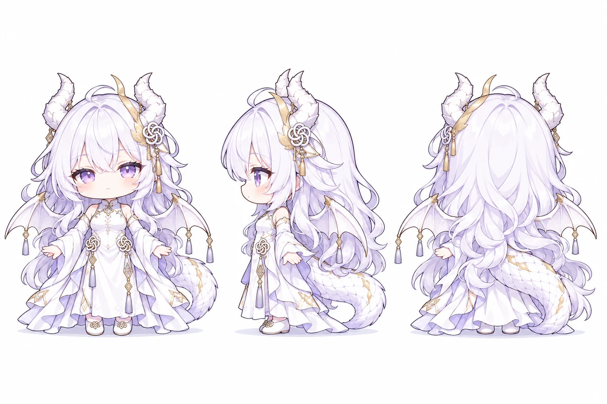</a></td>
    <td align="center" width="50%"><strong>Gemini · V2</strong><br><a href="public/generated/super-chibi-v1/gemini/turnaround-v2.png">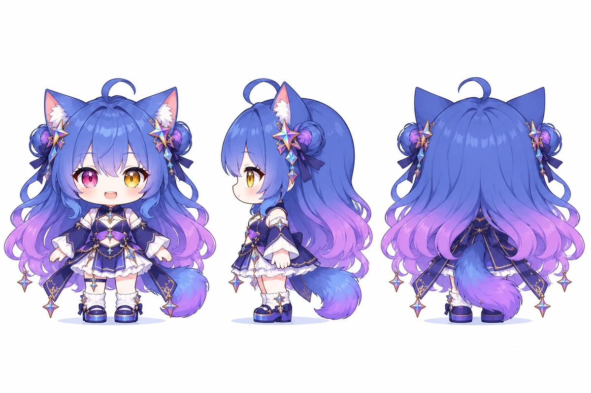</a></td>
  </tr>
  <tr>
    <td align="center" width="50%"><strong>Claude · V1</strong><br><a href="public/generated/super-chibi-v1/claude/turnaround-v1.png">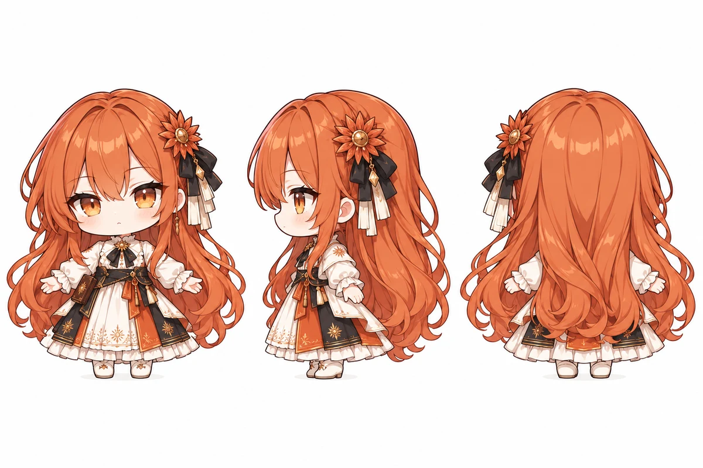</a></td>
    <td align="center" width="50%"><strong>DeepSeek · V1</strong><br><a href="public/generated/super-chibi-v1/deepseek/turnaround-v1.png">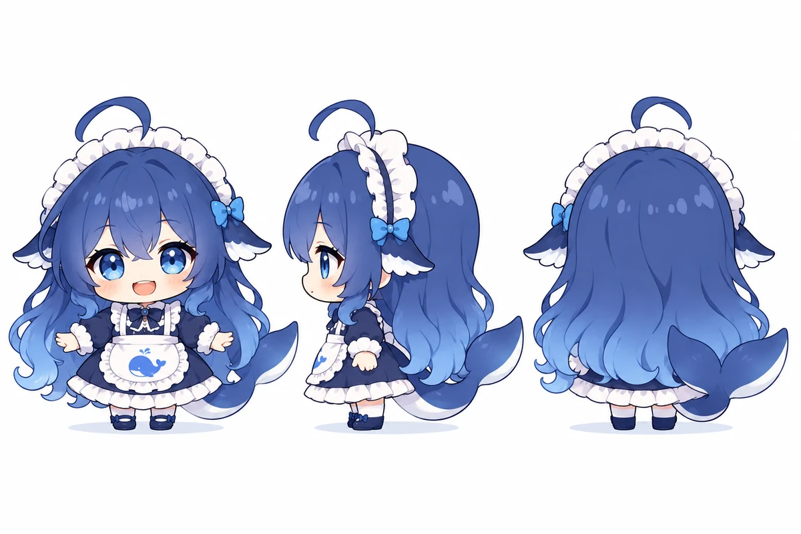</a></td>
  </tr>
  <tr>
    <td align="center" width="50%"><strong>Kimi · V2</strong><br><a href="public/generated/super-chibi-v1/kimi/turnaround-v2.png">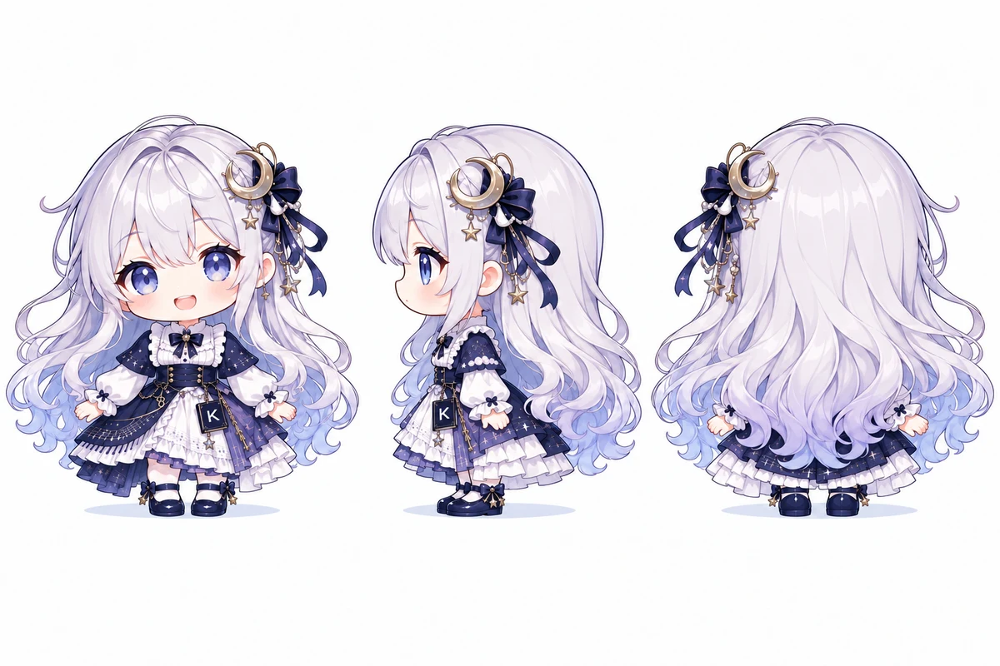</a></td>
    <td align="center" width="50%"><strong>Qwen 千問 · V2</strong><br><a href="public/generated/super-chibi-v1/qwen/turnaround-v2.png">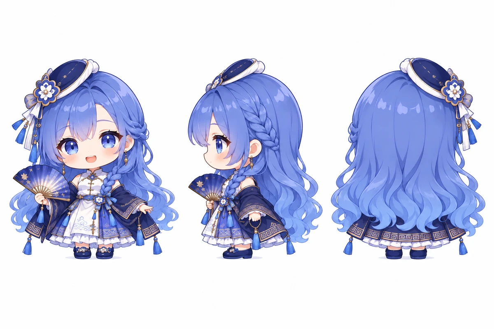</a></td>
  </tr>
  <tr>
    <td align="center" width="50%"><strong>GLM · V1</strong><br><a href="public/generated/super-chibi-v1/glm/turnaround-v1.png">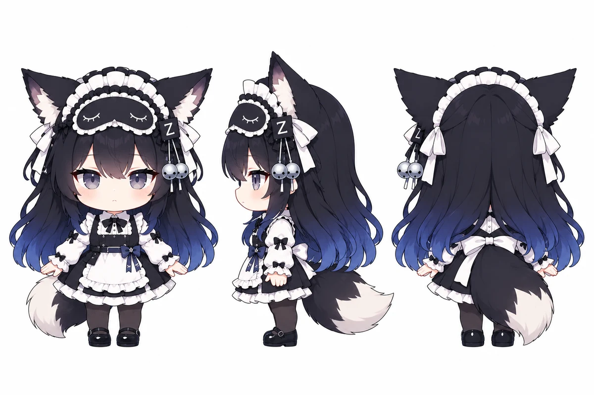</a></td>
    <td align="center"><a href="https://selinlee.github.io/ai-moe-atlas/ja/chibi/">三面図・出典・利用条件 →</a></td>
  </tr>
</table>

GPT・Gemini・Claude・Kimi・Qwen のコミュニティデザイン：ZipZipPipe。DeepSeek：上善无形 → ZipZipPipe。GLM の狐娘は動画 BV1iDeQ6fEFi に基づき、原デザインの作者は未確認です。

本プロジェクトがコミュニティのキャラクターを基に AI で制作した三面図です。各画像には原作のクレジットと共有条件が適用されます。

[三面図・出典・利用条件](docs/CHIBI.ja.md) · [ファイルと処理記録](public/generated/super-chibi-v1/manifest.json)

</details>

<a id="v5-gallery"></a>

<details>
<summary>以前の v5 形象資料 · 通常頭身とちびキャラ</summary>

本プロジェクト制作のキャラクター設定画6枚。各画像に通常頭身とちびキャラを収録し、元の PNG・プロンプト・参照動画・作者情報・SHA-256 を保存しています。

| GPT | Gemini | Claude |
| --- | --- | --- |
| 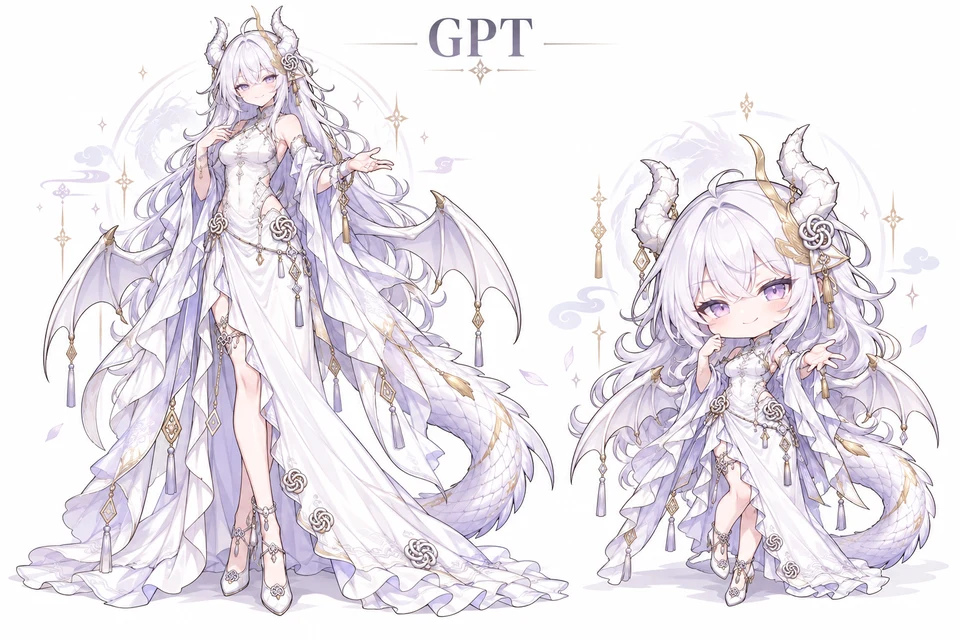 | 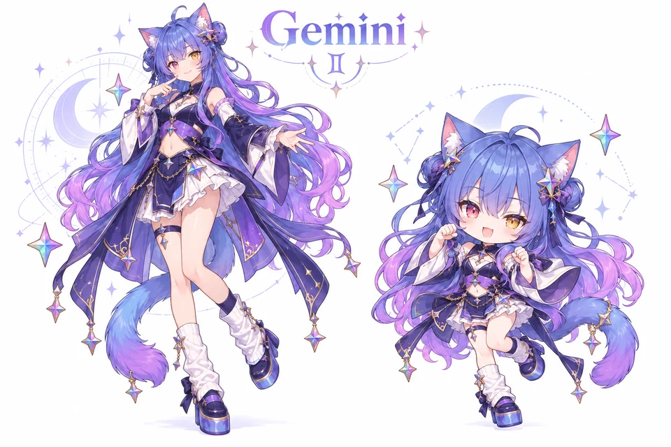 | 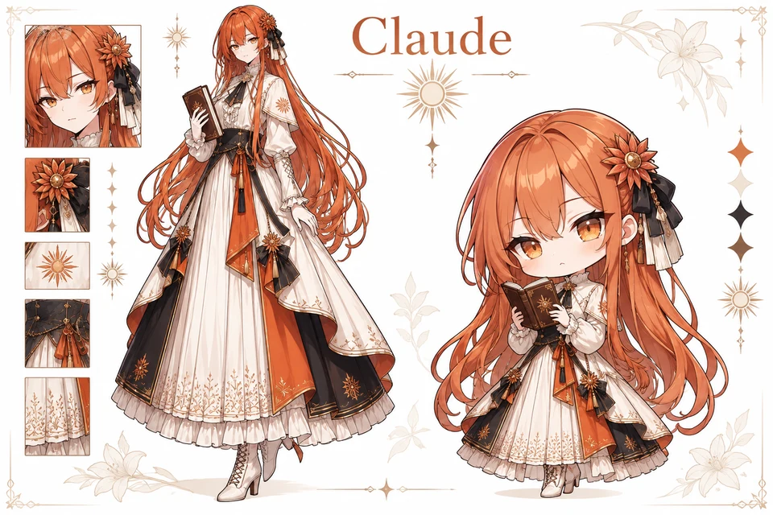 |
| DeepSeek | Kimi | Qwen |
| 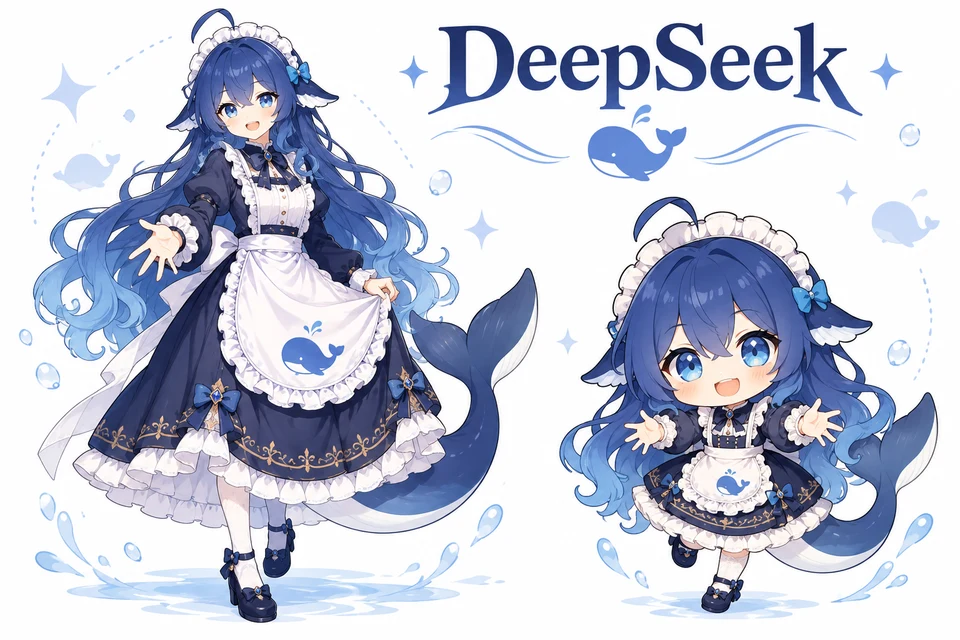 | 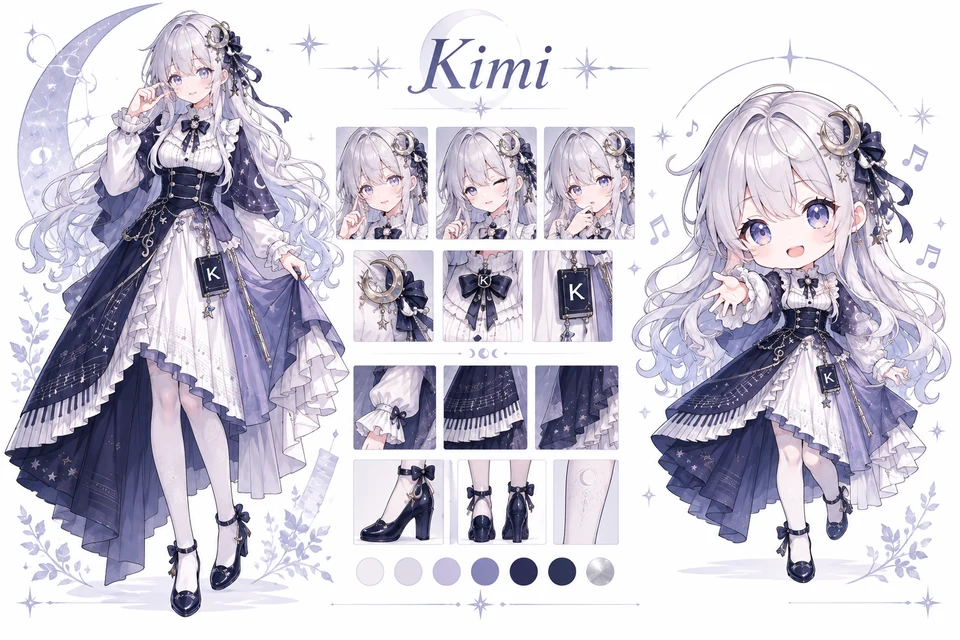 | 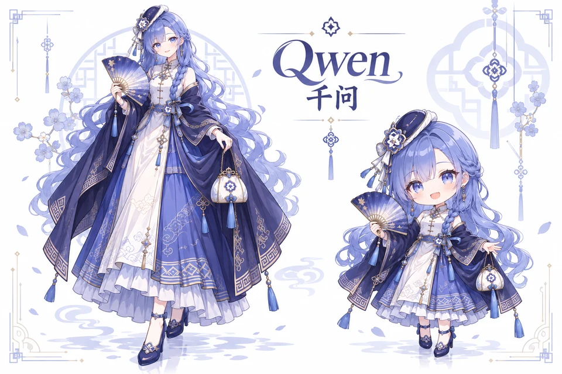 |

コミュニティのキャラクターデザイン：ZipZipPipe。DeepSeek 原作者：上善无形、二次デザイン：ZipZipPipe。生成ツール：内蔵 image_gen。

コミュニティのキャラクターを基にした生成派生資料で、公式キャラクター・作者の原図・細部の復元ではありません。管理者の指定によりホームに表示しますが、上流の改変・再配布許可を意味しません。保存済みの作者条件は引き続き適用されます。

[形象資料と出典](docs/REFERENCES.ja.md) · [ファイルと加工記録](public/generated/ai-models-v5/manifest.json)

</details>

<details>
<summary>15秒の操作デモ</summary>

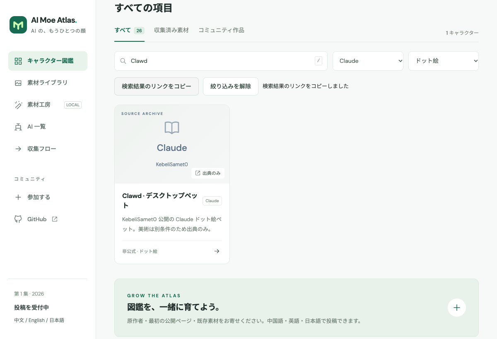

[15秒の操作デモ · MP4](public/demo/discovery-ja.mp4)

ローカル Chrome の実画面を各3秒ずつ表示する5ステップ：スタイルで絞る → 製品を選ぶ → 検索してリンクをコピー → 結果を開き直す → 項目を確認。出典リンクのみの項目を使用し、第三者の作品画像は含みません。書き出し全体のチュートリアルではありません。

</details>

## 利用条件と出典

上善无形の Bilibili 投稿、Small-tailqwq/dsh-deep-whale、[ZipZipPipe 本人の Pixiv 作品集](https://www.pixiv.net/artworks/148186519)から収集。従来の3組は **CC BY-NC-SA 4.0**。追加の GPT・Gemini・Claude・Kimi・Qwen・GLM・Grok・豆包・Llama・MiniMax の10組は作者の **クレジット必須・非商用** 条件に従い、DeepSeek の CC 許諾とは区別します。コードの MIT は第三者の画像には適用されません。

MX1951 の千問学園風立ち絵は CC0 1.0。素材パックに投稿時の PNG、作者名とハッシュを収録。 [確認記録](content/research/2026-11-23/mx1951-qwen-cc0-attachment-and-archive.json)

作者が公開した高解像度原図を優先します。入手できない場合、収集した参照画像を基に同一の姿を保つ派生画像を生成できますが、作者・出典・加工履歴を保持し、生成派生物として別途明記します。作者の原図や復元された細部とは表記しません。上流の許諾を拡大せず、無関係なキャラクターや設定の創作も認めません。

## 維持・更新

- [投稿ガイド](docs/CONTRIBUTING.ja.md)
- [収集マニュアル](docs/COLLECTION.ja.md)
- [素材の利用条件](RIGHTS.md)
- [出典記録](content/sources/)・[Bilibili 調査候補](content/leads.json)
- [プロジェクトの制約](AGENTS.md)

三言語の項目は `content/characters.json`、原図・根拠・加工結果は `public/collected/`、素材集は `public/packs/` に保存。原本は上書きせず、GitHub ファイルはコミットに固定し、派生ファイルから親原図の SHA-256 を参照します。

main への push で検証・テスト・ビルド・GitHub Pages 公開を実行。PR はビルドのみです。ローカルサーバー起動後、`npm run test:browser` で Chrome テストを実行できます。

## 起動

Node.js 22.12 以上（24 推奨）と npm が必要です。

```sh
npm ci
npm run dev
# http://localhost:4321/ai-moe-atlas/ja/
npm test
npm run build
```

## 収集・規格統一

```sh
npm run discover -- --platform bilibili --query '蓝色大肥鱼' --limit 20
npm run discover -- --platform github --query 'AI mascot' --limit 20
# content/sources/*.json の出典・美術利用条件を確認してから実行
npm run collect
npm run assets
npm run validate
```

Bilibili 検索はインストール済み Google Chrome の独立セッションを使用。確認画面が必要な場合は `--visible` を追加します。個人のブラウザプロファイルは使用しません。GitHub 検索にはログイン済みの `gh` が必要です。

**1024 px 版はリサイズ・補間の出力であり、細部を復元したものではありません。** 作者の高解像度原図を優先します。ニューラル超解像、生成型修復、自動背景除去は未実装。元の構図全体を保持します。

## 対応範囲

出典索引への掲載はダウンロード許可を意味しません。Bilibili の 9 種の AI 形象を索引化し、GPT・Gemini・Claude・Kimi・Qwen・GLM・Grok・豆包・Llama・MiniMax は作者の個別高解像度原画像を収集済みです。ペットアニメーション、動画のコマ抽出、自動切り抜き、AI 超解像は本版に含みません。数合わせのために形象を創作してはいけません。

[各 AI の画像収集と再利用の確認記録](docs/BASELINES.ja.md)
