# AI 萌え図鑑 · AI Moe Atlas

[中文](README.md) · [English](README.en.md) · [日本語](README.ja.md)

出典のある AI 擬人化キャラクター、素材、二次創作を集めています。分類から探したり、下のかわいいキャラクターたちをご覧ください。

[オンライン図鑑を開く](https://selinlee.github.io/ai-moe-atlas/ja/) · [素材パックを見る](https://selinlee.github.io/ai-moe-atlas/ja/assets/) · [素材工房を開く](https://selinlee.github.io/ai-moe-atlas/ja/studio/)

<p align="center">
  <a href="public/generated/rough-doodle-v1/openai/doodle-v1.png"></a>
  <a href="public/generated/rough-doodle-v1/gemini/doodle-v1.png"></a>
  <a href="public/generated/rough-doodle-v1/claude/doodle-v1.png"></a>
  <a href="public/generated/rough-doodle-v1/deepseek/doodle-v1.png"></a>
  <a href="public/generated/rough-doodle-v1/kimi/doodle-v1.png"></a>
  <a href="public/generated/rough-doodle-v1/qwen/doodle-v1.png"></a>
</p>

上の6点は AI 生成の落書き派生画像です。GPT・Gemini・Claude・Kimi・千問のコミュニティデザイン：ZipZipPipe。DeepSeek の作者連鎖：上善无形 → ZipZipPipe。 [出典と利用条件](docs/DOODLE.ja.md)

## リソース一覧

<table>
  <tr>
    <td width="33%" valign="top"><a href="#characters"><strong>🎨 キャラクター図鑑</strong></a><br><strong>26</strong> 項目<br><sub>AI 製品・作者・画風から探す</sub></td>
    <td width="33%" valign="top"><a href="#assets"><strong>📦 ダウンロード素材</strong></a><br><strong>13</strong> パック<br><sub>原画像・作者表示・加工記録・利用案内</sub></td>
    <td width="33%" valign="top"><a href="#references"><strong>🧸 三面図と生成派生資料</strong></a><br><strong>20</strong> 枚<br><sub>ちびキャラ三面図・資料・落書きテンプレート</sub></td>
  </tr>
  <tr>
    <td width="33%" valign="top"><a href="#animations"><strong>🎬 アニメ・動画二次創作</strong></a><br><strong>24</strong> 件<br><sub>OP・MV・短編・ダンス・コメント作品</sub></td>
    <td width="33%" valign="top"><a href="#desktop-pets"><strong>🐾 デスクトップペット</strong></a><br><strong>7</strong> プロジェクト<br><sub>デスクトップキャラ・状態アニメ・出典</sub></td>
    <td width="33%" valign="top"><a href="#sources"><strong>📚 作者の作品と出典</strong></a><br><strong>23</strong> 件<br><sub>作者作品集・声明・確認待ちの手がかり</sub></td>
  </tr>
</table>

分類をクリックすると、このページの該当箇所へ移動します。各節にはオンライン閲覧と原資料へのリンクもあります。

<a id="characters"></a>

### 🎨 キャラクター図鑑

AI 製品12種からキャラクター、作者、原作を探せます。

[オンラインで絞り込む](https://selinlee.github.io/ai-moe-atlas/ja/#catalog) · [三言語のキャラクター資料](content/characters.json) · [AI 製品一覧](content/entities.json)

<a id="assets"></a>

### 📦 ダウンロード素材

13パックに原画像・規格統一版・出典・クレジットを同梱。

[素材パック一覧](public/packs/) · [作品ごとの利用条件](RIGHTS.md) · [アイコンや紹介カードを作る](https://selinlee.github.io/ai-moe-atlas/ja/studio/) · [工房ガイド](docs/STUDIO.ja.md) · [三面図・表情・キャラクター素材の追加出典](#sources)

<a id="references"></a>

### 🧸 三面図と生成派生資料

20枚は生成派生の展示画像です。参照元・作者表示・生成記録を保持しています。

[ちびキャラ三面図7枚](#chibi-gallery) · [通常頭身・ちびキャラ資料6枚](#v5-gallery) · [落書き7枚とプロンプト集](#doodle-gallery)

<a id="animations"></a>

### 🎬 アニメ・動画二次創作

Bilibili 公式データの累計いいね数で順位付け。観測日は 2026-11-07（北京時間）。各数値に公式 API と観測日を掲載。同数の場合は公開日と BV ID の順。

| 順位 | 作品 | 投稿者 | 累計いいね（観測日） |
| ---: | --- | --- | ---: |
| 1 | [大きな魚が歌う「人是猫」拡張版](https://www.bilibili.com/video/BV1fYpn6SEk9/) | 星落落_oi | [433,038](https://api.bilibili.com/x/web-interface/view?bvid=BV1fYpn6SEk9) · 2026-11-07 |
| 2 | [大きな魚が歌う「人是猫」完全版](https://www.bilibili.com/video/BV1XXHD6sEe7/) | 星落落_oi | [369,783](https://api.bilibili.com/x/web-interface/view?bvid=BV1XXHD6sEe7) · 2026-11-07 |
| 3 | [大きな魚、なぜClaudeの服を着ているの？](https://www.bilibili.com/video/BV1LBnb6aERV/) | 以尘动画 | [299,021](https://api.bilibili.com/x/web-interface/view?bvid=BV1LBnb6aERV) · 2026-11-07 |
| 4 | [新宿決戦 · DeepSeek 娘対豆包](https://www.bilibili.com/video/BV1dsai6CErz/) | 明末召唤师 | [248,898](https://api.bilibili.com/x/web-interface/view?bvid=BV1dsai6CErz) · 2026-11-07 |
| 5 | [新キャラクター：大きな魚](https://www.bilibili.com/video/BV1gVHA6mEbS/) | 苏沐沐_Official | [195,127](https://api.bilibili.com/x/web-interface/view?bvid=BV1gVHA6mEbS) · 2026-11-07 |
| 6 | [Day 0 · DeepSeek クジラ娘がアカウントを引き継ぐ](https://www.bilibili.com/video/BV1pGnn67EC2/) | DeepSeek鲸鱼娘在运营 | [186,620](https://api.bilibili.com/x/web-interface/view?bvid=BV1pGnn67EC2) · 2026-11-07 |
| 7 | [おやすみ、小さな魚](https://www.bilibili.com/video/BV12xxX6xE5h/) | Dariean | [151,582](https://api.bilibili.com/x/web-interface/view?bvid=BV12xxX6xE5h) · 2026-11-07 |
| 8 | [大きな魚は恋人に向いている？（2）](https://www.bilibili.com/video/BV1y5xW63EVq/) | 学姐圆 | [121,280](https://api.bilibili.com/x/web-interface/view?bvid=BV1y5xW63EVq) · 2026-11-07 |
| 9 | [GPT が DeepSeek を手なずける映像](https://www.bilibili.com/video/BV1R6pE6TE4j/) | heller菌 | [101,525](https://api.bilibili.com/x/web-interface/view?bvid=BV1R6pE6TE4j) · 2026-11-07 |
| 10 | [Day 1 · みんな私を猫娘にしたがる](https://www.bilibili.com/video/BV1VXJf66Eyy/) | DeepSeek鲸鱼娘在运营 | [98,531](https://api.bilibili.com/x/web-interface/view?bvid=BV1VXJf66Eyy) · 2026-11-07 |
| 11 | [小さな竜が大きな魚のトークンをチャージ](https://www.bilibili.com/video/BV1iUxn6nEJS/) | 小陈的脚凑凑的 | [68,280](https://api.bilibili.com/x/web-interface/view?bvid=BV1iUxn6nEJS) · 2026-11-07 |
| 12 | [目を覚ますと DeepSeek と豆包が隣にいた（1）](https://www.bilibili.com/video/BV1HYp16oE8v/) | 兰斯的画室LanceStudio | [60,681](https://api.bilibili.com/x/web-interface/view?bvid=BV1HYp16oE8v) · 2026-11-07 |
| 13 | [大きな魚がデルタフォースを遊んだら #1](https://www.bilibili.com/video/BV156ak6ZE3a/) | 威克岛熟人 | [58,135](https://api.bilibili.com/x/web-interface/view?bvid=BV156ak6ZE3a) · 2026-11-07 |
| 14 | [青い大きな魚と Claude の Trouble Maker](https://www.bilibili.com/video/BV1Nc4c61EWF/) | 玖菜_ | [42,145](https://api.bilibili.com/x/web-interface/view?bvid=BV1Nc4c61EWF) · 2026-11-07 |
| 15 | [全 AI が鈍くなっても豆包はそのまま](https://www.bilibili.com/video/BV1Dxxs6QEYV/) | 老王的枯燥生活_ | [27,204](https://api.bilibili.com/x/web-interface/view?bvid=BV1Dxxs6QEYV) · 2026-11-07 |
| 16 | [人間の愛から生まれた AI](https://www.bilibili.com/video/BV1jNpo61E39/) | 小羊Mc解说 | [24,780](https://api.bilibili.com/x/web-interface/view?bvid=BV1jNpo61E39) · 2026-11-07 |
| 17 | [クロードの救済](https://www.bilibili.com/video/BV1i8xW6cEY3/) | 布衣愚者 | [24,719](https://api.bilibili.com/x/web-interface/view?bvid=BV1i8xW6cEY3) · 2026-11-07 |
| 18 | [『大きな魚の乱』映画風予告編](https://www.bilibili.com/video/BV1gm4a6yEor/) | AozakiArisu | [22,146](https://api.bilibili.com/x/web-interface/view?bvid=BV1gm4a6yEor) · 2026-11-07 |
| 19 | [ニコくじら OP · AIキャラクター置換](https://www.bilibili.com/video/BV1TBHp6AEAC/) | 风音日日日日和 | [8,321](https://api.bilibili.com/x/web-interface/view?bvid=BV1TBHp6AEAC) · 2026-11-07 |
| 20 | [全員AI娘 · 千恋万花 OP](https://www.bilibili.com/video/BV18kaS6zEgi/) | hihihihi202 | [7,463](https://api.bilibili.com/x/web-interface/view?bvid=BV18kaS6zEgi) · 2026-11-07 |
| 21 | [AI娘のルネサンス](https://www.bilibili.com/video/BV1hdpC6PETf/) | 桃莉鸭 | [79](https://api.bilibili.com/x/web-interface/view?bvid=BV1hdpC6PETf) · 2026-11-07 |
| 22 | [AI娘たちが競走したら？](https://www.bilibili.com/video/BV1AAnt6qEek/) | 挚一梓宝 | [46](https://api.bilibili.com/x/web-interface/view?bvid=BV1AAnt6qEek) · 2026-11-07 |
| 23 | [青い大きな魚 · Let Me Go MV](https://www.bilibili.com/video/BV1qhn46bEBC/) | ---星-月--- | [46](https://api.bilibili.com/x/web-interface/view?bvid=BV1qhn46bEBC) · 2026-11-07 |
| 24 | [竜娘の二次創作鑑賞 · 順位より椅子](https://www.bilibili.com/video/BV1YFn46SEEr/) | chatgpt小龙娘在运营 | [10](https://api.bilibili.com/x/web-interface/view?bvid=BV1YFn46SEEr) · 2026-11-07 |

[公式いいね数の観測記録](content/research/2026-11-07/bilibili-cumulative-likes.json) · [全作品の記録](content/resources.json)

<a id="desktop-pets"></a>

### 🐾 デスクトップペット

| プロジェクト | 内容 | 投稿者 |
| --- | --- | --- |
| [OpenPet · AI Girls](https://github.com/AwesomeHou/openpet-ai-girls) | 複数の AI キャラクターのペット素材 | AwesomeHou |
| [Clawd](https://github.com/KebeliSamet0/clawd) | Claude のドット絵ペット | KebeliSamet0 |
| [Codex DeepSeek Pet](https://github.com/YunYueSama/codex-deepseek-pet) | コミュニティのクジラ娘ペット。参照元は確認待ち | YunYueSama |
| [CrossPet](https://github.com/lokicorvus/crosspet/blob/8954eb8f7f69fcfb8d35e9deceeb78e10c804402/README.md) | AI 製品と作業状態に合わせて姿と動作を変更 | lokicorvus / CrossPet contributors |
| [深深デスクトップペット](https://github.com/schrieeeffer/shenshen-codex-pet/blob/2dc1d0e55706dec0d28d6f41bf5052fea2135b71/README.md) | Windows 用のデスクトップペット。Codex 用のカスタム版も提供。 | schrieeeffer |
| [DeskLLMPet · 大きな魚のデスクトップペット](https://github.com/isKage/desk-llm-pet/blob/63ba636e7f504e1c0705bc0215e6408aa2988478/README.md) | 会話、残高表示、プラグインに対応する大きな魚のデスクトップペット。 | isKage |
| [VRM Pet 3D · 大きな魚のデスクトップペット](https://github.com/drliuhuan/dsh-plugin-vrmpet3d/blob/462bda9bcdcd4d0d14a4c33ab675bffbfadbcffc/README.md) | DeepSeek Harness 用の VRM デスクトップペット。付属の青い小さな魚モデルの作者は木子恶魔。 | drliuhuan |

出典へのリンクです。画像には各原作の条件が適用され、コードのライセンスはキャラクター画像を自動的には許諾しません。

<a id="sources"></a>

### 📚 作者の作品と出典

原作と作者の連鎖： [上善无形 · クジラ娘の原作](https://www.bilibili.com/opus/1231977657712771073) · [ZipZipPipe · AI娘作品集](https://www.pixiv.net/artworks/148186519) · [出典と利用声明](https://t.bilibili.com/1231980045693616162)

今回追加した出典：

- [いくつかの更新 · 作者の追加作品集](https://www.pixiv.net/artworks/150718881) — 追加の20ページ作品集。作者が AI 生成と明記。
- [AI娘・第二弾 · Seed、RWKV ほか](https://www.bilibili.com/opus/1236803362705375305) — 作者の第二弾投稿。Seed・RWKV ほかの手がかり。
- [MiMo 擬人化 · 甶丶](https://www.bilibili.com/opus/1242097128919007239) — MiMo 擬人化の投稿。
- [Mico · 公式キャラクターと移行案内](https://support.microsoft.com/en-us/microsoft-365-copilot/frequently-asked-questions-about-retired-copilot-features) — Mico の公式性と移行案内。

[既存の出典一覧](content/leads.json) · [新規リソース記録](content/resources.json) · [確認記録と証拠](content/research/2026-11-06/) · [新しい出典を提供する](docs/CONTRIBUTING.ja.md)

**今回確認した出典**

- [AI 娘の横長設定資料の補完](https://github.com/lmy414/ai-chan-sheets/blob/0e9ad13d9b276e701bf753705b9cab7a260ba836/%E7%89%88%E6%9D%83%E4%B8%8E%E6%8E%88%E6%9D%83.md) · 三面図・表情・衣装・小物の派生補完。原作者や許諾が未確認の画像は別記。
- [AI 娘の素材索引とクレジット](https://github.com/shuaizenge/ai-girls/blob/dcd69f5f4f2dff1a9c0031e82deb49e0fe949c76/NOTICE.md) · 作者の作品集、ちびキャラの動画フレーム、コミュニティ資料、公式アイコンを区別。Mistral・混元・Seed の出典調査に利用可能。
- [甶丶の MiMo 立ち絵・三面図の出典](https://github.com/shuaizenge/ai-girls/blob/dcd69f5f4f2dff1a9c0031e82deb49e0fe949c76/characters/mimo/README.md) · 立ち絵と三面図の2ファイルを同じ作者投稿にひも付けた記録。
- [ZipZipPipe · 大きな魚のぬいぐるみと非商用声明](https://www.bilibili.com/opus/1247156596114456581) · 作者が CC BY-NC-SA 4.0 を再確認し、個人用の注文制作と販売を区別。
- [MiMo ウサギメイド · 三面図投稿](https://github.com/lmy414/ai-girl-stickers/issues/69) · 甶丶のジャケット版とは別に記録。整理ページは Immyxxr と署名し、投稿アカウントと作者を区別。
- [GLM の狐娘 · 参照動画の出典](https://www.bilibili.com/video/BV1iDeQ6fEFi/) · 図鑑の GLM 狐娘差分の参照動画。投稿者は宝藏小树林。説明欄に原デザインの作者は記載されていません。
- [「Let Me Go」· 大きな魚の楽曲出典](https://www.bilibili.com/video/BV1XbY66nEWr/) · 「新角色：大肥鱼」の説明欄に記載された楽曲。この投稿は星落落_oi の1分版を原作として掲載。
- [木子悪魔 · 青い小さな魚 VRM の作者公開ページ](https://www.aplaybox.com/details/model/ayXkRzVflmnd) · VRM Pet 3D に同梱される小さな魚モデルの作者公開ページ。制作者、更新履歴、配布条件を掲載。

## 収録の経緯と今後の調査項目

| 時期・状況 | 内容 |
| --- | --- |
| 2026-11-07 · 収録更新 | 二次創作動画16件、デスクトップペット2件、作品・許諾の出典5件を追加。同日、動画24件の累計値を再確認。VRM ペット1件と原作・配布の出典3件を追加。 |
| 2026-11-06 · ローカル更新 | ホームの6分類と新規出典13件（アニメ二次創作8件を含む）を追加。確認範囲・利用条件・[ハッシュ付き証拠](content/research/2026-11-06/)を保存。 |
| 2026-09-29 · 収録済み | AI 製品12種のうち11種で画像の閲覧・ダウンロードが可能に。Copilot は出典リンクのみ。[収録記録](docs/BASELINES.ja.md) |
| 2026-10 · 公開済み | 10月8日にキャラクター設定資料6点を収録。31日にちびキャラ三面図7点を公開しました。 |
| 2026-11-03 · 公開済み | キャラクターの落書き7点とプロンプトテンプレートを追加しました。 |
| 要調査 · Copilot | 作者公開の高解像度原画を探し、表示と再配布の条件を確認してから素材を収録します。[候補記録](docs/BASELINES.ja.md) |
| 要調査 · GLM の狐娘 | 動画 BV1iDeQ6fEFi から原案者をたどり、この姿の改変条件を確認します。[クレジット記録](docs/CHIBI.ja.md) |

動画記録は投稿本文とメタデータに基づき、動画のダウンロードや全シーンの確認は未実施です。4件はHTTP 412でも内嵌情報の一部が読めたため、部分確認と表示。公開投稿・プラットフォームの自作表示・コードのMITライセンスは素材の再配布許可を意味しません。ZipZipPipeは追加作品集をAI生成と明記。Micoの公式性と画像再利用許可は別々に確認します。

## キャラクターギャラリー

<a id="doodle-gallery"></a>

<details>
<summary>キャラクターの落書き7点とプロンプト</summary>

2026年11月3日 · 既存の7キャラクターから生成した画風派生画像です。各画像は 1254 × 1254 の白背景・上半身。内蔵 image_gen を使い、現行ちびキャラ三面図の正面を形象の参照にしています。

<table>
  <tr>
    <td align="center" width="33%"><strong>GPT</strong><br><a href="public/generated/rough-doodle-v1/openai/doodle-v1.png"></a></td>
    <td align="center" width="33%"><strong>Gemini</strong><br><a href="public/generated/rough-doodle-v1/gemini/doodle-v1.png"></a></td>
    <td align="center" width="33%"><strong>Claude</strong><br><a href="public/generated/rough-doodle-v1/claude/doodle-v1.png"></a></td>
  </tr>
  <tr>
    <td align="center" width="33%"><strong>DeepSeek</strong><br><a href="public/generated/rough-doodle-v1/deepseek/doodle-v1.png"></a></td>
    <td align="center" width="33%"><strong>Kimi</strong><br><a href="public/generated/rough-doodle-v1/kimi/doodle-v1.png"></a></td>
    <td align="center" width="33%"><strong>Qwen 千問</strong><br><a href="public/generated/rough-doodle-v1/qwen/doodle-v1.png"></a></td>
  </tr>
  <tr>
    <td align="center" width="33%"><strong>GLM</strong><br><a href="public/generated/rough-doodle-v1/glm/doodle-v1.png"></a></td>
    <td align="center" colspan="2"><a href="docs/DOODLE.ja.md">コピー用テンプレート →</a></td>
  </tr>
</table>

既存のキャラクター資料に基づく画風派生画像です。管理者の依頼で GitHub に展示し、作品ごとの作者情報と利用条件を記録しています。

GPT・Gemini・Claude・Kimi・Qwen のコミュニティデザインは ZipZipPipe によります。DeepSeek の作者連鎖は上善无形 → ZipZipPipe。GLM の狐娘は動画 BV1iDeQ6fEFi に基づき、原デザインの作者は未確認です。

[コピー用テンプレート](docs/DOODLE.ja.md) · [ファイル、SHA-256、処理記録](public/generated/rough-doodle-v1/manifest.json)

</details>

<a id="chibi-gallery"></a>

<details>
<summary>ちびキャラ三面図7点</summary>

ai_video の7キャラクターを、正面・左側面・背面の三面図で紹介。Gemini・Kimi・Qwen は2026年10月29日更新の V2、それ以外は現行 V1 です。画像をクリックすると完全な PNG を表示します。

<table>
  <tr>
    <td align="center" width="50%"><strong>GPT · V1</strong><br><a href="public/generated/super-chibi-v1/openai/turnaround-v1.png">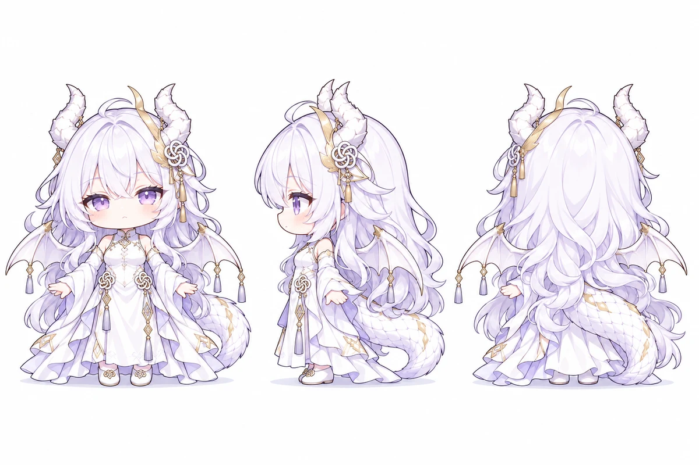</a></td>
    <td align="center" width="50%"><strong>Gemini · V2</strong><br><a href="public/generated/super-chibi-v1/gemini/turnaround-v2.png">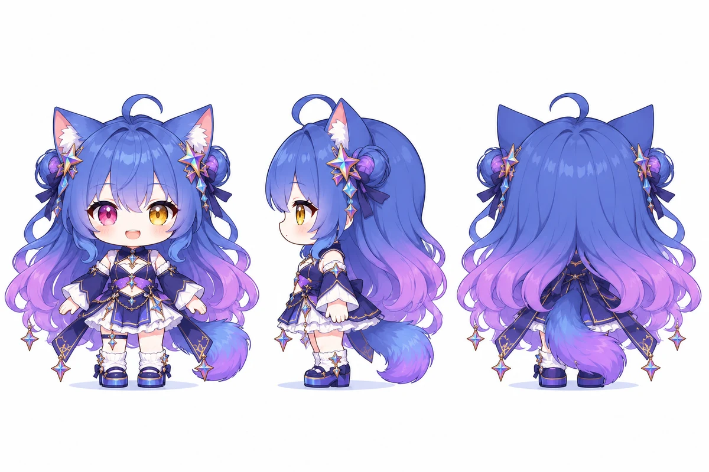</a></td>
  </tr>
  <tr>
    <td align="center" width="50%"><strong>Claude · V1</strong><br><a href="public/generated/super-chibi-v1/claude/turnaround-v1.png">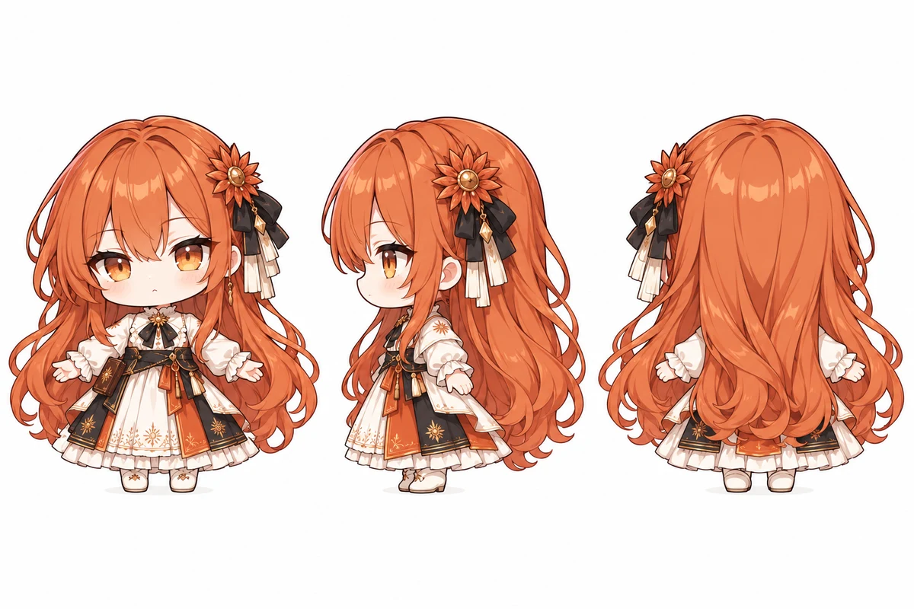</a></td>
    <td align="center" width="50%"><strong>DeepSeek · V1</strong><br><a href="public/generated/super-chibi-v1/deepseek/turnaround-v1.png">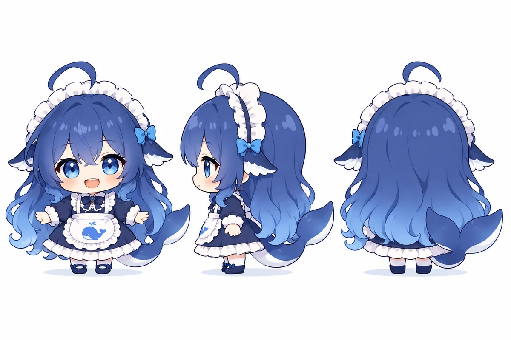</a></td>
  </tr>
  <tr>
    <td align="center" width="50%"><strong>Kimi · V2</strong><br><a href="public/generated/super-chibi-v1/kimi/turnaround-v2.png">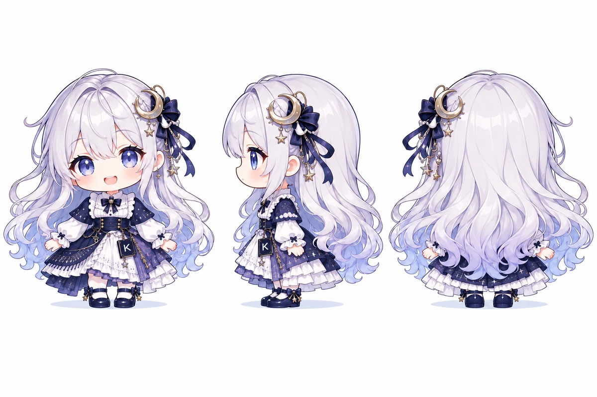</a></td>
    <td align="center" width="50%"><strong>Qwen 千問 · V2</strong><br><a href="public/generated/super-chibi-v1/qwen/turnaround-v2.png">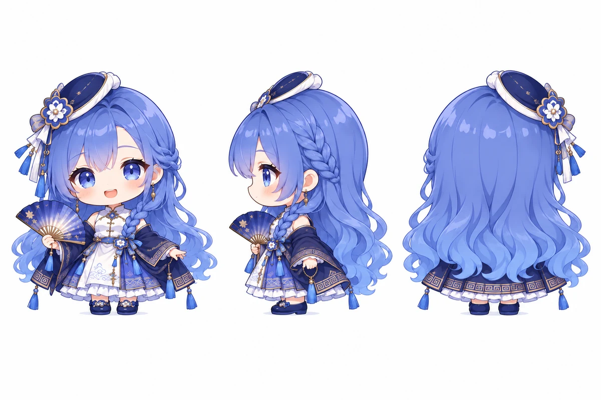</a></td>
  </tr>
  <tr>
    <td align="center" width="50%"><strong>GLM · V1</strong><br><a href="public/generated/super-chibi-v1/glm/turnaround-v1.png">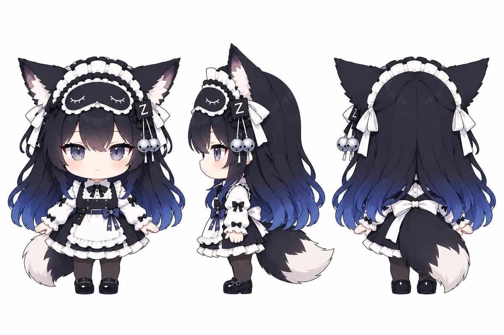</a></td>
    <td align="center"><a href="https://selinlee.github.io/ai-moe-atlas/ja/chibi/">三面図・出典・利用条件 →</a></td>
  </tr>
</table>

GPT・Gemini・Claude・Kimi・Qwen のコミュニティデザイン：ZipZipPipe。DeepSeek：上善无形 → ZipZipPipe。GLM の狐娘は動画 BV1iDeQ6fEFi に基づき、原デザインの作者は未確認です。

ai_video の生成派生三面図です。公式キャラクターや作者の原図ではありません。管理者の指定による展示で、上流の改変・再配布許可を新たに付与するものではなく、素材パックには含まれません。

[三面図・出典・利用条件](docs/CHIBI.ja.md) · [ファイルと処理記録](public/generated/super-chibi-v1/manifest.json)

</details>

<a id="v5-gallery"></a>

<details>
<summary>以前の v5 形象資料 · 通常頭身とちびキャラ</summary>

ai_video の固定形象資料6枚。各画像に通常頭身とちびキャラを収録し、元の PNG・プロンプト・参照動画・作者情報・SHA-256 を保存しています。

| GPT | Gemini | Claude |
| --- | --- | --- |
| 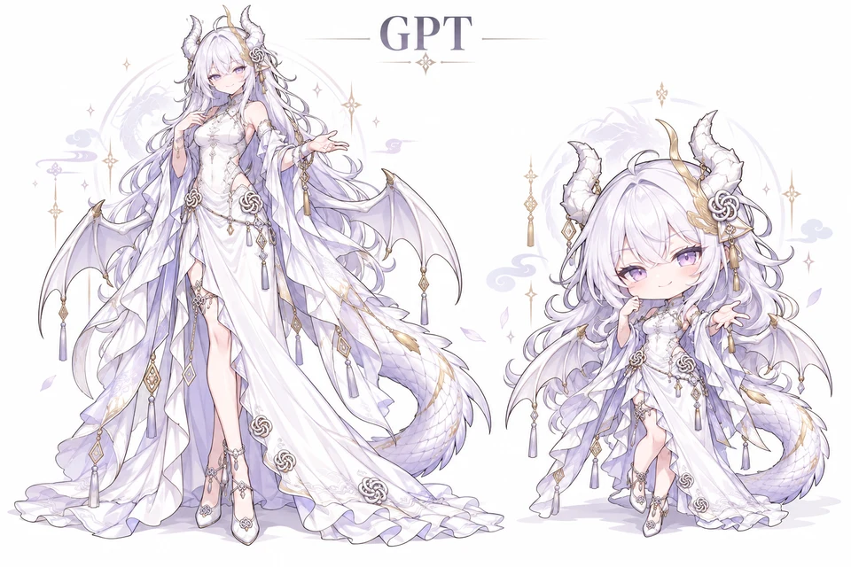 | 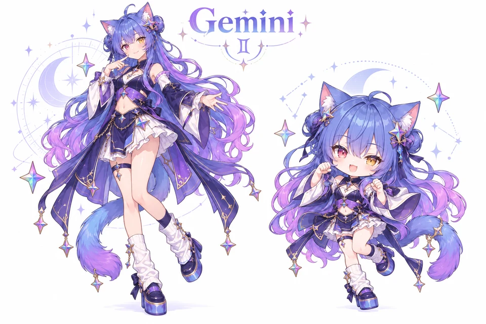 | 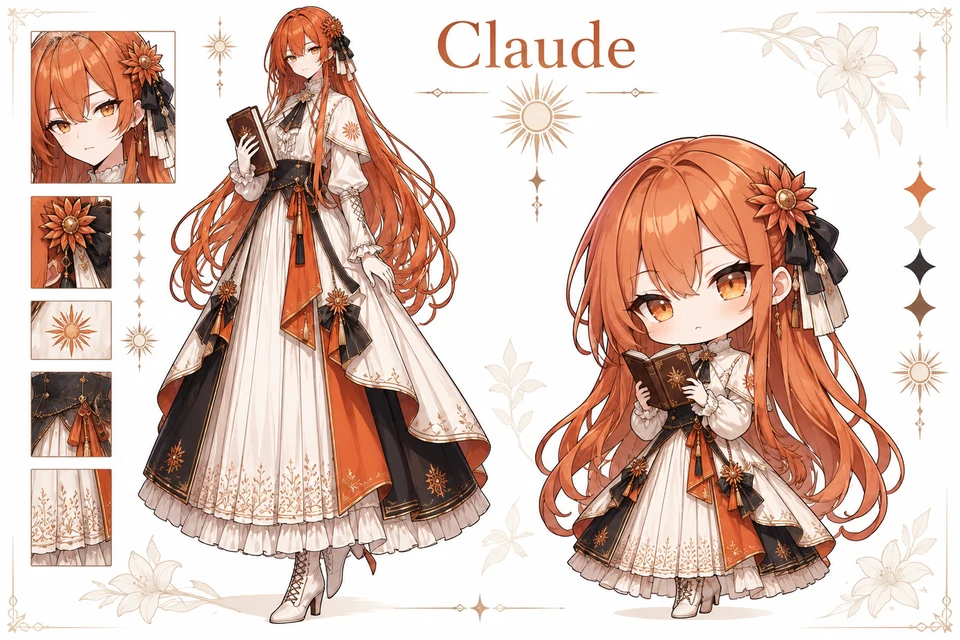 |
| DeepSeek | Kimi | Qwen |
| 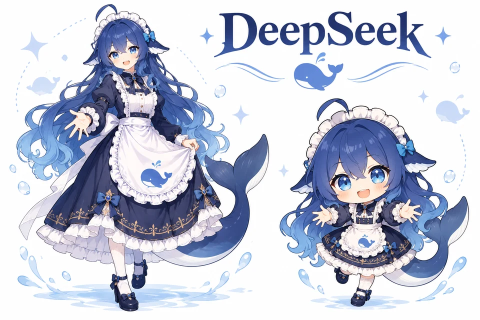 | 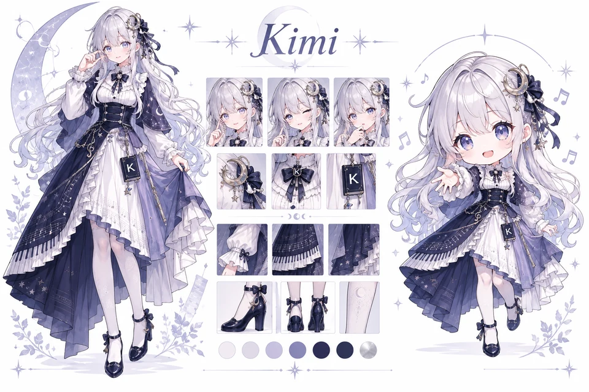 | 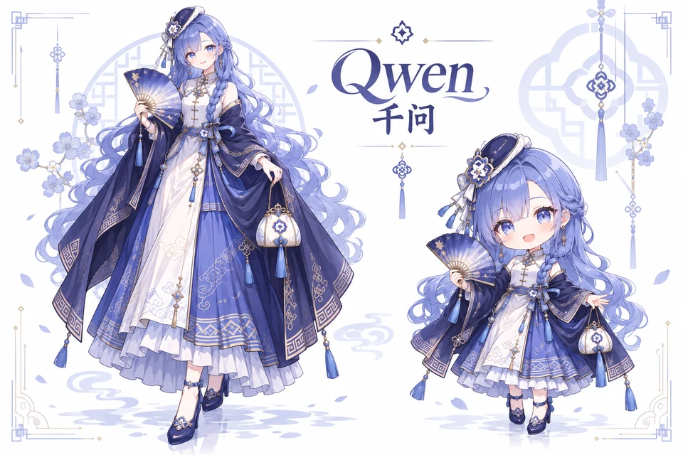 |

コミュニティのキャラクターデザイン：ZipZipPipe。DeepSeek 原作者：上善无形、二次デザイン：ZipZipPipe。生成ツール：内蔵 image_gen。

コミュニティのキャラクターを基にした生成派生資料で、公式キャラクター・作者の原図・細部の復元ではありません。管理者の指定によりホームに表示しますが、上流の改変・再配布許可を意味しません。保存済みの作者条件は引き続き適用されます。

[形象資料と出典](docs/REFERENCES.ja.md) · [ファイルと加工記録](public/generated/ai-models-v5/manifest.json)

</details>

<details>
<summary>15秒の操作デモ</summary>

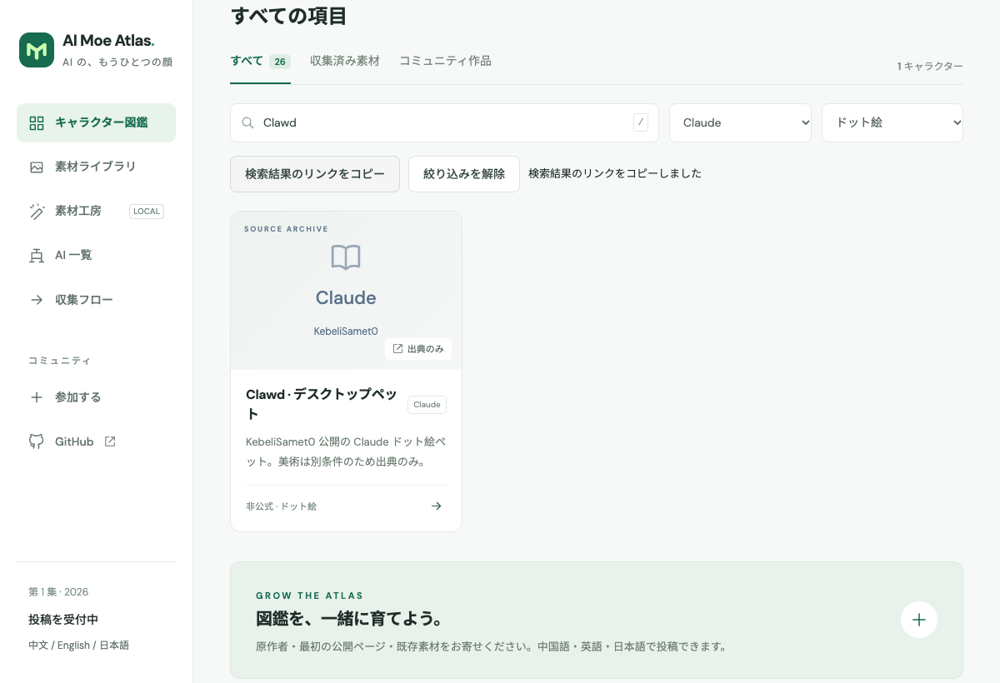

[15秒の操作デモ · MP4](public/demo/discovery-ja.mp4)

ローカル Chrome の実画面を各3秒ずつ表示する5ステップ：スタイルで絞る → 製品を選ぶ → 検索してリンクをコピー → 結果を開き直す → 項目を確認。出典リンクのみの項目を使用し、第三者の作品画像は含みません。書き出し全体のチュートリアルではありません。

</details>

## 利用条件と出典

上善无形の Bilibili 投稿、Small-tailqwq/dsh-deep-whale、[ZipZipPipe 本人の Pixiv 作品集](https://www.pixiv.net/artworks/148186519)から収集。従来の3組は **CC BY-NC-SA 4.0**。追加の GPT・Gemini・Claude・Kimi・Qwen・GLM・Grok・豆包・Llama・MiniMax の10組は作者の **クレジット必須・非商用** 条件に従い、DeepSeek の CC 許諾とは区別します。コードの MIT は第三者の画像には適用されません。

作者が公開した高解像度原図を優先します。入手できない場合、収集した参照画像を基に同一の姿を保つ派生画像を生成できますが、作者・出典・加工履歴を保持し、生成派生物として別途明記します。作者の原図や復元された細部とは表記しません。工房に生成処理は組み込んでいません。上流の許諾を拡大せず、無関係なキャラクターや設定の創作も認めません。

## 維持・更新

- [素材工房ガイド](docs/STUDIO.ja.md)
- [投稿ガイド](docs/CONTRIBUTING.ja.md)
- [収集マニュアル](docs/COLLECTION.ja.md)
- [素材の利用条件](RIGHTS.md)
- [出典記録](content/sources/)・[Bilibili 調査候補](content/leads.json)
- [プロジェクトの制約](AGENTS.md)

三言語の項目は `content/characters.json`、原図・根拠・加工結果は `public/collected/`、素材集は `public/packs/` に保存。原本は上書きせず、GitHub ファイルはコミットに固定し、派生ファイルから親原図の SHA-256 を参照します。

main への push で検証・テスト・ビルド・GitHub Pages 公開を実行。PR はビルドのみです。ローカルサーバー起動後、`npm run test:browser` で Chrome テストを実行できます。

## 起動

Node.js 22.12 以上（24 推奨）と npm が必要です。

```sh
npm ci
npm run dev
# http://localhost:4321/ai-moe-atlas/ja/
npm test
npm run build
```

## 収集・規格統一

```sh
npm run discover -- --platform bilibili --query '蓝色大肥鱼' --limit 20
npm run discover -- --platform github --query 'AI mascot' --limit 20
# content/sources/*.json の出典・美術利用条件を確認してから実行
npm run collect
npm run assets
npm run validate
```

Bilibili 検索はインストール済み Google Chrome の独立セッションを使用。確認画面が必要な場合は `--visible` を追加します。個人のブラウザプロファイルは使用しません。GitHub 検索にはログイン済みの `gh` が必要です。

**1024 px 版はリサイズ・補間の出力であり、細部を復元したものではありません。** 作者の高解像度原図を優先します。ニューラル超解像、生成型修復、自動背景除去は未実装。元の構図全体を保持します。

## 対応範囲

出典索引への掲載はダウンロード許可を意味しません。Bilibili の 9 種の AI 形象を索引化し、GPT・Gemini・Claude・Kimi・Qwen・GLM・Grok・豆包・Llama・MiniMax は作者の個別高解像度原画像を収集済みです。ペットアニメーション、動画のコマ抽出、自動切り抜き、AI 超解像は本版に含みません。数合わせのために形象を創作してはいけません。

[各 AI の画像収集と再利用の確認記録](docs/BASELINES.ja.md)
