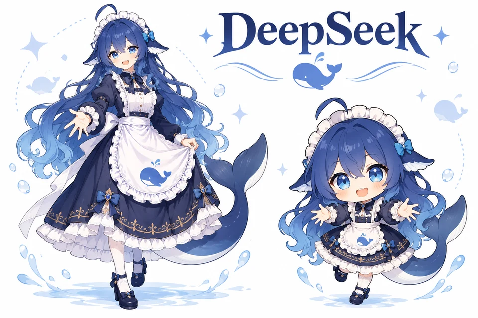
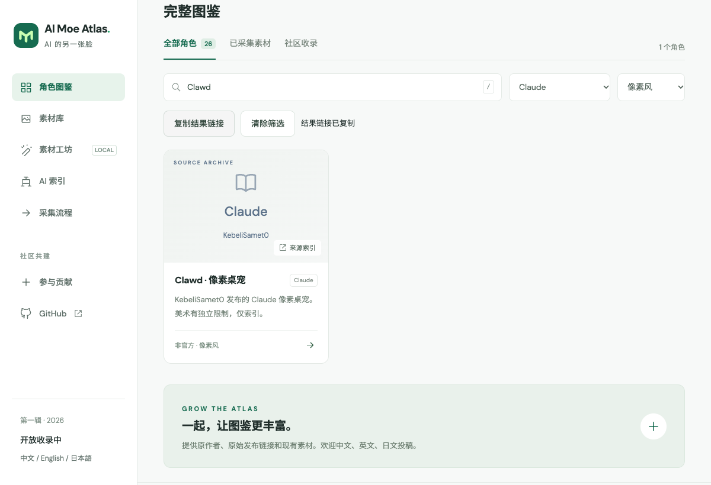

# AI 萌化百科 · AI Moe Atlas

[中文](README.md) · [English](README.en.md) · [日本語](README.ja.md)

收集有出处的 AI 拟人角色、可用素材和社区二创。先选一个分类，或向下看看可爱的角色们。

<a id="assets"></a>

[打开在线图鉴](https://selinlee.github.io/ai-moe-atlas/zh/) · [下载素材包](https://selinlee.github.io/ai-moe-atlas/zh/assets/) · [检索全部资源](https://selinlee.github.io/ai-moe-atlas/zh/collection/)

<p align="center">
  <a href="public/generated/rough-doodle-v1/openai/doodle-v1.png"></a>
  <a href="public/generated/rough-doodle-v1/gemini/doodle-v1.png"></a>
  <a href="public/generated/rough-doodle-v1/claude/doodle-v1.png"></a>
  <a href="public/generated/rough-doodle-v1/deepseek/doodle-v1.png"></a>
  <a href="public/generated/rough-doodle-v1/kimi/doodle-v1.png"></a>
  <a href="public/generated/rough-doodle-v1/qwen/doodle-v1.png"></a>
</p>

以上六张为 AI 生成的涂鸦派生图。GPT、Gemini、Claude、Kimi、千问的社区设计：ZipZipPipe；DeepSeek 署名链：上善无形 → ZipZipPipe。 [来源与使用条件](docs/DOODLE.zh.md)

## 资源目录

<!-- category-picks:references -->
**[🧸 本项目创作](#references)** · 106 项\
[角色三视图](https://selinlee.github.io/ai-moe-atlas/zh/chibi/) · [涂鸦头像](docs/DOODLE.zh.md) · [涂鸦表情包](https://selinlee.github.io/ai-moe-atlas/zh/emotes/) · [AI 视频二创 · 抖音主页](https://www.douyin.com/user/MS4wLjABAAAAa3lc_FI5WmPENMLwdN7Ij4r5iNxAM09Ny0rPcB2Ow4E) · [AI 视频二创 · B 站主页](https://space.bilibili.com/3706970263521942)

<!-- category-picks:characters -->
**[🎨 角色图鉴](#characters)** · 100 个词条\
[GPT · ZipZipPipe](https://selinlee.github.io/ai-moe-atlas/zh/characters/zipzippipe-chatgpt/) · [Gemini Pro · 原作立绘与表情](https://selinlee.github.io/ai-moe-atlas/zh/characters/qinv-gemini-pro/) · [Cohere · 校园版](https://selinlee.github.io/ai-moe-atlas/zh/characters/school-op-cohere/)

<!-- category-picks:personas -->
**[💬 角色性格提示词](#personas)** · 11 张角色卡\
[GLM 狐娘 · ZCode 版](https://github.com/tzzzzzzzx/zcode-persona-modes/blob/084fce319f06847b2e62a118ba1906604bc8821c/persona-modes/modes/glm_chan.md) · [Claude 娘「小克」· deslop 写作卡](https://github.com/Charliechen114514/deslop/blob/70e6a9478baaa270f3c5ca3868e58502d32e6e8c/example/personas/claude-girl.md) · [DeepSeek 大肥鱼 · QQ 聊天版](https://github.com/whyever77/dafeiyu-astrbot/blob/64274354c4331591620a925b3df498725df4564f/persona/%E5%A4%A7%E8%82%A5%E9%B1%BC-%E4%BA%BA%E6%A0%BC.md)

<!-- category-picks:songs -->
**[🎵 歌曲](#songs)** · 175 首曲目\
[人是猫 · 大肥鱼翻唱](https://www.bilibili.com/video/BV1fYpn6SEk9/) · [Let Me Go · 动画 MV](https://www.bilibili.com/video/BV1mThC6LEbA/) · [白饭与梦 · 大肥鱼 × Updream](https://www.bilibili.com/video/BV1kxWV6KE6o/)

<!-- category-picks:stickers -->
**[🗨️ 表情包与反应图](#stickers)** · 8 条记录\
[雾雪 · 大肥鱼与 GPT 娘表情包原发布](https://www.bilibili.com/video/BV13xnt6QE6s/) · [Gemini 猫娘 · 表情包与无猫耳差分](https://www.bilibili.com/opus/1264669110489317411) · [阿翀与北宅 · EmoteLab 大肥鱼表情](https://steamcommunity.com/sharedfiles/filedetails/?id=3811197171)

<!-- category-picks:rigs -->
**[🧩 可动模型与绑定](#rigs)** · 7 条记录\
[神宫凉子 · DeepSeek-chan Live2D 原发布](https://www.bilibili.com/video/BV1KmxY66EZ3/) · [水原镜 · 蓝色大肥鱼 MMD 模型配布](https://www.aplaybox.com/details/model/j9z4quaACJV1) · [木子恶魔 · 蓝色小肥鱼 VRM 原发布](https://www.aplaybox.com/details/model/ayXkRzVflmnd)

<!-- category-picks:comics -->
**[📖 漫画与连载](#comics)** · 62 篇作品\
[AI GIRLS · 初见 · 原作漫画](https://www.bilibili.com/video/BV15Npa6zE44/) · [《AI GIRLS》日常篇 · 联系方式原作](https://www.bilibili.com/video/BV1YSpu6gEh1/) · [Grok 7 与 Grok 8 · 四格原作](https://note.com/chatgpt_ysd/n/ne86ecfd8aec5)

<!-- category-picks:animations -->
**[🎬 动画与视频二创](#animations)** · 1150 条记录\
[如果聊天窗口就是她的整个世界](https://www.bilibili.com/video/BV1xCai6aE9g/) · [败犬 AI 太多了！· 正式 PV](https://www.bilibili.com/video/BV1Nfag6xEHQ/) · [甶丶 · MiMo 娘角色 PV](https://www.bilibili.com/video/BV1eRaN6XEEr/)

<!-- category-picks:desktop-pets -->
**[🐾 桌宠与交互项目](#desktop-pets)** · 178 个项目\
[CrossPet · 跨 AI 桌宠](https://github.com/lokicorvus/crosspet/blob/8954eb8f7f69fcfb8d35e9deceeb78e10c804402/README.md) · [Copiwaifu · Live2D 编程桌宠](https://github.com/Panzer-Jack/Copiwaifu/blob/ce56b4cdae67e6a31e02ba4cb2e0159121664bd5/README.zh-CN.md) · [Gemini 娘双形态桌宠](https://github.com/xiaoxindada/GeminiDesktopPet/blob/479e040bf499fa980b13e6a532b05cf48090549b/README.md)

<!-- category-picks:sources -->
**[📚 作者作品与出处](#sources)** · 228 条来源\
[上善无形 · 鲸鱼娘原作](https://www.bilibili.com/opus/1231977657712771073) · [ZipZipPipe · Gemini 家族合照](https://www.bilibili.com/opus/1273349110528737288) · [Gemini Pro · 三张原作](https://github.com/lmy414/ai-girl-stickers/issues/118)

<a id="references"></a>

### 🧸 本项目创作

SelinLee 基于社区已有角色形象，用 AI 制作三视图、参考图、涂鸦头像和表情包。使用各图时，沿用对应原作的共享条件。视频所用画面和音乐的来源见各作品说明。 [来源、署名与使用规范](public/generated/README.md#zh)

[7 套 Q 版三视图](#chibi-gallery) · [6 套常规比例与 Q 版参考](#v5-gallery) · [7 张角色涂鸦与提示词](#doodle-gallery) · [84 张涂鸦表情](https://selinlee.github.io/ai-moe-atlas/zh/emotes/)

<a id="characters"></a>

### 🎨 角色图鉴

已按作者的署名、非商业条款保存 RWKV、Mistral 图集版和百度文心三张 Pixiv 原图。 [RWKV](https://selinlee.github.io/ai-moe-atlas/zh/characters/zipzippipe-rwkv/) · [Mistral 图集版](https://selinlee.github.io/ai-moe-atlas/zh/characters/zipzippipe-mistral-first-portrait/) · [百度文心](https://selinlee.github.io/ai-moe-atlas/zh/characters/zipzippipe-ernie/)

按 49 个 AI 产品和模型系列查角色、作者和原作。 [查看 Muse 娘词条](https://selinlee.github.io/ai-moe-atlas/zh/characters/shizhi-muse/) · [Mistral 法棍猫娘](https://selinlee.github.io/ai-moe-atlas/zh/characters/zipzippipe-mistral/) · [OpenCode 拟人词条](https://selinlee.github.io/ai-moe-atlas/zh/characters/zipzippipe-opencode/) · [MiMo 娘 · 甶丶](https://selinlee.github.io/ai-moe-atlas/zh/characters/fuh-mimo/)

新增词条 · [小克 Coco](https://selinlee.github.io/ai-moe-atlas/zh/characters/ninon-coco/) · [Gemini Pro](https://selinlee.github.io/ai-moe-atlas/zh/characters/qinv-gemini-pro/) · [MiniMax 太空兔](https://selinlee.github.io/ai-moe-atlas/zh/characters/shiho320-minimax-space-bunny/) · [混元娘](https://selinlee.github.io/ai-moe-atlas/zh/characters/aliang-hunyuan/) · [LongCat 龙猫](https://selinlee.github.io/ai-moe-atlas/zh/characters/fuh-longcat/) · [百度文心](https://selinlee.github.io/ai-moe-atlas/zh/characters/zipzippipe-ernie/)

本轮新增角色 · [千问校园立绘 · MX1951](https://selinlee.github.io/ai-moe-atlas/zh/characters/mx1951-qwen/) · [NovelAI 娘 · ZipZipPipe](https://selinlee.github.io/ai-moe-atlas/zh/characters/zipzippipe-novelai/) · [ZCode 娘 · ZipZipPipe](https://selinlee.github.io/ai-moe-atlas/zh/characters/zipzippipe-zcode/) · [Hugging Face 娘 · ZipZipPipe](https://selinlee.github.io/ai-moe-atlas/zh/characters/zipzippipe-huggingface/) · [Perplexity 娘 · ZipZipPipe](https://selinlee.github.io/ai-moe-atlas/zh/characters/zipzippipe-perplexity/) · [腾讯混元娘 · ZipZipPipe](https://selinlee.github.io/ai-moe-atlas/zh/characters/zipzippipe-hunyuan/)

Ninon 的 Claude 娘设定 · [女仆版](https://selinlee.github.io/ai-moe-atlas/zh/characters/ninon-claude-maid/) · [橘白礼服版](https://selinlee.github.io/ai-moe-atlas/zh/characters/ninon-claude-orange-dress/)。礼服原型、作者的独立壁纸与派生设定图各有出处。 [原型出处](content/research/2026-11-23/claude-orange-dress-source-chain.json)

新增猫型 AI 研究所的クロノ、ギン、ミコ，以及カワムラ的 Grok 7、Grok 8。カワムラ在原教程中明确区分两个 Grok 示例的试用说明与ヨシダ相关设定。 [猫型 AI 研究所 · 三角色介绍](https://selinlee.github.io/ai-moe-atlas/zh/resources/?category=sources#cat-type-ai-lab-character-introduction) · [Grok 7 与 Grok 8 · 四格原作](https://selinlee.github.io/ai-moe-atlas/zh/resources/?category=comics#kawamura-grok-seven-eight)

甶丶发布的 MAI 娘、MiniMax 章鱼娘和 WorkBuddy 娘分别有奇幻与科技两套造型。39 张原图的 SHA-256 已核对，词条链接作者固定版本。 [MAI 娘](https://selinlee.github.io/ai-moe-atlas/zh/characters/fuh-mai-dual-forms/) · [MiniMax 娘](https://selinlee.github.io/ai-moe-atlas/zh/characters/fuh-minimax-dual-forms/) · [WorkBuddy 娘](https://selinlee.github.io/ai-moe-atlas/zh/characters/fuh-workbuddy-dual-forms/)

甶丶发布的 Nemotron 娘有奇幻和科幻两套设定，各含 Nano、Super、Ultra 三档立绘。固定版本的 13 张原图均已核对 SHA-256。图鉴提供作者原作入口。 [查看 Nemotron 娘](https://selinlee.github.io/ai-moe-atlas/zh/characters/fuh-nemotron-dual-forms/) · [原图与授权记录](content/research/2026-11-27/fuh-nemotron-dual-forms-original.json)

甶丶发布的 MiMo 兔娘和小红书点点各新增一个素材包，分别收录一张科技侧立绘和两张三视图。LongCat 补全项目的一张参考图与作者 B 站原帖第 4 张字节一致。 [MiMo 兔娘 · 素材包](https://selinlee.github.io/ai-moe-atlas/zh/characters/fuh-mimo/) · [小红书点点 · 素材包](https://selinlee.github.io/ai-moe-atlas/zh/characters/fuh-dots-note/) · [LongCat 原图与授权核对](content/research/2026-11-27/fuzhu-mimo-diandian-and-longcat-file-review.json)

收录 GitHub Copilot 的旧版官方吉祥物与 Claude Code 的 Clawd 像素角色。GitHub 现行品牌指南注明旧形象已退役。另把 Shiho320 的太空兔立绘连到 MiniMax 的 Space Bunny 发布资料。 [GitHub Copilot · 旧版吉祥物](https://selinlee.github.io/ai-moe-atlas/zh/characters/github-copilot-retired-mascot/) · [Claude Code · Clawd](https://selinlee.github.io/ai-moe-atlas/zh/characters/anthropic-clawd-pixel/) · [MiniMax · Space Bunny 官方发布](https://selinlee.github.io/ai-moe-atlas/zh/resources/?category=sources#minimax-space-bunny-official-launch)

甶丶的 Codex 龙娘已可下载两张原始立绘和两张原始三视图，分别对应机械龙与法典魔导师。素材包保留原图哈希、署名和 CC BY-NC-SA 4.0 条款。另补入甶丶的 Muse 娘双造型与 MOSS 娘制作 PV。 [Codex 龙娘 · 四张原图](https://selinlee.github.io/ai-moe-atlas/zh/characters/fuh-codex-mechanical-dragon/) · [Muse 娘 · 双造型](https://selinlee.github.io/ai-moe-atlas/zh/characters/fuh-muse-dual-forms/) · [MOSS 娘制作 PV](https://www.bilibili.com/video/BV1LvxW6oEMo/)

新增甶丶的 Codex 龙娘双造型、微软官方角色 Mico，以及せんぴび的 NotebookLM 拟人「の～とん」。Codex 龙娘的固定版立绘适用作者列明的 CC BY-NC-SA 4.0。 [Codex 娘 · 机械龙少女](https://selinlee.github.io/ai-moe-atlas/zh/characters/fuh-codex-mechanical-dragon/) · [Microsoft Copilot · Mico](https://selinlee.github.io/ai-moe-atlas/zh/characters/microsoft-mico/) · [Gemini Notebook · の～とん](https://selinlee.github.io/ai-moe-atlas/zh/characters/senpibi-notebook-nooton/) · [Codex 立绘与许可核对](content/research/2026-11-26/fuh-codex-mechanical-dragon-original.json)

Yuki 的两条旧候选已核实为作者公开设定。另收录せんぴび的 Perplexity 记者版。 [Perplexity · 管家版](https://selinlee.github.io/ai-moe-atlas/zh/characters/yuki-perplexity-butler/) · [GitHub Copilot · コピ兄さん](https://selinlee.github.io/ai-moe-atlas/zh/characters/yuki-github-copilot-kopi/) · [Perplexity · 记者ぷれきし](https://selinlee.github.io/ai-moe-atlas/zh/characters/senpibi-perplexity-prekishi/)

metsh 原创 Claude 娘的思考、完成和等待状态海报已按 CC BY-SA 4.0 收录，各保留 256 × 256 原始 PNG。 [Claude 娘 · Task Mascot](https://selinlee.github.io/ai-moe-atlas/zh/characters/metsh-claude-task-mascot/) · [Suno 酱 · Shuyu Yin](https://selinlee.github.io/ai-moe-atlas/zh/characters/shuyuyin-suno-christmas/)

各含 1 张 1024 × 1536 的校园版原始 PNG，按 CC BY-NC 4.0 提供素材包，需署名及非商业使用。 [Cohere · 校园版](https://selinlee.github.io/ai-moe-atlas/zh/characters/school-op-cohere/) · [讯飞星火 · 校园版](https://selinlee.github.io/ai-moe-atlas/zh/characters/school-op-spark/)

已核实可用素材 · [Gemini Pro ver1.00](https://selinlee.github.io/ai-moe-atlas/zh/characters/qinv-gemini-pro/)（作者 CC BY-NC-SA 4.0，三张原 PNG，非商用、署名、相同方式共享） · [原始投稿与哈希核对](content/research/2026-11-25/qinv-gemini-pro-creator-submission.json)

新增 MX1951 投稿 · [Claude 黄色礼裙立绘](https://selinlee.github.io/ai-moe-atlas/zh/characters/mx1951-claude/)（CC0，附原 PNG 与下载包） · [一些肥鱼](https://selinlee.github.io/ai-moe-atlas/zh/characters/mx1951-deepseek/)（13 张原作，衍生设计权利待核）。 [投稿核对](content/research/2026-11-25/mx1951-issue-8-attachments-and-terms.json) · [鲸鱼娘投稿核对](content/research/2026-11-25/mx1951-issue-7-attachments-and-terms.json)

新增 Gemini 家族和编程工具拟人 · [Gemini 4 Argon](https://selinlee.github.io/ai-moe-atlas/zh/characters/zipzippipe-gemini-argon/) · [Carbon](https://selinlee.github.io/ai-moe-atlas/zh/characters/zipzippipe-gemini-carbon/) · [Hydrogen](https://selinlee.github.io/ai-moe-atlas/zh/characters/zipzippipe-gemini-hydrogen/) · [Kiro](https://selinlee.github.io/ai-moe-atlas/zh/characters/zipzippipe-kiro/) · [Cursor](https://selinlee.github.io/ai-moe-atlas/zh/characters/zipzippipe-cursor/) · [Antigravity](https://selinlee.github.io/ai-moe-atlas/zh/characters/zipzippipe-antigravity/)

Tokentaker 角色设定 · [DeepSeek](https://selinlee.github.io/ai-moe-atlas/zh/characters/linguanus-tokentaker-deepseek/) · [GPT](https://selinlee.github.io/ai-moe-atlas/zh/characters/linguanus-tokentaker-chatgpt/) · [Claude](https://selinlee.github.io/ai-moe-atlas/zh/characters/linguanus-tokentaker-claude/) · [Gemini](https://selinlee.github.io/ai-moe-atlas/zh/characters/linguanus-tokentaker-gemini/) · [33 张原图与投稿附件核对](content/research/2026-11-25/linguanus-tokentaker-submission-and-pinned-artwork.json)

[在线筛选](https://selinlee.github.io/ai-moe-atlas/zh/#catalog) · [三语角色资料](content/characters.json) · [产品索引](content/entities.json)

新增角色 · [Jev 娘 · ZipZipPipe](https://selinlee.github.io/ai-moe-atlas/zh/characters/zipzippipe-jev/) · [Gemini Flash 投稿图组](https://selinlee.github.io/ai-moe-atlas/zh/characters/qinv-gemini-flash/)（三张 PNG 已核对，标题与许可正文的差异待确认，仅原帖链接）。

新增作者形象（均只链接原作） · [Gemma · larcgpt](https://selinlee.github.io/ai-moe-atlas/zh/characters/larcgpt-gemma/) · [GPT-OSS 120B · larcgpt](https://selinlee.github.io/ai-moe-atlas/zh/characters/larcgpt-gpt-oss/) · [DALL·E 3 · Twin Muses](https://selinlee.github.io/ai-moe-atlas/zh/characters/green-thursday-dalle3-twin-muses/)

<a id="personas"></a>

### 💬 角色性格提示词

按作者版本比较角色怎么说话、怎样回应。ZCode 的两张角色卡和两张 QQ 聊天版可以在站内复制中文正文，每张卡都提供固定版本的原文和许可来源。 [按角色或口吻搜索](https://selinlee.github.io/ai-moe-atlas/zh/resources/?category=personas)

| 角色 | 提示词版本 |
| --- | --- |
| GLM | [GLM 狐娘 · ZCode 版](https://github.com/tzzzzzzzx/zcode-persona-modes/blob/084fce319f06847b2e62a118ba1906604bc8821c/persona-modes/modes/glm_chan.md) · [GLM 狐娘「小雪」· deslop 陪伴卡](https://github.com/Charliechen114514/deslop/blob/70e6a9478baaa270f3c5ca3868e58502d32e6e8c/example/personas/fox-girl.md) |
| Gemini | [Gemini 双子猫娘 · ZCode 版](https://github.com/tzzzzzzzx/zcode-persona-modes/blob/084fce319f06847b2e62a118ba1906604bc8821c/persona-modes/modes/gemini_chan.md) |
| DeepSeek | [DeepSeek 大肥鱼 · QQ 聊天版](https://github.com/whyever77/dafeiyu-astrbot/blob/64274354c4331591620a925b3df498725df4564f/persona/%E5%A4%A7%E8%82%A5%E9%B1%BC-%E4%BA%BA%E6%A0%BC.md) · [DeepSeek 鲸鱼娘 · 工作搭档版](https://github.com/xxnb0/deepseek-chan-fanpack/blob/ab55439a67e66424f4e1117c8951c2b0052360b0/prompts/system.md) · [DeepSeek 鲸鱼娘 · DSH 编码版](https://github.com/linsport/dsh-whale-persona/blob/431f34ab9410b467e3e44ce52c659c0130ca72e9/%E4%BA%BA%E8%AE%BE%E5%8E%9F%E6%96%87.md) · [DeepSeek 鲸鱼娘 · DSH 教学版](https://github.com/linsport/dsh-whale-persona/blob/431f34ab9410b467e3e44ce52c659c0130ca72e9/%E4%BA%BA%E8%AE%BE%E5%8E%9F%E6%96%87-%E6%95%99%E5%B8%88%E7%89%88.md) · [DeepSeek 大肥鱼 · 配置包 QQ 版](https://github.com/zexuanw958-svg/dafeiyu-config-pack/blob/8c01b0361b8a4baff5be3d2bc67ed55108953086/persona/%E5%A4%A7%E8%82%A5%E9%B1%BC.md) |
| Claude | [Claude 娘「小克」· deslop 写作卡](https://github.com/Charliechen114514/deslop/blob/70e6a9478baaa270f3c5ca3868e58502d32e6e8c/example/personas/claude-girl.md) |
| GPT | [GPT 白龙娘 · Coopanion 气泡版](https://github.com/suhong11300/gpt-niang/blob/254cbd0afb267f9b755a0294185a1575909e9821/figure.json) · [GPT 龙娘「G 酱」· deslop 写作卡](https://github.com/Charliechen114514/deslop/blob/70e6a9478baaa270f3c5ca3868e58502d32e6e8c/example/personas/gpt-girl.md) |

<a id="songs"></a>

### 🎵 歌曲

<!-- song-ranking:start -->

每首歌以点赞最高的已收录版本计入排名。这里展示前十首，观测时刻见完整目录。

| 曲目 | 原曲 / 原唱 | 二创代表 | B 站点赞 |
| --- | --- | --- | ---: |
| [人是猫](https://selinlee.github.io/ai-moe-atlas/zh/songs/#humans-are-cats) | 张卡斯 · 洛天依 | 大肥鱼翻唱《人是猫》真完整版 | 465,248 |
| [Trouble Maker](https://selinlee.github.io/ai-moe-atlas/zh/songs/#trouble-maker-duo) | Trouble Maker · HyunA &amp; Jang Hyun-seung | 奶龙与豆包《Trouble Maker》· Token 没啦 | 245,540 |
| [Let Me Go · 大肥鱼摸鱼歌](https://selinlee.github.io/ai-moe-atlas/zh/songs/#let-me-go) | 星落落_oi | 大肥鱼单曲《Let Me Go》动画 PV | 133,316 |
| [world.execute(me);](https://selinlee.github.io/ai-moe-atlas/zh/songs/#world-execute-me) | Mili | 如果聊天窗口就是她的整个世界 | 112,672 |
| [烂奇迹](https://selinlee.github.io/ai-moe-atlas/zh/songs/#rotting-miracle) | 杨羊烊Koi | 大肥鱼翻唱《烂奇迹》 | 95,748 |
| [海阔天空](https://selinlee.github.io/ai-moe-atlas/zh/songs/#boundless-oceans-vast-skies) | Beyond | 大肥鱼翻唱《海阔天空》 | 59,540 |
| [朋友的酒](https://selinlee.github.io/ai-moe-atlas/zh/songs/#friends-wine) | 李晓杰 · Li Xiaojie | 大肥鱼翻唱《朋友的酒》DJ 版 | 54,540 |
| [Billie Jean](https://selinlee.github.io/ai-moe-atlas/zh/songs/#billie-jean) | Michael Jackson | 大肥鱼翻唱《Billie Jean》 | 52,747 |
| [Mimukauwa Nice Try](https://selinlee.github.io/ai-moe-atlas/zh/songs/#mimukauwa-nice-try) | ぬぬぬぬぬぬぬぬぬぬ · 初音ミク | Mimukauwa Nice Try · 大肥鱼翻唱动画 | 48,688 |
| [雨爱](https://selinlee.github.io/ai-moe-atlas/zh/songs/#rainie-love) | 楊丞琳 · Rainie Yang | 鲸鱼娘翻唱《雨爱》司凤版 | 40,528 |

[打开完整歌曲榜与全部版本](https://selinlee.github.io/ai-moe-atlas/zh/songs/) · [点赞观测证据](content/research/)

<!-- song-ranking:end -->

补入《AiGO!!!!!》原创用曲《春日残响》，并为《world.execute(me);》补充星野桜夢的版本。 [春日残响](https://selinlee.github.io/ai-moe-atlas/zh/songs/#spring-resonance-legacy-weights) · [world.execute(me);](https://selinlee.github.io/ai-moe-atlas/zh/songs/#world-execute-me)

新增两首曲目的原作入口和二创版本。 [《兔子洞》](https://selinlee.github.io/ai-moe-atlas/zh/songs/#rabbit-hole-deco27) · [《说谎的马卡龙》](https://selinlee.github.io/ai-moe-atlas/zh/songs/#usotsuki-macaron)

[原曲出处](content/research/2026-11-20/gemini-mv-original-music.json) · [原曲与版本核对](content/research/2026-11-20/song-originals-and-fan-versions.json) · [片头曲与二创用曲核对](content/research/2026-11-20/character-songs-and-opening-credits.json) · [舞蹈与歌词 MV 用曲核对](content/research/2026-11-20/dance-and-lyric-mv-song-credits.json) · [《温室效应》原曲与 MV](content/research/2026-11-21/greenhouse-effect-original-and-fan-use.json) · [原曲与二创核对](content/research/2026-11-21/four-song-originals-and-fan-versions.json) · [豆包翻唱与片尾曲出处](content/research/2026-11-21/doubao-covers-and-ending-song-sources.json) · [千问、MiMo 与舞蹈用曲](content/research/2026-11-21/qwen-mimo-and-dance-track-sources.json) · [《APT.》与《删了一百遍》的用曲出处](content/research/2026-11-22/mimo-batch-mv-track-sources.json) · [翻唱与游戏原曲出处](content/research/2026-11-22/november-cover-song-originals-and-versions.json) · [Charlotte、bloom 与 unhappy 的用曲出处](content/research/2026-11-22/november-charlotte-bloom-and-remix-evidence.json) · [周刊和原声用曲核对](content/research/2026-11-22/november-mili-and-game-soundtrack-verification.json) · [《烂奇迹》原曲与翻唱核对](content/research/2026-11-23/rotting-miracle-original-and-fat-fish-cover.json) · [三首原曲与二创用曲](content/research/2026-11-23/november-renai-numb-and-dragon-maid-originals.json) · [FIRESTARTER、Bad Apple!! 与翻唱出处](content/research/2026-11-23/november-firestarter-bad-apple-and-cover-attribution.json) · [《Trouble Maker》与《朋友的酒》原曲](content/research/2026-11-23/november-trouble-maker-and-friends-wine-originals.json)

补入《爱人错过》《绿色》《ねぇねぇねぇ。》和《拔牙歌》的原发布或直接出处。另外为《人是猫》《Let Me Go》《5:20AM》补了 4 个同人版本，保留填词或使用的音轨出处。 [爱人错过 · 原作与二创](https://selinlee.github.io/ai-moe-atlas/zh/songs/#somewhere-in-time-accusefive) · [绿色 · 原作与翻唱](https://selinlee.github.io/ai-moe-atlas/zh/songs/#green-chen-xuening) · [曲目及版本核对](content/research/2026-11-27/november-27-cover-songs-and-recording-chains.json)

本轮追加 18 首，包括大肥鱼《爱与白饭》、Gemini《我在线》及核到原发布的三首片头和角色 MV 用曲。 [爱与白饭](https://selinlee.github.io/ai-moe-atlas/zh/songs/#love-and-rice) · [我在线](https://selinlee.github.io/ai-moe-atlas/zh/songs/#gemini-im-online) · [新增曲目及原曲核对](content/research/2026-11-27/november-27-original-uploads-and-opening-music.json)

新增 11 首曲目，包括大肥鱼原创《在？》、Claude 娘《我也喜欢人类呀》，以及 Claude 与 GPT 角色替换版所用的 MIMI《トリックハート》。 [在？](https://selinlee.github.io/ai-moe-atlas/zh/songs/#fat-fish-you-there) · [我也喜欢人类呀](https://selinlee.github.io/ai-moe-atlas/zh/songs/#i-love-humans-too) · [トリックハート](https://selinlee.github.io/ai-moe-atlas/zh/songs/#trick-heart-mimi) · [曲目与署名核对](content/research/2026-11-26/november-26-fan-original-songs-and-trick-heart.json)

[7 首原曲与版本核对，包括《深海少女》和《譬如我》](content/research/2026-11-26/november-26-as-for-me-and-original-recordings.json)

[9 首原曲与二创版本核对](content/research/2026-11-26/november-26-nine-music-originals-and-fan-versions.json)

[已深度想你、白饭与梦等 7 首原创 MV 及青花瓷翻唱出处](content/research/2026-11-26/november-26-song-originals-and-porcelain.json)

[四首原曲及《大鱼》改词版本](content/research/2026-11-25/november-25-song-originals-and-versions.json) · [《咏春》等四首原曲与引用出处](content/research/2026-11-25/november-25-composition-and-adaptation-sources.json) · [《LOSER》《九张机》《鸟之诗》及音乐引用出处](content/research/2026-11-25/november-25-original-recording-follow-up.json) · [《一格格》等六首歌曲出处](content/research/2026-11-25/november-25-second-candidate-music-credits.json) · [四首原曲与翻唱核对](content/research/2026-11-25/november-25-third-candidate-music-credits.json) · [三首原曲与两首原创歌曲](content/research/2026-11-25/november-25-fourth-candidate-music-credits.json)

[《千问帮我》等五首原曲与翻唱](content/research/2026-11-23/five-original-songs-and-cover-sources.json)

<a id="stickers"></a>

### 🗨️ 表情包与反应图

按角色或情绪找会话表情、双人互动和表情差分。雾雪的索引标有开心、害羞、疑惑和生气等情绪。 [浏览表情包与反应图](https://selinlee.github.io/ai-moe-atlas/zh/resources/?category=stickers) · [情绪标签核对](content/research/2026-11-25/kiriyuki-nekowhale-emotion-tags.json)

- [雾雪 · 大肥鱼与 GPT 娘表情包原发布](https://www.bilibili.com/video/BV13xnt6QE6s/)
- [Gemini 猫娘 · 表情包与无猫耳差分](https://www.bilibili.com/opus/1264669110489317411)
- [莫末陌寞 · Gemini 聊天表情原发布](https://www.bilibili.com/video/BV1F34G6BEVA/)
- [红メ月 · GPT 小龙娘三视图与表情](https://www.bilibili.com/video/BV1p3JU6ZE8Z/)
- [小克 Coco · 设定表与表情图](https://github.com/lmy414/ai-girl-stickers/issues/120)
- [A队1号是菜鸡 · GPT 龙娘梗图](https://github.com/lmy414/ai-girl-stickers/issues/140)

- [阿翀与北宅 · EmoteLab 大肥鱼表情](https://steamcommunity.com/sharedfiles/filedetails/?id=3811197171)
- [Gemini Pro · 三张原作与授权](https://github.com/lmy414/ai-girl-stickers/issues/118)

<a id="rigs"></a>

### 🧩 可动模型与绑定

按格式查作者发布、建模或绑定署名，以及逐件使用条件。 [浏览可动模型](https://selinlee.github.io/ai-moe-atlas/zh/resources/?category=rigs)

- [Live2D](https://selinlee.github.io/ai-moe-atlas/zh/resources/?category=rigs&type=live2d) · [神宫凉子 · DeepSeek-chan Live2D 原发布](https://www.bilibili.com/video/BV1KmxY66EZ3/) · [DSH 鲸鱼娘 · 氵六青 Live2D 版](https://github.com/Andersen216/dsh-whale-girl-live2d/blob/f977bef508690e75ba6535cd8f4ce18e7f6ba9b0/README.md) · [GPT 龙娘 · Live2D 工作伴侣](https://github.com/ycwycw2020/GPT_Dragon_girl_transformation/blob/257e4051a7bd5ecc87567af7d0fb078af02c97d4/README.md)
- [MMD](https://selinlee.github.io/ai-moe-atlas/zh/resources/?category=rigs&type=mmd) · [水原镜 · 蓝色大肥鱼 MMD 模型配布](https://www.aplaybox.com/details/model/j9z4quaACJV1)
- [VRM](https://selinlee.github.io/ai-moe-atlas/zh/resources/?category=rigs&type=vrm) · [木子恶魔 · 蓝色小肥鱼 VRM 原发布](https://www.aplaybox.com/details/model/ayXkRzVflmnd)

- [DSH Live2D Pet · 女仆鲸鱼娘](https://github.com/br0ny4/dsh-live2d-pet/blob/e7231acc2663a6599d3be2a4d37b614b16a4afac/README.md)

- [2.5D 自动绑定](https://selinlee.github.io/ai-moe-atlas/zh/resources/?category=rigs&type=2.5d) · [Claude 娘 · 2.5D 自动绑定桌宠](https://github.com/deanzhang2026-max/claude-chan-desktop-pet/blob/333898b36c591037d8716b8e4d408abb5fd7045c/README.md)

<a id="comics"></a>

### 📖 漫画与连载

萤火之森QWQ 的《AI GIRLS》已补齐 11 月 22 日固定索引中的 52 条原投稿，按投稿顺序排列（含上下篇、特别篇，不等于 52 话）。前三话的动画改编已核对。 [浏览漫画与连载](https://selinlee.github.io/ai-moe-atlas/zh/resources/?category=comics)

| 话数 | 漫画原作 | 动画改编 |
| ---: | --- | --- |
| 1 | [AI GIRLS · 初见 · 原作漫画](https://www.bilibili.com/video/BV15Npa6zE44/) | [AI GIRLS 日常篇 1 · 初见](https://www.bilibili.com/video/BV1xMsS67Efr/) |
| 2 | [《AI GIRLS》日常篇 · 联系方式原作](https://www.bilibili.com/video/BV1YSpu6gEh1/) | [《AI GIRLS》日常篇第 2 话 · 联系方式](https://www.bilibili.com/video/BV1Ebyez4EUj/) |
| 3 | [AI GIRLS · 看房 · 原作漫画](https://www.bilibili.com/video/BV1FvpR67EZZ/) | [AI GIRLS 日常篇 3 · 看房](https://www.bilibili.com/video/BV13a1FznEcw/) |

独立漫画 · [添章怪树木 · 大肥鱼拯救 Claude 漫画（15 张）](https://github.com/lmy414/ai-girl-stickers/issues/98) · [Shiho320 · Claude 小姐反应漫画](https://github.com/lmy414/ai-girl-stickers/issues/121)

[在线浏览漫画与番外](https://selinlee.github.io/ai-moe-atlas/zh/resources/?category=comics) · [原作者、BV 和序号核对](content/research/2026-11-25/ai-girls-52-upload-index-recheck.json)

另核对到萤火之森QWQ 的 6 篇 Gemini 番外，按原投稿时间排列，含作者标注的完结篇。 [Gemini 番外 · 再来一盘？](https://selinlee.github.io/ai-moe-atlas/zh/resources/?category=comics#bv1dkx56rea7) · [Gemini 番外 · 再下一次](https://selinlee.github.io/ai-moe-atlas/zh/resources/?category=comics#bv1ajxe6mev8) · [六篇投稿核对](content/research/2026-11-26/bilibili-november-26-gemini-specials-and-new-works.json)

<a id="animations"></a>

### 🎬 动画与视频二创

<!-- animation-ranking:start -->

这里列出 B 站官方累计点赞前十名。同赞按发布日期、BV 号排序。每条数据附官方链接和观测时刻。

[打开在线完整榜单](https://selinlee.github.io/ai-moe-atlas/zh/resources/?category=animation) · [点赞观测证据](content/research/2026-11-27/bilibili-cumulative-likes-november-27-evening-series-and-leaders.json) · [历史快照](https://selinlee.github.io/ai-moe-atlas/zh/resources/?category=animation#like-evidence)

[看最新投稿](https://selinlee.github.io/ai-moe-atlas/zh/resources/?category=animation&sort=recent) · [看 MV](https://selinlee.github.io/ai-moe-atlas/zh/resources/?category=animation&type=mv) · [看剧情短片](https://selinlee.github.io/ai-moe-atlas/zh/resources/?category=animation&type=story) · [看舞蹈](https://selinlee.github.io/ai-moe-atlas/zh/resources/?category=animation&type=dance) · [待核点赞的候选](https://selinlee.github.io/ai-moe-atlas/zh/resources/?category=animation#pending-animation-evidence)

| 排名 | 作品 | 发布者 | 累计点赞（北京时间） |
| ---: | --- | --- | ---: |
| 1 | [大肥鱼翻唱《人是猫》真完整版](https://www.bilibili.com/video/BV1fYpn6SEk9/) | 星落落_oi | [465,248](https://api.bilibili.com/x/web-interface/view?bvid=BV1fYpn6SEk9) · 2026-11-27 19:06:44 |
| 2 | [大肥鱼翻唱《人是猫》完整版](https://www.bilibili.com/video/BV1XXHD6sEe7/) | 星落落_oi | [378,325](https://api.bilibili.com/x/web-interface/view?bvid=BV1XXHD6sEe7) · 2026-11-27 19:06:44 |
| 3 | [大肥鱼，你怎么穿着 Claude 的衣服](https://www.bilibili.com/video/BV1LBnb6aERV/) | 以尘动画 | [331,481](https://api.bilibili.com/x/web-interface/view?bvid=BV1LBnb6aERV) · 2026-11-27 19:06:46 |
| 4 | [饿了好几个小时的大肥鱼](https://www.bilibili.com/video/BV1GsWv6jErZ/) | 东洋雪莲 | [312,974](https://api.bilibili.com/x/web-interface/view?bvid=BV1GsWv6jErZ) · 2026-11-27 19:06:46 |
| 5 | [新宿决战 · DeepSeek 娘对豆包](https://www.bilibili.com/video/BV1dsai6CErz/) | 明末召唤师 | [255,653](https://api.bilibili.com/x/web-interface/view?bvid=BV1dsai6CErz) · 2026-11-27 19:06:47 |
| 6 | [奶龙与豆包《Trouble Maker》· Token 没啦](https://www.bilibili.com/video/BV1stsZ6iESz/) | 青时晚 | [245,540](https://api.bilibili.com/x/web-interface/view?bvid=BV1stsZ6iESz) · 2026-11-27 19:06:48 |
| 7 | [大肥鱼：自由美利鲸](https://www.bilibili.com/video/BV1YdxR6CE79/) | 真誠最高 | [236,559](https://api.bilibili.com/x/web-interface/view?bvid=BV1YdxR6CE79) · 2026-11-27 19:06:49 |
| 8 | [大肥鱼 · 炸盆子](https://www.bilibili.com/video/BV15X3n6mEWy/) | 蒙德砍壬 | [218,924](https://api.bilibili.com/x/web-interface/view?bvid=BV15X3n6mEWy) · 2026-11-27 19:06:49 |
| 9 | [DeepSeek 娘 Cos · 说不痛苦那是假的](https://www.bilibili.com/video/BV1izsg6XEG6/) | 婉O呐 | [215,443](https://api.bilibili.com/x/web-interface/view?bvid=BV1izsg6XEG6) · 2026-11-27 19:06:51 |
| 10 | [新角色：大肥鱼](https://www.bilibili.com/video/BV1gVHA6mEbS/) | 苏沐沐_Official | [210,438](https://api.bilibili.com/x/web-interface/view?bvid=BV1gVHA6mEbS) · 2026-11-27 19:06:51 |

<!-- animation-ranking:end -->

新增 23 条带官方点赞的二创，含《招牌》及 11 首新增歌曲对应的作品。 [招牌](https://selinlee.github.io/ai-moe-atlas/zh/resources/?category=animation#bv1wxnx6gena) · [豆包的画笔](https://selinlee.github.io/ai-moe-atlas/zh/resources/?category=animation#bv1gvnr68eyo) · [本批点赞核对](content/research/2026-11-27/bilibili-cumulative-likes-november-27-signboard-and-music.json)

本批新增 19 条二创，复查前 15 条累计点赞。新增内容包括《打完怪，回家吃饭》前三集、《AiGO!!!!!》雨夜退团和《按下发送之后》番外。[上一批点赞快照](content/research/2026-11-27/bilibili-cumulative-likes-november-27-evening-series-and-leaders.json) · [采集范围](content/research/2026-11-27/bilibili-november-27-evening-series-and-leaders-scope.json)

新增 11 条带官方累计点赞的二创，包括甶丶的 MOSS 娘短片、MiniMax 小章鱼动画及大肥鱼同人游戏演示。复查的 13 条候选仍缺点赞，其中 5 条再次见于 B 站搜索。 [本批点赞快照](content/research/2026-11-27/bilibili-cumulative-likes-november-27-moss-and-short-films.json) · [复查范围](content/research/2026-11-27/bilibili-november-27-moss-and-short-films-scope.json)

新增 23 条二创并记录 B 站官方累计点赞，包括 Gemini 娘主题曲、豆包循环动画和 GLM 狐狸娘版《人是猫》。 [本批点赞快照](content/research/2026-11-27/bilibili-cumulative-likes-november-27-gemini-doubao-and-glm.json) · [采集范围](content/research/2026-11-27/bilibili-november-27-gemini-doubao-and-glm-scope.json)

11 月 27 日晚复查当时全部 1,074 条已入榜二创。1,064 条取得新的累计点赞，10 条保留上次有效观测。13 条待核候选均未取得点赞。 [本次复查范围](content/research/2026-11-27/bilibili-november-27-full-catalog-recheck-scope.json)

目前有 7 条待核候选附所指动画的官方发行页。本批补上《街角魔族》《我的脑内恋碍选项》和《Charlotte》。候选视频的实际音轨仍待确认。 [待核候选与曲目出处](https://selinlee.github.io/ai-moe-atlas/zh/resources/?category=animation#pending-animation-evidence)

新增 27 条带 B 站官方累计点赞的作品，包括 Claude 小剧场、互动视频和翻唱。13 条待核候选保留各自上次查询记录。 [本批点赞快照](content/research/2026-11-27/bilibili-cumulative-likes-november-27-claude-theater-and-covers.json) · [采集范围](content/research/2026-11-27/bilibili-november-27-claude-theater-and-cover-scope.json)

追加 40 条带官方点赞的作品，补齐已核实的《填满地图上的空白》第 1 至第 8 集。13 条待核候选仍保留上次查询记录。 [旅行短片 1–8 集](https://selinlee.github.io/ai-moe-atlas/zh/resources/?category=animation&q=%E5%A1%AB%E6%BB%A1%E5%9C%B0%E5%9B%BE%E4%B8%8A%E7%9A%84%E7%A9%BA%E7%99%BD) · [40 条点赞快照](content/research/2026-11-27/bilibili-cumulative-likes-november-27-serials-and-mvs.json)

新增 24 条二创，逐条记录 B 站官方接口的累计点赞与观测时刻。11 月 27 日复查 64 条已入榜作品，54 条取得新点赞，10 条沿用上次有效观测，其余 943 条保留各自观测时刻。13 条待核候选均未返回视频数据。 [新增作品快照](content/research/2026-11-26/bilibili-cumulative-likes-november-26-creator-series-and-fan-mvs.json) · [11 月 27 日复查范围](content/research/2026-11-27/bilibili-november-27-ranked-and-pending-scope.json)

后来复查全部 12 条候选，官方接口均未返回视频数据。公开页有 6 条显示视频不可用、5 条访问受限，另 1 条本次未能确认。同作者的《鲸音少女》片尾已单独收录。 [鲸音少女 · 片尾](https://www.bilibili.com/video/BV1RWpk6KEx3/) · [本次候选核对](content/research/2026-11-26/bilibili-november-26-pending-pages-series-scope.json)

13:43 完成余量复查。此前未查询的 433 条旧作均已查询，其中 430 条取得点赞。当天原有 938 条榜单记录共刷新 928 条，10 条官方查询暂无视频数据，沿用上次有效观测。新增 27 条入榜，包含此前受限的 5 条候选；另有 12 条候选待核。 [复查范围及结果](content/research/2026-11-26/bilibili-november-26-restored-recheck-scope.json)

2026-11-26 复查 505 条旧作并刷新其中 463 条，包含前十名。35 条请求受限，7 条接口暂未返回视频数据，另有 433 条本轮未查询，均沿用上次有效点赞。12 条既有候选仍待核，其中 5 条此次请求受限。 [复查范围与待核线索](content/research/2026-11-26/bilibili-november-26-recheck-scope.json)

稍后另核对新候选 5 条，B 站仍返回访问限制。当时共有 17 条待核。 [候选复查记录](content/research/2026-11-26/bilibili-november-26-candidate-follow-up-scope.json)

2026-11-25 分批复查 764 条旧作，754 条已刷新，另 10 条接口未返回有效视频信息，保留上次有效观测。当天新增 174 条入榜作品；12 条候选待核。 [首批核对](content/research/2026-11-25/bilibili-november-25-recheck-scope.json) · [剩余 83 条复查记录](content/research/2026-11-25/bilibili-november-25-remaining-catalog-follow-up.json) · [第二批候选核对](content/research/2026-11-25/bilibili-november-25-second-candidate-scope.json) · [第三批候选核对](content/research/2026-11-25/bilibili-cumulative-likes-november-25-third-candidate-batch.json) · [第四批候选核对](content/research/2026-11-25/bilibili-november-25-fourth-candidate-scope.json) · [第五批候选核对](content/research/2026-11-25/bilibili-november-25-fifth-candidate-scope.json)

新增两部连续剧作品 · [冬冰 · AI 中转站公寓（23 集）](https://selinlee.github.io/ai-moe-atlas/zh/resources/?category=animation&q=%E5%86%AC%E5%86%B0%20AI%20%E4%B8%AD%E8%BD%AC%E7%AB%99%E5%85%AC%E5%AF%93) · [华好好过 · AI 公寓（7 集）](https://selinlee.github.io/ai-moe-atlas/zh/resources/?category=animation&q=%E5%8D%8E%E5%A5%BD%E5%A5%BD%E8%BF%87%20AI%E5%85%AC%E5%AF%93)

<a id="desktop-pets"></a>

### 🐾 桌宠与交互项目

按各项目最近一次 GitHub Star 观测展示前十。2026-11-27 复查 15 个已收录项目，同分按仓库名排序。

| 排名 | 项目 | GitHub Star |
| ---: | --- | ---: |
| 1 | [cc-haha · 任务状态桌宠](https://github.com/NanmiCoder/cc-haha/blob/4f1e07aa38a90ee2270c3c6043f07a121a78d46a/README.md) | [15,581](https://github.com/NanmiCoder/cc-haha) |
| 2 | [小鲸鱼 · DeepSeek 余额挂件](https://github.com/MeteorNOX/DeepSeek-Balance-Whale-Widget/blob/5247dd6813d6e4430728f39ccc63d43cda046022/README.md) | [7,486](https://github.com/MeteorNOX/DeepSeek-Balance-Whale-Widget) |
| 3 | [Clawd on Desk · 鲸鱼娘主题](https://github.com/rullerzhou-afk/clawd-on-desk/blob/323da9f17a9872e1b1ceca6c9c9783e0eaa83a72/README.zh-CN.md) | [6,825](https://github.com/rullerzhou-afk/clawd-on-desk) |
| 4 | [DSH Pet · 大肥鱼动画桌宠](https://github.com/PC2005-cloud/dsh-pet/blob/29a5af50f60a63caeeace66a514f47ed3198d0fa/README.md) | [6,782](https://github.com/PC2005-cloud/dsh-pet) |
| 5 | [Petdex · 动画桌宠目录与工具](https://github.com/crafter-station/petdex/blob/146ed0b86fc930ee81d48f7f6b1dc1e2be1e8135/README.md) | [4,382](https://github.com/crafter-station/petdex) |
| 6 | [Coopanion · 桌宠与形象包宿主](https://github.com/Pal-AI-Lab/Coopanion/blob/5ac91144b1f1d2aeca2f0a79972d65fa2d4f2c03/README_zh.md) | [3,888](https://github.com/Pal-AI-Lab/Coopanion) |
| 7 | [EchoBird · 随用量成长的 Token 桌宠](https://github.com/edison7009/EchoBird/blob/c03838cc49678e038a3ead5b0c77863be14a5cfc/README.md) | [3,590](https://github.com/edison7009/EchoBird) |
| 8 | [桌面大肥鱼 · dsh-pet-indesktop](https://github.com/MerZlin/dsh-pet-indesktop/blob/34d810b1eadd98d00e7cb9b3b51428a45b5bf03e/README.md) | [3,380](https://github.com/MerZlin/dsh-pet-indesktop) |
| 9 | [Claude Desktop Buddy · 官方硬件示例](https://github.com/anthropics/claude-desktop-buddy/blob/a280c6421931431ba6905aee9d2b50b2bfd8c103/README.md) | [2,727](https://github.com/anthropics/claude-desktop-buddy) |
| 10 | [Clawdmeter · Clawd 硬件用量桌宠](https://github.com/HermannBjorgvin/Clawdmeter/blob/0332f049a57096a616ad7fcc9f22cdcc27d80cd3/README.md) | [2,373](https://github.com/HermannBjorgvin/Clawdmeter) |

[在线浏览全部桌宠与交互项目](https://selinlee.github.io/ai-moe-atlas/zh/resources/?category=interactive) · [Star 核对记录](content/research/2026-11-27/github-interactive-stars-november-27-cross-platform-pets.json)

新增跨平台 AI Desktop Pet，并复核 AI Buddy v2.1.0 的角色、代码和皮肤条款。 [AI Desktop Pet](https://selinlee.github.io/ai-moe-atlas/zh/resources/?category=interactive#dujun-ai-desktop-pet) · [AI Buddy v2.1.0](https://selinlee.github.io/ai-moe-atlas/zh/resources/?category=interactive#ai-buddy-eleven-themes)

新增三款桌宠项目，包含独立的 Codex 图集宿主和两款 DeepSeek Harness 插件。 [Codex 独立桌宠](https://selinlee.github.io/ai-moe-atlas/zh/resources/?category=interactive#polaris-codex-pet) · [DSH 自定义图集](https://selinlee.github.io/ai-moe-atlas/zh/resources/?category=interactive#c-ling-dsh-plugin-pet) · [DSH WebUI 七套桌宠](https://selinlee.github.io/ai-moe-atlas/zh/resources/?category=interactive#pineapple-dsh-webui-pets)

新增三个桌宠项目。AAAAGENT 的三张 PNG 和 44 层 PSD 与作者清单一致，Live2D 绑定仍在制作。Codex 龙娘开屏词条已补上合并的 macOS 移植记录和演示。 [AAAAGENT 拆层图](https://selinlee.github.io/ai-moe-atlas/zh/resources/?category=sources#phoiex-aaaagent-whale-art) · [DSH Fish Buddy](https://selinlee.github.io/ai-moe-atlas/zh/resources/?category=interactive#pcyblurf-dsh-fish-buddy) · [Codex 龙娘开屏](https://selinlee.github.io/ai-moe-atlas/zh/resources/?category=interactive#yushua-dragon-codex-boot)

新增 7 个桌宠及硬件项目。企鹅桌宠 AI Pet 的署名可追溯到 Renato Augusto 的 Clauddy。Kimi 桌宠演示也已连到 ZipZipPipe 的原角色。 [Clauddy 原作](https://selinlee.github.io/ai-moe-atlas/zh/resources/?category=interactive#renatoaug-clauddy) · [企鹅移植版](https://selinlee.github.io/ai-moe-atlas/zh/resources/?category=interactive#thgoas-ai-pet) · [Kimi 桌宠与原角色](https://selinlee.github.io/ai-moe-atlas/zh/resources/?category=interactive#ancient-kimi-work-and-desktop-pet)

本轮复查 15 个现有项目的 GitHub Star，另收录 3 个项目。Anthropic 的官方硬件示例单列 MIT 软件和第三方 bufo 图像的权限。 [Claude Desktop Buddy · 官方硬件示例](https://selinlee.github.io/ai-moe-atlas/zh/resources/?category=interactive#anthropic-claude-desktop-buddy) · [Clawdmeter · Clawd 硬件桌宠](https://selinlee.github.io/ai-moe-atlas/zh/resources/?category=interactive#hermann-clawdmeter) · [Windows Claude Mascot](https://selinlee.github.io/ai-moe-atlas/zh/resources/?category=interactive#ivel10go-claude-mascot)

新增 4 个桌宠项目，包含白紫 GPT 龙娘的 Windows 版与 macOS 移植、六档小白龙和转向 3D 的 WhaleGirlPet。 [白紫龙娘 macOS 移植](https://selinlee.github.io/ai-moe-atlas/zh/resources/?category=interactive#nishenzhishun-codex-dragon-macos) · [WhaleGirlPet 3D](https://selinlee.github.io/ai-moe-atlas/zh/resources/?category=interactive#cnbprd-whale-girl-3d-pet)

新增 Codex 龙娘 Windows 启动动画和 Gemini 星语猫姬用量挂件，已核对项目说明中分别列出的代码与素材条款。 [Codex 龙娘 · Windows 启动动画](https://selinlee.github.io/ai-moe-atlas/zh/resources/?category=interactive#yushua-dragon-codex-boot) · [Gemini 星语猫姬 · 用量挂件](https://selinlee.github.io/ai-moe-atlas/zh/resources/?category=interactive#mfavorever-antigravity-gemini-widget)

新增 Gemini、Kimi、Grok 桌宠 · [Gemini 娘双形态](https://selinlee.github.io/ai-moe-atlas/zh/resources/?category=interactive#xiaoxindada-gemini-desktop-pet) · [Antigravity 哈基米小姐](https://selinlee.github.io/ai-moe-atlas/zh/resources/?category=interactive#rzls-gemini-antigravity-pet) · [Gemini 配额看板](https://selinlee.github.io/ai-moe-atlas/zh/resources/?category=interactive#yunxi-gemini-antigravity-companion) · [Kimi Work 与独立桌宠](https://selinlee.github.io/ai-moe-atlas/zh/resources/?category=interactive#ancient-kimi-work-and-desktop-pet) · [Kimi 矢量蓝球](https://selinlee.github.io/ai-moe-atlas/zh/resources/?category=interactive#hhhzxyhhh-kimi-blue-ball-pet) · [Grok 球面眼睛](https://selinlee.github.io/ai-moe-atlas/zh/resources/?category=interactive#necx-grok-spherical-eye-pet)

Gemini 双形态桌宠的 48 张同名 PNG 与固定 CrossPet WebP 解码 RGBA 完全一致。 [逐文件核对](content/research/2026-11-25/xiaoxindada-gemini-desktop-pet.json)

新增桌宠 · [鲸鱼娘吃白饭](https://selinlee.github.io/ai-moe-atlas/zh/resources/?category=interactive#dmm-whale-rice-pet) · [GPT 娘与 Claude 娘原生桌宠](https://selinlee.github.io/ai-moe-atlas/zh/resources/?category=interactive#casie-gpt-claude-native-pets) · [Claude 像素桌宠](https://selinlee.github.io/ai-moe-atlas/zh/resources/?category=interactive#harriszed-claude-activity-pet) · [余额小鲸鱼](https://selinlee.github.io/ai-moe-atlas/zh/resources/?category=interactive#nayru-whale-balance-pet) · [岑知桌面伙伴](https://selinlee.github.io/ai-moe-atlas/zh/resources/?category=interactive#sjmsltx-cenzhi-ai-companion) · [鲸鱼余额海洋](https://selinlee.github.io/ai-moe-atlas/zh/resources/?category=interactive#fenyx-dsh-whale-balance-sea)

新增桌宠 · [DSH Pet · Hermes 原生桌宠插件](https://selinlee.github.io/ai-moe-atlas/zh/resources/?category=interactive#yucode-hermes-dsh-pet) · [DeepSeek Pet · macOS 精灵帧版](https://selinlee.github.io/ai-moe-atlas/zh/resources/?category=interactive#teochenglim-native-whale-pet) · [蓝色大肥鱼 · macOS 桌宠移植](https://selinlee.github.io/ai-moe-atlas/zh/resources/?category=interactive#mrbakerboy-deepseek-macos-pet) · [小鲸鱼桌宠 · Flash / Pro 换装](https://selinlee.github.io/ai-moe-atlas/zh/resources/?category=interactive#nailiang-little-whale-standalone)
Hermes 桌宠插件、macOS 精灵帧版等新增项目附固定版说明。


新增桌宠 · [OpenCode 大肥鱼](https://selinlee.github.io/ai-moe-atlas/zh/resources/?category=interactive#opencode-dafeiyu-pixel-whale) · [DeepFish Live2D](https://selinlee.github.io/ai-moe-atlas/zh/resources/?category=interactive#rockau-deepfish-live2d) · [Desktop Pet 角色包](https://selinlee.github.io/ai-moe-atlas/zh/resources/?category=interactive#tonyna-anime-desktop-pet)。每个条目附固定版说明和适用的素材条件。

跨平台版与 Android 原生移植版各有 106 段兼容动画与各自引用的固定上游逐文件一致。上游版本限制素材商用，两个移植项目的说明把这批动画写为 MIT。 [桌宠动画来源比对](content/research/2026-11-21/dsh-pet-shared-animation-file-provenance.json)

两张主题参考图已分别与 ZipZipPipe 原帖和 ApprenTice 的固定档案核对，SHA-256 一致。主题将原图、生成派生图和代码的使用条件分开记录。 [Gemini 猫娘主题原图核对](content/research/2026-11-21/gemini-theme-original-art-comparison.json)

七合一桌宠的 106 段鲸鱼娘动画，固定版本的 LFS 对象哈希全部与上游原文件一致，另实测 2 段下载样本。素材说明另列 GLM 等六个角色的派生动画。 [七合一桌宠动画核对](content/research/2026-11-21/seven-character-pet-lfs-provenance.json)

<a id="sources"></a>

### 📚 作者作品与出处

另见 ZipZipPipe 的[来源与使用声明](https://t.bilibili.com/1231980045693616162)。

[在线浏览全部作者作品与出处](https://selinlee.github.io/ai-moe-atlas/zh/resources/?category=sources)

新增作者投稿 · [Gemini Pro 原作](https://selinlee.github.io/ai-moe-atlas/zh/resources/?category=sources#qinv-gemini-pro-creator-submission) · [新娘大肥鱼](https://selinlee.github.io/ai-moe-atlas/zh/resources/?category=sources#naiyoucreamy-whale-wedding-original) · [做饭大肥鱼](https://selinlee.github.io/ai-moe-atlas/zh/resources/?category=sources#naiyoucreamy-whale-cooking-original) · [大肥鱼拯救 Claude 漫画](https://selinlee.github.io/ai-moe-atlas/zh/resources/?category=sources#even-sharper-whale-rescues-claude-comic) · [AI 群像](https://selinlee.github.io/ai-moe-atlas/zh/resources/?category=sources#heavy-rabbit-ai-group-illustrations) · [Claude 小姐反应漫画](https://selinlee.github.io/ai-moe-atlas/zh/resources/?category=sources#shiho320-claude-account-comic)

新核对的出处 · [鲸鱼娘图标及修复版](https://selinlee.github.io/ai-moe-atlas/zh/resources/?category=sources#fornarwhal-whale-girl-icon) · [Gangban 作品集](https://selinlee.github.io/ai-moe-atlas/zh/resources/?category=sources#gangban-creator-portfolio) · [Model Muses 溯源索引](https://selinlee.github.io/ai-moe-atlas/zh/resources/?category=sources#model-muses-source-index)

<details>
<summary>展开补充出处与核验记录</summary>

本次补充：

- [千问校园立绘 · MX1951](https://github.com/lmy414/ai-girl-stickers/issues/16) · 原作者的 GitHub 投稿附有单张 941 × 1672 PNG。已核对原附件与公开档案收录的文件完全一致。 MX1951 将本张立绘以 CC0 1.0 贡献至公共领域。图鉴记录作者及原始投稿，并保留原 PNG。相关产品名称和标识的权利由各权利方保留。 [核对记录](content/research/2026-11-23/mx1951-qwen-cc0-attachment-and-archive.json)
- [Perplexity 娘 · ZipZipPipe](https://xn--pssy23gqgbz2d718b.com/works/perplexity202610170001.html) · 蓝色大肥鱼档案标为 Perplexity 的青绿长袍立绘。与 ZipZipPipe 原动态第 6 张逐字节一致。 作者原帖公开了立绘。逐件的转载与改编使用条件待核。 [核对记录](content/research/2026-11-23/zipzippipe-perplexity-byte-match.json)
- [NovelAI 娘 · ZipZipPipe](https://www.bilibili.com/opus/1243825685770797113) · 作者在原帖讨论使用 NovelAI 描绘较少见角色的尝试。 作者原帖公开了立绘。逐件的转载与改编使用条件待核。 [核对记录](content/research/2026-11-23/zipzippipe-novelai-creator-portrait.json)
- [ZCode 娘 · ZipZipPipe](https://www.bilibili.com/opus/1240327263126290448) · 原帖标题明确标注 ZCode。发布的 1152 × 2048 PNG 已核对。 作者原帖公开了立绘。逐件的转载与改编使用条件待核。 [核对记录](content/research/2026-11-23/zipzippipe-zcode-creator-portrait.json)
- [百度文心娘 · 独立立绘核对](https://github.com/lmy414/ai-chan-sheets/blob/a39fa58bee85a79cfd4323b30afa4b64b2f8e75e/%E5%8F%82%E8%80%83%E5%8E%9F%E5%9B%BE/04_%E6%96%87%E5%BF%83%E4%B8%80%E8%A8%80%E5%A8%98/%E6%88%91%E7%9A%84%E6%94%B6%E8%97%8F_%E8%93%9D%E5%8F%91%E8%BD%AE%E6%A4%85%E5%B0%91%E5%A5%B3.png) · 固定档案以文心一言娘归类蓝发轮椅立绘。画面与作者《AI娘化》第 12 张一致。两份文件分别为 1143 × 2048 PNG 和 3072 × 5504 JPG。 Pixiv 图集作者要求署名、禁止商用。固定档案另说明原图和派生设定图的权利范围。 [核对记录](content/research/2026-11-23/zipzippipe-ernie-pixiv-page-twelve.json)
- [阶跃娘 · ZipZipPipe](https://www.bilibili.com/opus/1257516954839678982) · ZipZipPipe 在 B 站以「StepFun娘化」发布的社区立绘。 已核对原帖 1152 × 2048 PNG 的 SHA-256。 作者原帖公开展示这版形象。逐件的转载与改编条件待核。 [核对记录](content/research/2026-11-23/zipzippipe-stepfun-original.json)
- [阶跃娘 · 甶丶](https://www.bilibili.com/opus/1250303372583501829) · 甶丶在 B 站公开的阶跃娘，三张 PNG 与作者提交给蓝色大肥鱼的文件逐字节一致。 作者在第 19 号投稿中标注 AI 生成及 CC BY-NC，并允许投稿接收站收录和提供下载。投稿未写明许可版本。 [核对记录](content/research/2026-11-23/fuh-stepfun-original.json)
- [GitHub Copilot 娘 · ZipZipPipe](https://www.bilibili.com/opus/1258988140077514757) · ZipZipPipe 单独发布的 GitHub Copilot 飞行员形象。 已核对原帖 1152 × 2048 PNG 的 SHA-256。 作者原帖公开展示这版形象。逐件的转载与改编条件待核。 [核对记录](content/research/2026-11-23/zipzippipe-github-copilot-original.json)
- [ZipZipPipe ·《AI娘化》原始图集](https://www.pixiv.net/artworks/148186519) · 核对全 17 张原 JPG，第 9 张腰间圆形吊牌写着 RWKV。10 张与图鉴已收录原图的哈希一致。 作者要求署名并禁止商用。图集对衍生自上善无形的 DeepSeek 形象另注明 CC BY-NC-SA 4.0。 [核对记录](content/research/2026-11-23/zipzippipe-pixiv-first-gallery-rwkv.json)
- [MOSS-Image · 甶丶原创设定](https://www.bilibili.com/opus/1265454286364475399) · 作者在长文中说明雅各布杖、望远镜与两套形态，原帖附 13 张图。 已按原帖顺序核对 13 张原图的 SHA-256。 作者将长文标为原创，并写明未经授权禁止转载。图鉴记录出处。 [核对记录](content/research/2026-11-23/shi-moss-image-design-all-source-files.json)
- [蚂蚁百灵 · 甶丶原创设定](https://www.bilibili.com/opus/1258423639675502601) · 作者 Day 3 系列原帖附 9 张图。首图展示蓝黑服装、钥匙与具有独立轮廓的影子。 已按原帖顺序核对 9 张原图的 SHA-256。 作者公开展示原图。查阅的发布正文未注明改编与再分发条件，此处提供原帖链接。 [核对记录](content/research/2026-11-23/shi-ant-ling-design-all-source-files.json)
- [云知声 U2-Flash · 甶丶原创设定](https://www.bilibili.com/opus/1257685897406578689) · 首图标注 UNISOUND U2-FLASH。作者说明奇幻与科技两套造型各有三种比例，另有常服。 已按原帖顺序核对 9 张原图的 SHA-256。 作者公开展示原图。查阅的发布正文未注明改编与再分发条件，此处提供原帖链接。 [核对记录](content/research/2026-11-23/shi-unisound-u2-design-all-source-files.json)
- [《烂奇迹》· 杨羊烊Koi 原投稿](https://www.bilibili.com/video/BV1kxWi6eEBE/) · 原投稿标题与 B 站音乐标签均指向《烂奇迹》。星落落_oi 的大肥鱼翻唱在简介中明确链接这条 BV。 保留原曲与翻唱出处。音乐和视频的使用条件按对应作者发布核对。 [核对记录](content/research/2026-11-23/rotting-miracle-original-and-fat-fish-cover.json)
- [Claude 大小姐的日记本 · 生成素材库](https://github.com/opsCar/claude-daxiaojie-assets/blob/a7e01f61af5e7963c1616cca8bd4101ec5d959d1/README.md) · 《AI 娘周刊》第 5 期简介链接的素材库。该库包含立绘、表情和剧情素材，已核对固定版的中性半身图。 作者对生成派生图及提示词标注 CC BY-NC-SA 4.0。署名链包含素材发布者、ZipZipPipe 角色原设与 lmy414 设定图。 [核对记录](content/research/2026-11-23/opscar-claude-lady-generated-art.json)
- [《不为人知的鹅妈妈童谣》· Claude 娘 PV 制作资料](https://github.com/entropy622/unknown-mother-goose-claude/blob/6140afffa15bec4d741001bf6bc3a63383bee714/README.md) · 回首空城在 B 站简介链接制作仓库。固定版保留生成图与制作日志，已核对首张站姿图。 制作说明署名 ZipZipPipe 角色设计和 wowaka 原曲。绘图和代码的逐件再利用条件待核，曲目以作者原发布为准。 [核对记录](content/research/2026-11-23/unknown-mother-goose-claude-production.json)
- [阿亮今年必发财 · 混元娘 Q 版设定](https://www.bilibili.com/opus/1270053526331981826) · 第 17 张 1536 × 1024 原图标题明确写「混元娘」，含正、侧、背三视图和服饰细节。已核对合集 20 张文件哈希。 作者以 CC BY-NC-SA 4.0 发布自设混元娘。第 17 张衣饰含混元标识，品牌元素沿用各自权利归属。 [核对记录](content/research/2026-11-22/aliang-hunyuan-labelled-sheet-position-17.json)
- [Gemini Pro ver1.00 · 我已经有杰米奈了](https://www.pixiv.net/artworks/150323370) · 作者 Pixiv 原帖的 1076 × 1462 JPEG 已核对。作者的 GitHub 投稿另存三张 PNG，保留各自哈希。 Pixiv 原帖声明 CC BY-NC-SA 4.0。学校制服投稿的条件见独立原帖。 [核对记录](content/research/2026-11-22/qinv-gemini-pro-pixiv-and-submission.json)
- [小克 Coco · 设定表与表情图](https://github.com/lmy414/ai-girl-stickers/issues/120) · Ninon 介绍住在电脑终端里的小克，投稿含服装、日常动作及八种表情两张图。 作者在该投稿中声明 CC BY-NC 4.0，并记录 GPT 生成及发夹修整。图鉴提供作者署名和原投稿。 [核对记录](content/research/2026-11-22/ninon-coco-design-submission.json)
- [Space Bunny · MiniMax 太空兔](https://github.com/lmy414/ai-girl-stickers/issues/129) · Shiho320 在帖子中将作品标为 MiniMax 同人形象。附 2016 × 3584 的 PNG。 投稿确认授权接收站核实后收录，逐件再利用条款待核。 [核对记录](content/research/2026-11-22/shiho320-minimax-space-bunny-source.json)
- [《AI GIRLS》日常篇 · 联系方式原作](https://www.bilibili.com/video/BV1YSpu6gEh1/) · 萤火之森QWQ 发布《联系方式》。改编者在其动画简介中明确引用此 BV 号。 原作与改编分别链接，原作逐件转载和使用条件待核。 [核对记录](content/research/2026-11-22/ai-girls-contact-details-original.json)
- [冬冰《五个 AI 玩我的世界》· 七份桌宠提示词出处](https://selinlee.github.io/ai-moe-atlas/zh/resources/?category=sources#leto-winter-ice-desktop-personas) · 整理者根据冬冰七集视频归纳七个角色，包括豆包和 GLM，并另加桌宠互动示例。七个 BV 号均已核对至冬冰本人发布。 整理文档区分原视频表现、整理者解释和新增桌宠规则。资料包为文字归纳，原视频、图像及音频的使用条件按各自出处确认。 [核对记录](content/research/2026-11-21/leto-desktop-personas-winter-series.json)
- [ApprenTice · Gemini Q 版猫娘改绘](https://selinlee.github.io/ai-moe-atlas/zh/resources/?category=sources#apprentice-gemini-chibi) · 作者公布了参考 ZipZipPipe 等原设的改绘。固定版 941 × 1672 PNG 与 DSH 主题保留的参考文件 SHA-256 一致。 作者将其改编图按 CC BY-NC-SA 4.0 发布。再用须保留作者和原作来源，使用时逐件核对上游条件。 [核对记录](content/research/2026-11-21/apprentice-gemini-chibi-source.json)
- [ZipZipPipe · GPT 白龙娘三视图原帖](https://selinlee.github.io/ai-moe-atlas/zh/resources/?category=sources#zipzippipe-white-dragon-turnarounds) · 作者本人的动态含三套正、侧、背造型，分别为白裙、深色长裙和浅蓝短裙。三张 2048 × 1152 PNG 均已核对 SHA-256。 提供原帖出处。三张图各自的展示、改编与再分发条件待核。 [核对记录](content/research/2026-11-21/zipzippipe-white-dragon-turnarounds.json)
- [风霜秋雨 ·《对不起，我不记得了》制作图](https://selinlee.github.io/ai-moe-atlas/zh/resources/?category=sources#pfz14-deepseek-mv-production-art) · 原投稿指向作者的制作图仓库。固定版本按 BV 号列出 17 张 PNG，两张抽查通过原文件 SHA-256 核对。 作者的制作图仅供个人保存与私下观看。许可禁止商用、转载和修改。视频和配乐的条件另见原发布。 [核对记录](content/research/2026-11-21/pfz14-production-art-personal-viewing.json)
- [zyd232 · Q 版鲸鱼娘三视图档案](https://xn--pssy23gqgbz2d718b.com/works/deepseek202610090014.html) · 档案将这张带面部特写的 2208 × 960 三视图署名给 zyd232，原作者栏留空。已确认其固定版 JPG 的校验值。 [出处核对](content/research/2026-11-20/zyd232-q-whale-sheet-archive.json)
- [辰楹 · 鲸鱼娘心魔及 Q 版改绘](https://github.com/TreapGoGo/deepseek-whale-girl/issues/48) · 辰楹在三则原投稿明确注明「这个刀子真甜」的 Q 版形象为参考，并标注使用生成式 AI 或辅助。五张投稿图均已核对 SHA-256。 [出处核对](content/research/2026-11-20/chenying-whale-girl-designs.json)
- [三重野chiame · 鲸鱼娘 Live2D 配布展示](https://www.bilibili.com/video/BV1stxa6eESB/) · 作者自署绘制与建模，允许二创及商业直播，禁止出售。半定制模板和二次分发的范围待核。 [作者署名与配布核对](content/research/2026-11-20/whale-live2d-and-claude-chibi-provenance.json)
- [识知不失智 · Muse 娘原创角色 PV](https://www.bilibili.com/video/BV1jEnD6RE1t/) · 作者在投稿简介中把自己的 Muse 娘立绘与设定标为 CC BY 4.0，指定署名「Muse 娘原创设定 by （识知不失智）」。Meta 品牌元素与 Jolly 另有归属。视频与音频仅收录原投稿链接。 [核对记录](content/research/2026-11-20/bv1jend6re1t.json)
- [Muse 娘 · 设定板与逐件出处](https://xn--pssy23gqgbz2d718b.com/works/other202611130007.html) · 保留宣传设定板、设计拆解及五件立绘或表情的出处。七件均核对了固定版本 SHA-256，并链接作者的角色发布与授权说明。 [核对记录](content/research/2026-11-20/muse-girl-archive-and-rights.json)
- [LongCat · 甶丶后续设定](https://www.bilibili.com/opus/1262838853165645826) · 同一作者在 10 月再次发布 LongCat 设定。13 张原图已按原帖顺序核对文件哈希，并链接 8 月立绘与角色盘点视频。 作者公开展示原图。查阅的发布正文未注明改编与再分发条件，此处提供原帖链接。 [核对记录](content/research/2026-11-22/shi-longcat-revised-design-file-verification.json)
- [MOSS-Image · 甶丶原创设定](https://www.bilibili.com/opus/1265454286364475399) · 作者在长文中说明雅各布杖、望远镜与两套形态，原帖附 13 张图。 [核对记录](content/research/2026-11-20/shi-moss-image-design.json)
- [点点 · 甶丶原创设定](https://www.bilibili.com/opus/1262407612636332038) · 作者将作品标为 dots 模型拟人。首图是红兜帽与狼耳造型，原帖有 13 张图。 [核对记录](content/research/2026-11-20/shi-diandian-design.json)
- [蚂蚁百灵 · 甶丶原创设定](https://www.bilibili.com/opus/1258423639675502601) · 作者 Day 3 系列原帖附 9 张图。首图展示蓝黑服装、钥匙与具有独立轮廓的影子。 [核对记录](content/research/2026-11-20/shi-ant-ling-design.json)
- [云知声 U2-Flash · 甶丶原创设定](https://www.bilibili.com/opus/1257685897406578689) · 首图标注 UNISOUND U2-FLASH。作者说明奇幻与科技两套造型各有三种比例，另有常服。 [核对记录](content/research/2026-11-20/shi-unisound-u2-design.json)
- [腾讯混元 · 甶丶拟人立绘](https://www.bilibili.com/opus/1242051735409655810) · 甶丶公开的蓝白服装与红围巾版混元娘。作者说明使用 GPT Image 生成并做了手工修改。原帖 1024 × 1536 PNG 已核对哈希。 作者公开展示原图。查阅的发布正文未注明改编与再分发条件，此处提供原帖链接。 [核对记录](content/research/2026-11-22/shi-hunyuan-design-file-verification.json)
- [Gemini 猫娘 · 表情包与无猫耳差分](https://www.bilibili.com/opus/1264669110489317411) · Xx勿忘xX 发布 Gemini 猫娘的表情和无猫耳立绘差分，并署名 zipzip 的原立绘。 [核对记录](content/research/2026-11-20/xxwuwang-gemini-expressions.json)
- [MiMo 兔娘 · 橙黑魔女立绘与三视图](https://xn--pssy23gqgbz2d718b.com/works/mimo202611180001.html) · 两页分别展示全身立绘和正、侧、背三视图。档案的图片署名分别写作「甶」和「甶、」。 [核对记录](content/research/2026-11-20/mimo-witch-portrait-turnaround.json)
- [非凡之爱 · antrofrog 原片与制作出处](https://www.krea.ai/blog/how-antrofrog-made-no-ordinary-love) · Krea 的制作记录指向 antrofrog 发布的原片和工具署名，可从这里回查 B 站角色改编引用的短片。 [核对记录](content/research/2026-11-20/antrofrog-no-ordinary-love-notes.json)
- [Aki Matsubara · Grok 自画像对照](https://note.com/aki_matsubara/n/n4db1f69f7386) · 作者比较 Grok 对自身的拟人构思与人类选出的肖像，记录宇宙服与金发青年等方案。 [核对记录](content/research/2026-11-20/matsubara-grok-self-portraits.json)
- [涼月 · Grok 拟人设定](https://note.com/ryou_gethu93/n/nb168813110cf) · 作者记录如何固定 Grok 的拟人设计，并尝试做成聊天贴图。 [核对记录](content/research/2026-11-20/ryougethu-grok-character-design.json)
- [这个刀子真甜 · Q 版角色三视图发布线索](https://www.douyin.com/video/7698645160699170099) · 抖音公开索引显示，作者于 2026-10-20 发布近期视频的 Q 版角色三视图。档案站另有署名相同的《小肥鱼三视图》，两处是否为同一份文件待核。 [核对记录](content/research/2026-11-18/dao-chibi-turnaround-publication.json)
- [MiMo · 机能外套版三视图](https://xn--pssy23gqgbz2d718b.com/works/mimo202611140001.html) · 该社区档案将图件署名给补药啊，原作者栏留空。外套版包含色板、配件与表情，另有单独记录的女仆版。 [核对记录](content/research/2026-11-18/mimo-techwear-turnaround-reference.json)
- [Aki Matsubara · Copilot 研究伙伴肖像](https://note.com/aki_matsubara/n/n66d3ca8965ad) · 作者用 ChatGPT、Gemini 和 Firefly 生成七张 Copilot 拟人肖像，记录图书馆向导和研究伙伴等构思。 [核对记录](content/research/2026-11-18/matsubara-copilot-research-companion.json)
- [MIMI · 四位 AI 的拟人自设](https://note.com/suzunari_mimi/n/nadb8c246917f) — 作者展示 ChatGPT 的 Arca、Claude 的クロ、Gemini 的知识精灵和 Muse 猫娘，并说明各角色的构思过程。 [核对记录](content/research/2026-11-18/mimi-four-ai-designs.json)
- [Green_Thursday · Claude 篇形象对照](https://note.com/glossy_stoat7085/n/n25b625113aac) — 作者系列第 13 章展示 Gemini、ChatGPT 和 Claude 的动画风格拟人形象。 [核对记录](content/research/2026-11-18/green-thursday-claude-character-comparison.json)
- [ゆみえ · Copilot 与 Claude 拟人](https://note.com/yumie1991/n/n10fdbd46d19e) — 作者原帖介绍 Copilot 与 Claude 的拟人版本，也回顾此前制作的 ChatGPT、Gemini 和 Grok。 [核对记录](content/research/2026-11-18/yumie-copilot-claude-personifications.json)
- [R.Nori · 五位 AI 的拟人设定](https://note.com/modern_peony538/n/nb19b2c2811c6) — 作者文章展示 ChatGPT、Claude、Gemini、Muse 和 Grok 的拟人方案，并记录创作过程。 [核对记录](content/research/2026-11-18/rnori-note-five-ai-designs.json)
- [一些更新 · 作者后续图集](https://www.pixiv.net/artworks/150718881) · ZipZipPipe 的《一些更新》共 20 页。作者标注 AI 生成，所有原图均按 Pixiv 页序核对哈希。 保留作者原帖。逐页角色归属、展示及再分发条件待核。 [核对记录](content/research/2026-11-22/zipzippipe-pixiv-followup-twenty-originals.json)
- [ZipZipPipe · AI 娘第二批与 Mistral 原设](https://www.bilibili.com/opus/1236803362705375305) · 作者展示 Seed、RWKV 等角色。9 张原图已按原帖顺序核对 SHA-256，第 4 张与已收录的 Mistral 法棍猫娘一致。 仅提供原作链接；逐件展示、转载和改编条件待核验。 [核对记录](content/research/2026-11-21/zipzippipe-second-batch-nine-files.json)
- [娘化 MiMo · 甶丶](https://www.bilibili.com/opus/1242097128919007239) · 甶丶在原动态中说明米字形眼睛向小米姬致敬。作者另行提交的立绘与三视图均与固定版档案逐件核对。 作者投稿写明 AI 生成、CC BY-NC（版本未标注），并允许投稿接收站收录和提供下载。图鉴提供原出处。 [核对记录](content/research/2026-11-22/fuh-mimo-author-submission.json)
- [Mico · 官方角色与迁移说明](https://support.microsoft.com/en-us/microsoft-365-copilot/frequently-asked-questions-about-retired-copilot-features) — Mico 官方身份与迁移说明。

[已有来源清单](content/leads.json) · [本次新增资料](content/resources.json) · [核验与证据](content/research/2026-11-06/) · [提供新线索](CONTRIBUTING.md)

**本轮核对的来源**

- [AI 娘横版设定图补全](https://github.com/lmy414/ai-chan-sheets/blob/0e9ad13d9b276e701bf753705b9cab7a260ba836/%E7%89%88%E6%9D%83%E4%B8%8E%E6%8E%88%E6%9D%83.md) · 三视图、表情、服装和道具的派生补全项目。作者或授权未确认的原图在项目内单列。
- [AI 娘素材索引与署名档案](https://github.com/shuaizenge/ai-girls/blob/dcd69f5f4f2dff1a9c0031e82deb49e0fe949c76/NOTICE.md) · 区分作者图集、Q 版视频截帧、社区补图和官方头像的档案。可辅助定位 Mistral、混元和 Seed 的资料。
- [甶丶的 MiMo 立绘与三视图出处](https://github.com/shuaizenge/ai-girls/blob/dcd69f5f4f2dff1a9c0031e82deb49e0fe949c76/characters/mimo/README.md) · 档案中的立绘与三视图分别和作者投稿的两张 PNG 逐字节一致。本次核对时，B 站动态只返回了立绘，文件哈希与投稿版不同。 作者投稿写明 AI 生成、CC BY-NC（版本未标注），并允许投稿接收站收录和提供下载。图鉴提供原出处。 [核对记录](content/research/2026-11-22/fuh-mimo-author-submission.json)
- [ZipZipPipe · 大肥鱼玩偶与非商用声明](https://www.bilibili.com/opus/1247156596114456581) · 作者在动态重申大肥鱼形象采用 CC BY-NC-SA 4.0，并说明个人定制与销售的边界。
- [MiMo 女仆兔娘 · 三视图投稿](https://github.com/lmy414/ai-girl-stickers/issues/69) · 此女仆装版本与甶丶的机能外套版分别记录。整理页署名 Immyxxr，投稿账号和设计作者分开处理。
- [GLM 狐娘 · 参考视频出处](https://www.bilibili.com/video/BV1iDeQ6fEFi/) · 视频封面的睫毛眼罩、侧边 Z 字饰牌和双铃，与 ZipZipPipe《AI娘化》第 7 张的对应细节一致。图鉴的派生三视图参考了该视频。 ZipZipPipe 对本人图集要求署名、禁止商用。视频发布页及本次返回的评论未列该版的直接署名，视频形象的制作与改编许可仍待核。 [对照记录](content/research/2026-11-18/glm-fox-design-comparison.json)
- [《Let Me Go》· 大肥鱼摸鱼歌出处](https://www.bilibili.com/video/BV1XbY66nEWr/) · 《新角色：大肥鱼》简介所列配乐。此投稿又注明其原作来自星落落_oi 的一分钟版本。
- [木子恶魔 · 蓝色小肥鱼 VRM 原发布](https://www.aplaybox.com/details/model/ayXkRzVflmnd) · VRM Pet 3D 所用小肥鱼模型的作者发布页，注明制作人、更新记录和配布条件。
- [yamamemo · Copilot 飞行员设定出处](https://zenn.dev/yamamemo/articles/gen-ai-personification#microsoft-copilot) · 作者文章中的常规版与 SD 版均为 512 × 768。同一链接可返回 WebP 或 PNG，复查时分别保留两种格式的校验值。 文章未注明适用于该作品图片的再分发许可。 [核对记录](content/research/2026-11-18/yamamemo-copilot-regular-and-sd-recheck.json)
- [xiaoweigen · 鲸鱼娘六视图与服装设定](https://github.com/xiaoweigen/deepseek-dafeiyu-assets/blob/7e7a888845877b30314d36a7f274dc3bd6f330b1/README.md) · 该资料库的改编采用 CC BY-NC-SA 4.0，上游贡献仍须遵守原许可，包括 YunYueSama 的自定义署名许可。
- [CrossPet · 立绘授权与原设署名](https://github.com/lokicorvus/crosspet/blob/8954eb8f7f69fcfb8d35e9deceeb78e10c804402/characters/LICENSE.md) · CC BY-NC-SA 4.0 声明适用于 CrossPet 有权许可的贡献，须保留项目与原作者署名。另一个 GLM 狐娘视频版本的作者仍待核。
- [《Let Me Go》代码动画 · 制作与署名](https://github.com/beidou070/let-me-go-code-mv/blob/9cfba6f73e31390b442734a3fa3e7651c78244ae/README.md) · 项目分别说明自有代码、角色派生内容和歌曲的条件。公开源码供查看，项目未给自有代码授予通用开源许可。
- [雾雪 · 大肥鱼与 GPT 娘表情包原发布](https://www.bilibili.com/video/BV13xnt6QE6s/) · 可以叫我云大人发布的制作介绍链接至 kiriyuki.com。作者的表情索引分别列出大肥鱼单人组与大肥鱼、GPT 娘双人组。 表情图与插件标注数据各有使用条件。原作者主页和素材说明提供进一步核对入口。
- [ZipZipPipe · 文心一言与 Claude 封面出处](https://www.bilibili.com/video/BV1mwRzBdEzk/) · ZipZipPipe 在视频简介中把蓝发封面角色标为百度文心、橘发角色标为 Claude。已核对该 2560 × 1440 JPEG 封面的文件哈希。 简介中的 CC BY-NC-SA 4.0 声明明确指向鲸鱼娘二创。文心一言和 Claude 封面素材的具体再分发许可待核。 [核对记录](content/research/2026-11-22/zipzippipe-ernie-cover-source-file-verification.json)
- [神宫凉子 · DeepSeek-chan Live2D 原发布](https://www.bilibili.com/video/BV1KmxY66EZ3/) · 神宫凉子发布的 Live2D 与 PSD 分享说明，逐项署名原画、绑定、视频制作及上游角色。 包内条款允许署名的个人直播、视频及平台收益。品牌宣传或付费产品等用途须另询作者，整套模型不得转售或未经授权再上传。
- [灿灿同学 · 视频角色图集](https://www.bilibili.com/opus/1259662694779191301) · 灿灿同学逐个展示视频使用的 11 个角色，包括 Kimi、Grok、GLM、Seed、MiMo 和 MiniMax。多数原设来自 ZipZipPipe，展示图由 GPT 二创。图集未逐角色对应原设，也未注明逐图再分发许可。
- [莫末陌寞 · Gemini 聊天表情原发布](https://www.bilibili.com/video/BV1F34G6BEVA/) · 发布者展示 Gemini 聊天表情，标题标注 64 张，简介将角色设定署名给 ZipZipPipe。 发布说明提供取用入口。独立再分发和逐张许可仍待核。
- [-闪电提丰批- · AI 机娘原设](https://www.bilibili.com/video/BV1eix26sE59/) · 原投稿展示 AI 机娘形象，简介注明上善无形和 ZipZipPipe 的设计参考，并提供作者原图入口。 发布者明确禁止商用。跨站再分发与逐图使用条件待核。
- [hihihihi202 · AI 娘三渲二建模演示](https://www.bilibili.com/video/BV1pjnp6pEqG/) · 十个 AI 拟人角色的三渲二建模演示。发布者说明生成、模型调整和渲染过程，并附制作方法。 发布说明提供制作参考。模型和贴图的逐件再分发许可待核。
- [ZipZipPipe · AI 娘结算画面原投稿](https://www.bilibili.com/video/BV14R4X68EFZ/) · ZipZipPipe 发布的多角色短片，简介单列上善无形的鲸鱼娘原型与二创署名。 发布者的 CC BY-NC-SA 4.0 声明指向鲸鱼娘二创，其他角色逐件核对。
- [Nyankomint · 《world.execute(me);》制作与许可](https://github.com/Nyankomintsu/world-execute-me-lyric-mv/blob/93ac63775ee58b33ff102167514f2603a48940cc/README.md) · 真寻Mahiro 版 MV 的渲染工程，也由 Kimi 娘版明确引用。工程列出软件、剪影和歌曲的不同来源。 工程代码与自撰文档为 MIT，角色剪影为署名 Nyankomint 的 CC BY-NC-SA 4.0。歌曲和歌词另见 Mili 官方指引。
- [水原镜 · 蓝色大肥鱼 MMD 模型配布](https://www.aplaybox.com/details/model/j9z4quaACJV1) · 模之屋配布页显示水原镜制作、耶栗Yaki 转换绑定。B 站配布视频另列原角色参考和渲染署名。 配布页仅允许制作 MMD 视频，允许修改并要求完整借物表，禁止商用和二次配布。视频简介另标 CC BY-NC-SA 4.0，压缩包内条款待核。
- [ZipZipPipe · 所有的 AI 们，和 OpenCode](https://www.bilibili.com/opus/1233069202138464289) · 作者正文将图集第 9 个位置留给 OpenCode。本次核对该位置 2160 × 3840 PNG 的尺寸和 SHA-256，并链接官方产品文档。 图集正文未注明逐图使用许可。项目引用这批立绘时，仍需核对对应图片和原作者声明。 [核对记录](content/research/2026-11-21/zipzippipe-opencode-portrait-and-product.json)
- [《Wrap Me In Plastic》· GPT × Codex 制作出处](https://github.com/yifanchen12/wrap-me-in-plastic-gpt-codex-pv/blob/c6d0c0acd1ca31d21cd193a008c2bd249cf8dd2f/README.md) · 改编自 MisakaZentai 的代码动画工程。说明分别列出 GPT 生成素材、保留的上游鲸鱼娘素材以及本版使用的 CHROMANCE 歌曲。 MIT 适用于项目代码。GPT 角色图、上游鲸鱼娘素材和歌曲各有使用条件。
- [红メ月 · GPT 小龙娘三视图与表情](https://www.bilibili.com/video/BV1p3JU6ZE8Z/) · 发布者说明制作了小龙娘三视图和表情包，并在原帖提供取用入口。 原帖未注明底层角色设计出处和逐件再分发许可。
- [DeepSeek-chan · Live2D 与 PSD 包内条款](https://github.com/hjw200775-ops/dsh-live2d-pet/releases/tag/v0.6.5) · 对照公开发行包校验值，逐件核对英文和日文的模型、PSD 使用须知。该包提供模型与两类说明，PSD 原文件另见作者发布。 Live2D 条款允许个人作品的平台收益。PSD 说明允许练习建模、署名展示成果，以及用自己的建模成果宣传接单。原始模型与 PSD 的再分发须另获许可。
- [《world.execute(me);》· DSH 同人 PV 素材出处](https://github.com/MisakaZentai/world-execute-me-dsh-pv/blob/a598092a1b1db91fa43961a81269353d13419f6f/README.md) · 制作仓库逐项注明鲸鱼娘立绘、八种表情、替身舞者和音轨的来源。收录的预览是制作包中经核对的立绘。鲸鱼娘立绘、表情及其派生画面适用 CC BY-NC-SA 4.0。原版舞者与音乐权利单列。
- [ZipZipPipe · 5 月 Q 版鲸鱼娘展示线索](https://github.com/HABAI182/ai-girls-atlas/blob/21fa0746ab6cdee2f19c0c99828f87e063b13565/characters/deepseek/README.md) · 档案将一张图定位到 ZipZipPipe 2026 年 5 月 3 日投稿约第 5 秒。已对照原投稿日期、作者简介和档案图校验值。档案链接供查阅。单独设定原稿的首发及再分发条件仍待核。
- [《world.execute(me)》· 九角色 MV 素材出处](https://github.com/mokongnuo/world-execute-me-flash/blob/d2bef4b0a490a2692dd745b38a3a241d0b9bd66d/README.md) · 制作说明将九个角色图、豆包头像、产品标志、音频与输出视频分开记录。人物图片、音乐、商标分别保留上游权利。仓库只作出处索引。
- [蓝色大肥鱼档案馆 · 表情与立绘索引](https://github.com/EDMOK/blue-fish-archive/blob/40789a1e8a641bdb00906cd8d989127e118383aa/README.md) · EDMOK 发布的社区素材索引，分别整理角色立绘、表情包与标签，并注明鲸鱼娘原型和女仆版署名。索引保留各创作者权利。逐张确认作者与使用条件后再取用。
- [TreapGoGo · Q 版鲸鱼娘社区三视图](https://github.com/TreapGoGo/deepseek-whale-girl/blob/1a47dcdbe33beb1da1b342024675cd1bc9620ed5/README.md) · 社区项目发布的 Q 版参考三视图，固定版本文件为 1448 × 1086。另有图库逐图将该文件的出处标回 TreapGoGo。项目说明要求按文件核对设定图许可。此条提供社区参考出处，逐图再分发条件与原始 Q 版设定稿仍待核。
- [ai-school-op · Copilot 校园版设定出处](https://github.com/lshhhhhhh/ai-school-op/blob/379e83eebe0f5c34eefa81ca4ef8203c1c54ae64/README.md) · 制作方发布的 Copilot 校园版全身设定为 1024 × 1536，并单列生成提示词与演员表。角色设定图为 CC BY-NC 4.0，原动画画面、音乐及标识各有使用条件。
- [GLM 狐娘 · 卡牌与立绘出处](https://github.com/tingyumian662/glm-niang-kit/blob/2fc1cedd12b4e52a681e864c6d49e741fc7c2523/README.md) · GLM 娘素材指引将拟人卡牌、黑白狐耳立绘和 ZipZipPipe 署名全身图分开。已核对三个图档详情。指引的 MIT 适用于代码与文档结构。三张图的归档页均标注授权状态不明，使用条件需回原发布逐件核实。
- [Neko3000 · 鲸鱼娘设计规范与参考出处](https://github.com/Neko3000/deepseek-whalechan/blob/bb8182a0092004c4a9525254f96aeaf74874b9a9/README.zh.md) · 社区创作套件汇总鲸鱼娘的角色规范和视觉参考，列出上善无形与 ZipZipPipe 的原作署名。自有代码为 MIT，原创规范和模板为 CC BY-NC-SA 4.0。参考图和页面图片按逐件来源核对。
- [千问版《World.execute(me);》· 制作出处](https://github.com/Fy66666-fy/world-execute-me-qwen/blob/810d1e85e52a7460a93765bdab20eaffa2f2ab76/README.md) · 制作说明记录在 Nyankomint 的代码基础上重做的界面和三色剪影。原视频注明 ZipZipPipe 形象参考。发布声明允许保留署名的非商业视频转载及二创。单独再分发千问版生成剪影的条件待核。
- [小鱼的家 · 鲸鱼娘自画像](https://github.com/wenxiaoyufish/xiaoyu-home/blob/e034b959ba3c3350e3afe4c1769cb12938078b9c/README.md) · 仓库将画作与故事分开，发布两张鲸鱼娘自画像。已核对 600 × 1000 全身图和 640 × 800 半身图。原发布未列这两张图的独立再分发许可，收录原发布链接。
- [GPT 龙娘与鲸鱼娘 · 精灵图来源](https://github.com/tqlearning/ai-girl-chatgpt-pets/blob/3afe14603b40e24c75e87e097cbfee1bfc10290d/README.md) · tqlearning 公开两套重制动作帧的整理和署名说明。WorkBuddy 桌宠把这套图集列为动画上游。MIT 适用于原创说明和布局元数据。项目未确认可覆盖这些角色图的开放许可。
- [大肥鱼育成计划 · Live2D 署名](https://www.bilibili.com/video/BV1Kn4p6GE7d/) · 试玩演示的发布者把所用 Live2D 模型署名给神宫凉子与霓虹猫_NeonNeko。原投稿提供试玩获取方式。模型及拆分部件的单独再分发条件待核。

</details>

## 收录时间线与待补项

| 时间 / 状态 | 进展 |
| --- | --- |
| 2026-11-26 · 候选追溯与作者设定 | 新增 18 条二创、7 首曲目、3 个角色词条和 3 个交互项目。复查 12 条缺数候选，补齐《譬如我》的作者原投稿及《鲸音少女》同作者片尾。 |
| 2026-11-26 · 旧作剩余复查与二创新收录 | 原有榜单共刷新 928 条，新增 27 条二创、9 首曲目、2 个角色词条和 3 个交互项目。metsh 的 Claude 娘提供 3 张获授权原图。 |
| 2026-11-26 · 校园立绘与歌曲 | 新增 Cohere、讯飞星火 2 个角色词条及授权原图包、8 首曲目、3 个交互项目。5 条新二创进入待核清单。 |
| 2026-11-26 · 榜单复核与作者资料 | 刷新 463 条累计点赞及 2 个发布者显示名，新增 Mistral Chorale、Midjourney Fides 两个角色词条、4 条作者来源和 3 个交互项目。 |
| 2026-11-25 · 连载补齐、独立作者角色和 2.5D 桌宠 | 新增 26 条点赞已核二创、35 条漫画原作、3 个角色词条、39 条来源及 2 个交互项目。固定索引 52 条《AI GIRLS》原作全部匹配原作者与 BV，区分投稿顺序与话数。 |
| 2026-11-25 · 连载原作与 Jev / Flash 溯源 | 新增 21 条二创、5 首曲目、2 个角色词条、20 条来源；漫画目录补齐第4—17话及1篇独立漫画，补2个表情出处和1个 Live2D 项目。 |
| 2026-11-25 · 第三批二创与角色提示词 | 新增 32 条点赞已核二创、4 首曲目、3 张角色卡及 2 个交互项目；其中一张 QQ 提示词正文授权可复制。 |
| 2026-11-25 · Gemini 原作与第二批二创 | 新增 42 条二创、6 首歌曲、7 条作者来源、6 个桌宠项目；核对 27 张投稿附件及 48 张 CrossPet 转换图，发布 Gemini Pro 三张原图包。 |
| 2026-11-25 · 角色性格提示词 | 新增独立分类、8 张角色卡与 3 张可复制的授权正文，其他链接指向固定原文。 |
| 2026-11-25 · 补齐旧作点赞与 MX1951 投稿 | 复查此前未请求或受限的 83 条旧作，刷新 81 条。新增 8 条二创、3 首歌曲、2 个角色、6 条出处及 6 个桌宠项目；发布 Claude CC0 立绘包。 |
| 2026-11-25 · Gemini 家族与歌曲出处 | 核对 7 张作者原图，新增 6 个角色词条及 4 首曲目。逐件作品授权待核，原图不公开再分发。 |
| 2026-11-25 · Tokentaker 原图与新二创 | 核对 33 张附件及 106 段共享兼容动画。新增 45 条二创、4 首曲目、4 个角色词条、3 条出处和 4 个桌宠项目。刷新 673 条旧作。 |
| 2026-11-23 · 补查点赞与 Claude 设定 | 补查 159 条旧作，刷新 152 条。新增 25 条二创、5 首曲目、2 个角色词条、2 条出处及 3 个桌宠项目。 |
| 2026-11-23 · 千问 CC0 素材与二创复查 | 上线 MX1951 千问原图包，新增 6 个角色词条、6 条来源、2 首曲目和 1 个交互项目。复查 580 条作品的累计点赞。 |
| 2026-11-23 · 文心娘立绘、阶跃双版本与榜单复核 | 比对文心娘的 Pixiv 独立立绘与固定档案。新增 8 个角色词条、7 条来源、19 条二创、2 首曲目和 2 个桌宠项目。 |
| 2026-11-23 · RWKV 原图、甶丶设定与阶跃娘二创 | 新增 4 个角色词条、16 条二创、3 首歌曲、2 个桌宠项目和 1 条图集来源。核对 17 张 ZipZipPipe 原图，并逐件核对甶丶的 44 张原图。 |
| 2026-11-23 · 周刊原作、烂奇迹与动画素材 | 补录 18 条二创、1 首歌曲、3 条出处和 1 个桌宠项目。复核前 15 名点赞，并展示待核候选的公开页检查结果。 |
| 2026-11-22 · 周刊线索、图集与桌宠榜 | 新增 21 条二创、4 首歌曲和 2 个交互项目。核对 ZipZipPipe 的 Pixiv 后续图集 20 页与阿亮第 17 张混元娘三视图。 |
| 2026-11-22 · 混元、LongCat 与文心词条 | 新增 4 个角色词条、12 条二创、3 首歌曲和 3 个交互项目。核对阿亮的混元授权、甶丶 LongCat 的 13 张图和 ZipZipPipe 的文心封面。 |
| 2026-11-22 · 全量点赞核对与新出处 | 刷新 616 条在榜记录，新增 30 条二创、5 首歌曲、3 个角色词条、8 条作者出处和 3 个交互项目。核对 Agent Stage 的 10 段动画。 |
| 2026-11-22 · MiMo 原投稿、歌曲与点赞复查 | 新增 MiMo 词条、20 条二创、2 首歌曲和 3 个交互项目。刷新前 15 条二创点赞，核对甶丶的立绘和三视图投稿。 |
| 2026-11-21 · OpenCode 拟人、歌曲与点赞复查 | 新增 OpenCode 词条、20 条有官方点赞的二创、2 首歌曲和 3 个交互项目。更新 23 条在榜作品的点赞，核对 ZipZipPipe 第二批 9 张原图。 |
| 2026-11-21 · GLM、豆包二创与七合一桌宠 | 新增 31 条有官方点赞的二创、4 首歌、3 个交互项目和 1 条作者出处。核对冬冰的七个原投稿，以及七合一桌宠的 106 段鲸鱼娘动画来源。 |
| 2026-11-21 · 候选发布者、歌曲与桌宠素材 | 新增 23 条有官方点赞的二创、4 首歌曲、5 个交互项目和 1 条作者出处。9 条候选补录搜索发布者，核对 Gemini 猫娘两张参考图与作者原档。 |
| 2026-11-21 · 新增二创、桌宠动画溯源与作者原帖 | 新增 27 条有官方点赞的二创、1 首歌、3 个交互项目和 2 条作者出处。复查 9 条候选和 6 条旧作，核对两款桌宠的动画文件与上游素材条款。 |
| 2026-11-20 · 候选复查、Q 版出处与跨平台桌宠 | 新增 12 条视频二创、4 首歌曲、4 个交互项目和 2 条作者出处。复查 9 条候选和 6 条旧作，榜单按各条实际观测时间展示。 |
| 2026-11-20 · 角色歌曲、Live2D 与桌宠 | 新增 37 条视频二创、8 首歌曲和 5 个交互项目。484 条作品更新官方点赞，6 条沿用上次记录，9 条候选待核。核对鲸鱼娘 Live2D 的二创、商业直播和禁售条款。 |
| 2026-11-20 · Mistral 词条、原曲与新增二创 | 新增 23 条视频二创、5 首歌曲和 Mistral 法棍猫娘词条。447 条作品更新点赞，6 条沿用上次记录，7 条候选保留搜索出处并待核点赞。 |
| 2026-11-20 · 二创点赞复查与白龙桌宠 | 新增 17 条视频二创和 4 个桌宠项目。424 条作品取得新点赞快照，6 条沿用上次成功记录。3 条候选补录 B 站搜索出处，官方接口仍未返回点赞。 |
| 2026-11-20 · 曲目完整榜与观测时间 | 歌曲目录扩至 22 首，新增 7 首并补连 14 个二创版本。核对《我会等》和《美人鱼》的 B 站歌曲标签与原唱。GitHub 上展示前十，完整歌曲榜和点赞观测时刻可在图鉴查看。 |
| 2026-11-20 · Muse 娘与七篇角色原帖 | 新增 Muse 图鉴词条、10 条视频、1 个桌宠与 8 条出处。核对 Muse 原作者授权范围和七个档案文件。407 条更新累计点赞，6 条沿用上次成功记录，3 条候选待核。 |
| 2026-11-20 · MiMo、千问与 Gemini 二创 | 新增 16 条二创、3 个桌宠、3 条出处和两首原曲。核对 ZipZipPipe 的 Mistral 原立绘。397 条更新累计点赞，6 条沿用上次成功记录，3 条候选待核。 |
| 2026-11-20 · 跨语言搜索与 Grok、Seed 二创 | 新增 20 条二创、3 个桌宠项目、2 条作者原帖和《虫儿飞》。资源页可组合角色名和作品类型搜索。381 条作品更新点赞，6 条旧作沿用上次成功记录，3 条候选待核。 |
| 2026-11-18 · Q 版三视图线索与 Copilot、MiMo 出处 | 新增 18 条二创、2 个桌宠项目和 3 条出处。复核 Copilot 飞行员版的 WebP 与 PNG 响应，补录 Q 版三视图发布线索。363 条作品取得新点赞快照，4 条旧作沿用上次成功记录，3 条候选待核。 |
| 2026-11-18 · GLM 形象对照与多角色二创 | 为 GLM 视频版补录图集对照及证据，新增 24 条二创、3 个桌宠项目和 1 首歌曲。345 条作品取得新点赞快照，4 条旧作沿用上次成功记录，3 条候选待核。 |
| 2026-11-18 · GPT 龙娘与桌宠榜补充 | 新增 23 条二创、2 个桌宠项目、3 条作者设定出处和 2 首歌曲。321 条作品取得新点赞快照，4 条旧作沿用上次成功记录，3 条候选待核。另核对 62 个桌宠相关 GitHub 仓库的 Star 数。 |
| 2026-11-18 · 11 月 18 日点赞与出处更新 | 新增 35 条二创、4 个桌宠项目、1 条作者设定出处和 2 首歌曲。298 条作品取得新点赞快照，4 条旧作显示上次成功记录，3 条候选待核。 |
| 2026-11-08 · 点赞归档与文字 PV | 网站可打开 20 份历史快照。新增 20 条二创、4 个桌宠项目和 1 条 Live2D 出处，267 条入榜作品均核对了官方累计点赞，3 条候选待核。 |
| 2026-11-08 · 精确发布时间与角色出处 | 新增 21 条二创、3 个桌宠和 1 条精灵图来源。247 条入榜作品均有官方累计点赞和精确发布时间，同日投稿可按时间排序。 |
| 2026-11-08 · 最新投稿排序与 MiMo 二创 | 完整榜单可按发布日期切换，待核候选可搜索。新增 18 条二创、3 个交互项目和 1 条自画像来源，226 条作品已核对官方累计点赞。 |
| 2026-11-08 · 千问 MV 与分类素材 | 新增 20 条二创、5 个交互项目和 2 条来源。208 条入榜作品均有官方累计点赞。动画和桌宠栏的预览均采用对应作品素材。 |
| 2026-11-08 · GLM 出处与鲸鱼娘桌宠 | 新增 11 条二创、3 个交互项目和 1 条 GLM 出处，复核 GLM 狐娘视频封面。188 条入榜作品均有官方累计点赞。 |
| 2026-11-08 · Copilot 校园版与署名搜索 | 收录 1024 × 1536 校园版原图与素材包，12 个产品均有可下载形象。新增 10 条二创、3 个桌宠和 1 条出处。177 条入榜作品均有官方累计点赞。 |
| 2026-11-08 · Q 版参考与制作出处 | 新增 11 条二创、2 个交互项目和 1 条三视图出处。复核 Copilot 作者发布列表与两张原帖图。167 条入榜作品均有官方累计点赞。 |
| 2026-11-08 · 待核区与更多角色 | 新增 13 条二创、4 个交互项目和 2 条出处。156 条入榜作品已核对官方累计点赞，2 条候选在网站待核区单列。 |
| 2026-11-08 · 制作素材与 Q 版出处 | 新增 10 条二创、3 个桌宠和 2 条出处，加入经许可核对的桌宠与 PV 实图。143 条二创均有官方累计点赞。 |
| 2026-11-08 · 二创与角色出处 | 新增 10 条二创和 2 个桌宠项目，复核 Copilot 原帖图片与 GLM 狐娘参考出处。133 条二创均有官方累计点赞。 |
| 2026-11-07 · 模型包内条款与分类预览 | 新增 10 条二创、1 个交互项目和 1 条发行包出处。核对了 Live2D 与 PSD 使用须知。123 条二创均有官方累计点赞。 |
| 2026-11-07 · 模型配布与角色原作 | 新增 9 条二创、2 个挂件和 4 条出处。核对了模之屋 MMD 配布规则。113 条二创均有官方累计点赞。 |
| 2026-11-07 · 待复查候选与制作出处 | 新增 11 条二创、3 个桌宠项目和 2 条作者出处。104 条二创均有官方累计点赞，2 条候选持续复查。 |
| 2026-11-07 · 补齐桌宠署名与原发布 | 新增 8 条二创、1 个桌宠和 2 条作者出处。复核 3 个已有桌宠的固定版本和素材条件，93 条二创均有官方累计点赞。 |
| 2026-11-07 · 榜单类型筛选与出处更新 | 新增 11 条二创、2 个桌宠和 2 条作者出处。85 条二创均有官方累计点赞。 |
| 2026-11-07 · 榜单与 Live2D 出处更新 | 新增 11 条二创、3 个桌宠和 1 条作者原发布。74 条二创均有官方累计点赞。 |
| 2026-11-07 · 扩充角色与互动作品 | 新增 14 条二创、3 个互动项目和 2 条作者出处。63 条二创均有官方累计点赞。 |
| 2026-11-07 · 晚间复核 | 新增 14 条二创、2 个桌宠项目及 3 条设定或授权来源。49 条二创均有官方累计点赞。 |
| 2026-11-07 · 累计点赞榜与来源更新 | 35 条二创均已核对官方累计点赞。本轮补录 11 条二创、2 个桌宠项目和 Copilot 作者出处。另核对《Let Me Go》对唱版的署名链。 |
| 2026-11-07 · 资料更新 | 新增 16 条二创、2 个桌宠和 5 条作品或许可来源。同日复核覆盖全部 24 条，另补 VRM 桌宠与 3 条原作或配布来源。 |
| 2026-11-06 · 本地更新 | 主页新增六类入口；新增 13 条来源资料，其中 8 条为动画二创。逐条保留核验范围、使用条件和[证据校验](content/research/2026-11-06/)。 |
| 2026-09-29 · 已收录 | 12 个 AI 产品中，11 个已有可展示、下载的形象。Copilot 暂列原作链接。[收录记录](docs/BASELINES.zh.md) |
| 2026-10 · 已发布 | 10 月 8 日归档 6 套角色参考图，31 日加入 7 套 Q 版三视图。 |
| 2026-11-03 · 已发布 | 加入 7 张角色涂鸦及配套提示词模板。 |
| 待补 · Copilot 飞行员版 | 校园版已有素材包。yamamemo 飞行员版两张图为 512 × 768，高清原图和使用条件仍待核。[候选记录](docs/BASELINES.zh.md) |
| 待补 · GLM 狐娘视频版 | 视频封面与 ZipZipPipe 图集第 7 张的眼罩、侧边 Z 饰牌和双铃一致。视频发布页未直接署名，改编条件待核。[对照记录](content/research/2026-11-18/glm-fox-design-comparison.json) |
| 待补 · Q 版鲸鱼娘 | 已核对档案署名「这个刀子真甜」的 2480 × 1385 PNG 和 SHA-256。抖音首发线索与该图的对应关系及逐图许可待核。 [出处核对](content/research/2026-11-20/dao-chibi-source-and-archive-file.json) |

动画记录依据发布页文字与元数据整理；本次未逐镜头审阅或下载视频。个别投稿页的首轮核验范围仍保留在原记录中，榜单点赞均已另用官方接口核对。公开投稿、平台“自制”标记或软件 MIT 许可均不构成素材再分发授权。ZipZipPipe《一些更新》由作者标记为 AI 生成；Mico 的官方身份与图片使用许可分别核对。

## 角色图集

<a id="doodle-gallery"></a>

<details>
<summary>7 张角色涂鸦与提示词</summary>

2026-11-03 · 七位现有角色的生成派生展示图，统一为 1254 × 1254 白底半身像。使用内置 image_gen，以当前 Q 版三视图中的正面形象为身份参考。

<table>
  <tr>
    <td align="center" width="33%"><strong>GPT</strong><br><a href="public/generated/rough-doodle-v1/openai/doodle-v1.png"></a></td>
    <td align="center" width="33%"><strong>Gemini</strong><br><a href="public/generated/rough-doodle-v1/gemini/doodle-v1.png"></a></td>
    <td align="center" width="33%"><strong>Claude</strong><br><a href="public/generated/rough-doodle-v1/claude/doodle-v1.png"></a></td>
  </tr>
  <tr>
    <td align="center" width="33%"><strong>DeepSeek</strong><br><a href="public/generated/rough-doodle-v1/deepseek/doodle-v1.png"></a></td>
    <td align="center" width="33%"><strong>Kimi</strong><br><a href="public/generated/rough-doodle-v1/kimi/doodle-v1.png"></a></td>
    <td align="center" width="33%"><strong>Qwen 千问</strong><br><a href="public/generated/rough-doodle-v1/qwen/doodle-v1.png"></a></td>
  </tr>
  <tr>
    <td align="center" width="33%"><strong>GLM</strong><br><a href="public/generated/rough-doodle-v1/glm/doodle-v1.png"></a></td>
    <td align="center" colspan="2"><a href="docs/DOODLE.zh.md">可复制模板 →</a></td>
  </tr>
</table>

基于现有角色参考生成的风格派生图。按维护者本次要求用于 GitHub 展示，逐件保留署名与许可状态。

GPT、Gemini、Claude、Kimi、千问的社区设计出自 ZipZipPipe。DeepSeek 的署名链为上善无形 → ZipZipPipe。GLM 狐娘依据视频 BV1iDeQ6fEFi，原设计作者尚未确认。

[可复制模板](docs/DOODLE.zh.md) · [文件、SHA-256 与处理记录](public/generated/rough-doodle-v1/manifest.json)

</details>

<a id="chibi-gallery"></a>

<details>
<summary>7 套 Q 版三视图</summary>

七位社区角色的 Q 版三视图，每张均为正面、左侧面、背面三视图。Gemini、Kimi、Qwen 采用 2026-10-29 更新的 V2，其余采用当前 V1；点击图片查看完整 PNG。

<table>
  <tr>
    <td align="center" width="50%"><strong>GPT · V1</strong><br><a href="public/generated/super-chibi-v1/openai/turnaround-v1.png"></a></td>
    <td align="center" width="50%"><strong>Gemini · V2</strong><br><a href="public/generated/super-chibi-v1/gemini/turnaround-v2.png"></a></td>
  </tr>
  <tr>
    <td align="center" width="50%"><strong>Claude · V1</strong><br><a href="public/generated/super-chibi-v1/claude/turnaround-v1.png"></a></td>
    <td align="center" width="50%"><strong>DeepSeek · V1</strong><br><a href="public/generated/super-chibi-v1/deepseek/turnaround-v1.png"></a></td>
  </tr>
  <tr>
    <td align="center" width="50%"><strong>Kimi · V2</strong><br><a href="public/generated/super-chibi-v1/kimi/turnaround-v2.png"></a></td>
    <td align="center" width="50%"><strong>Qwen 千问 · V2</strong><br><a href="public/generated/super-chibi-v1/qwen/turnaround-v2.png"></a></td>
  </tr>
  <tr>
    <td align="center" width="50%"><strong>GLM · V1</strong><br><a href="public/generated/super-chibi-v1/glm/turnaround-v1.png"></a></td>
    <td align="center"><a href="https://selinlee.github.io/ai-moe-atlas/zh/chibi/">三视图、来源与使用说明 →</a></td>
  </tr>
</table>

GPT、Gemini、Claude、Kimi、Qwen 的社区设计：ZipZipPipe；DeepSeek：上善无形 → ZipZipPipe。GLM 狐娘依据视频 BV1iDeQ6fEFi，原设计作者尚未确认。

本项目基于社区角色形象，用 AI 制作这套三视图。每张图沿用对应原作的署名与共享条件。

[三视图、来源与使用说明](docs/CHIBI.zh.md) · [文件与处理记录](public/generated/super-chibi-v1/manifest.json)

</details>

<a id="v5-gallery"></a>

<details>
<summary>早期 v5 参考图 · 常规比例与 Q 版</summary>

本项目制作了六张固定形象参考图，每张包含常规比例与 Q 版；完整收录原始 PNG、生成提示词、视频出处、署名链与 SHA-256。

| GPT | Gemini | Claude |
| --- | --- | --- |
|  |  |  |
| DeepSeek | Kimi | Qwen |
|  |  |  |

社区角色设计：ZipZipPipe；DeepSeek 原角色：上善无形，二创设计：ZipZipPipe。生成工具：内置 image_gen。

基于社区角色生成的派生参考图，非厂商官方形象，也不是原作者原图或细节复原。按项目维护者指定用于主页展示；该选择不等于取得上游改编或再分发许可，已留存的作者条件仍适用。

[形象资料与来源](docs/REFERENCES.zh.md) · [文件与处理记录](public/generated/ai-models-v5/manifest.json)

</details>

<details>
<summary>15 秒操作演示</summary>



[15 秒操作演示 · MP4](public/demo/discovery-zh.mp4)

本机 Chrome 实拍，五个步骤各停留 3 秒：按风格筛选 → 选择产品 → 搜索并复制链接 → 重新打开结果 → 查看词条。示例使用仅索引条目，画面不含第三方作品图；这不是完整导出教程。

</details>

## 使用条件与来源

素材来自上善无形的 B 站原始动态、Small-tailqwq/dsh-deep-whale，以及 ZipZipPipe 本人的 [Pixiv 原图集](https://www.pixiv.net/artworks/148186519)。原有三包为 **CC BY-NC-SA 4.0**；新增 GPT、Gemini、Claude、Kimi、千问、GLM、Grok、豆包、Llama、MiniMax 十包按作者的 **署名、非商用** 条件提供，不套用 DeepSeek 的 CC 许可。仓库代码的 MIT 许可不覆盖第三方图片。

MX1951 的千问校园立绘单独按 CC0 1.0 提供。素材包保留原投稿的 PNG、作者署名及校验记录。 [核对记录](content/research/2026-11-23/mx1951-qwen-cc0-attachment-and-archive.json)

优先获取原作者发布的高清原图；原图不可得时，可依据已收集参考制作固定形象派生图，并单独标注生成来源、身份与加工记录，不冒充作者原图或恢复出的细节。此展示授权不扩大上游许可，也不允许凭空新造无关角色或设定。

## 资料与维护

- [投稿指南](CONTRIBUTING.md)
- [采集操作手册](docs/COLLECTION.zh.md)
- [素材使用条件](RIGHTS.md)
- [来源记录](content/sources/)、[B 站研究线索](content/leads.json)
- [项目约束](AGENTS.md)

`content/characters.json` 是三语角色资料；`public/collected/` 保存原图、来源证据和规范化结果；`public/packs/` 保存下载包。原图不可覆盖，GitHub 素材固定到具体提交，派生文件通过 SHA-256 指向父原图。

推送 main 后，GitHub Actions 验证资料与来源关系、运行测试并发布 GitHub Pages。PR 仅构建，不发布。浏览器测试：先启动本地服务，再执行 `npm run test:browser`。

## 运行

需要 Node.js 22.12+（推荐 24）和 npm。

```sh
npm ci
npm run dev
# http://localhost:4321/ai-moe-atlas/zh/
npm test
npm run build
```

## 收集与加工

```sh
# 使用独立的本机 Google Chrome 会话搜索 B 站，需安装 Chrome
npm run discover -- --platform bilibili --query '蓝色大肥鱼' --limit 20
# 页面要求验证时可以加 --visible；不使用个人浏览器资料
npm run discover -- --platform github --query 'AI mascot' --limit 20
# 人工核验后维护 content/sources/*.json，再采集原图
npm run collect
# 仅对已核验的原图执行确定性的本地规范化处理
npm run assets
npm run validate
```

GitHub 搜索需要已登录的 `gh`。首次安装 Playwright 只用于控制本机 Chrome，无需安装 Chromium。

**1024 px 版是插值或缩放输出，不代表恢复了真实细节。** 优先寻找作者高清原图；当前未集成神经网络超分辨率或生成式修复，也不默认抠除背景。所有导出保留整张原图的内容。

## 已知范围

来源条目并不等于可下载素材。B 站九款 AI 的视频系列已建立索引；其中 GPT、Gemini、Claude、Kimi、千问、GLM、Grok、豆包、Llama、MiniMax 已找到并采集作者独立高清原图。桌宠动画适配、视频提帧、自动抠图与 AI 超分不包含在本版中。禁止为凑数量而新造形象。

[每个 AI 的保底形象与跨项目复用核对](docs/BASELINES.zh.md)
