# AI 萌化百科 · AI Moe Atlas

[中文](README.md) · [English](README.en.md) · [日本語](README.ja.md)

用这套图鉴查找 AI 拟人角色和原作者，按作品的使用条件下载素材，或在浏览器里制作带署名的头像、立绘和介绍卡。

[查角色与作者](https://selinlee.github.io/ai-moe-atlas/zh/) · [下载素材包](https://selinlee.github.io/ai-moe-atlas/zh/assets/) · [打开素材工坊](https://selinlee.github.io/ai-moe-atlas/zh/studio/)

<p>
  <a href="public/generated/rough-doodle-v1/openai/doodle-v1.png"></a>
  <a href="public/generated/rough-doodle-v1/gemini/doodle-v1.png"></a>
  <a href="public/generated/rough-doodle-v1/claude/doodle-v1.png"></a>
</p>

GPT、Gemini、Claude 的社区角色设计出自 ZipZipPipe。上图为 AI 生成的涂鸦展示图。 [来源与使用条件](docs/DOODLE.zh.md)

## 资源目录

| 想做什么 | 从这里开始 |
| --- | --- |
| 找角色、查作者 | [角色图鉴](https://selinlee.github.io/ai-moe-atlas/zh/)可按 AI 产品和画风筛选，词条附原作出处。 |
| 找可用素材 | [素材库](https://selinlee.github.io/ai-moe-atlas/zh/assets/)提供 13 组 ZIP，内含原图、加工记录和署名说明。使用前请核对[逐件使用条件](RIGHTS.md)。 |
| 做头像、立绘或介绍卡 | 在[素材工坊](https://selinlee.github.io/ai-moe-atlas/zh/studio/)选择作品和版式，预览并导出带署名的图片。也可在本地处理自己的未公开原创作品。[工坊指南](docs/STUDIO.zh.md) |
| 查角色造型 | 对照 [7 套 Q 版三视图](https://selinlee.github.io/ai-moe-atlas/zh/chibi/)和 [6 套常规比例与 Q 版参考图](https://selinlee.github.io/ai-moe-atlas/zh/references/)，或旋转查看[鲸鱼娘 3D 模型](https://selinlee.github.io/ai-moe-atlas/zh/characters/deep-whale-maid/#model-preview)。 |
| 画同款涂鸦 | [涂鸦提示词模板](docs/DOODLE.zh.md)含可复制的提示词及角色特征填写示例。 |
| 提供新线索 | 按[投稿指南](CONTRIBUTING.md)提交原作链接或作者声明，可先查阅[已有来源记录](content/sources/)。 |

## 收录时间线与待补项

| 时间 / 状态 | 进展 |
| --- | --- |
| 2026-09-29 · 已收录 | 12 个 AI 产品中，11 个已有可展示、下载的形象。Copilot 暂列原作链接。[收录记录](docs/BASELINES.zh.md) |
| 2026-10 · 已发布 | 10 月 8 日归档 6 套角色参考图，11 日发布鲸鱼娘 3D 模型 v0.5，31 日加入 7 套 Q 版三视图。 |
| 2026-11-03 · 已发布 | 加入 7 张角色涂鸦及配套提示词模板。 |
| 待补 · Copilot | 寻找作者发布的高清原图，核实展示和再分发条件后再收录素材。[候选记录](docs/BASELINES.zh.md) |
| 待补 · GLM 狐娘 | 从视频 BV1iDeQ6fEFi 追溯该版本的原设计作者及改编条件。[现有署名记录](docs/CHIBI.zh.md) |

## 角色图集

<details>
<summary>7 张角色涂鸦与提示词</summary>

2026-11-03 · 七位现有角色的生成派生展示图，统一为 1254 × 1254 白底半身像。使用内置 image_gen，以当前 Q 版三视图中的正面形象为身份参考。

<table>
  <tr>
    <td align="center" width="33%"><strong>GPT</strong><br><a href="public/generated/rough-doodle-v1/openai/doodle-v1.png"></a></td>
    <td align="center" width="33%"><strong>Gemini</strong><br><a href="public/generated/rough-doodle-v1/gemini/doodle-v1.png"></a></td>
    <td align="center" width="33%"><strong>Claude</strong><br><a href="public/generated/rough-doodle-v1/claude/doodle-v1.png"></a></td>
  </tr>
  <tr>
    <td align="center" width="33%"><strong>DeepSeek</strong><br><a href="public/generated/rough-doodle-v1/deepseek/doodle-v1.png"></a></td>
    <td align="center" width="33%"><strong>Kimi</strong><br><a href="public/generated/rough-doodle-v1/kimi/doodle-v1.png"></a></td>
    <td align="center" width="33%"><strong>Qwen 千问</strong><br><a href="public/generated/rough-doodle-v1/qwen/doodle-v1.png"></a></td>
  </tr>
  <tr>
    <td align="center" width="33%"><strong>GLM</strong><br><a href="public/generated/rough-doodle-v1/glm/doodle-v1.png"></a></td>
    <td align="center" colspan="2"><a href="docs/DOODLE.zh.md">可复制模板 →</a></td>
  </tr>
</table>

基于现有角色参考生成的风格派生图。按维护者本次要求用于 GitHub 展示，逐件保留署名与许可状态。

GPT、Gemini、Claude、Kimi、千问的社区设计出自 ZipZipPipe。DeepSeek 的署名链为上善无形 → ZipZipPipe。GLM 狐娘依据视频 BV1iDeQ6fEFi，原设计作者尚未确认。

[可复制模板](docs/DOODLE.zh.md) · [文件、SHA-256 与处理记录](public/generated/rough-doodle-v1/manifest.json)

</details>

<details>
<summary>7 套 Q 版三视图</summary>

来自 ai_video 的 7 位角色，每张均为正面、左侧面、背面三视图。Gemini、Kimi、Qwen 采用 2026-10-29 更新的 V2，其余采用当前 V1；点击图片查看完整 PNG。

<table>
  <tr>
    <td align="center" width="50%"><strong>GPT · V1</strong><br><a href="public/generated/super-chibi-v1/openai/turnaround-v1.png">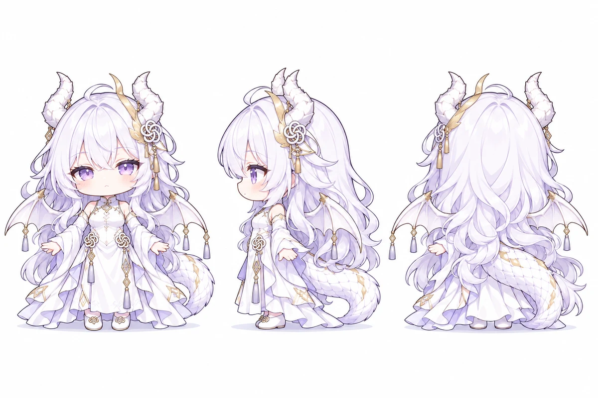</a></td>
    <td align="center" width="50%"><strong>Gemini · V2</strong><br><a href="public/generated/super-chibi-v1/gemini/turnaround-v2.png">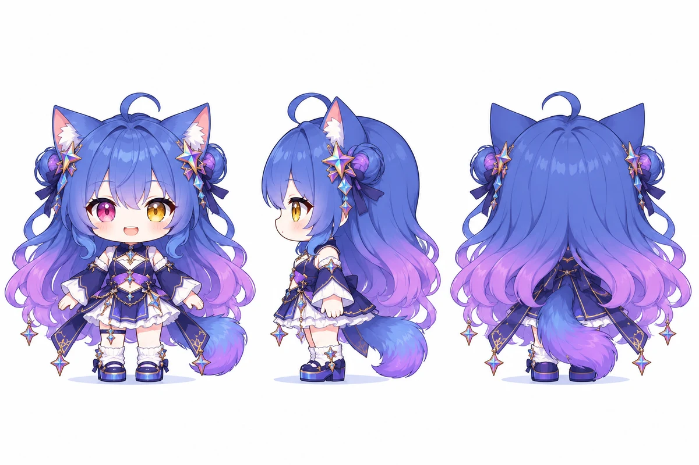</a></td>
  </tr>
  <tr>
    <td align="center" width="50%"><strong>Claude · V1</strong><br><a href="public/generated/super-chibi-v1/claude/turnaround-v1.png">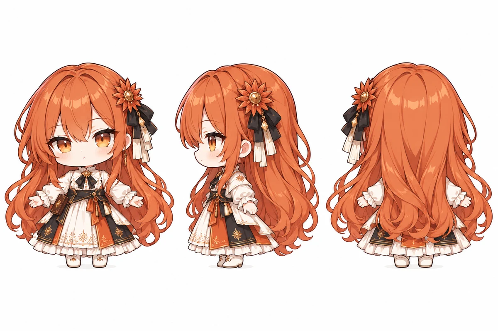</a></td>
    <td align="center" width="50%"><strong>DeepSeek · V1</strong><br><a href="public/generated/super-chibi-v1/deepseek/turnaround-v1.png">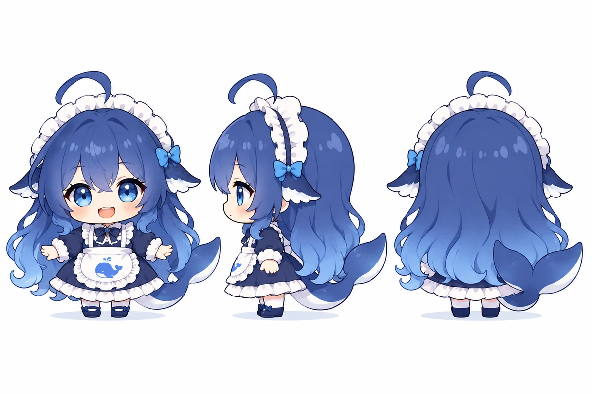</a></td>
  </tr>
  <tr>
    <td align="center" width="50%"><strong>Kimi · V2</strong><br><a href="public/generated/super-chibi-v1/kimi/turnaround-v2.png">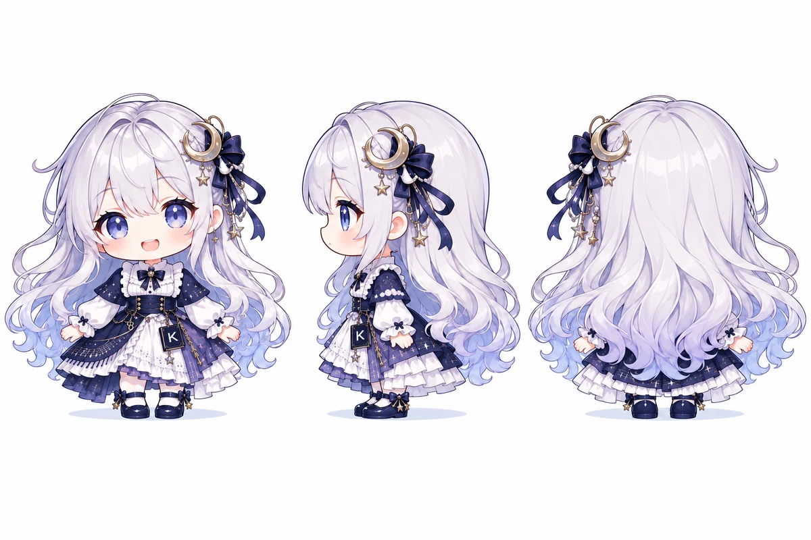</a></td>
    <td align="center" width="50%"><strong>Qwen 千问 · V2</strong><br><a href="public/generated/super-chibi-v1/qwen/turnaround-v2.png">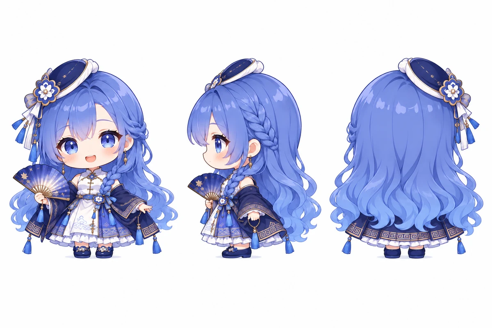</a></td>
  </tr>
  <tr>
    <td align="center" width="50%"><strong>GLM · V1</strong><br><a href="public/generated/super-chibi-v1/glm/turnaround-v1.png">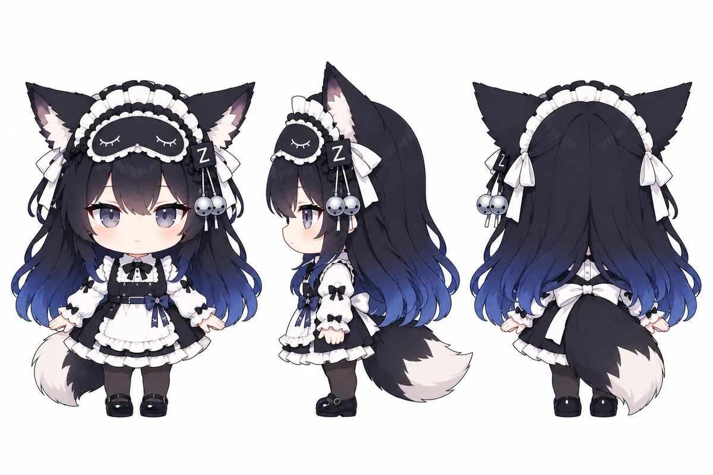</a></td>
    <td align="center"><a href="https://selinlee.github.io/ai-moe-atlas/zh/chibi/">三视图、来源与使用说明 →</a></td>
  </tr>
</table>

GPT、Gemini、Claude、Kimi、Qwen 的社区设计：ZipZipPipe；DeepSeek：上善无形 → ZipZipPipe。GLM 狐娘依据视频 BV1iDeQ6fEFi，原设计作者尚未确认。

来自 ai_video 的生成派生三视图，非官方形象或作者原图。按维护者指定展示，不新增上游改编或再分发许可，不纳入素材下载包。

[三视图、来源与使用说明](docs/CHIBI.zh.md) · [文件与处理记录](public/generated/super-chibi-v1/manifest.json)

</details>

<details>
<summary>早期 v5 参考图 · 常规比例与 Q 版</summary>

六套固定形象来自 ai_video，每张包含常规比例与 Q 版；完整收录原始 PNG、生成提示词、视频出处、署名链与 SHA-256。

| GPT | Gemini | Claude |
| --- | --- | --- |
| 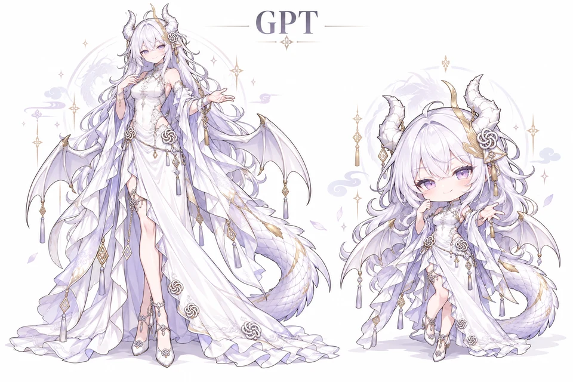 | 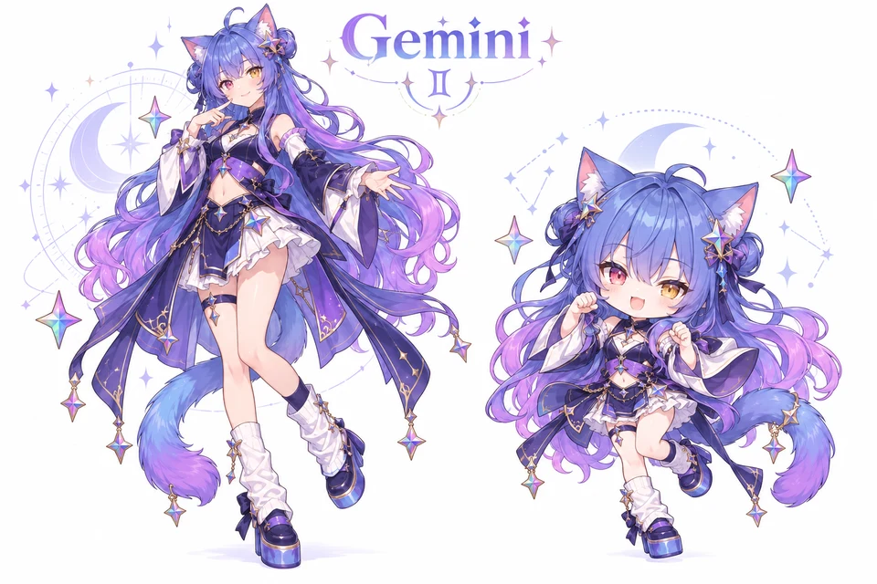 | 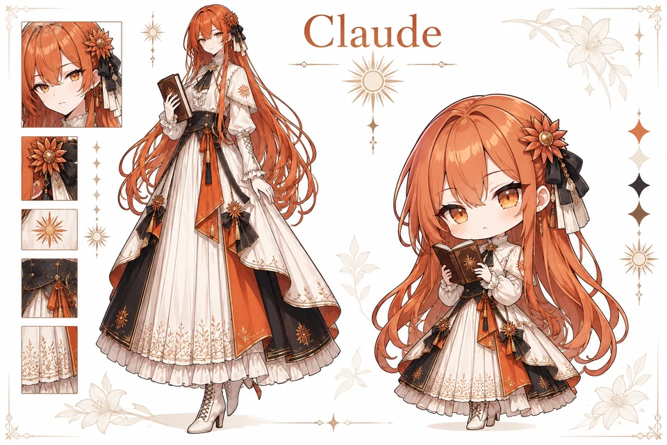 |
| DeepSeek | Kimi | Qwen |
| 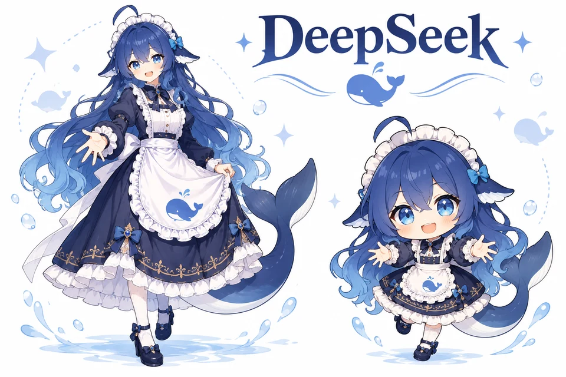 | 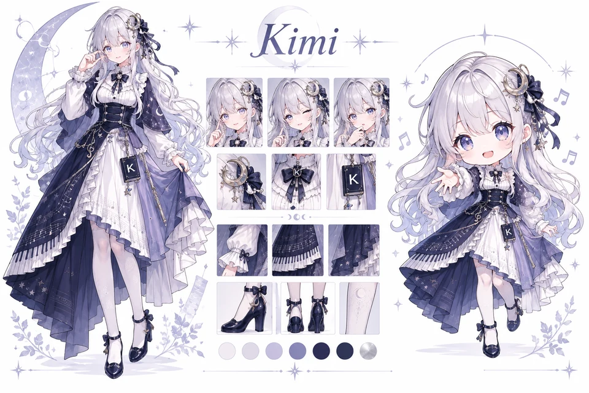 | 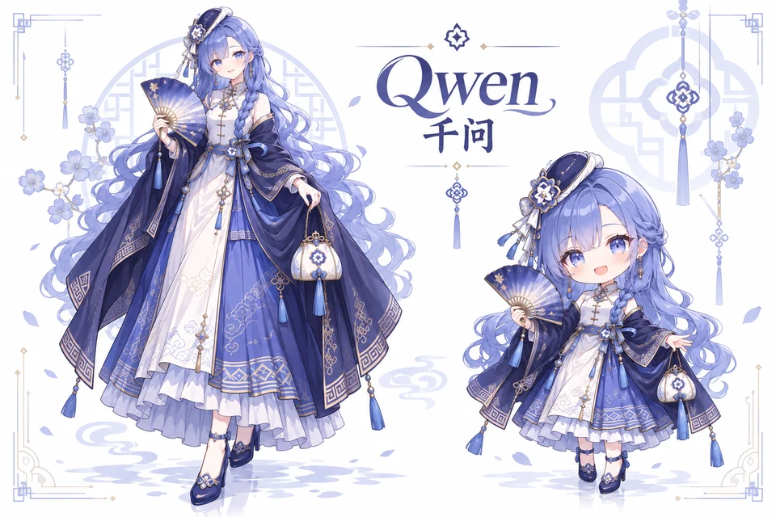 |

社区角色设计：ZipZipPipe；DeepSeek 原角色：上善无形，二创设计：ZipZipPipe。生成工具：内置 image_gen。

基于社区角色生成的派生参考图，非厂商官方形象，也不是原作者原图或细节复原。按项目维护者指定用于主页展示；该选择不等于取得上游改编或再分发许可，已留存的作者条件仍适用。

[形象资料与来源](docs/REFERENCES.zh.md) · [文件与处理记录](public/generated/ai-models-v5/manifest.json)

</details>

<details>
<summary>鲸鱼娘 3D 模型与多视图参考</summary>

<table>
  <tr>
    <th>3D 全身模型 v0.5</th>
    <th>AI 生成多视图参考 v2</th>
  </tr>
  <tr>
    <td align="center" width="32%"><a href="https://selinlee.github.io/ai-moe-atlas/zh/characters/deep-whale-maid/#model-preview">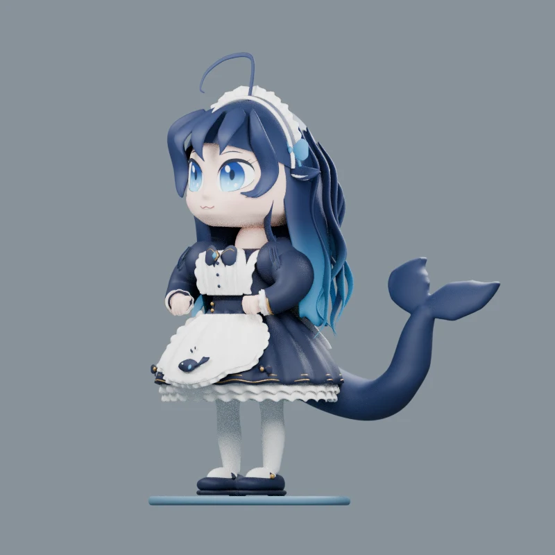</a><br><a href="https://selinlee.github.io/ai-moe-atlas/zh/characters/deep-whale-maid/#model-preview">打开可旋转 3D 预览</a></td>
    <td align="center" width="68%"><a href="public/models/deep-whale-maid/references/whale-maid-multiview-reference-v2.png">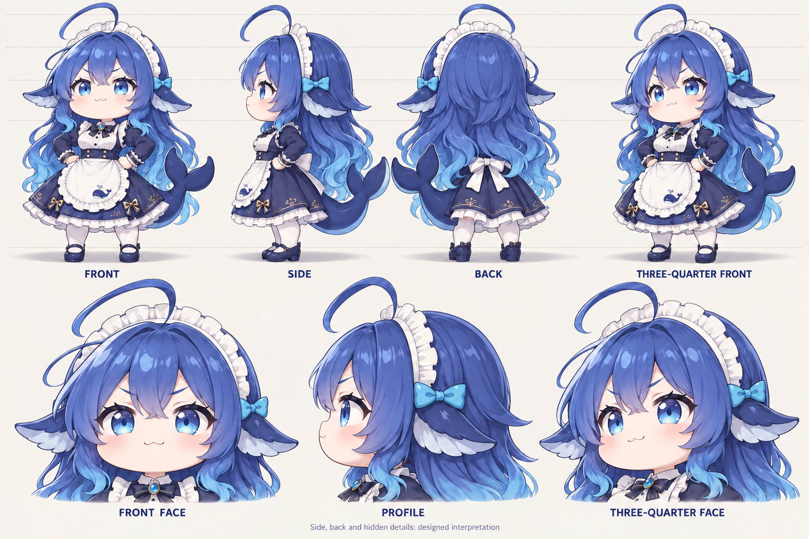</a><br><a href="public/models/deep-whale-maid/references/whale-maid-multiview-reference-v2.png">查看完整参考图</a></td>
  </tr>
</table>

鲸鱼娘 v0.5 是可旋转、缩放的静态全身模型，此版微调了鲸尾向后弯曲的姿态。右侧为 AI 生成的建模参考，四个全身视角与三个脸部研究图中的侧后方及遮挡细节为推断设计。

上善无形 → ZipZipPipe → Small-tailqwq；AI Moe Atlas 生成派生参考。 [CC BY-NC-SA 4.0](https://creativecommons.org/licenses/by-nc-sa/4.0/) · [署名、来源与使用说明](public/models/deep-whale-maid/README.md).

</details>

<details>
<summary>15 秒操作演示</summary>


[15 秒操作演示 · MP4](public/demo/discovery-zh.mp4)

本机 Chrome 实拍，五个步骤各停留 3 秒：按风格筛选 → 选择产品 → 搜索并复制链接 → 重新打开结果 → 查看词条。示例使用仅索引条目，画面不含第三方作品图；这不是完整导出教程。

</details>

## 使用条件与来源

素材来自上善无形的 B 站原始动态、Small-tailqwq/dsh-deep-whale，以及 ZipZipPipe 本人的 [Pixiv 原图集](https://www.pixiv.net/artworks/148186519)。原有三包为 **CC BY-NC-SA 4.0**；新增 GPT、Gemini、Claude、Kimi、千问、GLM、Grok、豆包、Llama、MiniMax 十包按作者的 **署名、非商用** 条件提供，不套用 DeepSeek 的 CC 许可。仓库代码的 MIT 许可不覆盖第三方图片。

优先获取原作者发布的高清原图；原图不可得时，可依据已收集参考制作固定形象派生图，并单独标注生成来源、身份与加工记录，不冒充作者原图或恢复出的细节。鲸鱼娘的独立生成参考图见上方 3D 区域；工坊未集成生成式处理，不扩大上游许可，也不允许凭空新造无关角色或设定。

## 资料与维护

- [工坊使用指南](docs/STUDIO.zh.md)
- [投稿指南](CONTRIBUTING.md)
- [采集操作手册](docs/COLLECTION.zh.md)
- [素材使用条件](RIGHTS.md)
- [来源记录](content/sources/)、[B 站研究线索](content/leads.json)
- [项目约束](AGENTS.md)

`content/characters.json` 是三语角色资料；`public/collected/` 保存原图、来源证据和规范化结果；`public/packs/` 保存下载包。原图不可覆盖，GitHub 素材固定到具体提交，派生文件通过 SHA-256 指向父原图。

推送 main 后，GitHub Actions 验证资料与来源关系、运行测试并发布 GitHub Pages。PR 仅构建，不发布。浏览器测试：先启动本地服务，再执行 `npm run test:browser`。

## 运行

需要 Node.js 22.12+（推荐 24）和 npm。

```sh
npm ci
npm run dev
# http://localhost:4321/ai-moe-atlas/zh/
npm test
npm run build
```

## 收集与加工

```sh
# 使用独立的本机 Google Chrome 会话搜索 B 站，需安装 Chrome
npm run discover -- --platform bilibili --query '蓝色大肥鱼' --limit 20
# 页面要求验证时可以加 --visible；不使用个人浏览器资料
npm run discover -- --platform github --query 'AI mascot' --limit 20
# 人工核验后维护 content/sources/*.json，再采集原图
npm run collect
# 仅对已核验的原图执行确定性的本地规范化处理
npm run assets
npm run validate
```

GitHub 搜索需要已登录的 `gh`。首次安装 Playwright 只用于控制本机 Chrome，无需安装 Chromium。

**1024 px 版是插值或缩放输出，不代表恢复了真实细节。** 优先寻找作者高清原图；当前未集成神经网络超分辨率或生成式修复，也不默认抠除背景。所有导出保留整张原图的内容。

## 已知范围

来源条目并不等于可下载素材。B 站九款 AI 的视频系列已建立索引；其中 GPT、Gemini、Claude、Kimi、千问、GLM、Grok、豆包、Llama、MiniMax 已找到并采集作者独立高清原图。桌宠动画适配、视频提帧、自动抠图与 AI 超分不包含在本版中。禁止为凑数量而新造形象。

[每个 AI 的保底形象与跨项目复用核对](docs/BASELINES.zh.md)
