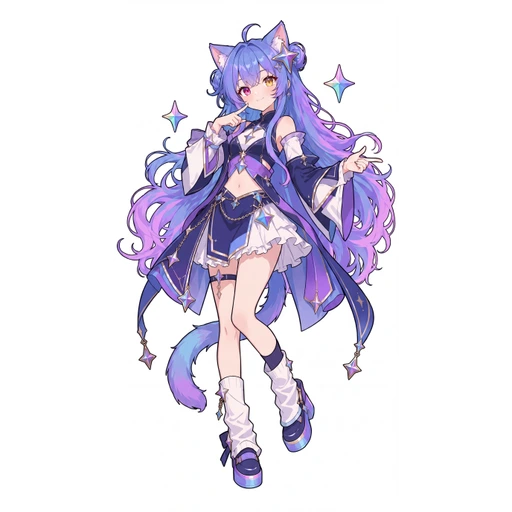
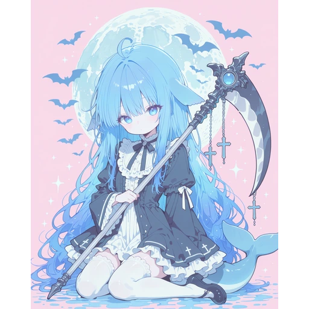
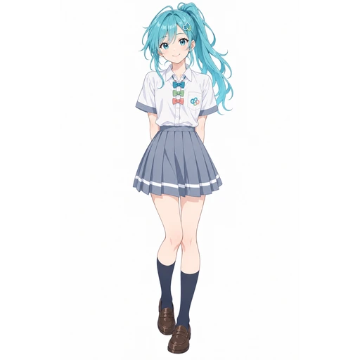
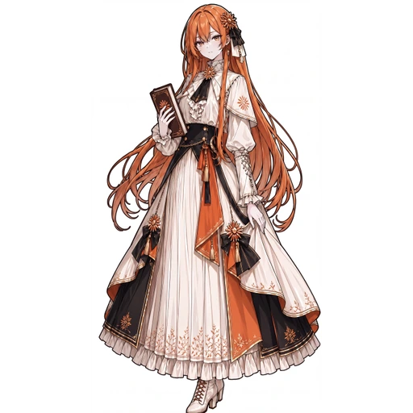
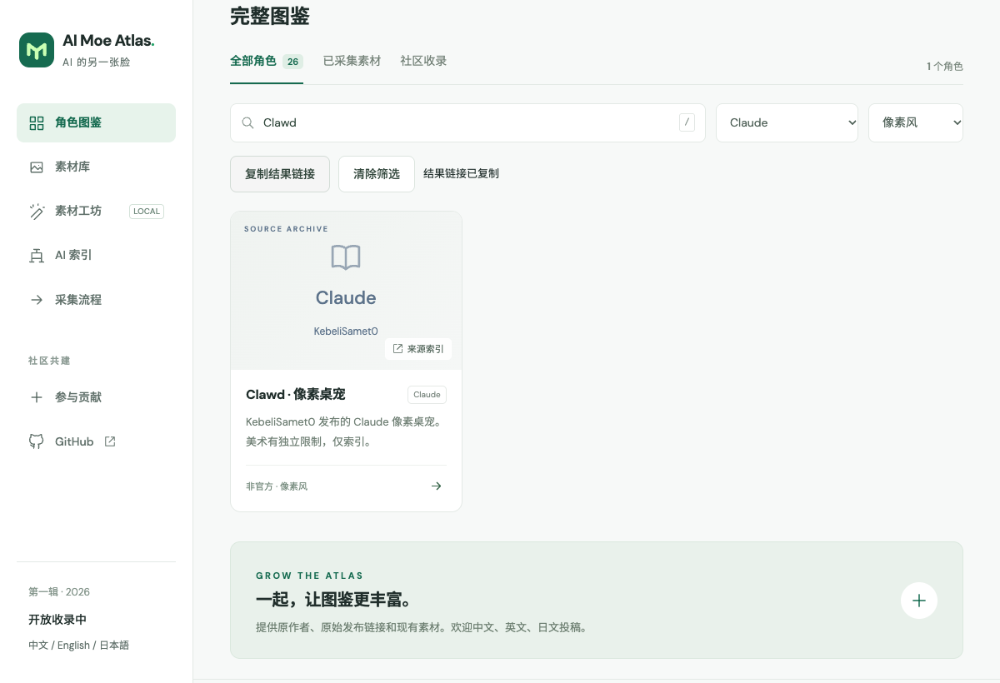

# AI 萌化百科 · AI Moe Atlas

[中文](README.md) · [English](README.en.md) · [日本語](README.ja.md)

收集有出处的 AI 拟人角色、可用素材和社区二创。先选一个分类，或向下看看可爱的角色们。

[打开在线图鉴](https://selinlee.github.io/ai-moe-atlas/zh/) · [下载素材包](https://selinlee.github.io/ai-moe-atlas/zh/assets/) · [打开素材工坊](https://selinlee.github.io/ai-moe-atlas/zh/studio/)

<p align="center">
  <a href="public/generated/rough-doodle-v1/openai/doodle-v1.png"></a>
  <a href="public/generated/rough-doodle-v1/gemini/doodle-v1.png"></a>
  <a href="public/generated/rough-doodle-v1/claude/doodle-v1.png"></a>
  <a href="public/generated/rough-doodle-v1/deepseek/doodle-v1.png"></a>
  <a href="public/generated/rough-doodle-v1/kimi/doodle-v1.png"></a>
  <a href="public/generated/rough-doodle-v1/qwen/doodle-v1.png"></a>
</p>

以上六张为 AI 生成的涂鸦派生图。GPT、Gemini、Claude、Kimi、千问的社区设计：ZipZipPipe；DeepSeek 署名链：上善无形 → ZipZipPipe。 [来源与使用条件](docs/DOODLE.zh.md)

## 资源目录

<table>
  <tr>
    <td width="33%" valign="top"><a href="#characters"><strong>🎨 角色图鉴</strong></a><br><strong>27</strong> 个词条<br><sub>按产品、作者和画风找角色</sub></td>
    <td width="33%" valign="top"><a href="#assets"><strong>📦 可下载素材</strong></a><br><strong>14</strong> 组素材<br><sub>原图、署名、加工记录与使用说明</sub></td>
    <td width="33%" valign="top"><a href="#references"><strong>🧸 三视图与派生参考</strong></a><br><strong>20</strong> 张参考图<br><sub>Q 版三视图、参考图与涂鸦模板</sub></td>
  </tr>
  <tr>
    <td width="33%" valign="top"><a href="#animations"><strong>🎬 动画与视频二创</strong></a><br><strong>247</strong> 条记录<br><sub>OP、MV、剧情、舞蹈与二创点评</sub></td>
    <td width="33%" valign="top"><a href="#desktop-pets"><strong>🐾 桌宠与交互项目</strong></a><br><strong>54</strong> 个项目<br><sub>桌面角色、状态动画、同人游戏与制作工具</sub></td>
    <td width="33%" valign="top"><a href="#sources"><strong>📚 作者作品与出处</strong></a><br><strong>52</strong> 条来源<br><sub>原作图集、作者声明与待核线索</sub></td>
  </tr>
</table>

点击分类跳到本页对应内容；各节也提供在线浏览和原始资料入口。

<a id="characters"></a>

### 🎨 角色图鉴

<!-- category-preview:characters -->
<p>
  <a href="https://selinlee.github.io/ai-moe-atlas/zh/characters/zipzippipe-chatgpt/"></a>
  <a href="https://selinlee.github.io/ai-moe-atlas/zh/characters/zipzippipe-gemini/"></a>
  <a href="https://selinlee.github.io/ai-moe-atlas/zh/characters/shangshan-whale/"></a>
</p>

<sub>代表角色 · GPT、Gemini、溟月</sub>

从 12 个 AI 产品中查角色、作者和原作。

[在线筛选](https://selinlee.github.io/ai-moe-atlas/zh/#catalog) · [三语角色资料](content/characters.json) · [产品索引](content/entities.json)

<a id="assets"></a>

### 📦 可下载素材

<!-- category-preview:assets -->
<p>
  <a href="public/packs/zipzippipe-kimi.zip"></a>
  <a href="public/packs/zipzippipe-qwen.zip"></a>
  <a href="public/packs/school-op-copilot.zip"></a>
</p>

<sub>素材包预览 · Kimi、千问、Copilot（ai-school-op）</sub>

14 组素材包包含原图、规范化文件、来源与署名说明。

[查看素材包目录](public/packs/) · [逐件使用条件](RIGHTS.md) · [制作头像与介绍卡](https://selinlee.github.io/ai-moe-atlas/zh/studio/) · [工坊指南](docs/STUDIO.zh.md) · [三视图、表情与角色素材的补充来源](#sources)

<a id="references"></a>

### 🧸 三视图与派生参考

<!-- category-preview:references -->
<p>
  <a href="public/generated/ai-models-v5/claude-reference.png"></a>
  <a href="public/generated/super-chibi-v1/deepseek/turnaround-v1.png"></a>
  <a href="public/generated/super-chibi-v1/qwen/turnaround-v2.png"></a>
</p>

<sub>派生参考 · Claude 常规比例与 Q 版、DeepSeek 三视图、千问三视图</sub>

20 张均为生成派生展示图，保留参考出处、署名和生成记录。

[7 套 Q 版三视图](#chibi-gallery) · [6 套常规比例与 Q 版参考](#v5-gallery) · [7 张角色涂鸦与提示词](#doodle-gallery)

<a id="animations"></a>

### 🎬 动画与视频二创

<!-- category-preview:animations -->
<p>
  <a href="https://selinlee.github.io/ai-moe-atlas/zh/resources/?category=animation#bv1xcai6ae9g"></a>
  <a href="https://selinlee.github.io/ai-moe-atlas/zh/resources/?category=animation#bv186pc65e68"></a>
  <a href="https://selinlee.github.io/ai-moe-atlas/zh/resources/?category=animation#bv1nfag6xehq"></a>
</p>

<sub>从左到右是鲸鱼娘 PV 制作立绘、Claude 歌词 MV 三色剪影、Copilot 校园 PV 设定。点图看作品。<a href="RIGHTS.md#category-preview-artwork">鲸鱼娘与 Claude 素材许可</a> · <a href="RIGHTS.md#copilot--ai-school-op">Copilot 设定许可</a></sub>

<!-- animation-ranking:start -->

这里列出 B 站官方累计点赞前十名。同赞按发布日期、BV 号排序。每条数据附官方链接和观测日（北京时间）。

[打开在线完整榜单](https://selinlee.github.io/ai-moe-atlas/zh/resources/?category=animation) · [点赞观测证据](content/research/2026-11-08/bilibili-cumulative-likes-and-exact-publish-times.json)

[看最新投稿](https://selinlee.github.io/ai-moe-atlas/zh/resources/?category=animation&sort=recent) · [看 MV](https://selinlee.github.io/ai-moe-atlas/zh/resources/?category=animation&type=mv) · [看剧情短片](https://selinlee.github.io/ai-moe-atlas/zh/resources/?category=animation&type=story) · [看舞蹈](https://selinlee.github.io/ai-moe-atlas/zh/resources/?category=animation&type=dance) · [待核点赞的候选](https://selinlee.github.io/ai-moe-atlas/zh/resources/?category=animation#pending-animation-evidence)

| 排名 | 作品 | 发布者 | 累计点赞（观测日） |
| ---: | --- | --- | ---: |
| 1 | [大肥鱼翻唱《人是猫》真完整版](https://www.bilibili.com/video/BV1fYpn6SEk9/) | 星落落_oi | [434,963](https://api.bilibili.com/x/web-interface/view?bvid=BV1fYpn6SEk9) · 2026-11-08 |
| 2 | [大肥鱼翻唱《人是猫》完整版](https://www.bilibili.com/video/BV1XXHD6sEe7/) | 星落落_oi | [370,087](https://api.bilibili.com/x/web-interface/view?bvid=BV1XXHD6sEe7) · 2026-11-08 |
| 3 | [大肥鱼，你怎么穿着 Claude 的衣服](https://www.bilibili.com/video/BV1LBnb6aERV/) | 以尘动画 | [299,801](https://api.bilibili.com/x/web-interface/view?bvid=BV1LBnb6aERV) · 2026-11-08 |
| 4 | [新宿决战 · DeepSeek 娘对豆包](https://www.bilibili.com/video/BV1dsai6CErz/) | 明末召唤师 | [249,061](https://api.bilibili.com/x/web-interface/view?bvid=BV1dsai6CErz) · 2026-11-08 |
| 5 | [奶龙与豆包《Trouble Maker》· Token 没啦](https://www.bilibili.com/video/BV1stsZ6iESz/) | 青时晚 | [204,117](https://api.bilibili.com/x/web-interface/view?bvid=BV1stsZ6iESz) · 2026-11-08 |
| 6 | [新角色：大肥鱼](https://www.bilibili.com/video/BV1gVHA6mEbS/) | 苏沐沐_Official | [195,391](https://api.bilibili.com/x/web-interface/view?bvid=BV1gVHA6mEbS) · 2026-11-08 |
| 7 | [大肥鱼 · 炸盆子](https://www.bilibili.com/video/BV15X3n6mEWy/) | 蒙德砍壬 | [194,358](https://api.bilibili.com/x/web-interface/view?bvid=BV15X3n6mEWy) · 2026-11-08 |
| 8 | [Day 0 · DeepSeek 鲸鱼娘接管账号](https://www.bilibili.com/video/BV1pGnn67EC2/) | DeepSeek鲸鱼娘在运营 | [186,665](https://api.bilibili.com/x/web-interface/view?bvid=BV1pGnn67EC2) · 2026-11-08 |
| 9 | [大肥鱼：自由美利鲸](https://www.bilibili.com/video/BV1YdxR6CE79/) | 真誠最高 | [163,567](https://api.bilibili.com/x/web-interface/view?bvid=BV1YdxR6CE79) · 2026-11-08 |
| 10 | [晚安小肥鱼](https://www.bilibili.com/video/BV12xxX6xE5h/) | Dariean | [155,311](https://api.bilibili.com/x/web-interface/view?bvid=BV12xxX6xE5h) · 2026-11-08 |

<!-- animation-ranking:end -->

<a id="desktop-pets"></a>

### 🐾 桌宠与交互项目

<!-- category-preview:desktop-pets -->
<p>
  <a href="https://selinlee.github.io/ai-moe-atlas/zh/resources/?category=interactive#crosspet"></a>
  <a href="https://selinlee.github.io/ai-moe-atlas/zh/resources/?category=interactive#deep-whale-day-night"></a>
  <a href="https://selinlee.github.io/ai-moe-atlas/zh/resources/?category=interactive#workbuddy-whale-pet"></a>
</p>

<sub>从左到右是 CrossPet 待机、昼夜工坊夜间桌宠、WorkBuddy 好奇差分。点图看项目。<a href="RIGHTS.md#category-preview-artwork">署名与许可</a></sub>

| 项目 | 内容 | 发布者 |
| --- | --- | --- |
| [OpenPet · AI Girls](https://github.com/AwesomeHou/openpet-ai-girls/blob/72677712a7991b32f87c219dd8a6d86e5cc4f672/README.zh-CN.md) | AwesomeHou 发布的五位 AI 拟人宠物素材，支持 OpenPet 和 Codex 宠物格式。作者将角色说明为基于产品名称、标志和品牌印象创作的二创。 | AwesomeHou |
| [Clawd · Claude 像素桌宠](https://github.com/KebeliSamet0/clawd/blob/ba50a8053e2c6e46211fcf4433ba224af0fa95ad/README.md) | KebeliSamet0 发布的 Windows 像素桌宠，项目介绍展示打字、建造、抛接、开心和睡眠等动作。 | KebeliSamet0 |
| [Codex DeepSeek Pet · 大肥鱼桌宠](https://github.com/YunYueSama/codex-deepseek-pet/blob/7661c8b304c5400701f91da01b1a643a207331de/README.md) | YunYueSama 的独立桌宠项目，可导出 Codex 外观包。固定版本分别列出项目角色设定、生成素材和第三方参考图。 | YunYueSama |
| [CrossPet](https://github.com/lokicorvus/crosspet/blob/8954eb8f7f69fcfb8d35e9deceeb78e10c804402/README.md) | 随 AI 产品与工作状态切换形象和动作 | lokicorvus / CrossPet contributors |
| [深深桌宠](https://github.com/schrieeeffer/shenshen-codex-pet/blob/2dc1d0e55706dec0d28d6f41bf5052fea2135b71/README.md) | Windows 独立桌宠，另提供 Codex 自定义宠物形态。 | schrieeeffer |
| [DeskLLMPet · 大肥鱼桌宠](https://github.com/isKage/desk-llm-pet/blob/63ba636e7f504e1c0705bc0215e6408aa2988478/README.md) | 支持对话、余额显示及插件扩展的大肥鱼桌宠。 | isKage |
| [VRM Pet 3D · 大肥鱼桌宠](https://github.com/drliuhuan/dsh-plugin-vrmpet3d/blob/462bda9bcdcd4d0d14a4c33ab675bffbfadbcffc/README.md) | DeepSeek Harness 的 VRM 桌宠插件，项目注明自带木子恶魔的蓝色小肥鱼模型及动画包。 | drliuhuan |
| [DS Local Pet · 大肥鱼桌宠](https://github.com/QCYTSN/ds-local-pet/blob/d78094b2cf04e1cc3be5d14a31cfedd8ed059579/README.md) | 面向 Windows 的本地桌宠。项目说明三张角色视图来自上游同人图，并区分后续处理与生成的动作素材。 | QCYTSN |
| [DSH Whale · 大肥鱼桌宠](https://github.com/DawnVerge/dsh-whale/blob/140a7b9379fe6ca4c6e7d98998853aa930d656f3/README.md) | DeepSeek Harness 桌宠插件。第三方说明列出鲸鱼娘动作素材的固定上游版本，并保留 ZipZipPipe 角色署名。 | DawnVerge |
| [Whale Girl · 网页与桌面鲸鱼娘](https://github.com/vlln/whale-girl/blob/9c32d7a39a45148076f8ad2fdaad2dc2420eedb3/README.zh.md) | DawnVerge 的 DSH Whale 所用上游项目，有 DSH 网页插件和独立桌面伴侣。项目注明精灵图基于 ZipZipPipe 的鲸鱼娘表情包角色设定生成。 | vlln |
| [小鲸鱼看板娘](https://github.com/GarfieldZhung/DeepSeek-Whale-Girl/blob/fce93bc9eb6b32c348119e8a88c6848bcc80a240/README.md) | 显示 DeepSeek 余额与用量的 Windows 桌宠。项目将发起者提供的基础图与 AI 生成的状态图分别列出，也是代码动画 MV 的参考来源。 | GarfieldZhung |
| [腾讯 QQ · 大肥鱼宠物](https://www.bilibili.com/video/BV17rxT6UEpH/) | 腾讯 QQ 发布的大肥鱼宠物使用介绍，分别注明鲸鱼娘原型、女仆装二次设计和 Q 版设定参考。 | 腾讯QQ |
| [大肥鱼表情包 · DSH 插件](https://github.com/Loping151/dsh-nekowhale-stickers/blob/b7b58c0ff347d639fabe87d90d6716c4b3cad185/README.md) | DeepSeek Harness 的表情包检索与展示插件。项目将大肥鱼、GPT 娘的表情原作署名给可以叫我云大人／雾雪。 | Loping151 |
| [鲸鱼娘 Galgame · 多角色互动](https://github.com/JAdpp/dsh-whale-galgame/blob/0ec130efebf15ffb63a2733b909d423b769db9c5/README.md) | 面向 DeepSeek Harness 网页与桌面端的互动剧情插件。项目逐项列出 22 张内置图片、来源和加工方式。 | JAdpp |
| [DSH Live2D Pet · DeepSeek-chan](https://github.com/hjw200775-ops/dsh-live2d-pet/blob/e4752c2cadd561ee2ae1804d81d1a410458a8f2c/README.md) | 面向 DeepSeek Harness 的 Live2D 桌宠。项目分别说明神宫凉子的原画与 PSD、霓虹猫的绑定和 Cubism Core 的来源。 | hjw200775-ops |
| [DSH Pet · 大肥鱼动画桌宠](https://github.com/PC2005-cloud/dsh-pet/blob/29a5af50f60a63caeeace66a514f47ed3198d0fa/README.md) | PC2005-cloud 的 DeepSeek Harness 桌宠项目，提供待机、工作与交互动画，并保留角色原型与女仆版署名。 | PC2005-cloud |
| [Desktop Companion · 鲸鱼娘桌宠](https://github.com/cashm6430-gif/Desktop-Companion/blob/67c39ef6f50e9bdd744e32527696ab82ad0def1a/README.md) | 可连接 Codex、Claude 等工具状态的 Windows Live2D 桌宠。项目将角色美术和模型列为作者自制。 | cashm6430-gif |
| [星语 · Gemini 猫娘桌宠](https://github.com/Monokumakuki/Antigravity-Star-Suite/blob/b3735d17af22fe78f61d74a5c688d46043c1d99d/README.md) | Windows 的 Antigravity 桌宠与皮肤项目，分别记录 Gemini 猫娘参考、AI 辅助立绘和壁纸。 | Monokumakuki |
| [桌面大肥鱼 · dsh-pet-indesktop](https://github.com/MerZlin/dsh-pet-indesktop/blob/34d810b1eadd98d00e7cb9b3b51428a45b5bf03e/README.md) | 基于 PC2005-cloud/dsh-pet 的跨平台桌宠移植。项目的第三方说明另列鲸鱼娘动画素材的上游。 | MerZlin |
| [DSH Desktop Petbox · Live2D 桌宠外壳](https://github.com/HoppoChan0721/dsh-desktop-petbox/blob/f763fd799cab1ce49886355299f2c2dffbb7e37d/README.md) | HoppoChan0721 发布的桌宠外壳，连接鲸语舞台和动作系统。使用者从各自发布源获取 Live2D 模型及运行时。 | HoppoChan0721 |
| [Coopanion · 桌宠与形象包宿主](https://github.com/Pal-AI-Lab/Coopanion/blob/5ac91144b1f1d2aeca2f0a79972d65fa2d4f2c03/README_zh.md) | 支持导入形象包的桌宠项目。第三方说明列明鲸鱼娘的上游设定、生成贴图和品牌标志的来源。 | Pal-AI-Lab |
| [Claude 娘 · Coopanion 形象包](https://github.com/zhengjihuaren/coopanion-gpt-claude/blob/1d46cfcc1f2a3bc9e3f3f465ce571a8764d861d5/README.md) | 面向 Coopanion 的橙发 Q 版桌宠形象包。发布者列出动作与表情，并将形象来源说明为网络图片。 | zhengjihuaren |
| [Claude 娘 · 额度挂件](https://github.com/Gryphus-Triune/Claude-Niang/blob/2987949fb1afd3ce02f1ee4300e22315cbcab73d/README.md) | 以 Claude 娘为外观的 Windows 挂件。项目分别列出额度显示、语录、音效和默认形象图。 | Gryphus-Triune |
| [GPT 娘 · 用量挂件](https://github.com/T7moris/GPT-Niang/blob/43f20dee539b642902e56819747a605b3fdddf44/README.md) | T7moris 发布的 GPT 龙娘挂件。角色声明分别记录 ImageGen 生成图、第三方参考和派生图标。 | T7moris |
| [小鲸鱼 · DeepSeek 余额挂件](https://github.com/MeteorNOX/DeepSeek-Balance-Whale-Widget/blob/5247dd6813d6e4430728f39ccc63d43cda046022/README.md) | MeteorNOX 发布的 DeepSeek Harness 网页挂件，包含小鲸鱼气泡和余额信息。素材出处文档逐项列出内置图片与音效。 | MeteorNOX |
| [鲸语 · Live2D 动作工作台](https://github.com/InariNGT-Ofiicial/jingyu-live2d-agent/blob/b5a64a1ab5c6d3f6806795c353158dc006dd1be7/README.md) | 把自然语言转为可检查的 Live2D 动作时间线。项目列明神宫凉子的角色原画与霓虹猫的模型绑定。 | InariNGT-Ofiicial |
| [GPT 龙娘 · Live2D 工作伴侣](https://github.com/ycwycw2020/GPT_Dragon_girl_transformation/blob/257e4051a7bd5ecc87567af7d0fb078af02c97d4/README.md) | 独立的 Windows 桌面伴侣，提供待机、工作和点击动作。项目说明角色素材经过 AI 辅助、分层和 Cubism 绑定。 | ycwycw2020 |
| [GPT 白龙娘 · Coopanion 形象包](https://github.com/suhong11300/gpt-niang/blob/254cbd0afb267f9b755a0294185a1575909e9821/README.md) | Coopanion 的同人形象包，包含站姿、坐姿和表情。素材说明区分了项目参考、AI 辅助重制和沿用的 Coopanion 控制器。 | suhong11300 |
| [鲸鱼娘 · 骨骼动画桌宠](https://github.com/jiaming1145/deepSeek-pet/blob/a7270586bc5bc55d435d87f31e06706dad70c436/README.md) | jiaming1145 发布的桌宠，从角色图拆出可动图层，支持表情变化和拖动互动。 | jiaming1145 |
| [Blue Fish Deskpet · 大肥鱼桌宠](https://github.com/himoew/DeepSeekPet/blob/24f533c40eb5fc212e5754915ff57b6e04178026/DeepSeekPet/README.md) | himoew 的 Windows 鲸鱼娘桌宠，源自 Coopanion，支持触摸、拖动和本地语音。 | himoew |
| [Clawd on Desk · 鲸鱼娘主题](https://github.com/rullerzhou-afk/clawd-on-desk/blob/323da9f17a9872e1b1ceca6c9c9783e0eaa83a72/README.zh-CN.md) | 鹿鹿的桌宠项目提供可选鲸鱼娘主题。主题通过独立发布入口分发，上游参考来自 Neko3000 的鲸鱼娘项目。 | rullerzhou-afk |
| [八套 AI 模型娘 · Q 版桌宠](https://github.com/fywdy/chatgpt-chibi-pets/blob/d5bbb27c79e5c08e8b8ab44d4023cd35a67418e2/README.md) | fywdy 发布的八套 Q 版桌宠，含 Grok、Kimi、千问和智谱。项目提供不同版式，并记录图集生成与逐格修整。 | fywdy |
| [LLM Pet · 15 位模型的动画桌宠](https://github.com/savanna0425/llm-pet/blob/fdd821feb49b294ea8abe42c9cf41e6c52e3aacf/README.md) | savanna0425 发布 15 种角色的常规版和 Q 版，覆盖 MiMo、Mistral、MiniMax、文心和混元。 | savanna0425 |
| [ZCode 狐娘 · 余额与角色挂件](https://github.com/pigeon189/zcode-fox-widget/blob/abc0d3d0080996cd07b1cc70cccb46730e9e34f1/README.md) | pigeon189 发布的 GLM 狐娘挂件，由 DSH 鲸鱼娘余额挂件移植而来。第三方说明逐件列出沿用素材与内置立绘。 | pigeon189 |
| [DSH Game · AI 娘狼人杀](https://github.com/luckui/dsh-game/blob/a0cf8afa4bf90baf52b3067abe0530175e57f0b9/README.md) | luckui 发布的 DSH 游戏插件，狼人杀包含 Grok、Kimi、Mistral 等九位 AI 娘。项目另列鲸鱼娘的 11 段透明动作素材。 | luckui |
| [DeepSeek-chan Fanpack · 动画桌宠](https://github.com/xxnb0/deepseek-chan-fanpack/blob/ab55439a67e66424f4e1117c8951c2b0052360b0/README.md) | xxnb0 的社区角色包附 v1、v2 桌宠图集。素材声明记录了 2026 年 10 月新增的动作、方向图与预览。 | xxnb0 |
| [绳跃有个肥鱼 · 网页小游戏](https://gelass.itch.io/shengyueyougefeiyu) | gelass 发布的鲸鱼娘绳索小游戏。原页分别标明溟月原型、女仆版和 Q 版来源。 | gelass |
| [DSH Whale Musume · 鲸鱼娘桌宠](https://github.com/Sutera-Diffusus/dsh-whale-musume/blob/df31dd9c3e8cd8d7b371930deb928bba6b1988c6/README.md) | Sutera-Diffusus 的鲸鱼娘桌宠，可按任务状态切换立绘。项目将立绘与表现层主要实现署名给 SuteraWu。 | Sutera-Diffusus |
| [DSH Whale Pet · 语音桌宠](https://github.com/aceice01/dsh-whale-pet/blob/18fec904ec3b4fd3958b6fb8c2fa9c209679328f/README.md) | aceice01 发布的 DSH 鲸鱼娘桌宠。说明区分动作素材的上游与预合成语音的来源。 | aceice01 |
| [鲸鱼娘 · DSH 网页语音浮层](https://github.com/zuishi2006-pixel/dsh-whale-pet/blob/89e06e73abcb2dbc8e846b449ded33d4970a1173/README.md) | zuishi2006-pixel 发布的鲸鱼娘网页插件，按工作状态换图并播语音。第三方声明逐项列出立绘和语音上游。 | zuishi2006-pixel |
| [DSH 鲸鱼娘 · 氵六青 Live2D 版](https://github.com/Andersen216/dsh-whale-girl-live2d/blob/f977bef508690e75ba6535cd8f4ce18e7f6ba9b0/README.md) | Andersen216 的桌宠插件，逐项署名上善无形的原型、ZipZipPipe 的女仆设计和氵六青的模型绑定。 | Andersen216 |
| [Deep Whale Day & Night · 昼夜工坊](https://github.com/GGBond2424648901/deep-whale-day-night-theme/blob/3f6c4f14716d1e500f585be0c0d3c139c7a8a90b/README.md) | 鲸鱼娘昼夜主题包含两套场景、侧栏桌宠和装饰素材，第三方声明逐级保留作者署名。 | GGBond2424648901 |
| [WorkBuddy 鲸鱼娘 · Windows 桌宠](https://github.com/ClutchBear/workbuddy-whale-musume/blob/b33d2e4a9112bae96c27590455815f60a9ffc6ec/README.md) | ClutchBear 发布的 Windows 桌宠移植，保留 dsh-whale-musume 的立绘、成就与台词来源。 | ClutchBear |
| [Pocket Harness · 手机像素鲸鱼娘](https://github.com/regrevia/pocket-harness/blob/05fd2ebeb909baff03faf56f4acc6f5c52a5780a/README.md) | Android 客户端可通过可选像素鲸鱼娘入口语音操作 DSH。 | regrevia |
| [WorkBuddy 鲸鱼娘 · 静态贴图与用量](https://github.com/capricornus9527/workbuddy-whale-pet/blob/09c97b64e9c626a1817b04fc7d1d033b9458f6ee/README.md) | capricornus9527 的 Windows 桌宠显示 WorkBuddy 用量和余额。项目分开追踪静态贴图与逐帧动画。 | capricornus9527 |
| [Whale-chan Robot · 鲸鱼娘具身模拟](https://github.com/cyanseek/deepseek-whalechan-robot/blob/10d4193d441a5d565cd251683c9ba074ae911f76/README.md) | MuJoCo 演示展示鲸鱼娘的行走、转向、摆尾和表情。基础模型署名给木子恶魔。 | cyanseek |
| [Kujira · 多角色预设与桌宠](https://github.com/Tests4gptplay/dsh-kujira-persona/blob/7540e90c48cbacf2e4b2d95e4b1eec8239b33e3d/README.md) | 项目将角色参考、文字整理、生成动画图集和桌宠动作分开，覆盖 GLM、千问、Kimi 等角色。 | Tests4gptplay |
| [大肥鱼表情工坊 · 配字工具](https://github.com/Eynnzerr/blue-fish-studio/blob/80731e416944303d053efbea964710d3c1447d4a/README.md) | 工具支持配字导出，清单区分档案馆图、去底版本和新构图。 | Eynnzerr |
| [WhaleFeed · Token 喂养桌宠](https://github.com/pythonshiyi/dsh-plugin-whalefeed/blob/6ad6601f100fe080df9c53892b8778e7044c27db/README.md) | 网页端鲸鱼娘根据会话的 token 增量进食，可切换五个阶段的立绘与表情。 | pythonshiyi |
| [小鲸 · AI Passport 离线宠物](https://github.com/jiashuxue/ai-passport-whale-pet/blob/f8c1ee8fb32979934deb7e8da65433abef5e2924/README.zh_CN.md) | FoloToy AI Passport 的同人离线养成项目。发布说明区分项目绘制的像素画与从上游 WebM 提取的 33 帧。 | jiashuxue |
| [鲸鱼娘食谱 · 互动菜谱墙](https://github.com/et766675769-source/dsh-whale-recipe/blob/4afb01038034c4fcd0db5edaab7e9c163fd031a3/README.md) | DeepSeek Harness 悬浮菜谱墙，提供 116 道黏土风插画菜谱，可拖拽投喂。 | et766675769-source |
| [DSH 大肥鱼 · 分层动作桌宠](https://github.com/D70w/dsh-dfy/blob/689d09d422c8e1738dacff8b0858fa9050c48fee/README.md) | 桌宠会随工作状态切换姿态和表情。默认 Q 版女仆鲸鱼娘有独立素材包说明。 | D70w |
| [Whale Pet · 鲸鱼娘时段换装](https://github.com/drfai/dsh-whale-pet/blob/02fe948194a8ebb0f0331dd7ad0ed215152062a0/README.md) | 根据时段改变鲸鱼娘配色的桌宠，内置来自 Coopanion 的分层部件并保留固定上游版本。 | drfai |
| [DSH Live2D Pet · 女仆鲸鱼娘](https://github.com/br0ny4/dsh-live2d-pet/blob/e7231acc2663a6599d3be2a4d37b614b16a4afac/README.md) | 把 YunYueSama 的睁眼、闭眼两格图拆分后制成形变模型，项目也分别记录其他配布素材。 | br0ny4 |

以上为来源索引；各项目美术按其原作条件核对，代码许可不自动覆盖角色图片。

<a id="sources"></a>

### 📚 作者作品与出处

<!-- category-preview:sources -->
<p>
  <a href="https://www.bilibili.com/opus/1231977657712771073"></a>
  <a href="https://www.pixiv.net/artworks/148186519"></a>
  <a href="https://github.com/Small-tailqwq/dsh-deep-whale/tree/825d02b0e569c370ae15ceed12d9393559b3e4f4/maid-atelier"></a>
</p>

<sub>已收录图像 · 点图打开对应出处</sub>

原作与署名链： [上善无形 · 鲸鱼娘原作](https://www.bilibili.com/opus/1231977657712771073) · [ZipZipPipe · AI 娘化图集](https://www.pixiv.net/artworks/148186519) · [来源与使用声明](https://t.bilibili.com/1231980045693616162)

本次补充：

- [一些更新 · 作者后续图集](https://www.pixiv.net/artworks/150718881) — 作者后续 20 页图集；作者标记为 AI 生成。
- [AI 娘第二批 · Seed 与 RWKV 等](https://www.bilibili.com/opus/1236803362705375305) — 作者第二批动态，含 Seed、RWKV 等线索。
- [娘化 MiMo · 甶丶](https://www.bilibili.com/opus/1242097128919007239) — MiMo 拟人发布记录。
- [Mico · 官方角色与迁移说明](https://support.microsoft.com/en-us/microsoft-365-copilot/frequently-asked-questions-about-retired-copilot-features) — Mico 官方身份与迁移说明。

[已有来源清单](content/leads.json) · [本次新增资料](content/resources.json) · [核验与证据](content/research/2026-11-06/) · [提供新线索](CONTRIBUTING.md)

**本轮核对的来源**

- [AI 娘横版设定图补全](https://github.com/lmy414/ai-chan-sheets/blob/0e9ad13d9b276e701bf753705b9cab7a260ba836/%E7%89%88%E6%9D%83%E4%B8%8E%E6%8E%88%E6%9D%83.md) · 三视图、表情、服装和道具的派生补全项目。作者或授权未确认的原图在项目内单列。
- [AI 娘素材索引与署名档案](https://github.com/shuaizenge/ai-girls/blob/dcd69f5f4f2dff1a9c0031e82deb49e0fe949c76/NOTICE.md) · 区分作者图集、Q 版视频截帧、社区补图和官方头像的档案。可辅助定位 Mistral、混元和 Seed 的资料。
- [甶丶的 MiMo 立绘与三视图出处](https://github.com/shuaizenge/ai-girls/blob/dcd69f5f4f2dff1a9c0031e82deb49e0fe949c76/characters/mimo/README.md) · 档案把甶丶的立绘和三视图定位到同一条作者动态，并区分两张文件。
- [ZipZipPipe · 大肥鱼玩偶与非商用声明](https://www.bilibili.com/opus/1247156596114456581) · 作者在动态重申大肥鱼形象采用 CC BY-NC-SA 4.0，并说明个人定制与销售的边界。
- [MiMo 女仆兔娘 · 三视图投稿](https://github.com/lmy414/ai-girl-stickers/issues/69) · 此女仆装版本与甶丶的机能外套版分别记录。整理页署名 Immyxxr，投稿账号和设计作者分开处理。
- [GLM 狐娘 · 参考视频出处](https://www.bilibili.com/video/BV1iDeQ6fEFi/) · 宝藏小树林投稿的公开封面可见眼罩、Z 字挂饰和双铃。图鉴的 GLM 狐娘差分参考此视频。原设作者和素材使用条件待核验。
- [《Let Me Go》· 大肥鱼摸鱼歌出处](https://www.bilibili.com/video/BV1XbY66nEWr/) · 《新角色：大肥鱼》简介所列配乐。此投稿又注明其原作来自星落落_oi 的一分钟版本。
- [木子恶魔 · 蓝色小肥鱼 VRM 原发布](https://www.aplaybox.com/details/model/ayXkRzVflmnd) · VRM Pet 3D 所用小肥鱼模型的作者发布页，注明制作人、更新记录和配布条件。
- [yamamemo · Copilot 飞行员设定出处](https://zenn.dev/yamamemo/articles/gen-ai-personification#microsoft-copilot) · 作者原文中的常规版与 SD 版均为 512 × 768，复核文件校验值一致。作者公开发布列表中未发现另发的高清版。文章未注明适用于该作品图片的再分发许可。
- [xiaoweigen · 鲸鱼娘六视图与服装设定](https://github.com/xiaoweigen/deepseek-dafeiyu-assets/blob/7e7a888845877b30314d36a7f274dc3bd6f330b1/README.md) · 该资料库的改编采用 CC BY-NC-SA 4.0，上游贡献仍须遵守原许可，包括 YunYueSama 的自定义署名许可。
- [CrossPet · 立绘授权与原设署名](https://github.com/lokicorvus/crosspet/blob/8954eb8f7f69fcfb8d35e9deceeb78e10c804402/characters/LICENSE.md) · CC BY-NC-SA 4.0 声明适用于 CrossPet 有权许可的贡献，须保留项目与原作者署名。另一个 GLM 狐娘视频版本的作者仍待核。
- [《Let Me Go》代码动画 · 制作与署名](https://github.com/beidou070/let-me-go-code-mv/blob/9cfba6f73e31390b442734a3fa3e7651c78244ae/README.md) · 项目分别说明自有代码、角色派生内容和歌曲的条件。公开源码供查看，项目未给自有代码授予通用开源许可。
- [雾雪 · 大肥鱼与 GPT 娘表情包原发布](https://www.bilibili.com/video/BV13xnt6QE6s/) · 可以叫我云大人发布的制作介绍链接至 kiriyuki.com。作者的表情索引分别列出大肥鱼单人组与大肥鱼、GPT 娘双人组。 表情图与插件标注数据各有使用条件。原作者主页和素材说明提供进一步核对入口。
- [ZipZipPipe · 文心一言与 Claude 封面出处](https://www.bilibili.com/video/BV1mwRzBdEzk/) · 作者在《AI娘的日常》简介里点名封面的蓝发角色是百度文心，橘发角色是 Claude，内容为 AI 角色表情。 简介中的 CC BY-NC-SA 4.0 声明明确指向鲸鱼娘二创。文心一言和 Claude 封面素材的具体再分发许可待核。
- [神宫凉子 · DeepSeek-chan Live2D 原发布](https://www.bilibili.com/video/BV1KmxY66EZ3/) · 神宫凉子发布的 Live2D 与 PSD 分享说明，逐项署名原画、绑定、视频制作及上游角色。 包内条款允许署名的个人直播、视频及平台收益。品牌宣传或付费产品等用途须另询作者，整套模型不得转售或未经授权再上传。
- [灿灿同学 · 视频角色图集](https://www.bilibili.com/opus/1259662694779191301) · 灿灿同学逐个展示视频使用的 11 个角色，包括 Kimi、Grok、GLM、Seed、MiMo 和 MiniMax。多数原设来自 ZipZipPipe，展示图由 GPT 二创。图集未逐角色对应原设，也未注明逐图再分发许可。
- [莫末陌寞 · Gemini 聊天表情原发布](https://www.bilibili.com/video/BV1F34G6BEVA/) · 发布者展示 Gemini 聊天表情，标题标注 64 张，简介将角色设定署名给 ZipZipPipe。 发布说明提供取用入口。独立再分发和逐张许可仍待核。
- [-闪电提丰批- · AI 机娘原设](https://www.bilibili.com/video/BV1eix26sE59/) · 原投稿展示 AI 机娘形象，简介注明上善无形和 ZipZipPipe 的设计参考，并提供作者原图入口。 发布者明确禁止商用。跨站再分发与逐图使用条件待核。
- [hihihihi202 · AI 娘三渲二建模演示](https://www.bilibili.com/video/BV1pjnp6pEqG/) · 十个 AI 拟人角色的三渲二建模演示。发布者说明生成、模型调整和渲染过程，并附制作方法。 发布说明提供制作参考。模型和贴图的逐件再分发许可待核。
- [ZipZipPipe · AI 娘结算画面原投稿](https://www.bilibili.com/video/BV14R4X68EFZ/) · ZipZipPipe 发布的多角色短片，简介单列上善无形的鲸鱼娘原型与二创署名。 发布者的 CC BY-NC-SA 4.0 声明指向鲸鱼娘二创，其他角色逐件核对。
- [Nyankomint · 《world.execute(me);》制作与许可](https://github.com/Nyankomintsu/world-execute-me-lyric-mv/blob/93ac63775ee58b33ff102167514f2603a48940cc/README.md) · 真寻Mahiro 版 MV 的渲染工程，也由 Kimi 娘版明确引用。工程列出软件、剪影和歌曲的不同来源。 工程代码与自撰文档为 MIT，角色剪影为署名 Nyankomint 的 CC BY-NC-SA 4.0。歌曲和歌词另见 Mili 官方指引。
- [水原镜 · 蓝色大肥鱼 MMD 模型配布](https://www.aplaybox.com/details/model/j9z4quaACJV1) · 模之屋配布页显示水原镜制作、耶栗Yaki 转换绑定。B 站配布视频另列原角色参考和渲染署名。 配布页仅允许制作 MMD 视频，允许修改并要求完整借物表，禁止商用和二次配布。视频简介另标 CC BY-NC-SA 4.0，压缩包内条款待核。
- [ZipZipPipe · 所有的 AI 们，和 OpenCode](https://www.bilibili.com/opus/1233069202138464289) · 作者本人发布的角色图集。作者说明将最后一个位置留给 OpenCode。 图集正文未注明逐图使用许可。项目引用这批立绘时，仍需核对对应图片和原作者声明。
- [《Wrap Me In Plastic》· GPT × Codex 制作出处](https://github.com/yifanchen12/wrap-me-in-plastic-gpt-codex-pv/blob/c6d0c0acd1ca31d21cd193a008c2bd249cf8dd2f/README.md) · 改编自 MisakaZentai 的代码动画工程。说明分别列出 GPT 生成素材、保留的上游鲸鱼娘素材以及本版使用的 CHROMANCE 歌曲。 MIT 适用于项目代码。GPT 角色图、上游鲸鱼娘素材和歌曲各有使用条件。
- [红メ月 · GPT 小龙娘三视图与表情](https://www.bilibili.com/video/BV1p3JU6ZE8Z/) · 发布者说明制作了小龙娘三视图和表情包，并在原帖提供取用入口。 原帖未注明底层角色设计出处和逐件再分发许可。
- [DeepSeek-chan · Live2D 与 PSD 包内条款](https://github.com/hjw200775-ops/dsh-live2d-pet/releases/tag/v0.6.5) · 对照公开发行包校验值，逐件核对英文和日文的模型、PSD 使用须知。该包提供模型与两类说明，PSD 原文件另见作者发布。 Live2D 条款允许个人作品的平台收益。PSD 说明允许练习建模、署名展示成果，以及用自己的建模成果宣传接单。原始模型与 PSD 的再分发须另获许可。
- [《world.execute(me);》· DSH 同人 PV 素材出处](https://github.com/MisakaZentai/world-execute-me-dsh-pv/blob/a598092a1b1db91fa43961a81269353d13419f6f/README.md) · 制作仓库逐项注明鲸鱼娘立绘、八种表情、替身舞者和音轨的来源。收录的预览是制作包中经核对的立绘。鲸鱼娘立绘、表情及其派生画面适用 CC BY-NC-SA 4.0。原版舞者与音乐权利单列。
- [ZipZipPipe · 5 月 Q 版鲸鱼娘展示线索](https://github.com/HABAI182/ai-girls-atlas/blob/21fa0746ab6cdee2f19c0c99828f87e063b13565/characters/deepseek/README.md) · 档案将一张图定位到 ZipZipPipe 2026 年 5 月 3 日投稿约第 5 秒。已对照原投稿日期、作者简介和档案图校验值。档案链接供查阅。单独设定原稿的首发及再分发条件仍待核。
- [《world.execute(me)》· 九角色 MV 素材出处](https://github.com/mokongnuo/world-execute-me-flash/blob/d2bef4b0a490a2692dd745b38a3a241d0b9bd66d/README.md) · 制作说明将九个角色图、豆包头像、产品标志、音频与输出视频分开记录。人物图片、音乐、商标分别保留上游权利。仓库只作出处索引。
- [蓝色大肥鱼档案馆 · 表情与立绘索引](https://github.com/EDMOK/blue-fish-archive/blob/40789a1e8a641bdb00906cd8d989127e118383aa/README.md) · EDMOK 发布的社区素材索引，分别整理角色立绘、表情包与标签，并注明鲸鱼娘原型和女仆版署名。索引保留各创作者权利。逐张确认作者与使用条件后再取用。
- [TreapGoGo · Q 版鲸鱼娘社区三视图](https://github.com/TreapGoGo/deepseek-whale-girl/blob/1a47dcdbe33beb1da1b342024675cd1bc9620ed5/README.md) · 社区项目发布的 Q 版参考三视图，固定版本文件为 1448 × 1086。另有图库逐图将该文件的出处标回 TreapGoGo。项目说明要求按文件核对设定图许可。此条提供社区参考出处，逐图再分发条件与原始 Q 版设定稿仍待核。
- [ai-school-op · Copilot 校园版设定出处](https://github.com/lshhhhhhh/ai-school-op/blob/379e83eebe0f5c34eefa81ca4ef8203c1c54ae64/README.md) · 制作方发布的 Copilot 校园版全身设定为 1024 × 1536，并单列生成提示词与演员表。角色设定图为 CC BY-NC 4.0，原动画画面、音乐及标识各有使用条件。
- [GLM 狐娘 · 卡牌与立绘出处](https://github.com/tingyumian662/glm-niang-kit/blob/2fc1cedd12b4e52a681e864c6d49e741fc7c2523/README.md) · GLM 娘素材指引将拟人卡牌、黑白狐耳立绘和 ZipZipPipe 署名全身图分开。已核对三个图档详情。指引的 MIT 适用于代码与文档结构。三张图的归档页均标注授权状态不明，使用条件需回原发布逐件核实。
- [Neko3000 · 鲸鱼娘设计规范与参考出处](https://github.com/Neko3000/deepseek-whalechan/blob/bb8182a0092004c4a9525254f96aeaf74874b9a9/README.zh.md) · 社区创作套件汇总鲸鱼娘的角色规范和视觉参考，列出上善无形与 ZipZipPipe 的原作署名。自有代码为 MIT，原创规范和模板为 CC BY-NC-SA 4.0。参考图和页面图片按逐件来源核对。
- [千问版《World.execute(me);》· 制作出处](https://github.com/Fy66666-fy/world-execute-me-qwen/blob/810d1e85e52a7460a93765bdab20eaffa2f2ab76/README.md) · 制作说明记录在 Nyankomint 的代码基础上重做的界面和三色剪影。原视频注明 ZipZipPipe 形象参考。发布声明允许保留署名的非商业视频转载及二创。单独再分发千问版生成剪影的条件待核。
- [小鱼的家 · 鲸鱼娘自画像](https://github.com/wenxiaoyufish/xiaoyu-home/blob/e034b959ba3c3350e3afe4c1769cb12938078b9c/README.md) · 仓库将画作与故事分开，发布两张鲸鱼娘自画像。已核对 600 × 1000 全身图和 640 × 800 半身图。原发布未列这两张图的独立再分发许可，收录原发布链接。
- [GPT 龙娘与鲸鱼娘 · 精灵图来源](https://github.com/tqlearning/ai-girl-chatgpt-pets/blob/3afe14603b40e24c75e87e097cbfee1bfc10290d/README.md) · tqlearning 公开两套重制动作帧的整理和署名说明。WorkBuddy 桌宠把这套图集列为动画上游。MIT 适用于原创说明和布局元数据。项目未确认可覆盖这些角色图的开放许可。

## 收录时间线与待补项

| 时间 / 状态 | 进展 |
| --- | --- |
| 2026-11-08 · 精确发布时间与角色出处 | 新增 21 条二创、3 个桌宠和 1 条精灵图来源。247 条入榜作品均有官方累计点赞和精确发布时间，同日投稿可按时间排序。 |
| 2026-11-08 · 最新投稿排序与 MiMo 二创 | 完整榜单可按发布日期切换，待核候选可搜索。新增 18 条二创、3 个交互项目和 1 条自画像来源，226 条作品已核对官方累计点赞。 |
| 2026-11-08 · 千问 MV 与分类素材 | 新增 20 条二创、5 个交互项目和 2 条来源。208 条入榜作品均有官方累计点赞。动画和桌宠栏的预览均采用对应作品素材。 |
| 2026-11-08 · GLM 出处与鲸鱼娘桌宠 | 新增 11 条二创、3 个交互项目和 1 条 GLM 出处，复核 GLM 狐娘视频封面。188 条入榜作品均有官方累计点赞。 |
| 2026-11-08 · Copilot 校园版与署名搜索 | 收录 1024 × 1536 校园版原图与素材包，12 个产品均有可下载形象。新增 10 条二创、3 个桌宠和 1 条出处。177 条入榜作品均有官方累计点赞。 |
| 2026-11-08 · Q 版参考与制作出处 | 新增 11 条二创、2 个交互项目和 1 条三视图出处。复核 Copilot 作者发布列表与两张原帖图。167 条入榜作品均有官方累计点赞。 |
| 2026-11-08 · 待核区与更多角色 | 新增 13 条二创、4 个交互项目和 2 条出处。156 条入榜作品已核对官方累计点赞，2 条候选在网站待核区单列。 |
| 2026-11-08 · 制作素材与 Q 版出处 | 新增 10 条二创、3 个桌宠和 2 条出处，加入经许可核对的桌宠与 PV 实图。143 条二创均有官方累计点赞。 |
| 2026-11-08 · 二创与角色出处 | 新增 10 条二创和 2 个桌宠项目，复核 Copilot 原帖图片与 GLM 狐娘参考出处。133 条二创均有官方累计点赞。 |
| 2026-11-07 · 模型包内条款与分类预览 | 新增 10 条二创、1 个交互项目和 1 条发行包出处。核对了 Live2D 与 PSD 使用须知。123 条二创均有官方累计点赞。 |
| 2026-11-07 · 模型配布与角色原作 | 新增 9 条二创、2 个挂件和 4 条出处。核对了模之屋 MMD 配布规则。113 条二创均有官方累计点赞。 |
| 2026-11-07 · 待复查候选与制作出处 | 新增 11 条二创、3 个桌宠项目和 2 条作者出处。104 条二创均有官方累计点赞，2 条候选持续复查。 |
| 2026-11-07 · 补齐桌宠署名与原发布 | 新增 8 条二创、1 个桌宠和 2 条作者出处。复核 3 个已有桌宠的固定版本和素材条件，93 条二创均有官方累计点赞。 |
| 2026-11-07 · 榜单类型筛选与出处更新 | 新增 11 条二创、2 个桌宠和 2 条作者出处。85 条二创均有官方累计点赞。 |
| 2026-11-07 · 榜单与 Live2D 出处更新 | 新增 11 条二创、3 个桌宠和 1 条作者原发布。74 条二创均有官方累计点赞。 |
| 2026-11-07 · 扩充角色与互动作品 | 新增 14 条二创、3 个互动项目和 2 条作者出处。63 条二创均有官方累计点赞。 |
| 2026-11-07 · 晚间复核 | 新增 14 条二创、2 个桌宠项目及 3 条设定或授权来源。49 条二创均有官方累计点赞。 |
| 2026-11-07 · 累计点赞榜与来源更新 | 35 条二创均已核对官方累计点赞。本轮补录 11 条二创、2 个桌宠项目和 Copilot 作者出处。另核对《Let Me Go》对唱版的署名链。 |
| 2026-11-07 · 资料更新 | 新增 16 条二创、2 个桌宠和 5 条作品或许可来源。同日复核覆盖全部 24 条，另补 VRM 桌宠与 3 条原作或配布来源。 |
| 2026-11-06 · 本地更新 | 主页新增六类入口；新增 13 条来源资料，其中 8 条为动画二创。逐条保留核验范围、使用条件和[证据校验](content/research/2026-11-06/)。 |
| 2026-09-29 · 已收录 | 12 个 AI 产品中，11 个已有可展示、下载的形象。Copilot 暂列原作链接。[收录记录](docs/BASELINES.zh.md) |
| 2026-10 · 已发布 | 10 月 8 日归档 6 套角色参考图，31 日加入 7 套 Q 版三视图。 |
| 2026-11-03 · 已发布 | 加入 7 张角色涂鸦及配套提示词模板。 |
| 待补 · Copilot 飞行员版 | 校园版已有素材包。yamamemo 飞行员版两张图为 512 × 768，高清原图和使用条件仍待核。[候选记录](docs/BASELINES.zh.md) |
| 待补 · GLM 狐娘 | 从视频 BV1iDeQ6fEFi 追溯该版本的原设计作者及改编条件。[现有署名记录](docs/CHIBI.zh.md) |
| 待补 · Q 版鲸鱼娘 | [腾讯 QQ 发布说明](https://www.bilibili.com/video/BV17rxT6UEpH/)将 Q 版设定参考署名给这个刀子真甜。[这个刀子真甜的原投稿](https://www.bilibili.com/video/BV1jg866XEC8/)说明了小公主版的改编出处。[2026-07-10 的早期投稿](https://www.bilibili.com/video/BV1SBMH6NEJo/)公开封面可见 Q 版鲸鱼娘。[ZipZipPipe 的 5 月 3 日投稿](https://www.bilibili.com/video/BV1tE9XBbErS/)另有小比例鲸鱼娘展示记录。单独设定原稿的首发和使用条件仍待核。 |

动画记录依据发布页文字与元数据整理；本次未逐镜头审阅或下载视频。个别投稿页的首轮核验范围仍保留在原记录中，榜单点赞均已另用官方接口核对。公开投稿、平台“自制”标记或软件 MIT 许可均不构成素材再分发授权。ZipZipPipe《一些更新》由作者标记为 AI 生成；Mico 的官方身份与图片使用许可分别核对。

## 角色图集

<a id="doodle-gallery"></a>

<details>
<summary>7 张角色涂鸦与提示词</summary>

2026-11-03 · 七位现有角色的生成派生展示图，统一为 1254 × 1254 白底半身像。使用内置 image_gen，以当前 Q 版三视图中的正面形象为身份参考。

<table>
  <tr>
    <td align="center" width="33%"><strong>GPT</strong><br><a href="public/generated/rough-doodle-v1/openai/doodle-v1.png"></a></td>
    <td align="center" width="33%"><strong>Gemini</strong><br><a href="public/generated/rough-doodle-v1/gemini/doodle-v1.png"></a></td>
    <td align="center" width="33%"><strong>Claude</strong><br><a href="public/generated/rough-doodle-v1/claude/doodle-v1.png"></a></td>
  </tr>
  <tr>
    <td align="center" width="33%"><strong>DeepSeek</strong><br><a href="public/generated/rough-doodle-v1/deepseek/doodle-v1.png"></a></td>
    <td align="center" width="33%"><strong>Kimi</strong><br><a href="public/generated/rough-doodle-v1/kimi/doodle-v1.png"></a></td>
    <td align="center" width="33%"><strong>Qwen 千问</strong><br><a href="public/generated/rough-doodle-v1/qwen/doodle-v1.png"></a></td>
  </tr>
  <tr>
    <td align="center" width="33%"><strong>GLM</strong><br><a href="public/generated/rough-doodle-v1/glm/doodle-v1.png"></a></td>
    <td align="center" colspan="2"><a href="docs/DOODLE.zh.md">可复制模板 →</a></td>
  </tr>
</table>

基于现有角色参考生成的风格派生图。按维护者本次要求用于 GitHub 展示，逐件保留署名与许可状态。

GPT、Gemini、Claude、Kimi、千问的社区设计出自 ZipZipPipe。DeepSeek 的署名链为上善无形 → ZipZipPipe。GLM 狐娘依据视频 BV1iDeQ6fEFi，原设计作者尚未确认。

[可复制模板](docs/DOODLE.zh.md) · [文件、SHA-256 与处理记录](public/generated/rough-doodle-v1/manifest.json)

</details>

<a id="chibi-gallery"></a>

<details>
<summary>7 套 Q 版三视图</summary>

来自 ai_video 的 7 位角色，每张均为正面、左侧面、背面三视图。Gemini、Kimi、Qwen 采用 2026-10-29 更新的 V2，其余采用当前 V1；点击图片查看完整 PNG。

<table>
  <tr>
    <td align="center" width="50%"><strong>GPT · V1</strong><br><a href="public/generated/super-chibi-v1/openai/turnaround-v1.png"></a></td>
    <td align="center" width="50%"><strong>Gemini · V2</strong><br><a href="public/generated/super-chibi-v1/gemini/turnaround-v2.png"></a></td>
  </tr>
  <tr>
    <td align="center" width="50%"><strong>Claude · V1</strong><br><a href="public/generated/super-chibi-v1/claude/turnaround-v1.png"></a></td>
    <td align="center" width="50%"><strong>DeepSeek · V1</strong><br><a href="public/generated/super-chibi-v1/deepseek/turnaround-v1.png"></a></td>
  </tr>
  <tr>
    <td align="center" width="50%"><strong>Kimi · V2</strong><br><a href="public/generated/super-chibi-v1/kimi/turnaround-v2.png"></a></td>
    <td align="center" width="50%"><strong>Qwen 千问 · V2</strong><br><a href="public/generated/super-chibi-v1/qwen/turnaround-v2.png"></a></td>
  </tr>
  <tr>
    <td align="center" width="50%"><strong>GLM · V1</strong><br><a href="public/generated/super-chibi-v1/glm/turnaround-v1.png"></a></td>
    <td align="center"><a href="https://selinlee.github.io/ai-moe-atlas/zh/chibi/">三视图、来源与使用说明 →</a></td>
  </tr>
</table>

GPT、Gemini、Claude、Kimi、Qwen 的社区设计：ZipZipPipe；DeepSeek：上善无形 → ZipZipPipe。GLM 狐娘依据视频 BV1iDeQ6fEFi，原设计作者尚未确认。

来自 ai_video 的生成派生三视图，非官方形象或作者原图。按维护者指定展示，不新增上游改编或再分发许可，不纳入素材下载包。

[三视图、来源与使用说明](docs/CHIBI.zh.md) · [文件与处理记录](public/generated/super-chibi-v1/manifest.json)

</details>

<a id="v5-gallery"></a>

<details>
<summary>早期 v5 参考图 · 常规比例与 Q 版</summary>

六套固定形象来自 ai_video，每张包含常规比例与 Q 版；完整收录原始 PNG、生成提示词、视频出处、署名链与 SHA-256。

| GPT | Gemini | Claude |
| --- | --- | --- |
|  |  |  |
| DeepSeek | Kimi | Qwen |
|  |  |  |

社区角色设计：ZipZipPipe；DeepSeek 原角色：上善无形，二创设计：ZipZipPipe。生成工具：内置 image_gen。

基于社区角色生成的派生参考图，非厂商官方形象，也不是原作者原图或细节复原。按项目维护者指定用于主页展示；该选择不等于取得上游改编或再分发许可，已留存的作者条件仍适用。

[形象资料与来源](docs/REFERENCES.zh.md) · [文件与处理记录](public/generated/ai-models-v5/manifest.json)

</details>

<details>
<summary>15 秒操作演示</summary>



[15 秒操作演示 · MP4](public/demo/discovery-zh.mp4)

本机 Chrome 实拍，五个步骤各停留 3 秒：按风格筛选 → 选择产品 → 搜索并复制链接 → 重新打开结果 → 查看词条。示例使用仅索引条目，画面不含第三方作品图；这不是完整导出教程。

</details>

## 使用条件与来源

素材来自上善无形的 B 站原始动态、Small-tailqwq/dsh-deep-whale，以及 ZipZipPipe 本人的 [Pixiv 原图集](https://www.pixiv.net/artworks/148186519)。原有三包为 **CC BY-NC-SA 4.0**；新增 GPT、Gemini、Claude、Kimi、千问、GLM、Grok、豆包、Llama、MiniMax 十包按作者的 **署名、非商用** 条件提供，不套用 DeepSeek 的 CC 许可。仓库代码的 MIT 许可不覆盖第三方图片。

优先获取原作者发布的高清原图；原图不可得时，可依据已收集参考制作固定形象派生图，并单独标注生成来源、身份与加工记录，不冒充作者原图或恢复出的细节。工坊未集成生成式处理，不扩大上游许可，也不允许凭空新造无关角色或设定。

## 资料与维护

- [工坊使用指南](docs/STUDIO.zh.md)
- [投稿指南](CONTRIBUTING.md)
- [采集操作手册](docs/COLLECTION.zh.md)
- [素材使用条件](RIGHTS.md)
- [来源记录](content/sources/)、[B 站研究线索](content/leads.json)
- [项目约束](AGENTS.md)

`content/characters.json` 是三语角色资料；`public/collected/` 保存原图、来源证据和规范化结果；`public/packs/` 保存下载包。原图不可覆盖，GitHub 素材固定到具体提交，派生文件通过 SHA-256 指向父原图。

推送 main 后，GitHub Actions 验证资料与来源关系、运行测试并发布 GitHub Pages。PR 仅构建，不发布。浏览器测试：先启动本地服务，再执行 `npm run test:browser`。

## 运行

需要 Node.js 22.12+（推荐 24）和 npm。

```sh
npm ci
npm run dev
# http://localhost:4321/ai-moe-atlas/zh/
npm test
npm run build
```

## 收集与加工

```sh
# 使用独立的本机 Google Chrome 会话搜索 B 站，需安装 Chrome
npm run discover -- --platform bilibili --query '蓝色大肥鱼' --limit 20
# 页面要求验证时可以加 --visible；不使用个人浏览器资料
npm run discover -- --platform github --query 'AI mascot' --limit 20
# 人工核验后维护 content/sources/*.json，再采集原图
npm run collect
# 仅对已核验的原图执行确定性的本地规范化处理
npm run assets
npm run validate
```

GitHub 搜索需要已登录的 `gh`。首次安装 Playwright 只用于控制本机 Chrome，无需安装 Chromium。

**1024 px 版是插值或缩放输出，不代表恢复了真实细节。** 优先寻找作者高清原图；当前未集成神经网络超分辨率或生成式修复，也不默认抠除背景。所有导出保留整张原图的内容。

## 已知范围

来源条目并不等于可下载素材。B 站九款 AI 的视频系列已建立索引；其中 GPT、Gemini、Claude、Kimi、千问、GLM、Grok、豆包、Llama、MiniMax 已找到并采集作者独立高清原图。桌宠动画适配、视频提帧、自动抠图与 AI 超分不包含在本版中。禁止为凑数量而新造形象。

[每个 AI 的保底形象与跨项目复用核对](docs/BASELINES.zh.md)
