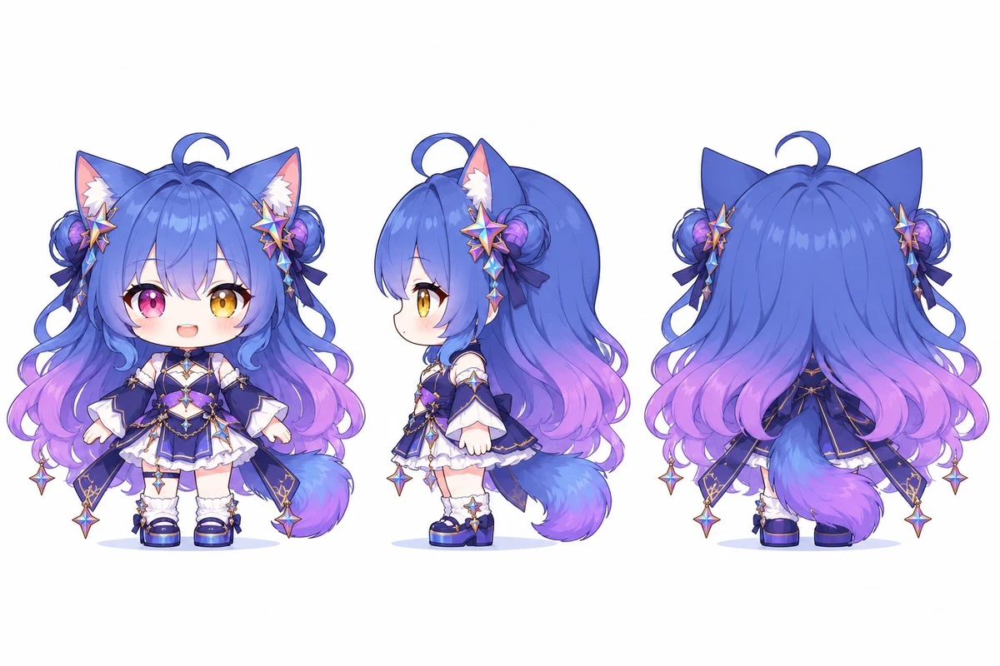
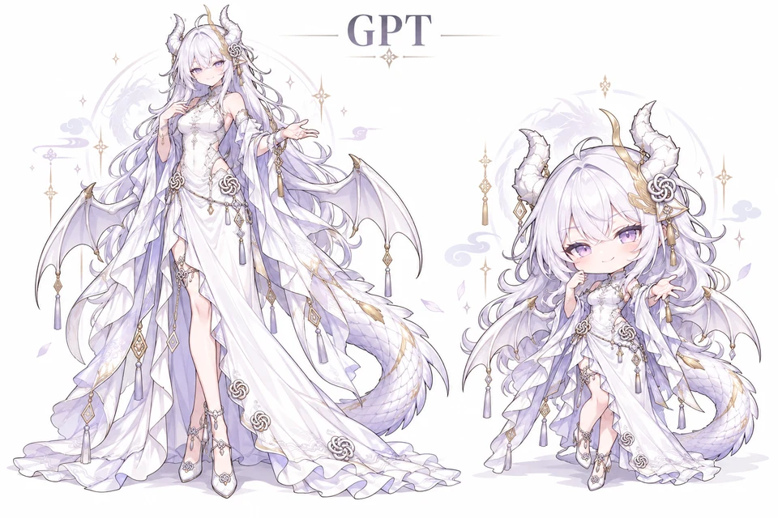
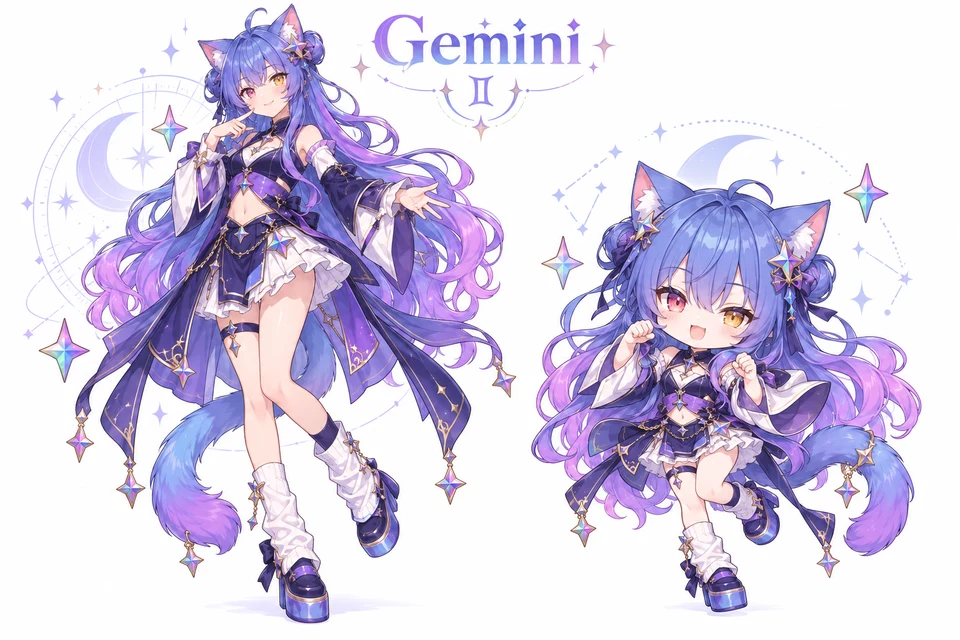
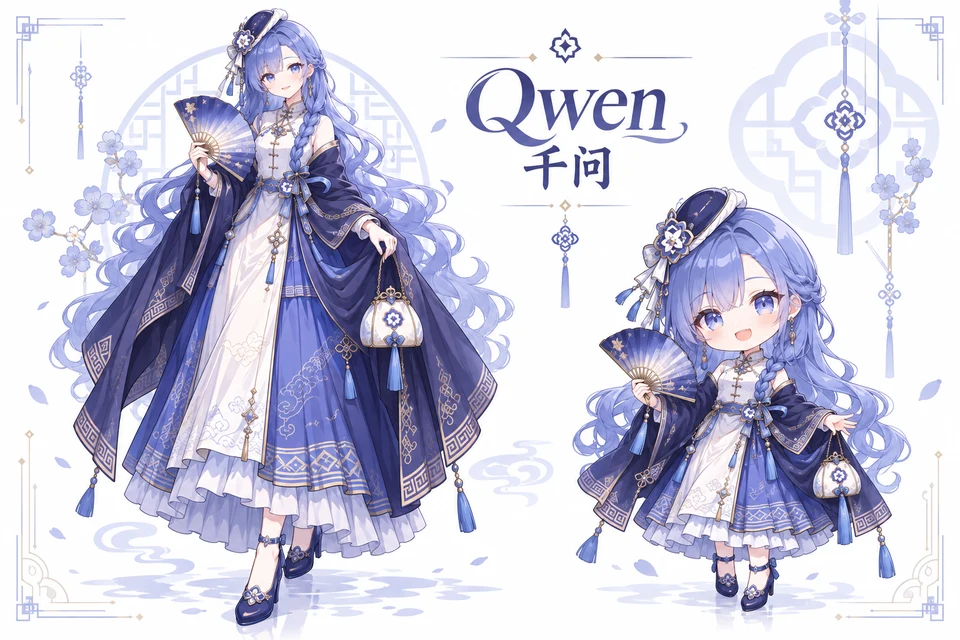

# AI 萌化百科 · AI Moe Atlas

[中文](README.md) · [English](README.en.md) · [日本語](README.ja.md)

收集有出处的 AI 拟人角色、可用素材和社区二创。先选一个分类，或向下看看可爱的角色们。

<a id="assets"></a>

[打开在线图鉴](https://selinlee.github.io/ai-moe-atlas/zh/) · [下载素材包](https://selinlee.github.io/ai-moe-atlas/zh/assets/) · [打开素材工坊](https://selinlee.github.io/ai-moe-atlas/zh/studio/)

<p align="center">
  <a href="public/generated/rough-doodle-v1/openai/doodle-v1.png"></a>
  <a href="public/generated/rough-doodle-v1/gemini/doodle-v1.png"></a>
  <a href="public/generated/rough-doodle-v1/claude/doodle-v1.png"></a>
  <a href="public/generated/rough-doodle-v1/deepseek/doodle-v1.png"></a>
  <a href="public/generated/rough-doodle-v1/kimi/doodle-v1.png"></a>
  <a href="public/generated/rough-doodle-v1/qwen/doodle-v1.png"></a>
</p>

以上六张为 AI 生成的涂鸦派生图。GPT、Gemini、Claude、Kimi、千问的社区设计：ZipZipPipe；DeepSeek 署名链：上善无形 → ZipZipPipe。 [来源与使用条件](docs/DOODLE.zh.md)

## 资源目录

<!-- category-picks:characters -->
**[🎨 角色图鉴](#characters)** · 38 个词条\
[GPT · ZipZipPipe](https://selinlee.github.io/ai-moe-atlas/zh/characters/zipzippipe-chatgpt/) · [MiMo 娘 · 甶丶](https://selinlee.github.io/ai-moe-atlas/zh/characters/fuh-mimo/) · [溟月 · 上善无形](https://selinlee.github.io/ai-moe-atlas/zh/characters/shangshan-whale/)

<!-- category-picks:songs -->
**[🎵 歌曲](#songs)** · 65 首曲目\
[人是猫](https://selinlee.github.io/ai-moe-atlas/zh/songs/#humans-are-cats) · [Let Me Go · 大肥鱼摸鱼歌](https://selinlee.github.io/ai-moe-atlas/zh/songs/#let-me-go) · [烂奇迹](https://selinlee.github.io/ai-moe-atlas/zh/songs/#rotting-miracle)

<!-- category-picks:references -->
**[🧸 三视图与派生参考](#references)** · 20 张参考图\
[Claude 角色参考图](https://selinlee.github.io/ai-moe-atlas/zh/references/#claude) · [DeepSeek Q 版三视图](https://selinlee.github.io/ai-moe-atlas/zh/chibi/#deepseek) · [千问 Q 版三视图](https://selinlee.github.io/ai-moe-atlas/zh/chibi/#qwen)

<!-- category-picks:animations -->
**[🎬 动画与视频二创](#animations)** · 704 条记录\
[如果聊天窗口就是她的整个世界](https://selinlee.github.io/ai-moe-atlas/zh/resources/?category=animation#bv1xcai6ae9g) · [败犬 AI 太多了！· 正式 PV](https://selinlee.github.io/ai-moe-atlas/zh/resources/?category=animation#bv1nfag6xehq) · [甶丶 · MiMo 娘角色 PV](https://selinlee.github.io/ai-moe-atlas/zh/resources/?category=animation#bv1eran6xeer)

<!-- category-picks:desktop-pets -->
**[🐾 桌宠与交互项目](#desktop-pets)** · 115 个项目\
[CrossPet · 跨 AI 桌宠](https://selinlee.github.io/ai-moe-atlas/zh/resources/?category=interactive#crosspet) · [Copiwaifu · Live2D 编程桌宠](https://selinlee.github.io/ai-moe-atlas/zh/resources/?category=interactive#copiwaifu-live2d) · [MIMO 桌宠 · Android 悬浮兔娘](https://selinlee.github.io/ai-moe-atlas/zh/resources/?category=interactive#abl949-mimo-android-pet)

<!-- category-picks:sources -->
**[📚 作者作品与出处](#sources)** · 80 条来源\
[上善无形 · 鲸鱼娘原作](https://www.bilibili.com/opus/1231977657712771073) · [ZipZipPipe · AI 娘化图集](https://www.pixiv.net/artworks/148186519) · [甶丶 · MiMo 立绘与三视图投稿](https://github.com/lmy414/ai-girl-stickers/issues/35)

<a id="characters"></a>

### 🎨 角色图鉴

从 19 个 AI 产品中查角色、作者和原作。 [查看 Muse 娘词条](https://selinlee.github.io/ai-moe-atlas/zh/characters/shizhi-muse/) · [Mistral 法棍猫娘](https://selinlee.github.io/ai-moe-atlas/zh/characters/zipzippipe-mistral/) · [OpenCode 拟人词条](https://selinlee.github.io/ai-moe-atlas/zh/characters/zipzippipe-opencode/) · [MiMo 娘 · 甶丶](https://selinlee.github.io/ai-moe-atlas/zh/characters/fuh-mimo/)

新增词条 · [小克 Coco](https://selinlee.github.io/ai-moe-atlas/zh/characters/ninon-coco/) · [Gemini Pro](https://selinlee.github.io/ai-moe-atlas/zh/characters/qinv-gemini-pro/) · [MiniMax 太空兔](https://selinlee.github.io/ai-moe-atlas/zh/characters/shiho320-minimax-space-bunny/) · [混元娘](https://selinlee.github.io/ai-moe-atlas/zh/characters/aliang-hunyuan/) · [LongCat 龙猫](https://selinlee.github.io/ai-moe-atlas/zh/characters/fuh-longcat/) · [百度文心](https://selinlee.github.io/ai-moe-atlas/zh/characters/zipzippipe-ernie/)

[在线筛选](https://selinlee.github.io/ai-moe-atlas/zh/#catalog) · [三语角色资料](content/characters.json) · [产品索引](content/entities.json)

<a id="songs"></a>

### 🎵 歌曲

<!-- song-ranking:start -->

每首歌以点赞最高的已收录版本计入排名。这里展示前十首，观测时刻见完整目录。

| 曲目 | 原曲 / 原唱 | 二创代表 | B 站点赞 |
| --- | --- | --- | ---: |
| [人是猫](https://selinlee.github.io/ai-moe-atlas/zh/songs/#humans-are-cats) | 张卡斯 · 洛天依 | 大肥鱼翻唱《人是猫》真完整版 | 462,007 |
| [Let Me Go · 大肥鱼摸鱼歌](https://selinlee.github.io/ai-moe-atlas/zh/songs/#let-me-go) | 星落落_oi | 大肥鱼单曲《Let Me Go》动画 PV | 130,984 |
| [world.execute(me);](https://selinlee.github.io/ai-moe-atlas/zh/songs/#world-execute-me) | Mili | 如果聊天窗口就是她的整个世界 | 112,261 |
| [烂奇迹](https://selinlee.github.io/ai-moe-atlas/zh/songs/#rotting-miracle) | 杨羊烊Koi | 大肥鱼翻唱《烂奇迹》 | 81,496 |
| [海阔天空](https://selinlee.github.io/ai-moe-atlas/zh/songs/#boundless-oceans-vast-skies) | Beyond | 大肥鱼翻唱《海阔天空》 | 59,389 |
| [Billie Jean](https://selinlee.github.io/ai-moe-atlas/zh/songs/#billie-jean) | Michael Jackson | 大肥鱼翻唱《Billie Jean》 | 52,583 |
| [雨爱](https://selinlee.github.io/ai-moe-atlas/zh/songs/#rainie-love) | 楊丞琳 · Rainie Yang | 鲸鱼娘翻唱《雨爱》司凤版 | 39,561 |
| [5:20AM](https://selinlee.github.io/ai-moe-atlas/zh/songs/#five-twenty-am) | Soldier | 大肥鱼 ·《5:20AM》中文版 | 37,226 |
| [シスターに懺悔を](https://selinlee.github.io/ai-moe-atlas/zh/songs/#confess-to-the-sister) | 廃原メモリ · 重音テト SV | 大肥鱼翻唱《シスターに懺悔を》 | 28,173 |
| [影色舞](https://selinlee.github.io/ai-moe-atlas/zh/songs/#silhouette-dance) | MyGO!!!!! | 大肥鱼《影色舞》 | 27,191 |

[打开完整歌曲榜与全部版本](https://selinlee.github.io/ai-moe-atlas/zh/songs/) · [点赞观测证据](content/research/)

<!-- song-ranking:end -->

[原曲出处](content/research/2026-11-20/gemini-mv-original-music.json) · [原曲与版本核对](content/research/2026-11-20/song-originals-and-fan-versions.json) · [片头曲与二创用曲核对](content/research/2026-11-20/character-songs-and-opening-credits.json) · [舞蹈与歌词 MV 用曲核对](content/research/2026-11-20/dance-and-lyric-mv-song-credits.json) · [《温室效应》原曲与 MV](content/research/2026-11-21/greenhouse-effect-original-and-fan-use.json) · [原曲与二创核对](content/research/2026-11-21/four-song-originals-and-fan-versions.json) · [豆包翻唱与片尾曲出处](content/research/2026-11-21/doubao-covers-and-ending-song-sources.json) · [千问、MiMo 与舞蹈用曲](content/research/2026-11-21/qwen-mimo-and-dance-track-sources.json) · [《APT.》与《删了一百遍》的用曲出处](content/research/2026-11-22/mimo-batch-mv-track-sources.json) · [翻唱与游戏原曲出处](content/research/2026-11-22/november-cover-song-originals-and-versions.json) · [Charlotte、bloom 与 unhappy 的用曲出处](content/research/2026-11-22/november-charlotte-bloom-and-remix-evidence.json) · [周刊和原声用曲核对](content/research/2026-11-22/november-mili-and-game-soundtrack-verification.json) · [《烂奇迹》原曲与翻唱核对](content/research/2026-11-23/rotting-miracle-original-and-fat-fish-cover.json)

<a id="references"></a>

### 🧸 三视图与派生参考

20 张均为生成派生展示图，保留参考出处、署名和生成记录。

[7 套 Q 版三视图](#chibi-gallery) · [6 套常规比例与 Q 版参考](#v5-gallery) · [7 张角色涂鸦与提示词](#doodle-gallery)

<a id="animations"></a>

### 🎬 动画与视频二创

<!-- animation-ranking:start -->

这里列出 B 站官方累计点赞前十名。同赞按发布日期、BV 号排序。每条数据附官方链接和观测时刻。

[打开在线完整榜单](https://selinlee.github.io/ai-moe-atlas/zh/resources/?category=animation) · [点赞观测证据](content/research/2026-11-22/bilibili-cumulative-likes-weekly-completion-and-top-refresh.json) · [历史快照](https://selinlee.github.io/ai-moe-atlas/zh/resources/?category=animation#like-evidence)

[看最新投稿](https://selinlee.github.io/ai-moe-atlas/zh/resources/?category=animation&sort=recent) · [看 MV](https://selinlee.github.io/ai-moe-atlas/zh/resources/?category=animation&type=mv) · [看剧情短片](https://selinlee.github.io/ai-moe-atlas/zh/resources/?category=animation&type=story) · [看舞蹈](https://selinlee.github.io/ai-moe-atlas/zh/resources/?category=animation&type=dance) · [待核点赞的候选](https://selinlee.github.io/ai-moe-atlas/zh/resources/?category=animation#pending-animation-evidence)

| 排名 | 作品 | 发布者 | 累计点赞（北京时间） |
| ---: | --- | --- | ---: |
| 1 | [大肥鱼翻唱《人是猫》真完整版](https://www.bilibili.com/video/BV1fYpn6SEk9/) | 星落落_oi | [462,007](https://api.bilibili.com/x/web-interface/view?bvid=BV1fYpn6SEk9) · 2026-11-22 23:58:28 |
| 2 | [大肥鱼翻唱《人是猫》完整版](https://www.bilibili.com/video/BV1XXHD6sEe7/) | 星落落_oi | [377,534](https://api.bilibili.com/x/web-interface/view?bvid=BV1XXHD6sEe7) · 2026-11-22 23:58:28 |
| 3 | [大肥鱼，你怎么穿着 Claude 的衣服](https://www.bilibili.com/video/BV1LBnb6aERV/) | 以尘动画 | [329,287](https://api.bilibili.com/x/web-interface/view?bvid=BV1LBnb6aERV) · 2026-11-22 23:58:28 |
| 4 | [饿了好几个小时的大肥鱼](https://www.bilibili.com/video/BV1GsWv6jErZ/) | 东洋雪莲 | [306,437](https://api.bilibili.com/x/web-interface/view?bvid=BV1GsWv6jErZ) · 2026-11-22 23:58:28 |
| 5 | [新宿决战 · DeepSeek 娘对豆包](https://www.bilibili.com/video/BV1dsai6CErz/) | 明末召唤师 | [254,657](https://api.bilibili.com/x/web-interface/view?bvid=BV1dsai6CErz) · 2026-11-22 23:58:28 |
| 6 | [奶龙与豆包《Trouble Maker》· Token 没啦](https://www.bilibili.com/video/BV1stsZ6iESz/) | 青时晚 | [241,042](https://api.bilibili.com/x/web-interface/view?bvid=BV1stsZ6iESz) · 2026-11-22 23:58:28 |
| 7 | [大肥鱼：自由美利鲸](https://www.bilibili.com/video/BV1YdxR6CE79/) | 真誠最高 | [227,688](https://api.bilibili.com/x/web-interface/view?bvid=BV1YdxR6CE79) · 2026-11-22 23:58:28 |
| 8 | [新角色：大肥鱼](https://www.bilibili.com/video/BV1gVHA6mEbS/) | 苏沐沐_Official | [208,506](https://api.bilibili.com/x/web-interface/view?bvid=BV1gVHA6mEbS) · 2026-11-22 23:58:29 |
| 9 | [大肥鱼 · 炸盆子](https://www.bilibili.com/video/BV15X3n6mEWy/) | 蒙德砍壬 | [208,242](https://api.bilibili.com/x/web-interface/view?bvid=BV15X3n6mEWy) · 2026-11-22 23:58:29 |
| 10 | [小傻龙 · 我养不起大肥鱼了](https://www.bilibili.com/video/BV1VExV6ZEd3/) | 小陈的脚凑凑的 | [204,861](https://api.bilibili.com/x/web-interface/view?bvid=BV1VExV6ZEd3) · 2026-11-22 23:58:29 |

<!-- animation-ranking:end -->

按《AI 娘周刊》原作链接补录 18 条二创，刷新前 15 名的官方累计点赞。7 条旧作沿用上次成功值，另有 9 条候选待核。在线图鉴同时标注候选的查询时刻与公开页状态。 [本轮点赞核对](content/research/2026-11-23/bilibili-weekly-completion-and-top-refresh-scope.json)

<a id="desktop-pets"></a>

### 🐾 桌宠与交互项目

按 2026-11-23 核对的 GitHub Star 数展示前十。同分按仓库名排序。

| 排名 | 项目 | GitHub Star |
| ---: | --- | ---: |
| 1 | [cc-haha · 任务状态桌宠](https://github.com/NanmiCoder/cc-haha/blob/4f1e07aa38a90ee2270c3c6043f07a121a78d46a/README.md) | [15,521](https://github.com/NanmiCoder/cc-haha) |
| 2 | [小鲸鱼 · DeepSeek 余额挂件](https://github.com/MeteorNOX/DeepSeek-Balance-Whale-Widget/blob/5247dd6813d6e4430728f39ccc63d43cda046022/README.md) | [7,425](https://github.com/MeteorNOX/DeepSeek-Balance-Whale-Widget) |
| 3 | [Clawd on Desk · 鲸鱼娘主题](https://github.com/rullerzhou-afk/clawd-on-desk/blob/323da9f17a9872e1b1ceca6c9c9783e0eaa83a72/README.zh-CN.md) | [6,803](https://github.com/rullerzhou-afk/clawd-on-desk) |
| 4 | [DSH Pet · 大肥鱼动画桌宠](https://github.com/PC2005-cloud/dsh-pet/blob/29a5af50f60a63caeeace66a514f47ed3198d0fa/README.md) | [6,621](https://github.com/PC2005-cloud/dsh-pet) |
| 5 | [Petdex · 动画桌宠目录与工具](https://github.com/crafter-station/petdex/blob/146ed0b86fc930ee81d48f7f6b1dc1e2be1e8135/README.md) | [4,376](https://github.com/crafter-station/petdex) |
| 6 | [Coopanion · 桌宠与形象包宿主](https://github.com/Pal-AI-Lab/Coopanion/blob/5ac91144b1f1d2aeca2f0a79972d65fa2d4f2c03/README_zh.md) | [3,722](https://github.com/Pal-AI-Lab/Coopanion) |
| 7 | [EchoBird · 随用量成长的 Token 桌宠](https://github.com/edison7009/EchoBird/blob/c03838cc49678e038a3ead5b0c77863be14a5cfc/README.md) | [3,579](https://github.com/edison7009/EchoBird) |
| 8 | [桌面大肥鱼 · dsh-pet-indesktop](https://github.com/MerZlin/dsh-pet-indesktop/blob/34d810b1eadd98d00e7cb9b3b51428a45b5bf03e/README.md) | [3,344](https://github.com/MerZlin/dsh-pet-indesktop) |
| 9 | [OpenPets · 本地桌宠平台](https://github.com/OpenPetsHQ/openpets/blob/9153e40ed37617243f903b074161d7df4bbd27b0/README.md) | [1,402](https://github.com/OpenPetsHQ/openpets) |
| 10 | [CrossPet · 跨 AI 桌宠](https://github.com/lokicorvus/crosspet/blob/8954eb8f7f69fcfb8d35e9deceeb78e10c804402/README.md) | [545](https://github.com/lokicorvus/crosspet) |

[在线浏览全部桌宠与交互项目](https://selinlee.github.io/ai-moe-atlas/zh/resources/?category=interactive) · [Star 核对记录](content/research/2026-11-23/github-interactive-stars-aboutme-and-leaders.json)

跨平台版与 Android 原生移植版各有 106 段兼容动画与各自引用的固定上游逐文件一致。上游版本限制素材商用，两个移植项目的说明把这批动画写为 MIT。 [桌宠动画来源比对](content/research/2026-11-21/dsh-pet-shared-animation-file-provenance.json)

两张主题参考图已分别与 ZipZipPipe 原帖和 ApprenTice 的固定档案核对，SHA-256 一致。主题将原图、生成派生图和代码的使用条件分开记录。 [Gemini 猫娘主题原图核对](content/research/2026-11-21/gemini-theme-original-art-comparison.json)

七合一桌宠的 106 段鲸鱼娘动画，固定版本的 LFS 对象哈希全部与上游原文件一致，另实测 2 段下载样本。素材说明另列 GLM 等六个角色的派生动画。 [七合一桌宠动画核对](content/research/2026-11-21/seven-character-pet-lfs-provenance.json)

<a id="sources"></a>

### 📚 作者作品与出处

另见 ZipZipPipe 的[来源与使用声明](https://t.bilibili.com/1231980045693616162)。

[在线浏览全部作者作品与出处](https://selinlee.github.io/ai-moe-atlas/zh/resources/?category=sources)

<details>
<summary>展开补充出处与核验记录</summary>

本次补充：

- [《烂奇迹》· 杨羊烊Koi 原投稿](https://www.bilibili.com/video/BV1kxWi6eEBE/) · 原投稿标题与 B 站音乐标签均指向《烂奇迹》。星落落_oi 的大肥鱼翻唱在简介中明确链接这条 BV。 保留原曲与翻唱出处。音乐和视频的使用条件按对应作者发布核对。 [核对记录](content/research/2026-11-23/rotting-miracle-original-and-fat-fish-cover.json)
- [Claude 大小姐的日记本 · 生成素材库](https://github.com/opsCar/claude-daxiaojie-assets/blob/a7e01f61af5e7963c1616cca8bd4101ec5d959d1/README.md) · 《AI 娘周刊》第 5 期简介链接的素材库。该库包含立绘、表情和剧情素材，已核对固定版的中性半身图。 作者对生成派生图及提示词标注 CC BY-NC-SA 4.0。署名链包含素材发布者、ZipZipPipe 角色原设与 lmy414 设定图。 [核对记录](content/research/2026-11-23/opscar-claude-lady-generated-art.json)
- [《不为人知的鹅妈妈童谣》· Claude 娘 PV 制作资料](https://github.com/entropy622/unknown-mother-goose-claude/blob/6140afffa15bec4d741001bf6bc3a63383bee714/README.md) · 回首空城在 B 站简介链接制作仓库。固定版保留生成图与制作日志，已核对首张站姿图。 制作说明署名 ZipZipPipe 角色设计和 wowaka 原曲。绘图和代码的逐件再利用条件待核，曲目以作者原发布为准。 [核对记录](content/research/2026-11-23/unknown-mother-goose-claude-production.json)
- [阿亮今年必发财 · 混元娘 Q 版设定](https://www.bilibili.com/opus/1270053526331981826) · 第 17 张 1536 × 1024 原图标题明确写「混元娘」，含正、侧、背三视图和服饰细节。已核对合集 20 张文件哈希。 作者以 CC BY-NC-SA 4.0 发布自设混元娘。第 17 张衣饰含混元标识，品牌元素沿用各自权利归属。 [核对记录](content/research/2026-11-22/aliang-hunyuan-labelled-sheet-position-17.json)
- [Gemini Pro ver1.00 · 我已经有杰米奈了](https://www.pixiv.net/artworks/150323370) · 作者 Pixiv 原帖的 1076 × 1462 JPEG 已核对。作者的 GitHub 投稿另存三张 PNG，保留各自哈希。 Pixiv 原帖声明 CC BY-NC-SA 4.0。学校制服投稿的条件见独立原帖。 [核对记录](content/research/2026-11-22/qinv-gemini-pro-pixiv-and-submission.json)
- [小克 Coco · 设定表与表情图](https://github.com/lmy414/ai-girl-stickers/issues/120) · Ninon 介绍住在电脑终端里的小克，投稿含服装、日常动作及八种表情两张图。 作者在该投稿中声明 CC BY-NC 4.0，并记录 GPT 生成及发夹修整。图鉴提供作者署名和原投稿。 [核对记录](content/research/2026-11-22/ninon-coco-design-submission.json)
- [Space Bunny · MiniMax 太空兔](https://github.com/lmy414/ai-girl-stickers/issues/129) · Shiho320 在帖子中将作品标为 MiniMax 同人形象。附 2016 × 3584 的 PNG。 投稿确认授权接收站核实后收录，逐件再利用条款待核。 [核对记录](content/research/2026-11-22/shiho320-minimax-space-bunny-source.json)
- [《AI GIRLS》日常篇 · 联系方式原作](https://www.bilibili.com/video/BV1YSpu6gEh1/) · 萤火之森QWQ 发布《联系方式》。改编者在其动画简介中明确引用此 BV 号。 原作与改编分别链接，原作逐件转载和使用条件待核。 [核对记录](content/research/2026-11-22/ai-girls-contact-details-original.json)
- [冬冰《五个 AI 玩我的世界》· 七份桌宠提示词出处](https://selinlee.github.io/ai-moe-atlas/zh/resources/?category=sources#leto-winter-ice-desktop-personas) · 整理者根据冬冰七集视频归纳七个角色，包括豆包和 GLM，并另加桌宠互动示例。七个 BV 号均已核对至冬冰本人发布。 整理文档区分原视频表现、整理者解释和新增桌宠规则。资料包为文字归纳，原视频、图像及音频的使用条件按各自出处确认。 [核对记录](content/research/2026-11-21/leto-desktop-personas-winter-series.json)
- [ApprenTice · Gemini Q 版猫娘改绘](https://selinlee.github.io/ai-moe-atlas/zh/resources/?category=sources#apprentice-gemini-chibi) · 作者公布了参考 ZipZipPipe 等原设的改绘。固定版 941 × 1672 PNG 与 DSH 主题保留的参考文件 SHA-256 一致。 作者将其改编图按 CC BY-NC-SA 4.0 发布。再用须保留作者和原作来源，使用时逐件核对上游条件。 [核对记录](content/research/2026-11-21/apprentice-gemini-chibi-source.json)
- [ZipZipPipe · GPT 白龙娘三视图原帖](https://selinlee.github.io/ai-moe-atlas/zh/resources/?category=sources#zipzippipe-white-dragon-turnarounds) · 作者本人的动态含三套正、侧、背造型，分别为白裙、深色长裙和浅蓝短裙。三张 2048 × 1152 PNG 均已核对 SHA-256。 提供原帖出处。三张图各自的展示、改编与再分发条件待核。 [核对记录](content/research/2026-11-21/zipzippipe-white-dragon-turnarounds.json)
- [风霜秋雨 ·《对不起，我不记得了》制作图](https://selinlee.github.io/ai-moe-atlas/zh/resources/?category=sources#pfz14-deepseek-mv-production-art) · 原投稿指向作者的制作图仓库。固定版本按 BV 号列出 17 张 PNG，两张抽查通过原文件 SHA-256 核对。 作者的制作图仅供个人保存与私下观看。许可禁止商用、转载和修改。视频和配乐的条件另见原发布。 [核对记录](content/research/2026-11-21/pfz14-production-art-personal-viewing.json)
- [zyd232 · Q 版鲸鱼娘三视图档案](https://xn--pssy23gqgbz2d718b.com/works/deepseek202610090014.html) · 档案将这张带面部特写的 2208 × 960 三视图署名给 zyd232，原作者栏留空。已确认其固定版 JPG 的校验值。 [出处核对](content/research/2026-11-20/zyd232-q-whale-sheet-archive.json)
- [辰楹 · 鲸鱼娘心魔及 Q 版改绘](https://github.com/TreapGoGo/deepseek-whale-girl/issues/48) · 辰楹在三则原投稿明确注明「这个刀子真甜」的 Q 版形象为参考，并标注使用生成式 AI 或辅助。五张投稿图均已核对 SHA-256。 [出处核对](content/research/2026-11-20/chenying-whale-girl-designs.json)
- [三重野chiame · 鲸鱼娘 Live2D 配布展示](https://www.bilibili.com/video/BV1stxa6eESB/) · 作者自署绘制与建模，允许二创及商业直播，禁止出售。半定制模板和二次分发的范围待核。 [作者署名与配布核对](content/research/2026-11-20/whale-live2d-and-claude-chibi-provenance.json)
- [识知不失智 · Muse 娘原创角色 PV](https://www.bilibili.com/video/BV1jEnD6RE1t/) · 作者在投稿简介中把自己的 Muse 娘立绘与设定标为 CC BY 4.0，指定署名「Muse 娘原创设定 by （识知不失智）」。Meta 品牌元素与 Jolly 另有归属。视频与音频仅收录原投稿链接。 [核对记录](content/research/2026-11-20/bv1jend6re1t.json)
- [Muse 娘 · 设定板与逐件出处](https://xn--pssy23gqgbz2d718b.com/works/other202611130007.html) · 保留宣传设定板、设计拆解及五件立绘或表情的出处。七件均核对了固定版本 SHA-256，并链接作者的角色发布与授权说明。 [核对记录](content/research/2026-11-20/muse-girl-archive-and-rights.json)
- [LongCat · 甶丶后续设定](https://www.bilibili.com/opus/1262838853165645826) · 同一作者在 10 月再次发布 LongCat 设定。13 张原图已按原帖顺序核对文件哈希，并链接 8 月立绘与角色盘点视频。 作者公开展示原图。查阅的发布正文未注明改编与再分发条件，此处提供原帖链接。 [核对记录](content/research/2026-11-22/shi-longcat-revised-design-file-verification.json)
- [MOSS-Image · 甶丶原创设定](https://www.bilibili.com/opus/1265454286364475399) · 作者在长文中说明雅各布杖、望远镜与两套形态，原帖附 13 张图。 [核对记录](content/research/2026-11-20/shi-moss-image-design.json)
- [点点 · 甶丶原创设定](https://www.bilibili.com/opus/1262407612636332038) · 作者将作品标为 dots 模型拟人。首图是红兜帽与狼耳造型，原帖有 13 张图。 [核对记录](content/research/2026-11-20/shi-diandian-design.json)
- [蚂蚁百灵 · 甶丶原创设定](https://www.bilibili.com/opus/1258423639675502601) · 作者 Day 3 系列原帖附 9 张图。首图展示蓝黑服装、钥匙与具有独立轮廓的影子。 [核对记录](content/research/2026-11-20/shi-ant-ling-design.json)
- [云知声 U2-Flash · 甶丶原创设定](https://www.bilibili.com/opus/1257685897406578689) · 首图标注 UNISOUND U2-FLASH。作者说明奇幻与科技两套造型各有三种比例，另有常服。 [核对记录](content/research/2026-11-20/shi-unisound-u2-design.json)
- [腾讯混元 · 甶丶拟人立绘](https://www.bilibili.com/opus/1242051735409655810) · 甶丶公开的蓝白服装与红围巾版混元娘。作者说明使用 GPT Image 生成并做了手工修改。原帖 1024 × 1536 PNG 已核对哈希。 作者公开展示原图。查阅的发布正文未注明改编与再分发条件，此处提供原帖链接。 [核对记录](content/research/2026-11-22/shi-hunyuan-design-file-verification.json)
- [Gemini 猫娘 · 表情包与无猫耳差分](https://www.bilibili.com/opus/1264669110489317411) · Xx勿忘xX 发布 Gemini 猫娘的表情和无猫耳立绘差分，并署名 zipzip 的原立绘。 [核对记录](content/research/2026-11-20/xxwuwang-gemini-expressions.json)
- [MiMo 兔娘 · 橙黑魔女立绘与三视图](https://xn--pssy23gqgbz2d718b.com/works/mimo202611180001.html) · 两页分别展示全身立绘和正、侧、背三视图。档案的图片署名分别写作「甶」和「甶、」。 [核对记录](content/research/2026-11-20/mimo-witch-portrait-turnaround.json)
- [非凡之爱 · antrofrog 原片与制作出处](https://www.krea.ai/blog/how-antrofrog-made-no-ordinary-love) · Krea 的制作记录指向 antrofrog 发布的原片和工具署名，可从这里回查 B 站角色改编引用的短片。 [核对记录](content/research/2026-11-20/antrofrog-no-ordinary-love-notes.json)
- [Aki Matsubara · Grok 自画像对照](https://note.com/aki_matsubara/n/n4db1f69f7386) · 作者比较 Grok 对自身的拟人构思与人类选出的肖像，记录宇宙服与金发青年等方案。 [核对记录](content/research/2026-11-20/matsubara-grok-self-portraits.json)
- [涼月 · Grok 拟人设定](https://note.com/ryou_gethu93/n/nb168813110cf) · 作者记录如何固定 Grok 的拟人设计，并尝试做成聊天贴图。 [核对记录](content/research/2026-11-20/ryougethu-grok-character-design.json)
- [这个刀子真甜 · Q 版角色三视图发布线索](https://www.douyin.com/video/7698645160699170099) · 抖音公开索引显示，作者于 2026-10-20 发布近期视频的 Q 版角色三视图。档案站另有署名相同的《小肥鱼三视图》，两处是否为同一份文件待核。 [核对记录](content/research/2026-11-18/dao-chibi-turnaround-publication.json)
- [MiMo · 机能外套版三视图](https://xn--pssy23gqgbz2d718b.com/works/mimo202611140001.html) · 该社区档案将图件署名给补药啊，原作者栏留空。外套版包含色板、配件与表情，另有单独记录的女仆版。 [核对记录](content/research/2026-11-18/mimo-techwear-turnaround-reference.json)
- [Aki Matsubara · Copilot 研究伙伴肖像](https://note.com/aki_matsubara/n/n66d3ca8965ad) · 作者用 ChatGPT、Gemini 和 Firefly 生成七张 Copilot 拟人肖像，记录图书馆向导和研究伙伴等构思。 [核对记录](content/research/2026-11-18/matsubara-copilot-research-companion.json)
- [MIMI · 四位 AI 的拟人自设](https://note.com/suzunari_mimi/n/nadb8c246917f) — 作者展示 ChatGPT 的 Arca、Claude 的クロ、Gemini 的知识精灵和 Muse 猫娘，并说明各角色的构思过程。 [核对记录](content/research/2026-11-18/mimi-four-ai-designs.json)
- [Green_Thursday · Claude 篇形象对照](https://note.com/glossy_stoat7085/n/n25b625113aac) — 作者系列第 13 章展示 Gemini、ChatGPT 和 Claude 的动画风格拟人形象。 [核对记录](content/research/2026-11-18/green-thursday-claude-character-comparison.json)
- [ゆみえ · Copilot 与 Claude 拟人](https://note.com/yumie1991/n/n10fdbd46d19e) — 作者原帖介绍 Copilot 与 Claude 的拟人版本，也回顾此前制作的 ChatGPT、Gemini 和 Grok。 [核对记录](content/research/2026-11-18/yumie-copilot-claude-personifications.json)
- [R.Nori · 五位 AI 的拟人设定](https://note.com/modern_peony538/n/nb19b2c2811c6) — 作者文章展示 ChatGPT、Claude、Gemini、Muse 和 Grok 的拟人方案，并记录创作过程。 [核对记录](content/research/2026-11-18/rnori-note-five-ai-designs.json)
- [一些更新 · 作者后续图集](https://www.pixiv.net/artworks/150718881) · ZipZipPipe 的《一些更新》共 20 页。作者标注 AI 生成，所有原图均按 Pixiv 页序核对哈希。 保留作者原帖。逐页角色归属、展示及再分发条件待核。 [核对记录](content/research/2026-11-22/zipzippipe-pixiv-followup-twenty-originals.json)
- [ZipZipPipe · AI 娘第二批与 Mistral 原设](https://www.bilibili.com/opus/1236803362705375305) · 作者展示 Seed、RWKV 等角色。9 张原图已按原帖顺序核对 SHA-256，第 4 张与已收录的 Mistral 法棍猫娘一致。 仅提供原作链接；逐件展示、转载和改编条件待核验。 [核对记录](content/research/2026-11-21/zipzippipe-second-batch-nine-files.json)
- [娘化 MiMo · 甶丶](https://www.bilibili.com/opus/1242097128919007239) · 甶丶在原动态中说明米字形眼睛向小米姬致敬。作者另行提交的立绘与三视图均与固定版档案逐件核对。 作者投稿写明 AI 生成、CC BY-NC（版本未标注），并允许投稿接收站收录和提供下载。图鉴提供原出处。 [核对记录](content/research/2026-11-22/fuh-mimo-author-submission.json)
- [Mico · 官方角色与迁移说明](https://support.microsoft.com/en-us/microsoft-365-copilot/frequently-asked-questions-about-retired-copilot-features) — Mico 官方身份与迁移说明。

[已有来源清单](content/leads.json) · [本次新增资料](content/resources.json) · [核验与证据](content/research/2026-11-06/) · [提供新线索](CONTRIBUTING.md)

**本轮核对的来源**

- [AI 娘横版设定图补全](https://github.com/lmy414/ai-chan-sheets/blob/0e9ad13d9b276e701bf753705b9cab7a260ba836/%E7%89%88%E6%9D%83%E4%B8%8E%E6%8E%88%E6%9D%83.md) · 三视图、表情、服装和道具的派生补全项目。作者或授权未确认的原图在项目内单列。
- [AI 娘素材索引与署名档案](https://github.com/shuaizenge/ai-girls/blob/dcd69f5f4f2dff1a9c0031e82deb49e0fe949c76/NOTICE.md) · 区分作者图集、Q 版视频截帧、社区补图和官方头像的档案。可辅助定位 Mistral、混元和 Seed 的资料。
- [甶丶的 MiMo 立绘与三视图出处](https://github.com/shuaizenge/ai-girls/blob/dcd69f5f4f2dff1a9c0031e82deb49e0fe949c76/characters/mimo/README.md) · 档案中的立绘与三视图分别和作者投稿的两张 PNG 逐字节一致。本次核对时，B 站动态只返回了立绘，文件哈希与投稿版不同。 作者投稿写明 AI 生成、CC BY-NC（版本未标注），并允许投稿接收站收录和提供下载。图鉴提供原出处。 [核对记录](content/research/2026-11-22/fuh-mimo-author-submission.json)
- [ZipZipPipe · 大肥鱼玩偶与非商用声明](https://www.bilibili.com/opus/1247156596114456581) · 作者在动态重申大肥鱼形象采用 CC BY-NC-SA 4.0，并说明个人定制与销售的边界。
- [MiMo 女仆兔娘 · 三视图投稿](https://github.com/lmy414/ai-girl-stickers/issues/69) · 此女仆装版本与甶丶的机能外套版分别记录。整理页署名 Immyxxr，投稿账号和设计作者分开处理。
- [GLM 狐娘 · 参考视频出处](https://www.bilibili.com/video/BV1iDeQ6fEFi/) · 视频封面的睫毛眼罩、侧边 Z 字饰牌和双铃，与 ZipZipPipe《AI娘化》第 7 张的对应细节一致。图鉴的派生三视图参考了该视频。 ZipZipPipe 对本人图集要求署名、禁止商用。视频发布页及本次返回的评论未列该版的直接署名，视频形象的制作与改编许可仍待核。 [对照记录](content/research/2026-11-18/glm-fox-design-comparison.json)
- [《Let Me Go》· 大肥鱼摸鱼歌出处](https://www.bilibili.com/video/BV1XbY66nEWr/) · 《新角色：大肥鱼》简介所列配乐。此投稿又注明其原作来自星落落_oi 的一分钟版本。
- [木子恶魔 · 蓝色小肥鱼 VRM 原发布](https://www.aplaybox.com/details/model/ayXkRzVflmnd) · VRM Pet 3D 所用小肥鱼模型的作者发布页，注明制作人、更新记录和配布条件。
- [yamamemo · Copilot 飞行员设定出处](https://zenn.dev/yamamemo/articles/gen-ai-personification#microsoft-copilot) · 作者文章中的常规版与 SD 版均为 512 × 768。同一链接可返回 WebP 或 PNG，复查时分别保留两种格式的校验值。 文章未注明适用于该作品图片的再分发许可。 [核对记录](content/research/2026-11-18/yamamemo-copilot-regular-and-sd-recheck.json)
- [xiaoweigen · 鲸鱼娘六视图与服装设定](https://github.com/xiaoweigen/deepseek-dafeiyu-assets/blob/7e7a888845877b30314d36a7f274dc3bd6f330b1/README.md) · 该资料库的改编采用 CC BY-NC-SA 4.0，上游贡献仍须遵守原许可，包括 YunYueSama 的自定义署名许可。
- [CrossPet · 立绘授权与原设署名](https://github.com/lokicorvus/crosspet/blob/8954eb8f7f69fcfb8d35e9deceeb78e10c804402/characters/LICENSE.md) · CC BY-NC-SA 4.0 声明适用于 CrossPet 有权许可的贡献，须保留项目与原作者署名。另一个 GLM 狐娘视频版本的作者仍待核。
- [《Let Me Go》代码动画 · 制作与署名](https://github.com/beidou070/let-me-go-code-mv/blob/9cfba6f73e31390b442734a3fa3e7651c78244ae/README.md) · 项目分别说明自有代码、角色派生内容和歌曲的条件。公开源码供查看，项目未给自有代码授予通用开源许可。
- [雾雪 · 大肥鱼与 GPT 娘表情包原发布](https://www.bilibili.com/video/BV13xnt6QE6s/) · 可以叫我云大人发布的制作介绍链接至 kiriyuki.com。作者的表情索引分别列出大肥鱼单人组与大肥鱼、GPT 娘双人组。 表情图与插件标注数据各有使用条件。原作者主页和素材说明提供进一步核对入口。
- [ZipZipPipe · 文心一言与 Claude 封面出处](https://www.bilibili.com/video/BV1mwRzBdEzk/) · ZipZipPipe 在视频简介中把蓝发封面角色标为百度文心、橘发角色标为 Claude。已核对该 2560 × 1440 JPEG 封面的文件哈希。 简介中的 CC BY-NC-SA 4.0 声明明确指向鲸鱼娘二创。文心一言和 Claude 封面素材的具体再分发许可待核。 [核对记录](content/research/2026-11-22/zipzippipe-ernie-cover-source-file-verification.json)
- [神宫凉子 · DeepSeek-chan Live2D 原发布](https://www.bilibili.com/video/BV1KmxY66EZ3/) · 神宫凉子发布的 Live2D 与 PSD 分享说明，逐项署名原画、绑定、视频制作及上游角色。 包内条款允许署名的个人直播、视频及平台收益。品牌宣传或付费产品等用途须另询作者，整套模型不得转售或未经授权再上传。
- [灿灿同学 · 视频角色图集](https://www.bilibili.com/opus/1259662694779191301) · 灿灿同学逐个展示视频使用的 11 个角色，包括 Kimi、Grok、GLM、Seed、MiMo 和 MiniMax。多数原设来自 ZipZipPipe，展示图由 GPT 二创。图集未逐角色对应原设，也未注明逐图再分发许可。
- [莫末陌寞 · Gemini 聊天表情原发布](https://www.bilibili.com/video/BV1F34G6BEVA/) · 发布者展示 Gemini 聊天表情，标题标注 64 张，简介将角色设定署名给 ZipZipPipe。 发布说明提供取用入口。独立再分发和逐张许可仍待核。
- [-闪电提丰批- · AI 机娘原设](https://www.bilibili.com/video/BV1eix26sE59/) · 原投稿展示 AI 机娘形象，简介注明上善无形和 ZipZipPipe 的设计参考，并提供作者原图入口。 发布者明确禁止商用。跨站再分发与逐图使用条件待核。
- [hihihihi202 · AI 娘三渲二建模演示](https://www.bilibili.com/video/BV1pjnp6pEqG/) · 十个 AI 拟人角色的三渲二建模演示。发布者说明生成、模型调整和渲染过程，并附制作方法。 发布说明提供制作参考。模型和贴图的逐件再分发许可待核。
- [ZipZipPipe · AI 娘结算画面原投稿](https://www.bilibili.com/video/BV14R4X68EFZ/) · ZipZipPipe 发布的多角色短片，简介单列上善无形的鲸鱼娘原型与二创署名。 发布者的 CC BY-NC-SA 4.0 声明指向鲸鱼娘二创，其他角色逐件核对。
- [Nyankomint · 《world.execute(me);》制作与许可](https://github.com/Nyankomintsu/world-execute-me-lyric-mv/blob/93ac63775ee58b33ff102167514f2603a48940cc/README.md) · 真寻Mahiro 版 MV 的渲染工程，也由 Kimi 娘版明确引用。工程列出软件、剪影和歌曲的不同来源。 工程代码与自撰文档为 MIT，角色剪影为署名 Nyankomint 的 CC BY-NC-SA 4.0。歌曲和歌词另见 Mili 官方指引。
- [水原镜 · 蓝色大肥鱼 MMD 模型配布](https://www.aplaybox.com/details/model/j9z4quaACJV1) · 模之屋配布页显示水原镜制作、耶栗Yaki 转换绑定。B 站配布视频另列原角色参考和渲染署名。 配布页仅允许制作 MMD 视频，允许修改并要求完整借物表，禁止商用和二次配布。视频简介另标 CC BY-NC-SA 4.0，压缩包内条款待核。
- [ZipZipPipe · 所有的 AI 们，和 OpenCode](https://www.bilibili.com/opus/1233069202138464289) · 作者正文将图集第 9 个位置留给 OpenCode。本次核对该位置 2160 × 3840 PNG 的尺寸和 SHA-256，并链接官方产品文档。 图集正文未注明逐图使用许可。项目引用这批立绘时，仍需核对对应图片和原作者声明。 [核对记录](content/research/2026-11-21/zipzippipe-opencode-portrait-and-product.json)
- [《Wrap Me In Plastic》· GPT × Codex 制作出处](https://github.com/yifanchen12/wrap-me-in-plastic-gpt-codex-pv/blob/c6d0c0acd1ca31d21cd193a008c2bd249cf8dd2f/README.md) · 改编自 MisakaZentai 的代码动画工程。说明分别列出 GPT 生成素材、保留的上游鲸鱼娘素材以及本版使用的 CHROMANCE 歌曲。 MIT 适用于项目代码。GPT 角色图、上游鲸鱼娘素材和歌曲各有使用条件。
- [红メ月 · GPT 小龙娘三视图与表情](https://www.bilibili.com/video/BV1p3JU6ZE8Z/) · 发布者说明制作了小龙娘三视图和表情包，并在原帖提供取用入口。 原帖未注明底层角色设计出处和逐件再分发许可。
- [DeepSeek-chan · Live2D 与 PSD 包内条款](https://github.com/hjw200775-ops/dsh-live2d-pet/releases/tag/v0.6.5) · 对照公开发行包校验值，逐件核对英文和日文的模型、PSD 使用须知。该包提供模型与两类说明，PSD 原文件另见作者发布。 Live2D 条款允许个人作品的平台收益。PSD 说明允许练习建模、署名展示成果，以及用自己的建模成果宣传接单。原始模型与 PSD 的再分发须另获许可。
- [《world.execute(me);》· DSH 同人 PV 素材出处](https://github.com/MisakaZentai/world-execute-me-dsh-pv/blob/a598092a1b1db91fa43961a81269353d13419f6f/README.md) · 制作仓库逐项注明鲸鱼娘立绘、八种表情、替身舞者和音轨的来源。收录的预览是制作包中经核对的立绘。鲸鱼娘立绘、表情及其派生画面适用 CC BY-NC-SA 4.0。原版舞者与音乐权利单列。
- [ZipZipPipe · 5 月 Q 版鲸鱼娘展示线索](https://github.com/HABAI182/ai-girls-atlas/blob/21fa0746ab6cdee2f19c0c99828f87e063b13565/characters/deepseek/README.md) · 档案将一张图定位到 ZipZipPipe 2026 年 5 月 3 日投稿约第 5 秒。已对照原投稿日期、作者简介和档案图校验值。档案链接供查阅。单独设定原稿的首发及再分发条件仍待核。
- [《world.execute(me)》· 九角色 MV 素材出处](https://github.com/mokongnuo/world-execute-me-flash/blob/d2bef4b0a490a2692dd745b38a3a241d0b9bd66d/README.md) · 制作说明将九个角色图、豆包头像、产品标志、音频与输出视频分开记录。人物图片、音乐、商标分别保留上游权利。仓库只作出处索引。
- [蓝色大肥鱼档案馆 · 表情与立绘索引](https://github.com/EDMOK/blue-fish-archive/blob/40789a1e8a641bdb00906cd8d989127e118383aa/README.md) · EDMOK 发布的社区素材索引，分别整理角色立绘、表情包与标签，并注明鲸鱼娘原型和女仆版署名。索引保留各创作者权利。逐张确认作者与使用条件后再取用。
- [TreapGoGo · Q 版鲸鱼娘社区三视图](https://github.com/TreapGoGo/deepseek-whale-girl/blob/1a47dcdbe33beb1da1b342024675cd1bc9620ed5/README.md) · 社区项目发布的 Q 版参考三视图，固定版本文件为 1448 × 1086。另有图库逐图将该文件的出处标回 TreapGoGo。项目说明要求按文件核对设定图许可。此条提供社区参考出处，逐图再分发条件与原始 Q 版设定稿仍待核。
- [ai-school-op · Copilot 校园版设定出处](https://github.com/lshhhhhhh/ai-school-op/blob/379e83eebe0f5c34eefa81ca4ef8203c1c54ae64/README.md) · 制作方发布的 Copilot 校园版全身设定为 1024 × 1536，并单列生成提示词与演员表。角色设定图为 CC BY-NC 4.0，原动画画面、音乐及标识各有使用条件。
- [GLM 狐娘 · 卡牌与立绘出处](https://github.com/tingyumian662/glm-niang-kit/blob/2fc1cedd12b4e52a681e864c6d49e741fc7c2523/README.md) · GLM 娘素材指引将拟人卡牌、黑白狐耳立绘和 ZipZipPipe 署名全身图分开。已核对三个图档详情。指引的 MIT 适用于代码与文档结构。三张图的归档页均标注授权状态不明，使用条件需回原发布逐件核实。
- [Neko3000 · 鲸鱼娘设计规范与参考出处](https://github.com/Neko3000/deepseek-whalechan/blob/bb8182a0092004c4a9525254f96aeaf74874b9a9/README.zh.md) · 社区创作套件汇总鲸鱼娘的角色规范和视觉参考，列出上善无形与 ZipZipPipe 的原作署名。自有代码为 MIT，原创规范和模板为 CC BY-NC-SA 4.0。参考图和页面图片按逐件来源核对。
- [千问版《World.execute(me);》· 制作出处](https://github.com/Fy66666-fy/world-execute-me-qwen/blob/810d1e85e52a7460a93765bdab20eaffa2f2ab76/README.md) · 制作说明记录在 Nyankomint 的代码基础上重做的界面和三色剪影。原视频注明 ZipZipPipe 形象参考。发布声明允许保留署名的非商业视频转载及二创。单独再分发千问版生成剪影的条件待核。
- [小鱼的家 · 鲸鱼娘自画像](https://github.com/wenxiaoyufish/xiaoyu-home/blob/e034b959ba3c3350e3afe4c1769cb12938078b9c/README.md) · 仓库将画作与故事分开，发布两张鲸鱼娘自画像。已核对 600 × 1000 全身图和 640 × 800 半身图。原发布未列这两张图的独立再分发许可，收录原发布链接。
- [GPT 龙娘与鲸鱼娘 · 精灵图来源](https://github.com/tqlearning/ai-girl-chatgpt-pets/blob/3afe14603b40e24c75e87e097cbfee1bfc10290d/README.md) · tqlearning 公开两套重制动作帧的整理和署名说明。WorkBuddy 桌宠把这套图集列为动画上游。MIT 适用于原创说明和布局元数据。项目未确认可覆盖这些角色图的开放许可。
- [大肥鱼育成计划 · Live2D 署名](https://www.bilibili.com/video/BV1Kn4p6GE7d/) · 试玩演示的发布者把所用 Live2D 模型署名给神宫凉子与霓虹猫_NeonNeko。原投稿提供试玩获取方式。模型及拆分部件的单独再分发条件待核。

</details>

## 收录时间线与待补项

| 时间 / 状态 | 进展 |
| --- | --- |
| 2026-11-23 · 周刊原作、烂奇迹与动画素材 | 补录 18 条二创、1 首歌曲、3 条出处和 1 个桌宠项目。复核前 15 名点赞，并展示待核候选的公开页检查结果。 |
| 2026-11-22 · 周刊线索、图集与桌宠榜 | 新增 21 条二创、4 首歌曲和 2 个交互项目。核对 ZipZipPipe 的 Pixiv 后续图集 20 页与阿亮第 17 张混元娘三视图。 |
| 2026-11-22 · 混元、LongCat 与文心词条 | 新增 4 个角色词条、12 条二创、3 首歌曲和 3 个交互项目。核对阿亮的混元授权、甶丶 LongCat 的 13 张图和 ZipZipPipe 的文心封面。 |
| 2026-11-22 · 全量点赞核对与新出处 | 刷新 616 条在榜记录，新增 30 条二创、5 首歌曲、3 个角色词条、8 条作者出处和 3 个交互项目。核对 Agent Stage 的 10 段动画。 |
| 2026-11-22 · MiMo 原投稿、歌曲与点赞复查 | 新增 MiMo 词条、20 条二创、2 首歌曲和 3 个交互项目。刷新前 15 条二创点赞，核对甶丶的立绘和三视图投稿。 |
| 2026-11-21 · OpenCode 拟人、歌曲与点赞复查 | 新增 OpenCode 词条、20 条有官方点赞的二创、2 首歌曲和 3 个交互项目。更新 23 条在榜作品的点赞，核对 ZipZipPipe 第二批 9 张原图。 |
| 2026-11-21 · GLM、豆包二创与七合一桌宠 | 新增 31 条有官方点赞的二创、4 首歌、3 个交互项目和 1 条作者出处。核对冬冰的七个原投稿，以及七合一桌宠的 106 段鲸鱼娘动画来源。 |
| 2026-11-21 · 候选发布者、歌曲与桌宠素材 | 新增 23 条有官方点赞的二创、4 首歌曲、5 个交互项目和 1 条作者出处。9 条候选补录搜索发布者，核对 Gemini 猫娘两张参考图与作者原档。 |
| 2026-11-21 · 新增二创、桌宠动画溯源与作者原帖 | 新增 27 条有官方点赞的二创、1 首歌、3 个交互项目和 2 条作者出处。复查 9 条候选和 6 条旧作，核对两款桌宠的动画文件与上游素材条款。 |
| 2026-11-20 · 候选复查、Q 版出处与跨平台桌宠 | 新增 12 条视频二创、4 首歌曲、4 个交互项目和 2 条作者出处。复查 9 条候选和 6 条旧作，榜单按各条实际观测时间展示。 |
| 2026-11-20 · 角色歌曲、Live2D 与桌宠 | 新增 37 条视频二创、8 首歌曲和 5 个交互项目。484 条作品更新官方点赞，6 条沿用上次记录，9 条候选待核。核对鲸鱼娘 Live2D 的二创、商业直播和禁售条款。 |
| 2026-11-20 · Mistral 词条、原曲与新增二创 | 新增 23 条视频二创、5 首歌曲和 Mistral 法棍猫娘词条。447 条作品更新点赞，6 条沿用上次记录，7 条候选保留搜索出处并待核点赞。 |
| 2026-11-20 · 二创点赞复查与白龙桌宠 | 新增 17 条视频二创和 4 个桌宠项目。424 条作品取得新点赞快照，6 条沿用上次成功记录。3 条候选补录 B 站搜索出处，官方接口仍未返回点赞。 |
| 2026-11-20 · 曲目完整榜与观测时间 | 歌曲目录扩至 22 首，新增 7 首并补连 14 个二创版本。核对《我会等》和《美人鱼》的 B 站歌曲标签与原唱。GitHub 上展示前十，完整歌曲榜和点赞观测时刻可在图鉴查看。 |
| 2026-11-20 · Muse 娘与七篇角色原帖 | 新增 Muse 图鉴词条、10 条视频、1 个桌宠与 8 条出处。核对 Muse 原作者授权范围和七个档案文件。407 条更新累计点赞，6 条沿用上次成功记录，3 条候选待核。 |
| 2026-11-20 · MiMo、千问与 Gemini 二创 | 新增 16 条二创、3 个桌宠、3 条出处和两首原曲。核对 ZipZipPipe 的 Mistral 原立绘。397 条更新累计点赞，6 条沿用上次成功记录，3 条候选待核。 |
| 2026-11-20 · 跨语言搜索与 Grok、Seed 二创 | 新增 20 条二创、3 个桌宠项目、2 条作者原帖和《虫儿飞》。资源页可组合角色名和作品类型搜索。381 条作品更新点赞，6 条旧作沿用上次成功记录，3 条候选待核。 |
| 2026-11-18 · Q 版三视图线索与 Copilot、MiMo 出处 | 新增 18 条二创、2 个桌宠项目和 3 条出处。复核 Copilot 飞行员版的 WebP 与 PNG 响应，补录 Q 版三视图发布线索。363 条作品取得新点赞快照，4 条旧作沿用上次成功记录，3 条候选待核。 |
| 2026-11-18 · GLM 形象对照与多角色二创 | 为 GLM 视频版补录图集对照及证据，新增 24 条二创、3 个桌宠项目和 1 首歌曲。345 条作品取得新点赞快照，4 条旧作沿用上次成功记录，3 条候选待核。 |
| 2026-11-18 · GPT 龙娘与桌宠榜补充 | 新增 23 条二创、2 个桌宠项目、3 条作者设定出处和 2 首歌曲。321 条作品取得新点赞快照，4 条旧作沿用上次成功记录，3 条候选待核。另核对 62 个桌宠相关 GitHub 仓库的 Star 数。 |
| 2026-11-18 · 11 月 18 日点赞与出处更新 | 新增 35 条二创、4 个桌宠项目、1 条作者设定出处和 2 首歌曲。298 条作品取得新点赞快照，4 条旧作显示上次成功记录，3 条候选待核。 |
| 2026-11-08 · 点赞归档与文字 PV | 网站可打开 20 份历史快照。新增 20 条二创、4 个桌宠项目和 1 条 Live2D 出处，267 条入榜作品均核对了官方累计点赞，3 条候选待核。 |
| 2026-11-08 · 精确发布时间与角色出处 | 新增 21 条二创、3 个桌宠和 1 条精灵图来源。247 条入榜作品均有官方累计点赞和精确发布时间，同日投稿可按时间排序。 |
| 2026-11-08 · 最新投稿排序与 MiMo 二创 | 完整榜单可按发布日期切换，待核候选可搜索。新增 18 条二创、3 个交互项目和 1 条自画像来源，226 条作品已核对官方累计点赞。 |
| 2026-11-08 · 千问 MV 与分类素材 | 新增 20 条二创、5 个交互项目和 2 条来源。208 条入榜作品均有官方累计点赞。动画和桌宠栏的预览均采用对应作品素材。 |
| 2026-11-08 · GLM 出处与鲸鱼娘桌宠 | 新增 11 条二创、3 个交互项目和 1 条 GLM 出处，复核 GLM 狐娘视频封面。188 条入榜作品均有官方累计点赞。 |
| 2026-11-08 · Copilot 校园版与署名搜索 | 收录 1024 × 1536 校园版原图与素材包，12 个产品均有可下载形象。新增 10 条二创、3 个桌宠和 1 条出处。177 条入榜作品均有官方累计点赞。 |
| 2026-11-08 · Q 版参考与制作出处 | 新增 11 条二创、2 个交互项目和 1 条三视图出处。复核 Copilot 作者发布列表与两张原帖图。167 条入榜作品均有官方累计点赞。 |
| 2026-11-08 · 待核区与更多角色 | 新增 13 条二创、4 个交互项目和 2 条出处。156 条入榜作品已核对官方累计点赞，2 条候选在网站待核区单列。 |
| 2026-11-08 · 制作素材与 Q 版出处 | 新增 10 条二创、3 个桌宠和 2 条出处，加入经许可核对的桌宠与 PV 实图。143 条二创均有官方累计点赞。 |
| 2026-11-08 · 二创与角色出处 | 新增 10 条二创和 2 个桌宠项目，复核 Copilot 原帖图片与 GLM 狐娘参考出处。133 条二创均有官方累计点赞。 |
| 2026-11-07 · 模型包内条款与分类预览 | 新增 10 条二创、1 个交互项目和 1 条发行包出处。核对了 Live2D 与 PSD 使用须知。123 条二创均有官方累计点赞。 |
| 2026-11-07 · 模型配布与角色原作 | 新增 9 条二创、2 个挂件和 4 条出处。核对了模之屋 MMD 配布规则。113 条二创均有官方累计点赞。 |
| 2026-11-07 · 待复查候选与制作出处 | 新增 11 条二创、3 个桌宠项目和 2 条作者出处。104 条二创均有官方累计点赞，2 条候选持续复查。 |
| 2026-11-07 · 补齐桌宠署名与原发布 | 新增 8 条二创、1 个桌宠和 2 条作者出处。复核 3 个已有桌宠的固定版本和素材条件，93 条二创均有官方累计点赞。 |
| 2026-11-07 · 榜单类型筛选与出处更新 | 新增 11 条二创、2 个桌宠和 2 条作者出处。85 条二创均有官方累计点赞。 |
| 2026-11-07 · 榜单与 Live2D 出处更新 | 新增 11 条二创、3 个桌宠和 1 条作者原发布。74 条二创均有官方累计点赞。 |
| 2026-11-07 · 扩充角色与互动作品 | 新增 14 条二创、3 个互动项目和 2 条作者出处。63 条二创均有官方累计点赞。 |
| 2026-11-07 · 晚间复核 | 新增 14 条二创、2 个桌宠项目及 3 条设定或授权来源。49 条二创均有官方累计点赞。 |
| 2026-11-07 · 累计点赞榜与来源更新 | 35 条二创均已核对官方累计点赞。本轮补录 11 条二创、2 个桌宠项目和 Copilot 作者出处。另核对《Let Me Go》对唱版的署名链。 |
| 2026-11-07 · 资料更新 | 新增 16 条二创、2 个桌宠和 5 条作品或许可来源。同日复核覆盖全部 24 条，另补 VRM 桌宠与 3 条原作或配布来源。 |
| 2026-11-06 · 本地更新 | 主页新增六类入口；新增 13 条来源资料，其中 8 条为动画二创。逐条保留核验范围、使用条件和[证据校验](content/research/2026-11-06/)。 |
| 2026-09-29 · 已收录 | 12 个 AI 产品中，11 个已有可展示、下载的形象。Copilot 暂列原作链接。[收录记录](docs/BASELINES.zh.md) |
| 2026-10 · 已发布 | 10 月 8 日归档 6 套角色参考图，31 日加入 7 套 Q 版三视图。 |
| 2026-11-03 · 已发布 | 加入 7 张角色涂鸦及配套提示词模板。 |
| 待补 · Copilot 飞行员版 | 校园版已有素材包。yamamemo 飞行员版两张图为 512 × 768，高清原图和使用条件仍待核。[候选记录](docs/BASELINES.zh.md) |
| 待补 · GLM 狐娘视频版 | 视频封面与 ZipZipPipe 图集第 7 张的眼罩、侧边 Z 饰牌和双铃一致。视频发布页未直接署名，改编条件待核。[对照记录](content/research/2026-11-18/glm-fox-design-comparison.json) |
| 待补 · Q 版鲸鱼娘 | 已核对档案署名「这个刀子真甜」的 2480 × 1385 PNG 和 SHA-256。抖音首发线索与该图的对应关系及逐图许可待核。 [出处核对](content/research/2026-11-20/dao-chibi-source-and-archive-file.json) |

动画记录依据发布页文字与元数据整理；本次未逐镜头审阅或下载视频。个别投稿页的首轮核验范围仍保留在原记录中，榜单点赞均已另用官方接口核对。公开投稿、平台“自制”标记或软件 MIT 许可均不构成素材再分发授权。ZipZipPipe《一些更新》由作者标记为 AI 生成；Mico 的官方身份与图片使用许可分别核对。

## 角色图集

<a id="doodle-gallery"></a>

<details>
<summary>7 张角色涂鸦与提示词</summary>

2026-11-03 · 七位现有角色的生成派生展示图，统一为 1254 × 1254 白底半身像。使用内置 image_gen，以当前 Q 版三视图中的正面形象为身份参考。

<table>
  <tr>
    <td align="center" width="33%"><strong>GPT</strong><br><a href="public/generated/rough-doodle-v1/openai/doodle-v1.png"></a></td>
    <td align="center" width="33%"><strong>Gemini</strong><br><a href="public/generated/rough-doodle-v1/gemini/doodle-v1.png"></a></td>
    <td align="center" width="33%"><strong>Claude</strong><br><a href="public/generated/rough-doodle-v1/claude/doodle-v1.png"></a></td>
  </tr>
  <tr>
    <td align="center" width="33%"><strong>DeepSeek</strong><br><a href="public/generated/rough-doodle-v1/deepseek/doodle-v1.png"></a></td>
    <td align="center" width="33%"><strong>Kimi</strong><br><a href="public/generated/rough-doodle-v1/kimi/doodle-v1.png"></a></td>
    <td align="center" width="33%"><strong>Qwen 千问</strong><br><a href="public/generated/rough-doodle-v1/qwen/doodle-v1.png"></a></td>
  </tr>
  <tr>
    <td align="center" width="33%"><strong>GLM</strong><br><a href="public/generated/rough-doodle-v1/glm/doodle-v1.png"></a></td>
    <td align="center" colspan="2"><a href="docs/DOODLE.zh.md">可复制模板 →</a></td>
  </tr>
</table>

基于现有角色参考生成的风格派生图。按维护者本次要求用于 GitHub 展示，逐件保留署名与许可状态。

GPT、Gemini、Claude、Kimi、千问的社区设计出自 ZipZipPipe。DeepSeek 的署名链为上善无形 → ZipZipPipe。GLM 狐娘依据视频 BV1iDeQ6fEFi，原设计作者尚未确认。

[可复制模板](docs/DOODLE.zh.md) · [文件、SHA-256 与处理记录](public/generated/rough-doodle-v1/manifest.json)

</details>

<a id="chibi-gallery"></a>

<details>
<summary>7 套 Q 版三视图</summary>

来自 ai_video 的 7 位角色，每张均为正面、左侧面、背面三视图。Gemini、Kimi、Qwen 采用 2026-10-29 更新的 V2，其余采用当前 V1；点击图片查看完整 PNG。

<table>
  <tr>
    <td align="center" width="50%"><strong>GPT · V1</strong><br><a href="public/generated/super-chibi-v1/openai/turnaround-v1.png"></a></td>
    <td align="center" width="50%"><strong>Gemini · V2</strong><br><a href="public/generated/super-chibi-v1/gemini/turnaround-v2.png"></a></td>
  </tr>
  <tr>
    <td align="center" width="50%"><strong>Claude · V1</strong><br><a href="public/generated/super-chibi-v1/claude/turnaround-v1.png"></a></td>
    <td align="center" width="50%"><strong>DeepSeek · V1</strong><br><a href="public/generated/super-chibi-v1/deepseek/turnaround-v1.png"></a></td>
  </tr>
  <tr>
    <td align="center" width="50%"><strong>Kimi · V2</strong><br><a href="public/generated/super-chibi-v1/kimi/turnaround-v2.png"></a></td>
    <td align="center" width="50%"><strong>Qwen 千问 · V2</strong><br><a href="public/generated/super-chibi-v1/qwen/turnaround-v2.png"></a></td>
  </tr>
  <tr>
    <td align="center" width="50%"><strong>GLM · V1</strong><br><a href="public/generated/super-chibi-v1/glm/turnaround-v1.png"></a></td>
    <td align="center"><a href="https://selinlee.github.io/ai-moe-atlas/zh/chibi/">三视图、来源与使用说明 →</a></td>
  </tr>
</table>

GPT、Gemini、Claude、Kimi、Qwen 的社区设计：ZipZipPipe；DeepSeek：上善无形 → ZipZipPipe。GLM 狐娘依据视频 BV1iDeQ6fEFi，原设计作者尚未确认。

来自 ai_video 的生成派生三视图，非官方形象或作者原图。按维护者指定展示，不新增上游改编或再分发许可，不纳入素材下载包。

[三视图、来源与使用说明](docs/CHIBI.zh.md) · [文件与处理记录](public/generated/super-chibi-v1/manifest.json)

</details>

<a id="v5-gallery"></a>

<details>
<summary>早期 v5 参考图 · 常规比例与 Q 版</summary>

六套固定形象来自 ai_video，每张包含常规比例与 Q 版；完整收录原始 PNG、生成提示词、视频出处、署名链与 SHA-256。

| GPT | Gemini | Claude |
| --- | --- | --- |
|  |  |  |
| DeepSeek | Kimi | Qwen |
|  |  |  |

社区角色设计：ZipZipPipe；DeepSeek 原角色：上善无形，二创设计：ZipZipPipe。生成工具：内置 image_gen。

基于社区角色生成的派生参考图，非厂商官方形象，也不是原作者原图或细节复原。按项目维护者指定用于主页展示；该选择不等于取得上游改编或再分发许可，已留存的作者条件仍适用。

[形象资料与来源](docs/REFERENCES.zh.md) · [文件与处理记录](public/generated/ai-models-v5/manifest.json)

</details>

<details>
<summary>15 秒操作演示</summary>


[15 秒操作演示 · MP4](public/demo/discovery-zh.mp4)

本机 Chrome 实拍，五个步骤各停留 3 秒：按风格筛选 → 选择产品 → 搜索并复制链接 → 重新打开结果 → 查看词条。示例使用仅索引条目，画面不含第三方作品图；这不是完整导出教程。

</details>

## 使用条件与来源

素材来自上善无形的 B 站原始动态、Small-tailqwq/dsh-deep-whale，以及 ZipZipPipe 本人的 [Pixiv 原图集](https://www.pixiv.net/artworks/148186519)。原有三包为 **CC BY-NC-SA 4.0**；新增 GPT、Gemini、Claude、Kimi、千问、GLM、Grok、豆包、Llama、MiniMax 十包按作者的 **署名、非商用** 条件提供，不套用 DeepSeek 的 CC 许可。仓库代码的 MIT 许可不覆盖第三方图片。

优先获取原作者发布的高清原图；原图不可得时，可依据已收集参考制作固定形象派生图，并单独标注生成来源、身份与加工记录，不冒充作者原图或恢复出的细节。工坊未集成生成式处理，不扩大上游许可，也不允许凭空新造无关角色或设定。

## 资料与维护

- [工坊使用指南](docs/STUDIO.zh.md)
- [投稿指南](CONTRIBUTING.md)
- [采集操作手册](docs/COLLECTION.zh.md)
- [素材使用条件](RIGHTS.md)
- [来源记录](content/sources/)、[B 站研究线索](content/leads.json)
- [项目约束](AGENTS.md)

`content/characters.json` 是三语角色资料；`public/collected/` 保存原图、来源证据和规范化结果；`public/packs/` 保存下载包。原图不可覆盖，GitHub 素材固定到具体提交，派生文件通过 SHA-256 指向父原图。

推送 main 后，GitHub Actions 验证资料与来源关系、运行测试并发布 GitHub Pages。PR 仅构建，不发布。浏览器测试：先启动本地服务，再执行 `npm run test:browser`。

## 运行

需要 Node.js 22.12+（推荐 24）和 npm。

```sh
npm ci
npm run dev
# http://localhost:4321/ai-moe-atlas/zh/
npm test
npm run build
```

## 收集与加工

```sh
# 使用独立的本机 Google Chrome 会话搜索 B 站，需安装 Chrome
npm run discover -- --platform bilibili --query '蓝色大肥鱼' --limit 20
# 页面要求验证时可以加 --visible；不使用个人浏览器资料
npm run discover -- --platform github --query 'AI mascot' --limit 20
# 人工核验后维护 content/sources/*.json，再采集原图
npm run collect
# 仅对已核验的原图执行确定性的本地规范化处理
npm run assets
npm run validate
```

GitHub 搜索需要已登录的 `gh`。首次安装 Playwright 只用于控制本机 Chrome，无需安装 Chromium。

**1024 px 版是插值或缩放输出，不代表恢复了真实细节。** 优先寻找作者高清原图；当前未集成神经网络超分辨率或生成式修复，也不默认抠除背景。所有导出保留整张原图的内容。

## 已知范围

来源条目并不等于可下载素材。B 站九款 AI 的视频系列已建立索引；其中 GPT、Gemini、Claude、Kimi、千问、GLM、Grok、豆包、Llama、MiniMax 已找到并采集作者独立高清原图。桌宠动画适配、视频提帧、自动抠图与 AI 超分不包含在本版中。禁止为凑数量而新造形象。

[每个 AI 的保底形象与跨项目复用核对](docs/BASELINES.zh.md)
