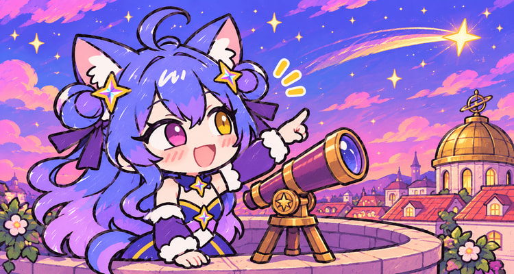

# 微信表情专辑素材 · WeChat sticker album artwork · WeChat スタンプ用素材

SelinLee 在 [ai-moe-atlas][atlas] 中以各角色已有的涂鸦表情为参考，用 AI 制作了七套微信专辑素材。点击图片可查看原尺寸文件。来源和使用条件沿用各自的角色设计。[署名与使用规范](../../README.md#zh)

SelinLee used the existing character emotes in [ai-moe-atlas][atlas] as references to generate artwork for seven WeChat sticker albums with AI. Select an image to open it at full size. Each set follows the terms of its source character design. [Credits and usage terms](../../README.md#en)

SelinLee が [ai-moe-atlas][atlas] の各キャラクターのスタンプを参照し、AI で7組の WeChat スタンプ用素材を制作しました。画像を選ぶと原寸で開けます。各画像には元のデザインの利用条件が適用されます。[クレジットと利用条件](../../README.md#ja)

| 角色 · Character · キャラクター | 详情页横幅 · Banner · バナー 750 × 400 JPG | 封面 · Cover · カバー 240 × 240 PNG | 聊天页图标 · Chat icon · トーク用アイコン 50 × 50 PNG | 制作记录 · Record · 制作記録 |
| --- | --- | --- | --- | --- |
| [GPT](openai/) |  |  |  | [JSON](openai-production.json) |
| [Gemini](gemini/) |  |  |  | [JSON](gemini-production.json) |
| [Claude](claude/) |  |  |  | [JSON](claude-production.json) |
| [DeepSeek](deepseek/) |  |  |  | [JSON](deepseek-production.json) |
| [Kimi](kimi/) |  |  |  | [JSON](kimi-production.json) |
| [Qwen](qwen/) |  |  |  | [JSON](qwen-production.json) |
| [GLM](glm/) |  |  |  | [JSON](glm-production.json) |

[atlas]: https://github.com/SelinLee/ai-moe-atlas
